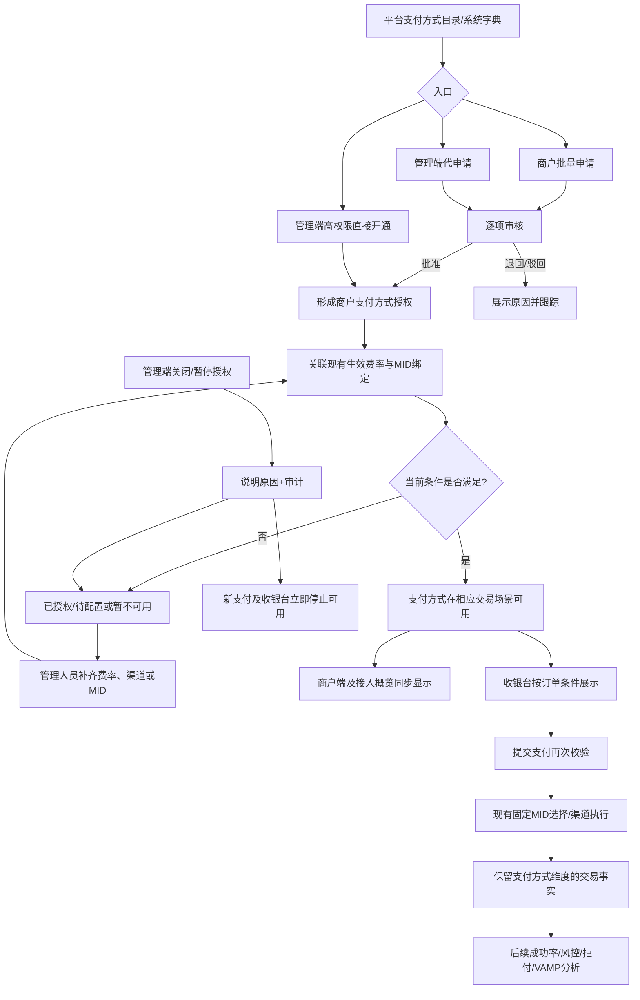

# 商户支付方式申请、授权、交易能力及收银台联动需求

> 版本：V1.3｜需求确认稿｜2026-11-19  
> 适用系统：Vexra Admin、Vexra Merchant、Hosted Checkout、PayByLink、OpenAPI、支付交易服务  
> 代码参照：前端 `acquiring-frontend`、后端 `acquiring-orchestration`，均以 `feat_scott_channel` 分支为准  
> 当前范围：业务需求、流程、交互及验收口径；**不包含数据库变更、API 定稿及研发实施**。

## 1. 需求目标与范围

### 1.1 核心目标

通过统一的商户支付方式授权，使**商户号 → 具体支付方式 → 生效费率 → 有效渠道/MID → 真实支付能力 → 收银台展示 → 支付执行 → 交易监控**形成闭环。商户必须能回答：能申请什么、申请过什么、获批了什么、现在实际能用什么、费率是什么、为什么不可用。

### 1.2 本期必须交付

1. 商户系统的支付方式清单、批量申请、申请记录、授权及可交易状态、费率关联。
2. 管理系统的商户支付方式管理、后台代申请、逐项审批、高权限直接开通、关闭/恢复、操作原因及审计。
3. 商户授权与现有费率、渠道能力、MID 绑定、固定通道选择的自动关联、就绪检查及交易前约束。
4. 商户系统「支付接入管理 → 接入概览」同步调整，不允许与新授权事实矛盾。
5. Hosted Checkout / PayByLink 的真实可用支付方式展示、默认卡支付、超出 N 项折叠、按所选方式展开对应内容、提交时再次校验。
6. OpenAPI 与收银台均不能绕过授权；保留支付方式维度用于后续成功率、失败原因、风控、拒付及 VAMP 分析。

### 1.3 明确不在本期

- 不引入店铺：本系统只按**商户号 Merchant ID**管理授权。
- 不重建“卡支付、钱包、移动支付”等新的业务大类、字典或业务枚举；以系统现有数据字典为准。
- 不重做费率模板、费率审批、渠道 MID、动态路由引擎、自动故障切换或成功率路由。
- 不假装已接入 PayPal、Apple Pay、Google Pay、Cash App Pay 等尚无真实支付能力的方式。
- 不在本期开发完整的交易统计、拒付分析和 VAMP 看板；但保留统计基础和后续字段语义。

## 2. 系统事实及统一口径

### 2.1 支付方式目录与字典

既有系统已使用以下数据字典：`acquiring_payment_method`（收单支付方式）、`card_brand`（银行卡品牌）、`transaction_type`（交易类型）。渠道能力中，银行卡通常体现为 `BANK_CARD + cardBrands`；在商户可申请清单中，Visa、Mastercard、JCB 等可作为**独立申请项**。非卡方式直接使用已有收单支付方式字典项。

**产品原则：** 申请项从现有字典及平台发布配置中生成；不人工硬编码另一套列表。逻辑上可用“银行卡品牌申请项”和“非银行卡支付方式申请项”区分数据映射，但不能据此新建一套支付类型业务模型。名称、代码、Logo、排序、语言及启停状态都应引用现有字典/资产。

| 展示例子 | 实际来源与映射 | 商户申请及监控主维度 |
|---|---|---|
| Visa | `card_brand`，对应实际银行卡能力 | Visa |
| Mastercard | `card_brand`，对应实际银行卡能力 | Mastercard |
| JCB | `card_brand`，对应实际银行卡能力 | JCB |
| Apple Pay | `acquiring_payment_method` 中已有对应项时才采用 | Apple Pay |
| PayPal | `acquiring_payment_method` 中已有对应项时才采用 | PayPal |

以上为**示例**，最终展示内容以当前有效字典及平台发布规则为准，不据此新增不存在的字典枚举。

### 2.2 不混淆的五种业务事实

| 层面 | 含义 | 示例 |
|---|---|---|
| 平台目录 | 平台是否公开该方式、是否允许申请 | “可申请”“暂不可申请” |
| 申请与审批 | 本次申请项的进度和审批决定 | “审核中”“批准”“驳回” |
| 商户授权 | 当前商户是否被允许使用此方式 | “已授权”“已关闭” |
| 配置就绪 | 有效费率、MID、渠道能力及固定通道是否匹配 | “待费率”“待通道”“冲突” |
| 实际可用 | 对给定交易条件能否发起新的支付 | “可交易”“部分场景可用”“不可用” |

**禁止**用“有费率”“已绑定 MID”“审批通过”中的任何一个单独替代“可交易”。授权是一项商户事实；就绪是根据实时有效配置计算的派生结果；单笔支付仍受风控、限额和渠道实时结果影响。

## 3. 端到端业务闭环



### 3.1 不要求固定的配置先后顺序

可以先有费率、先绑定 MID，也可以先审批商户支付方式。最终状态以当前有效事实的**交集**为准；已有 MID 在新授权批准后自动纳入候选，不需要解绑重绑或人工再勾选一遍支付方式。

### 3.2 自动关联绝不扩大授权

示例：渠道 MID 同时支持 Visa + Mastercard，但商户仅获批 Visa。系统只能将 Visa 判为可能就绪；Mastercard 必须继续显示“未开通”，不能因 MID 支持而顺带允许支付。

## 4. 商户系统：支付方式管理

### 4.1 菜单及布局

建议在**商户信息管理**下新增「支付方式管理」，与现有「财务管理 → 当前费率」并列且互相跳转。页面包含三处：统计摘要、可搜索的支付方式列表、申请记录标签页。保持 Vexra Merchant 当前的浅色表格/抽屉设计语言，不新增左侧二级菜单树。

#### 列表字段

| 字段 | 展示规则 |
|---|---|
| 支付方式 | 现有 Logo + 现有字典名称；Visa 等银行卡品牌也为申请项 |
| 申请状态 | 未申请、审核中、已批准、已驳回、已退回等，取最近相关申请明细 |
| 授权状态 | 未开通、已授权、已关闭，不用审批状态替代 |
| 交易状态 | 可交易、部分可用、待配置、暂不可用、已关闭，带原因 |
| 适用范围 | 已知的交易类型、币种、地区等；没有条件不等于无限制 |
| 当前费率 | 匹配的现行有效规则摘要；复杂规则展示“查看详情” |
| 操作 | 申请、查看申请、查看费率、查看不可用原因；仅展示有权限的操作 |

#### 公开及申请范围

商户仅能选择**平台公开且允许当前商户申请**的项目，支持批量选择。已经授权、待审、被策略限制的项目禁选并说明原因。平台内部测试/未发布的支付方式不在商户目录出现；若平台选择公开但暂不接受申请，则可显示“暂不可申请”但不可提交。

### 4.2 批量申请

- 从现有字典目录勾选多项，每项独立去重，顶部显示“已选择 X 项”。
- 本期不让商户额外选择消费者国家、币种、卡交易动作等范围，这些由已有后端能力继续约束。
- 提交前确认本次申请项、来源、商户身份、简短说明；商户号取可信登录会话，不允许用户任意传别人的 Merchant ID。
- 同一项审核中禁止重复申请；拒绝后可重新申请并保留旧记录；退回补充后可再提交；可撤回尚未形成有效批准的项。
- 每个申请明细可独立批准、退回补充或拒绝；整单状态可为“部分批准”。
- 商户收到提交回执、逐项审批结果及开通可用通知。

### 4.3 当前费率联动

- 支付方式详情显示当前生效费率规则，与现有 `finance/fee` 页面读取同一份生效费率事实。
- `ALL` 通用覆盖、多品牌覆盖、不同交易动作、标准/阶梯、固定费、比例费、上下限以及收费触发点按现有规则适配；不复制为每方式独立定价。
- 无匹配费率显示“待配置”，绝不能展示“0%”。
- 在“当前费率”页面可按对应方式查看授权/可用状态；有费率但未授权时标记“费率已配置、支付方式未开通”。
- 管理端内部成本、渠道费率及敏感 MID 信息不对商户展示。

## 5. 商户系统：支付接入管理 → 接入概览（必做联动）

保留现有**六阶段**接入流程、页面样式和总体结构；不额外增加第七阶段。将现有第 3 阶段「支付方式」/“已开通支付方式数量”的数据来源升级为：**有效授权与可执行能力交集**，不能仍只从 MID 或静态能力推断已开通。

### 5.1 显示内容

第 3 阶段需要显示：`已授权 X`、`可交易 Y`、`待配置 Z`、`已关闭 W`，以及现有 Logo 集合。Logo 不得混入未获批准或真实不可用方式；如须展示“已授权待配置”，应单独标注而不计入“可交易”。

详情可点击进入支付方式管理；平台的 MID、路由细节仍不向商户暴露。

### 5.2 六阶段总状态

该页面的“6/6 接入配置可用”是**商户级就绪摘要**，不代表所有申请项全部可用。建议第 3 阶段至少存在一项真实可用的收款方式时才满足支付方式条件；一个新申请项仍待配置，不应把已正常使用其他方式的商户整体错误置为不可用。商户未有任何可交易方式时，第 3 阶段不能继续显示“可用”。

历史商户数据必须灰度切换新口径，防止上线当天无新授权记录造成全体“6/6 → 5/6”及交易大面积受阻。

## 6. 管理系统：商户支付方式及审批

### 6.1 菜单安排

- `商户管理 → 商户支付方式`：统一查询商户 × 具体支付方式的申请、授权、费率和就绪结果，支持代申请、直接开通、关闭和恢复。
- `商户管理 → 支付方式审批`：逐项审批队列与历史记录，可按商户、申请来源和状态过滤。若希望减少新菜单，也可并入上述页签，但能力不得缺失。
- 保留并复用 `商户信息详情`、`渠道管理 → 商户 MID 绑定`、`费用管理 → 商户费率` 既有功能，只增加关联入口/状态透出。

### 6.2 区分三种后台操作

| 操作 | 含义 | 权限与流程 |
|---|---|---|
| 代申请 | 平台人员代商户提交新申请 | 正常进入逐项审批，申请人与审批人分离 |
| 直接开通 | 高权限人员**直接形成商户授权**，不等同“代申请” | 独立权限、操作原因、二次确认、完整审计；是否另加复核见第 17 章 |
| 关闭/恢复 | 对既有授权进行关闭或恢复 | 关闭原因**必填**、保留历史、禁止删除授权事实；恢复需权限及审计 |

“直接开通”只改变商户授权，不代表立即拥有费率/MID，不得强行把交易能力显示为可用。关闭不应删除历史交易或影响原交易退款/请款/查询等后续动作的既有生命周期约束。

### 6.3 审批流程

- 审批列表包含：申请单号、商户号/名称、来源、申请方式数、待审数、申请人、时间、审批状态。
- 审批详情按申请方式逐项显示：现有授权、申请状态、费率覆盖、渠道/MID 可用摘要、审批意见。
- 批准、退回补充、拒绝为每项独立操作；拒绝或退回必须填写原因；批准可填备注。
- 后台代申请人不得自己审批；商户系统申请也需管理员审批。重复/并发审批不得重复创建授权。
- 审批通过后可进入“开通检查”查看尚待完成的费用、MID 和收银台集成条件，但不在审批页复制整个 MID 或费率编辑器。

### 6.4 商户详情与原有工作台

对现有“开户就绪 → 支付方式与 MID → 实际支付能力”做增量改造：新增“授权检查”，保留原有结算、风控、3DS、技术接入步骤。在“实际支付能力”明细中显示具体支付方式、授权、费率、MID 是否就绪、适用条件及检查时间。不要因为商户新增一个待配置方式，就使其他已经可交易的方式被整体阻断。

## 7. 审批、授权和交易状态

### 7.1 申请项状态（记录事实）

`待审核 / 已批准 / 已驳回 / 退回补充 / 已撤回`。允许单据部分批准；已完成项不能被后续提交改写。

### 7.2 商户授权（记录事实）

`未开通 / 已授权 / 已关闭`。后台直接开通与审批开通均产生授权，来源须区分；关闭原因必填，恢复只重启授权资格、不绕过动态能力检查。

### 7.3 交易能力状态（实时派生）

`待配置 / 可交易 / 部分可用 / 暂不可用 / 已关闭`。建议配套展示原因码：无授权、待费率、无有效 MID、能力不匹配、候选冲突、平台方式停用、渠道不可用、收银台未支持等。**原因码为产品层语义，具体技术枚举待设计，不在此 PRD 发明一套系统码。**

| 典型场景 | 授权 | 交易能力 | 收银台 |
|---|---|---|---|
| Visa 有费率但未申请 | 未开通 | 不可交易 | 不展示对应卡品牌 |
| Visa 已批但未绑定 MID | 已授权 | 待配置 | 不展示 |
| Visa 已批，USD 有 MID，EUR 无 | 已授权 | 部分可用 | USD 展示，EUR 不展示 |
| MID 同时支持 Visa + Mastercard，商户只批 Visa | Visa 已授权；Mastercard 未开通 | Visa 视条件可用 | 卡支付只允许有效品牌 |
| 商户授权被关闭 | 已关闭 | 不可交易 | 不展示 |
| Apple Pay 只有字典 Logo，无真实支付能力 | 未具备交易条件 | 不可交易 | **生产不展示** |

## 8. 费率、渠道/MID 与固定通道

### 8.1 有效能力交集

对每个具体交易场景（商户、方式/品牌、交易动作、币种、金额、地区及适用限制）计算：

`当前可支付方式 = 平台可用范围 ∩ 商户有效授权 ∩ 生效费率覆盖 ∩ MID 有效绑定 ∩ 渠道/MID 能力 ∩ 当前确定的固定通道选择约束`

公式表达规则交集，不意味着每项字段在同一张数据库表中。

### 8.2 MID 匹配

- **0 个候选：** 待配置或暂不可用，收银台不可显示为可付款。
- **1 个候选：** 固定使用该 MID，不需要创建新路由配置。
- **2 个或以上：** 继续使用现有运行时有效选择规则；若不能唯一确定则明确报冲突，不随机选 MID。本期不开发新动态路由。
- 统计候选应按照当前交易条件过滤后再计数；同渠道两个 MID 也可能是两个候选。
- 已存在 MID 后批准方式，与先批准方式后绑定 MID，计算结果应一致。
- 关闭商户方式、停用 MID、修改能力或费率后，应重新计算相关可用性，避免缓存永久残留旧状态。

### 8.3 不破坏历史资金动作

新交易按当前授权校验；已形成原交易的查询、回调、退款、Capture、Void、Reversal 等后续动作按原交易状态机、原渠道/MID 和既有权限执行，不能因关闭新收款权限而误改投新 MID 或一概拒绝。

## 9. 收银台 / PayByLink 展示与交互

### 9.1 真实支付方式来源

收银台不得把“平台字典存在”“商户申请通过”“渠道静态支持”任意一项直接当作可展示选项。支付会话返回的方式必须是：**商户已授权、当前交易币种/动作等条件有真实通道、且前后端存在可执行支付集成**。

当前系统收银台主要实际渲染 `BANK_CARD`；未来钱包/本地方式必须完成服务端支付提交及前端交互适配后才能上线。平台当前未真实接通的 PayPal、Apple Pay、Google Pay、Cash App Pay 等方式，**不得在生产付款选择区展示成可支付项**。

### 9.2 展示规则（参照现有收银台视觉）

1. 保留现有订单信息、商户 Logo、支付表单、按钮与错误提示设计，不照搬 Stripe 整页 UI。
2. 若当前存在任何有效银行卡品牌，则「银行卡支付 / Card」**默认展开且选中**；品牌 Logo 只显示当前会话真实允许的品牌。
3. 一个“Card”入口可以承载若干授权的卡品牌；Visa/Mastercard 不是必须各占一条“支付方式”单选项。
4. 非银行卡方式（例如未来真正接通的 Alipay、Apple Pay 等）各为独立可选项，选择后展开自身表单、跳转说明或真实二维码区域，并折叠其他选项内容。
5. 展示入口超过 **N** 项时，默认展示前 N 项（优先 Card，其余按平台排序），通过“更多支付方式 / More payment methods”展开；建议默认 N=4，作为可配置 UI 参数。收起时不应错误隐藏当前已选方式。
6. 没有卡支付但有其他可用方式时，默认选中排序第一项。完全没有可用方式时展示“当前暂无可用的支付方式”，禁用提交按钮。
7. 实际 QR 码必须来自真实渠道返回的数据或平台已接入的合法交易流程；不能生成假二维码。
8. 对未来将支持的方式，可以**在设计稿或内部预览**展示“选择后展示二维码 / You will be shown a QR code ...”的说明及加载骨架；生产端若未完成真实接入，不能无限加载或让付款人以为可付款。

### 9.3 收银台动态变化

- 页面加载 / 会话查询基于最新有效商户能力；已有会话刷新后重新过滤。
- 用户打开页面后授权或 MID 被关闭，点击支付时服务端仍必须重新判断，不能仅靠隐藏 UI。
- 已选择方式突然失效时应提示“该支付方式暂不可用，请选择其他方式”，刷新可用方式列表。
- PayByLink、托管收银台以及后续其他支付入口保持一致的可用性语义，不允许同一笔订单在某入口放行、另一入口拦截。

## 10. 接口与交易链路约束（业务层）

- 在商户 OpenAPI、Payment Link 创建/加载、Checkout 查询/提交以及实际 Payment/Auth 交易中统一使用商户授权事实；显示结果与资金执行结果一致。
- 新的支付、授权、预授权属于新资金动作，按当前方式授权判断；已有交易的后续操作独立遵守原交易契约。
- 支付方式未授权、无 MID、费率缺失、渠道不支持等失败阶段分别留存，避免全归类为“渠道拒绝”。
- 交易请求仍遵守现有幂等、JWT/报文加密、风险控制、限额和回调等规范。
- 保证申请/审批/直开/关闭/恢复具备并发一致性与审计追溯；不得用前端传入的 Merchant ID 判断管理范围。

## 11. 监控统计预留（本期基础、后续建设）

### 11.1 主统计维度

以系统当前实际的**具体支付方式**作为主要分析轴：Visa、Mastercard、Apple Pay、PayPal 等均按其自己的支付方式口径统计。可继续与商户、交易类型、币种、渠道/MID、时间、失败阶段交叉分析。

**钱包处理规则：** Apple Pay 不默认归为 Visa，也不默认要求必须知道底层卡 BIN。若渠道真实且可信地返回底层卡品牌，可将其作为**可选的附加信息**保存；无法识别时记“未知/未返回”，不影响 Apple Pay 按自身方式统计。不能推导、猜测或强行回填卡组织；不能因为同一笔交易有附加卡品牌就把整体交易重复计数。

### 11.2 后续指标范围

商户侧：整体及支付方式成功率、失败原因分布、风控命中、拒付/争议、支付趋势。管理端：除上述维度外，增加渠道、MID 与商户间交叉分析。

正式指标必须区分商户业务订单、支付尝试、实际渠道请求、退款/拒付事件；处理中、未知与最终失败不能混算。VAMP 只按适用的 Visa 数据口径与监管/卡组织要求建立，不将所有 Apple Pay 或其他钱包交易默认归入 Visa VAMP。

## 12. 提醒、权限与审计

| 动作 | 商户人员 | 管理端 |
|---|---|---|
| 查询自己的支付方式与费率 | 具有菜单权限即可 | 需商户数据范围权限 |
| 批量申请 | 有申请权限 | 可代申请并留申请人 |
| 批准/驳回/退回 | 不可 | 独立审批权限；禁止自审代申请 |
| 直接开通 | 不可 | 高权限，原因、二次确认、审计；复核边界待最终确认 |
| 关闭方式 | 本期不支持自助关闭 | 有关闭权限，**原因必填** |
| 恢复方式 | 本期不支持自助恢复 | 独立恢复权限，记录原因及时间 |

至少提供申请提交、逐项审批结果、退回补充、变为可交易、关闭/恢复、重要费率变更通知。管理端需有“待审批”“批准后待配置”工作项，以免获批后无人跟进。通知渠道优先复用现有系统能力。

## 13. 历史商户兼容与上线要求

- 现有商户可能已运行多年但无新申请审批记录；不得一上线就将所有现有交易拦停。
- 先核对现行生效费率、渠道/MID 绑定、已使用支付方式、成功交易和当前平台支持范围，形成历史授权基线。
- 历史基线标为“历史配置核验”，不能补造过去的申请人、审批人和时间。
- 上线按只读观测 → 差异核对 → 授权初始化 → 少量商户灰度执行门禁 → 扩展到全量的顺序实施；出现问题支持停用新增门禁而不是回滚资金事实。
- 不允许新授权记录改变已发生交易的费用快照、交易方式及原渠道/MID 归属。
- 接入概览支付方式数字与后台商户支付能力在灰度期要明确口径，不能突然从“15 个可用”跳成“0 个”且无人知晓原因。

## 14. 页面交互示意（非最终像素稿）

### 14.1 商户端：支付方式管理

```text
支付方式管理                                              [申请支付方式]
已授权 3       可交易 2       待配置 1       审核中 1
[搜索支付方式] [授权状态 ▼] [交易状态 ▼]          [重置]
────────────────────────────────────────────────────────────────────
支付方式       申请/授权             交易能力       当前费率          操作
Visa            已授权                可交易         按现行规则        查看详情
Mastercard      已授权                待 MID 配置    按现行规则        查看原因
JCB             未申请                不可交易       —                 申请
Apple Pay       审核中                不可交易       —                 查看申请
PayPal          暂不可申请            不可交易       —                 查看说明
────────────────────────────────────────────────────────────────────
[申请记录]  申请单号 / 申请时间 / 申请项数 / 审批进度 / 审批结果
```

### 14.2 管理端：商户支付方式详情

```text
商户支付方式 · 200046 / Scott Test Merchant 200046
[代申请] [直接开通] [关闭支付方式] [刷新能力检查]
已授权 3 / 可交易 2 / 待配置 1 / 已关闭 0
────────────────────────────────────────────────────────────────────
Visa      授权有效  ✓费率有效  ✓MID 有效  ✓当前可交易 [查看费率][查看MID]
Mastercard 授权有效 ✓费率有效  !MID 缺失  待配置     [绑定MID]
JCB       未授权    -          -          未开通     [代申请][直接开通]
────────────────────────────────────────────────────────────────────
点击 Visa → 详情抽屉：授权来源与时间 / 生效费率 / MID 候选 / 适用币种
```

### 14.3 管理端：逐项审批

```text
支付方式申请审批   申请单号 AP-0001   商户 200046   来源 商户提交
申请项            当前授权   费率情况     通道情况       本次审批
Visa                未授权     已覆盖       有效 MID      [批准] [退回] [驳回]
Mastercard          未授权     已覆盖       无 MID        [批准] [退回] [驳回]
Apple Pay           未授权     未配置       未接入        [批准] [退回] [驳回]
说明：审批可通过但不会自动“可交易”；平台未公开可申请的方式不应出现在申请项。
```

### 14.4 收银台：根据真实能力选择付款方式

```text
Payment method
(●) Card                       [VISA] [Mastercard]
    [Card number__________________________________]
    [MM/YY____________] [CVC____________]
( ) Alipay                     （仅真实接通后出现）
( ) Apple Pay                  （仅真实接通后出现）
    [More payment methods ▼]   （超过 N 项才出现）

[Pay $28.80]
```

仅为交互结构示意。采用**现有 Vexra Checkout** 的视觉规范，不照抄所给 Stripe 截图，更不通过占位内容伪装未上线的支付方式。

## 15. 用户流程与状态变化示例

### 15.1 商户申请并上线 Visa

商户勾选 Visa → 提交申请 → 管理端审批通过 → 商户看到“已授权、待配置” → 管理端检查/配置现行费率与固定 MID → 能力检查通过 → 商户列表变“可交易” → 接入概览将 Visa 计入可交易列表 → 收银台在支持的币种显示 Card/Visa → 实际付款执行再校验授权与固定 MID。

### 15.2 后台直接开通 Mastercard

有权限人员选择商户和 Mastercard → 填写开通原因、二次确认 → 记录“后台直接开通”授权来源 → 检查已有 MID 和费率 → 就绪后可交易；若配置不完整，则商户仍看到“已授权，待配置”，不能跳过。

### 15.3 后台关闭 Visa

有权限人员进入已授权 Visa → 点击“关闭” → **必须填写关闭原因** → 系统记录操作者、时间、前后状态 → Visa 新交易禁止受理、收银台新的列表不再提供 Visa → 商户系统可查看关闭原因 → 已存在交易的后续合法操作保持原有状态机规则。

## 16. UAT 验收矩阵

| 编号 | 场景 | 预期结果 |
|---|---|---|
| U01 | 商户打开方式列表 | 只显示平台公开目录，允许申请项可选，禁选项说明原因 |
| U02 | 系统字典更新支付方式名称/Logo | 页面引用统一字典与 Logo，不出现第二套硬编码 |
| U03 | 商户批量申请 3 项 | 生成可追溯申请及逐项审批明细，防重 |
| U04 | 批量申请部分批准/拒绝 | 单项独立生效，整单显示部分批准 |
| U05 | 管理端代申请并尝试自审 | 不允许同人自审 |
| U06 | 管理端直接开通 | 凭独立权限授权、留原因和审计，未就绪时不放行 |
| U07 | 管理端关闭方式未填原因 | 不允许提交 |
| U08 | 管理端关闭 Visa | 新 Visa 支付拦截；其他方式不受无关影响 |
| U09 | 恢复 Visa 但 MID 已停用 | 恢复授权后仍然不可交易 |
| U10 | Visa 有费率无授权 | 商户显示未开通；收银台和 OpenAPI 禁用 |
| U11 | Visa 已授权无有效费率 | 显示待费率，不展示可支付入口 |
| U12 | Visa 已授权但无 MID | 显示待配置，并指向商户 MID 绑定 |
| U13 | 同 MID 支持 Visa、Mastercard，商户只批 Visa | Mastercard 不获得授权，也不进入支付范围 |
| U14 | 同一能力只有一个有效 MID | 直接固定选中该 MID |
| U15 | 多个 MID 同等有效且选择不唯一 | 标出冲突，不随机路由 |
| U16 | USD 可用 EUR 不可用 | 对 USD 显示，对 EUR 不显示/不可提交 |
| U17 | 申请和 MID 配置先后颠倒 | 最终就绪结果一致，无需解绑重绑 |
| U18 | 商户接入概览原来显示“已开通 15” | 按新授权/可交易口径正确拆分，六阶段不冲突 |
| U19 | 新增一个待配置方式，其他方式已可交易 | 不错误使商户整体全部不可用 |
| U20 | 收银台只支持 Visa 卡 | Card 默认选中，只显示 Visa Logo，非 Visa 卡后端拒绝 |
| U21 | 收银台有 Card 与其他真实已接通方式 | Card 默认选中；选择其他方式展开对应内容 |
| U22 | 真实可用入口 > N | 默认折叠，并可展开；当前选中项不被隐藏 |
| U23 | 没有任何银行卡能力 | 不展示 Card；默认选择其他有效方式 |
| U24 | 没有任何有效方式 | 提示暂无可用方式并禁用支付按钮 |
| U25 | 平台未接通 PayPal/Apple Pay/Google Pay/Cash 等 | 生产收银台不可伪装可付款，不出现假 QR 或永久 loading |
| U26 | 付款页面加载后 MID 或授权被关闭 | 提交时后端拒绝并刷新可选方式 |
| U27 | 已有交易退款/请款/查询 | 不误改投新 MID，不因关闭新收款权而一律拒绝 |
| U28 | 未授权账号访问其他商户申请与费率 | API 级阻断，列表/详情/导出一致 |
| U29 | 同一申请重复提交/并发审批 | 不重复授权、不覆盖新状态 |
| U30 | Apple Pay 底层卡 BIN 不可得 | 按 Apple Pay 统计，附加卡品牌为未知，不强行归 Visa |
| U31 | 钱包底层品牌有可靠返回 | 可选保存附加维度，但总体不重复计数 |
| U32 | 历史商户无新授权记录 | 按审核后的历史基线及灰度计划兼容，不集体停单 |
| U33 | 支付方式停用后查询历史 | 可追溯申请、关闭原因、旧交易及费用快照 |
| U34 | 交易失败原因分析 | 区分授权/费率/MID/风控/渠道失败，不全部计入渠道失败 |
| U35 | 费率为阶梯/固定费/通用覆盖 | 商户展示真实现行规则，不压缩为单一百分比 |

## 17. 需最终确认的产品决策（最小集合）

| 编号 | 问题 | 本文暂按此口径撰写 |
|---|---|---|
| D01 | 管理端“直接开通”是否还需要另一名管理人员复核？ | 高权限直接授权、必留原因与审计，不进入普通代申请审批；是否加双人复核待确认 |
| D02 | 平台公开但暂不可申请的方式是否允许商户看到？ | 允许只读展示“暂不可申请”；内部未发布、无能力的方式不对外展示 |
| D03 | 收银台折叠阈值 N | 默认 N=4，含 Card 作为一个入口；可配置，待最终拍板 |
| D04 | 管理端“恢复”是否要填原因？ | 建议必填，以便与关闭形成完整审计链 |
| D05 | 历史授权由谁核验？ | 运营/产品给出业务授权清单，技术提供只读事实报表，最终责任人待指定 |

除上表外，本稿的流程与业务规则可作为 Codex 开展**只读代码影响分析**的需求基线。上述决定定稿后才能进入技术设计/开发。

## 18. 代码核对范围（便于 Codex 定位）

以下是已检查的现有实现位置，不代表代码已适配新需求：

- 管理系统渠道能力字典：`apps/admin-system/src/views/channel/capability/index.vue`（`acquiring_payment_method`、`card_brand`、`transaction_type`）。
- 商户当前费率：`apps/merchant-portal/src/pages/finance/fee/index.vue`，`service-merchant/.../api/MerchantFeeController.java`。
- 商户接入概览：`apps/merchant-portal/src/pages/access-config/overview/index.vue`，`apps/merchant-portal/src/api/accessConfigApi.ts`。
- 管理端商户详情：`apps/admin-system/src/views/merchant/info/components/MerchantProfileDetailDrawer.vue`。
- MID 绑定：`apps/admin-system/src/views/channel/merchant-mid-binding/index.vue`。
- 固定 MID 执行链：`service-payment/.../service/impl/DefaultPaymentChannelRouteService.java`。
- 收银台可展示银行卡能力：`service-payment/.../service/impl/PaymentCheckoutCardCapabilityService.java`。
- 收银台页面：`apps/hosted-checkout/src/App.vue`，目前 `supportedPaymentMethods` 主要筛选 `BANK_CARD`。
- 收银台提交：`service-payment/.../service/impl/DefaultPaymentCheckoutService.java`。

文件路径中 `service-payment/...` 等省略了 `src/main/java/com/scott/payment/payment` 公共部分。具体实现应先核对当前分支，而不能仅照本稿假设方法及数据结构。
