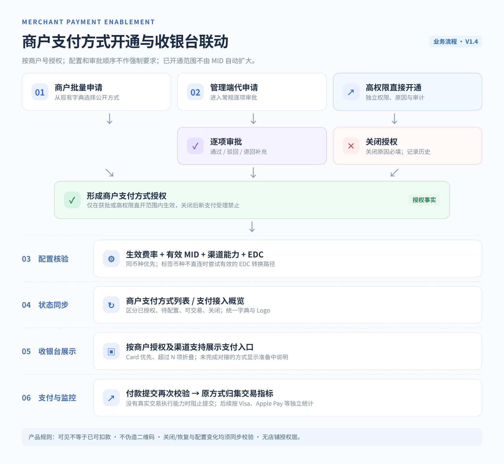
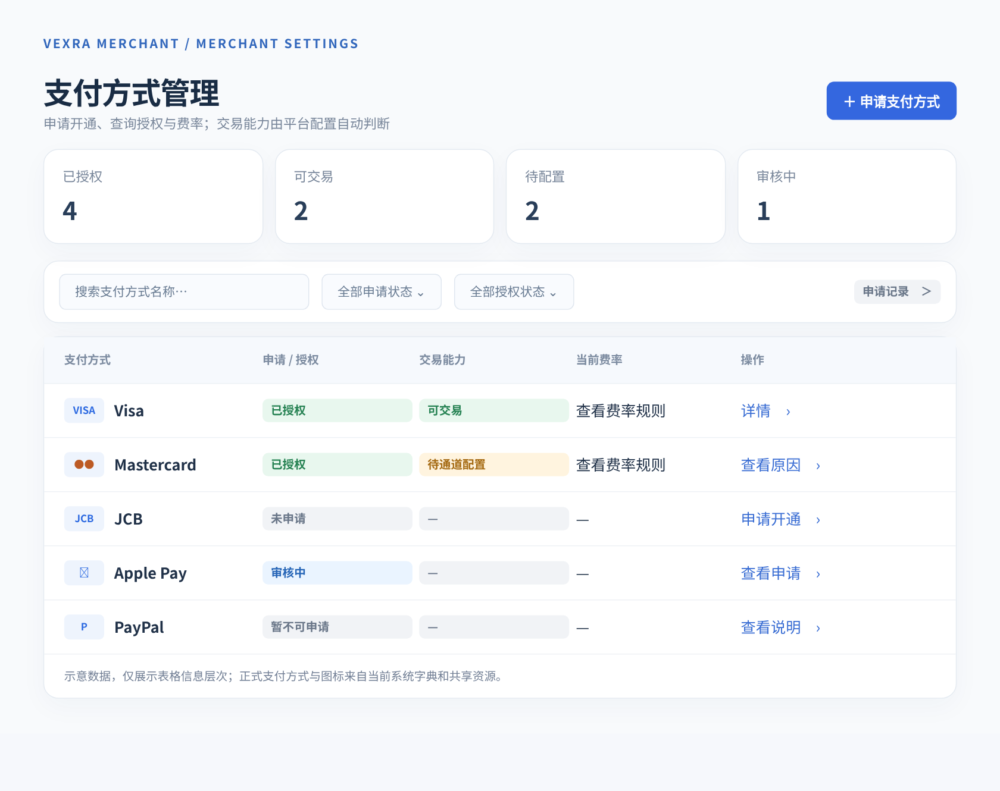
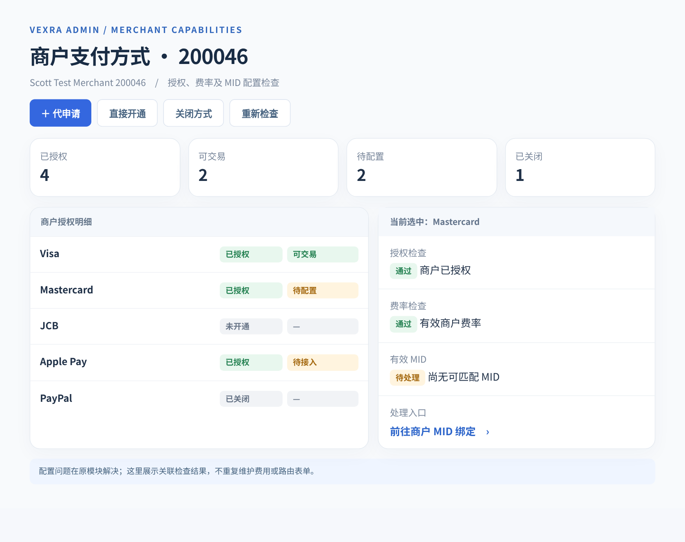
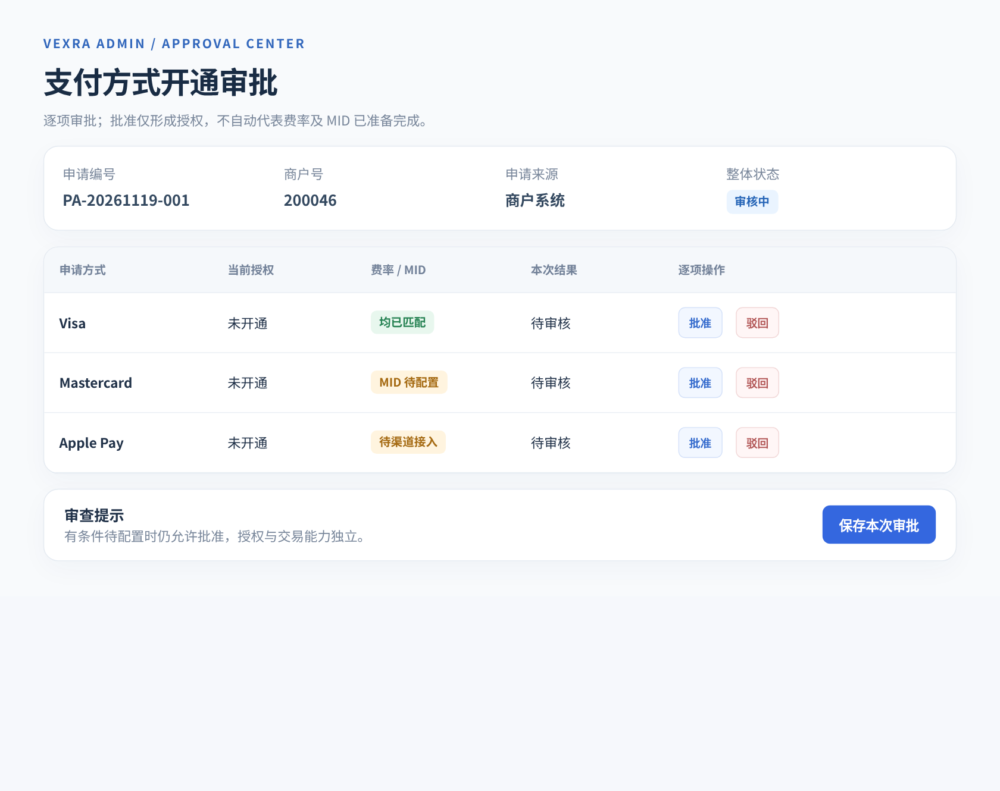
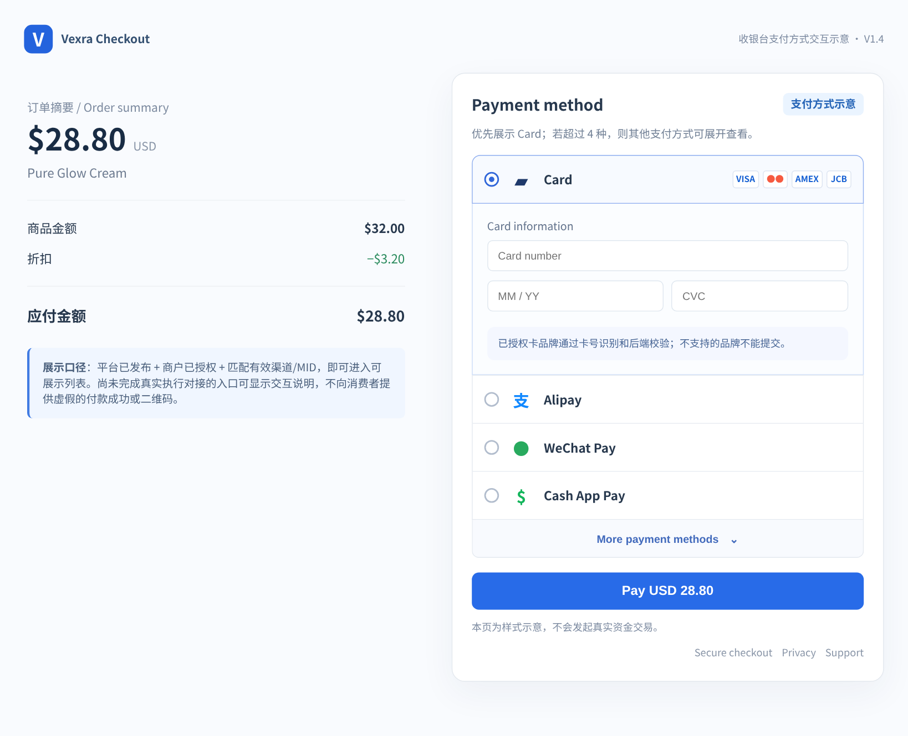
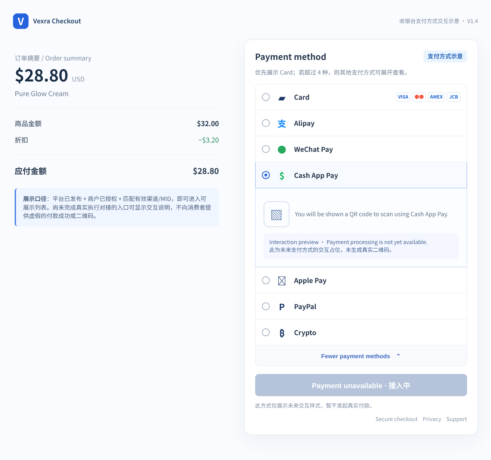

# 商户支付方式申请、授权、交易能力及收银台联动需求

版本：V1.4｜需求确认稿｜2026-11-19
适用系统：Vexra Admin、Vexra Merchant、Hosted Checkout、PayByLink、OpenAPI、支付交易服务
代码参照：前端 acquiring-frontend、后端 acquiring-orchestration，均以 feat_scott_channel 分支为准
当前范围：业务需求、流程、交互及验收口径；不包含数据库变更、API 定稿及研发实施。

## 目录

按章节查看业务规则、现有功能关联、收银台交互及验收场景。点击目录条目可跳转到对应章节。

- 1. 需求目标与范围
- 10. 接口与交易链路约束（业务层）
- 2. 系统事实及统一口径
- 11. 监控统计预留（本期基础、后续建设）
- 3. 端到端业务闭环
- 12. 提醒、权限与审计
- 4. 商户系统：支付方式管理
- 13. 历史商户兼容与上线要求
- 5. 商户系统：支付接入管理 → 接入概览（必做联动）
- 14. 页面交互示意（非最终像素稿）
- 6. 管理系统：商户支付方式及审批
- 15. 用户流程与状态变化示例
- 7. 审批、授权和交易状态
- 16. UAT 验收矩阵
- 8. 费率、渠道/MID 与固定通道
- 17. 需最终确认的产品决策（最小集合）
- 9. 收银台 / PayByLink 展示与交互
- 18. 代码核对范围（便于 Codex 定位）

## 1. 需求目标与范围

### 1.1 核心目标

通过统一的商户支付方式授权，使商户号 → 具体支付方式 → 生效费率 → 有效渠道/MID（含既有 EDC）→ 配置就绪 → 商户系统/接入概览 → 收银台展示与交互 → 实际支付提交 → 交易监控形成闭环。商户能够查询可申请范围、历史申请、已授权方式、当前费率及不可用原因；管理人员能够定位每种方式的授权与配置缺口。

### 1.2 本期必须交付

- 商户系统的支付方式清单、批量申请、申请记录、授权及可交易状态、费率关联。

- 管理系统的商户支付方式管理、后台代申请、逐项审批、高权限直接开通、关闭/恢复、操作原因及审计。

- 商户授权与现有费率、渠道能力、MID 绑定、固定通道选择的自动关联、就绪检查及交易前约束。

- 商户系统「支付接入管理 → 接入概览」同步调整，不允许与新授权事实矛盾。

- Hosted Checkout / PayByLink 根据商户授权与有效渠道能力展示支付入口；Card 默认选择，超过 N 项折叠；非卡方式预留对应内容、二维码说明和加载样式，执行对接完成后启用真实付款提交。

- OpenAPI 与收银台均不能绕过授权；保留支付方式维度用于后续成功率、失败原因、风控、拒付及 VAMP 分析。

### 1.3 明确不在本期

- 不引入店铺：本系统只按商户号 Merchant ID管理授权。

- 不重建“卡支付、钱包、移动支付”等新的业务大类、字典或业务枚举；以系统现有数据字典为准。

- 不重做费率模板、费率审批、渠道 MID、动态路由引擎、自动故障切换或成功率路由。

- PayPal、Apple Pay、Google Pay、Cash App Pay 等当前未完成的支付渠道或前后端执行适配，不在本期宣称已实现真实付款；允许在满足展示资格时呈现统一 Logo、支付方式名称和未来交互占位。不得伪造真实二维码或交易成功。

- 不在本期开发完整的交易统计、拒付分析和 VAMP 看板；但保留统计基础和后续字段语义。

## 2. 系统事实及统一口径

### 2.1 支付方式目录与字典

既有系统已使用以下数据字典：acquiring_payment_method（收单支付方式）、card_brand（银行卡品牌）、transaction_type（交易类型）。渠道能力中，银行卡通常体现为 BANK_CARD + cardBrands；在商户可申请清单中，Visa、Mastercard、JCB 等可作为独立申请项。非卡方式直接使用已有收单支付方式字典项。

申请项从现有字典及平台公开目录配置中生成，不另行硬编码支付方式大类。银行卡品牌申请项使用 card_brand，非卡收单方式使用 acquiring_payment_method；实际技术映射仍沿用现有协议字段。名称、编码、展示顺序、国际化与 Logo 均以现有字典和共享图标资产为准。

| 展示例子 | 实际来源与映射 | 商户申请及监控主维度 |

| --- | --- | --- |

| Visa | card_brand，对应实际银行卡能力 | Visa |

| Mastercard | card_brand，对应实际银行卡能力 | Mastercard |

| JCB | card_brand，对应实际银行卡能力 | JCB |

| Apple Pay | acquiring_payment_method 中已有对应项时才采用 | Apple Pay |

| PayPal | acquiring_payment_method 中已有对应项时才采用 | PayPal |

以上为示例，最终展示内容以当前有效字典及平台发布规则为准，不据此新增不存在的字典枚举。

### 2.2 不混淆的五种业务事实

| 层面 | 含义 | 示例 |

| --- | --- | --- |

| 平台目录 | 平台是否公开该方式、是否允许申请 | “可申请”“暂不可申请” |

| 申请与审批 | 本次申请项的进度和审批决定 | “审核中”“批准”“驳回” |

| 商户授权 | 当前商户是否被允许使用此方式 | “已授权”“已关闭” |

| 配置就绪 | 有效费率、MID、渠道能力及固定通道是否匹配 | “待费率”“待通道”“冲突” |

| 实际可用 | 对给定交易条件能否发起新的支付 | “可交易”“部分场景可用”“不可用” |

| 收银台交互与执行 | 允许展示与实际支付提交为两层能力；未完成执行对接可预留选项内容 | 已显示 / 接入中 / 可提交 |

“已授权”不等于“资金交易必定成功”。必须区分审批事实、商户授权、配置就绪、收银台展示与支付执行。对于暂未完成执行对接的支付方式，只要符合平台公开、商户授权及有效渠道/MID 支持的展示条件，就可以呈现付款入口与交互说明；真实扣款应由后端执行能力独立把关。

## 3. 端到端业务闭环

图 1  支付方式申请、审批、授权、配置及收银台闭环

### 3.1 不要求固定的配置先后顺序

费率、MID 绑定、商户支付方式审批允许采用不同先后顺序，最终按当前有效事实自动形成能力关联。渠道 MID 同时支持多个卡品牌时，不得超出商户获批的具体方式范围。固定通道可直接使用；不在本期重新设计支付路由策略。EDC 可为标签币种提供合法的交易币种转换路径，不能仅凭 MID 不支持标签币种就断定支付不可用。

### 3.2 自动关联绝不扩大授权

示例：渠道 MID 同时支持 Visa + Mastercard，但商户仅获批 Visa。系统只能将 Visa 判为可能就绪；Mastercard 必须继续显示“未开通”，不能因 MID 支持而顺带允许支付。

## 4. 商户系统：支付方式管理

### 4.1 菜单及布局

建议在商户信息管理下新增「支付方式管理」，与现有「财务管理 → 当前费率」并列且互相跳转。页面包含三处：统计摘要、可搜索的支付方式列表、申请记录标签页。保持 Vexra Merchant 当前的浅色表格/抽屉设计语言，不新增左侧二级菜单树。

### 列表字段

| 字段 | 展示规则 |

| --- | --- |

| 支付方式 | 现有 Logo + 现有字典名称；Visa 等银行卡品牌也为申请项 |

| 申请状态 | 未申请、审核中、已批准、已驳回、已退回等，取最近相关申请明细 |

| 授权状态 | 未开通、已授权、已关闭，不用审批状态替代 |

| 交易状态 | 可交易、部分可用、待配置、暂不可用、已关闭，带原因 |

| 适用范围 | 已知的交易类型、币种、地区等；没有条件不等于无限制 |

| 当前费率 | 匹配的现行有效规则摘要；复杂规则展示“查看详情” |

| 操作 | 申请、查看申请、查看费率、查看不可用原因；仅展示有权限的操作 |

### 公开及申请范围

商户仅能选择平台公开且允许当前商户申请的项目，支持批量选择。已经授权、待审、被策略限制的项目禁选并说明原因。平台内部测试/未发布的支付方式不在商户目录出现；若平台选择公开但暂不接受申请，则可显示“暂不可申请”但不可提交。

### 4.2 批量申请

- 从现有字典目录勾选多项，每项独立去重，顶部显示“已选择 X 项”。

- 本期不让商户额外选择消费者国家、币种、卡交易动作等范围，这些由已有后端能力继续约束。

- 提交前确认本次申请项、来源、商户身份、简短说明；商户号取可信登录会话，不允许用户任意传别人的 Merchant ID。

- 同一项审核中禁止重复申请；拒绝后可重新申请并保留旧记录；退回补充后可再提交；可撤回尚未形成有效批准的项。

- 每个申请明细可独立批准、退回补充或拒绝；整单状态可为“部分批准”。

- 商户收到提交回执、逐项审批结果及开通可用通知。

### 4.3 当前费率联动

- 支付方式详情显示当前生效费率规则，与现有 finance/fee 页面读取同一份生效费率事实。

- ALL 通用覆盖、多品牌覆盖、不同交易动作、标准/阶梯、固定费、比例费、上下限以及收费触发点按现有规则适配；不复制为每方式独立定价。

- 无匹配费率显示“待配置”，绝不能展示“0%”。

- 在“当前费率”页面可按对应方式查看授权/可用状态；有费率但未授权时标记“费率已配置、支付方式未开通”。

- 管理端内部成本、渠道费率及敏感 MID 信息不对商户展示。

## 5. 商户系统：支付接入管理 → 接入概览（必做联动）

保留现有六阶段接入流程、页面样式和总体结构；不额外增加第七阶段。将现有第 3 阶段「支付方式」/“已开通支付方式数量”的数据来源升级为：有效授权与可执行能力交集，不能仍只从 MID 或静态能力推断已开通。

### 5.1 显示内容

第 3 阶段应展示已授权、可交易、待配置与已关闭数量，并区分 Logo 列表含义：可交易 Logo 显示实际具备收款能力的方式；已授权但待配置、待执行接入的方式单独列示，不混入“可交易”。Logo、名称与其他商户页面使用同一共享资产。

详情可点击进入支付方式管理；平台的 MID、路由细节仍不向商户暴露。

### 5.2 六阶段总状态

该页面的“6/6 接入配置可用”是商户级就绪摘要，不代表所有申请项全部可用。建议第 3 阶段至少存在一项真实可用的收款方式时才满足支付方式条件；一个新申请项仍待配置，不应把已正常使用其他方式的商户整体错误置为不可用。商户未有任何可交易方式时，第 3 阶段不能继续显示“可用”。

历史商户数据必须灰度切换新口径，防止上线当天无新授权记录造成全体“6/6 → 5/6”及交易大面积受阻。

## 6. 管理系统：商户支付方式及审批

### 6.1 菜单安排

- 商户管理 → 商户支付方式：统一查询商户 × 具体支付方式的申请、授权、费率和就绪结果，支持代申请、直接开通、关闭和恢复。

- 商户管理 → 支付方式审批：逐项审批队列与历史记录，可按商户、申请来源和状态过滤。若希望减少新菜单，也可并入上述页签，但能力不得缺失。

- 保留并复用 商户信息详情、渠道管理 → 商户 MID 绑定、费用管理 → 商户费率 既有功能，只增加关联入口/状态透出。

### 6.2 区分三种后台操作

| 操作 | 含义 | 权限与流程 |

| --- | --- | --- |

| 代申请 | 平台人员代商户提交新申请 | 正常进入逐项审批，申请人与审批人分离 |

| 直接开通 | 高权限人员直接形成商户授权，不等同“代申请” | 独立权限、操作原因、二次确认、完整审计；是否另加复核见第 17 章 |

| 关闭/恢复 | 对既有授权进行关闭或恢复 | 关闭原因必填、保留历史、禁止删除授权事实；恢复需权限及审计 |

“直接开通”只改变商户授权，不代表立即拥有费率/MID，不得强行把交易能力显示为可用。关闭不应删除历史交易或影响原交易退款/请款/查询等后续动作的既有生命周期约束。

### 6.3 审批流程

- 审批列表包含：申请单号、商户号/名称、来源、申请方式数、待审数、申请人、时间、审批状态。

- 审批详情按申请方式逐项显示：现有授权、申请状态、费率覆盖、渠道/MID 可用摘要、审批意见。

- 批准、退回补充、拒绝为每项独立操作；拒绝或退回必须填写原因；批准可填备注。

- 后台代申请人不得自己审批；商户系统申请也需管理员审批。重复/并发审批不得重复创建授权。

- 审批通过后可进入“开通检查”查看尚待完成的费用、MID 和收银台集成条件，但不在审批页复制整个 MID 或费率编辑器。

### 6.4 商户详情与原有工作台

对现有“开户就绪 → 支付方式与 MID → 实际支付能力”做增量改造：新增“授权检查”，保留原有结算、风控、3DS、技术接入步骤。在“实际支付能力”明细中显示具体支付方式、授权、费率、MID 是否就绪、适用条件及检查时间。不要因为商户新增一个待配置方式，就使其他已经可交易的方式被整体阻断。

## 7. 审批、授权和交易状态

### 7.1 申请项状态（记录事实）

待审核 / 已批准 / 已驳回 / 退回补充 / 已撤回。允许单据部分批准；已完成项不能被后续提交改写。

### 7.2 商户授权（记录事实）

未开通 / 已授权 / 已关闭。后台直接开通与审批开通均产生授权，来源须区分；关闭原因必填，恢复只重启授权资格、不绕过动态能力检查。

### 7.3 交易能力状态（实时派生）

待配置 / 可交易 / 条件受限 / 暂不可用 / 已关闭。产品原因包含：未授权、待费率、无有效 MID、固定通道选择冲突、渠道停用、EDC 汇率/转换路径不可用等。这里的“部分场景可用”指真实业务能力限制，不得将“标签币种与 MID 直连币种不同”机械判定为不可用；应先检查有效 EDC 转换。收银台是否已完成付款执行适配是独立的交互/提交状态，不作为支付方式是否可展示的唯一条件。

| 典型场景 | 授权 | 交易能力 | 收银台 |

| --- | --- | --- | --- |

| Visa 有费率但未申请 | 未开通 | 不可交易 | 不展示对应卡品牌 |

| Visa 已批但未绑定 MID | 已授权 | 待配置 | 不展示 |

| Visa 已批准；订单标签币种 EUR；MID 仅支持 USD；EDC 路径与汇率均有效 | 已授权 | 可交易（EDC 转 USD） | EUR 订单仍可展示 Card / Visa |

| MID 同时支持 Visa + Mastercard，商户只批 Visa | Visa 已授权；Mastercard 未开通 | Visa 视条件可用 | 卡支付只允许有效品牌 |

| 商户授权被关闭 | 已关闭 | 不可交易 | 不展示 |

| Apple Pay 已公开、已授权且有有效渠道能力，但平台执行对接尚在建设 | 已授权 | 展示资格满足；付款执行待接入 | 展示 Logo + 名称，选中展开占位说明，禁止真实提交 |

| Visa 已批准，EUR 不直连且无法取得有效 EDC 汇率 | 已授权 | 暂不可交易（换汇不可用） | 不可付款；说明原因并保留已授权状态 |

## 8. 费率、渠道/MID 与固定通道

### 8.1 有效能力交集

对每个具体交易场景（商户、具体支付方式/卡品牌、交易动作、标签币种、金额、地区及其他适用限制），先检查商户有效授权和费率，再判断有效 MID 是否可直接处理标签币种，或者是否允许通过已配置的 EDC 转换为渠道支持的交易币种。交易路由与收银台预检应采用一致的 EDC 口径。

当前可受理能力 = 平台公开/允许范围 ∩ 商户有效授权 ∩ 有效费率 ∩ 有效 MID 绑定 ∩ 渠道/MID 支付方式能力 ∩（标签币种直接支持 或 有效 EDC 转换）∩ 固定通道的唯一选择约束。

此处为业务条件表达，不限定数据库表结构。收银台“可展示”和“可真实提交”继续分层：满足公开、授权和渠道支持条件后可展示；真实提交仍需要支付渠道执行对接、相关费率/换汇条件和后端安全校验。

### 8.2 MID 匹配

- 0 个有效候选：在执行 EDC 可达性检查之后仍无匹配 MID，则显示待配置或暂不可用；不得仅因渠道不直接支持标签币种就判定无候选。

- 1 个候选： 固定使用该 MID，不需要创建新路由配置。

- 2 个或以上： 继续使用现有运行时有效选择规则；若不能唯一确定则明确报冲突，不随机选 MID。本期不开发新动态路由。

- 候选数量按实际有效商户、方式/品牌、交易类型、地区、币种转换条件筛选后计算；同渠道不同 MID 也可能构成多个候选。已配置可用的 EDC 路径可以使非直连标签币种形成有效候选。

- 已存在 MID 后批准方式，与先批准方式后绑定 MID，计算结果应一致。

- 关闭商户方式、停用 MID、修改能力或费率后，应重新计算相关可用性，避免缓存永久残留旧状态。

### 8.3 EDC 与标签币种：按现有交易流程校验

EDC（动态货币转换）是现有支付链路的一部分。商户上送的标签币种（Label Currency）与渠道实际执行的交易币种（Transaction Currency）允许不同；不得用“渠道不直接支持标签币种”作为收银台隐藏该支付方式的充分条件。

判断顺序：先匹配原币直连 MID；原币不能直连时，检查是否存在有效的渠道默认交易币种、EDC 允许配置及可取得的交易汇率；满足时使用 EDC 路径；两者均不满足才判定不可受理。真实路由仍必须排除停用、过期、卡品牌或地区不匹配的 MID。

汇率转换发生在交易执行链；需保留商户上送的标签金额/币种，并分别记录渠道执行金额/币种、汇率及换汇来源。汇率缺失、配置无效或转换失败时应停止渠道请求并返回明确失败信息，不允许静默改用其他币种或假定 1:1 汇率。

目前收银台银行卡能力预检仍存在直接检查订单币种是否属于渠道支持币种的分支；技术设计需与支付路由的 EDC 判定对齐，不能一端展示、一端执行产生相反结论。

### 8.4 不破坏历史资金动作

新交易按当前授权校验；已形成原交易的查询、回调、退款、Capture、Void、Reversal 等后续动作按原交易状态机、原渠道/MID 和既有权限执行，不能因关闭新收款权限而误改投新 MID 或一概拒绝。

## 9. 收银台 / PayByLink 展示与交互

### 9.1 真实支付方式来源

收银台支付方式入口的展示资格，由三项业务条件共同决定：①该方式在平台目录中已公开/允许展示；②商户已获批或被高权限直接授权且未关闭；③存在与该方式匹配的有效收单渠道/MID 能力。收银台沿用订单信息及现有交易限制进行过滤；币种判断需先考虑 EDC，而不是只检查标签币种能否直连。满足展示资格不要求该方式的未来前端交互和渠道执行适配已经全部写完。

当前收银台前端主要渲染 BANK_CARD，后端也已有按 MID 聚合银行卡品牌的能力。V1.4 要预留非卡方式（例如 Apple Pay、PayPal、Google Pay、Cash App Pay）的可选行与展开容器：使用统一 Logo + 支付方式名称；选中后按类型显示 QR 说明、跳转说明、表单容器或有界加载态。尚未完成真实对接时可以展示“接入中/暂不可付款”及参考交互，但不得生成假二维码、虚构付款成功或将未实现的方式真正提交到渠道。

### 9.2 展示规则（参照现有收银台视觉）

- 保留现有订单信息、商户 Logo、支付表单、按钮与错误提示设计，不照搬 Stripe 整页 UI。

- 若当前存在任何有效银行卡品牌，则「银行卡支付 / Card」默认展开且选中；品牌 Logo 只显示当前会话真实允许的品牌。

- 一个“Card”入口可以承载若干授权的卡品牌；Visa/Mastercard 不是必须各占一条“支付方式”单选项。

- 非银行卡方式按照现有支付方式分别占一行，显示共享 Logo + 字典名称。点击后展开相应二维码说明、跳转说明、钱包容器或加载骨架；是否可真实扣款由执行对接状态独立控制。

- 展示入口超过 N 项时，默认展示前 N 项（优先 Card，其余按平台排序），通过“更多支付方式 / More payment methods”展开；建议默认 N=4，作为可配置 UI 参数。收起时不应错误隐藏当前已选方式。

- 没有卡支付时，显示其他满足展示资格的支付方式；默认选中首个真正可提交的选项。若只有“接入中”的预留选项，可以展示列表和说明，但不能启用真实付款按钮。

- 实际 QR 码必须来自真实渠道返回的数据或平台已接入的合法交易流程；不能生成假二维码。

- 对未来将接通的方式，允许在交互示意及真实页面预留“将展示二维码 / You will be shown a QR code ...”说明与有界加载状态。不可无限加载；真正支付尚未实现时显示“暂不可支付”并禁止提交。

### 9.3 未完成渠道执行对接的交互预留

对于平台已公开、商户已授权、渠道/MID 能力已经配置但尚未完成实际执行对接的方式，本期可以在收银台支付选项中显示统一 Logo + 名称。消费者选中后展开对应的支付容器，不必等到支付 SDK/渠道 API 全部接完才开发 UI。

二维码型：可显示“You will be shown a QR code to scan using Cash App Pay.”等说明、QR 占位图形；不得生成可扫码付款的虚假二维码。跳转型：显示将跳转至对应支付服务的说明。钱包型：预留钱包按钮或授权区。卡支付：继续展示当前银行卡表单及有效卡品牌 Logo。

执行逻辑分为“展示准备”与“真实提交”：接入中允许展示与选择，但按钮需标记暂不可支付或给出明确提示；只有真实渠道提交能力、回调/结果处理和安全校验具备后才能启用付款动作。加载态应有结束与异常回退，不能永久转圈。

默认有银行卡有效能力时自动选中 Card；Card 为一个入口，可展示多个获批银行卡品牌。超过 N 项时默认展示前 N 项，其余通过 More payment methods 展开。卡品牌及非卡方式 Logo 均使用现有共享支付图标体系，不单独复制图片到新模块。

### 9.4 收银台动态变化

- 页面加载 / 会话查询按当前商户授权、平台发布、MID 能力及 EDC 适配条件筛选展示项；支付对接未完成的预留项仍可以显示，但必须反映不可提交状态。旧会话刷新后重算。

- 用户打开页面后授权或 MID 被关闭，点击支付时服务端仍必须重新判断，不能仅靠隐藏 UI。

- 已选择方式突然失效时应提示“该支付方式暂不可用，请选择其他方式”，刷新可用方式列表。

- PayByLink、Hosted Checkout 与 OpenAPI 在真实付款受理时使用同一授权、费率、MID 和 EDC 判定；收银台展示层允许存在标注为“接入中”的预留交互，不能被误解为 OpenAPI 已可执行。

### 9.5 付款人交互提示文案

可提交的支付方式：保持现有 Pay / Continue 按钮及支付结果处理。接入中的支付方式：选中后在内容面板说明将来的二维码、跳转或钱包授权方式；主按钮置灰或替换为“暂不可支付”，提示用户选择其他方式。不存在真实渠道二维码时只显示占位图形和说明，不渲染伪造 QR。

推荐英中文案：You will be shown a QR code to scan using Cash App Pay. / 选择此方式后将展示用于扫码支付的二维码；Payment processing is not yet available. / 此支付方式正在接入，暂不可付款。文案应纳入现有国际化资源。

## 10. 接口与交易链路约束（业务层）

- 在商户 OpenAPI、Payment Link 创建/加载、Checkout 查询/提交以及实际 Payment/Auth 交易中统一使用商户授权事实；显示结果与资金执行结果一致。

- 新的支付、授权、预授权属于新资金动作，按当前方式授权判断；已有交易的后续操作独立遵守原交易契约。

- 支付方式未授权、无 MID、费率缺失、渠道不支持等失败阶段分别留存，避免全归类为“渠道拒绝”。

- 交易请求仍遵守现有幂等、JWT/报文加密、风险控制、限额和回调等规范。

- 保证申请/审批/直开/关闭/恢复具备并发一致性与审计追溯；不得用前端传入的 Merchant ID 判断管理范围。

## 11. 监控统计预留（本期基础、后续建设）

### 11.1 主统计维度

以系统当前实际的具体支付方式作为主要分析轴：Visa、Mastercard、Apple Pay、PayPal 等均按其自己的支付方式口径统计。可继续与商户、交易类型、币种、渠道/MID、时间、失败阶段交叉分析。

钱包处理规则： Apple Pay 不默认归为 Visa，也不默认要求必须知道底层卡 BIN。若渠道真实且可信地返回底层卡品牌，可将其作为可选的附加信息保存；无法识别时记“未知/未返回”，不影响 Apple Pay 按自身方式统计。不能推导、猜测或强行回填卡组织；不能因为同一笔交易有附加卡品牌就把整体交易重复计数。

### 11.2 后续指标范围

商户侧：整体及支付方式成功率、失败原因分布、风控命中、拒付/争议、支付趋势。管理端：除上述维度外，增加渠道、MID 与商户间交叉分析。

正式指标必须区分商户业务订单、支付尝试、实际渠道请求、退款/拒付事件；处理中、未知与最终失败不能混算。VAMP 只按适用的 Visa 数据口径与监管/卡组织要求建立，不将所有 Apple Pay 或其他钱包交易默认归入 Visa VAMP。

## 12. 提醒、权限与审计

| 动作 | 商户人员 | 管理端 |

| --- | --- | --- |

| 查询自己的支付方式与费率 | 具有菜单权限即可 | 需商户数据范围权限 |

| 批量申请 | 有申请权限 | 可代申请并留申请人 |

| 批准/驳回/退回 | 不可 | 独立审批权限；禁止自审代申请 |

| 直接开通 | 不可 | 高权限，原因、二次确认、审计；复核边界待最终确认 |

| 关闭方式 | 本期不支持自助关闭 | 有关闭权限，原因必填 |

| 恢复方式 | 本期不支持自助恢复 | 独立恢复权限，记录原因及时间 |

至少提供申请提交、逐项审批结果、退回补充、变为可交易、关闭/恢复、重要费率变更通知。管理端需有“待审批”“批准后待配置”工作项，以免获批后无人跟进。通知渠道优先复用现有系统能力。

## 13. 历史商户兼容与上线要求

- 现有商户可能已运行多年但无新申请审批记录；不得一上线就将所有现有交易拦停。

- 先核对现行生效费率、渠道/MID 绑定、已使用支付方式、成功交易和当前平台支持范围，形成历史授权基线。

- 历史基线标为“历史配置核验”，不能补造过去的申请人、审批人和时间。

- 上线按只读观测 → 差异核对 → 授权初始化 → 少量商户灰度执行门禁 → 扩展到全量的顺序实施；出现问题支持停用新增门禁而不是回滚资金事实。

- 不允许新授权记录改变已发生交易的费用快照、交易方式及原渠道/MID 归属。

- 接入概览支付方式数字与后台商户支付能力在灰度期要明确口径，不能突然从“15 个可用”跳成“0 个”且无人知晓原因。

## 14. 页面交互示意（非最终像素稿）

### 14.1 商户端：支付方式管理

商户端：支付方式管理示意

### 14.2 管理端：商户支付方式详情

管理端：商户支付方式授权与配置示意

### 14.3 管理端：逐项审批

管理端：申请逐项审批示意

### 14.4 收银台：根据真实能力选择付款方式

收银台：默认卡支付与可折叠选项示意

图 6  收银台选中非卡支付方式后展开预留说明（交互示意）

收银台以现有 Vexra Checkout 的颜色、表单、订单与付款按钮规范为准。支付方式行的图标必须复用管理端/商户端共享支付 Logo；本文截图是交互布局示意，正式项目不得使用截图中的文字假图标替代图标资源。未接通的方式可预留说明面板，真实支付动作须待渠道能力完成后再开启。

## 15. 用户流程与状态变化示例

### 15.1 商户申请并上线 Visa

商户勾选 Visa → 提交申请 → 管理端审批通过 → 商户看到“已授权” → 费率与 MID 自动关联检查 → 直连或 EDC 有效路径就绪 → 商户列表与接入概览显示可用范围 → 收银台 Card 显示 Visa Logo → 消费者提交时再次检查授权、交易币种与选定 MID。

### 15.2 后台直接开通 Mastercard

有权限人员选择商户和 Mastercard → 填写开通原因、二次确认 → 记录“后台直接开通”授权来源 → 关联有效费率和 MID → 具备直连或 EDC 的交易条件后可交易。若执行对接未完成，收银台仍可显示其方式名称与说明，但不能提供虚假交易执行。

### 15.3 后台关闭 Visa

有权限人员进入已授权 Visa → 点击“关闭” → 必须填写关闭原因 → 系统记录操作者、时间、前后状态 → Visa 新交易禁止受理、收银台新的列表不再提供 Visa → 商户系统可查看关闭原因 → 已存在交易的后续合法操作保持原有状态机规则。

## 16. UAT 验收矩阵

| 编号 | 场景 | 预期结果 |

| --- | --- | --- |

| U01 | 商户打开方式列表 | 只显示平台公开目录，允许申请项可选，禁选项说明原因 |

| U02 | 系统字典更新支付方式名称/Logo | 页面引用统一字典与 Logo，不出现第二套硬编码 |

| U03 | 商户批量申请 3 项 | 生成可追溯申请及逐项审批明细，防重 |

| U04 | 批量申请部分批准/拒绝 | 单项独立生效，整单显示部分批准 |

| U05 | 管理端代申请并尝试自审 | 不允许同人自审 |

| U06 | 管理端直接开通 | 凭独立权限授权、留原因和审计，未就绪时不放行 |

| U07 | 管理端关闭方式未填原因 | 不允许提交 |

| U08 | 管理端关闭 Visa | 新 Visa 支付拦截；其他方式不受无关影响 |

| U09 | 恢复 Visa 但 MID 已停用 | 恢复授权后仍然不可交易 |

| U10 | Visa 有费率无授权 | 商户显示未开通；收银台和 OpenAPI 禁用 |

| U11 | Visa 已授权无有效费率 | 显示待费率，不展示可支付入口 |

| U12 | Visa 已授权但无 MID | 显示待配置，并指向商户 MID 绑定 |

| U13 | 同 MID 支持 Visa、Mastercard，商户只批 Visa | Mastercard 不获得授权，也不进入支付范围 |

| U14 | 同一能力只有一个有效 MID | 直接固定选中该 MID |

| U15 | 多个 MID 同等有效且选择不唯一 | 标出冲突，不随机路由 |

| U16 | 订单 EUR 标签币种；MID 支持 USD；EDC 及有效汇率已配置 | EUR 订单可展示并走 EDC 转 USD；保留标签币种 EUR 与交易币种 USD |

| U17 | 申请和 MID 配置先后颠倒 | 最终就绪结果一致，无需解绑重绑 |

| U18 | 商户接入概览原来显示“已开通 15” | 按新授权/可交易口径正确拆分，六阶段不冲突 |

| U19 | 新增一个待配置方式，其他方式已可交易 | 不错误使商户整体全部不可用 |

| U20 | 收银台只支持 Visa 卡 | Card 默认选中，只显示 Visa Logo，非 Visa 卡后端拒绝 |

| U21 | 收银台有 Card 与平台已授权且渠道可支持的其他方式 | Card 默认选中；其他方式均可展开，未完成执行适配者仅展示交互占位、不可真实提交 |

| U22 | 真实可用入口 > N | 默认折叠，并可展开；当前选中项不被隐藏 |

| U23 | 没有银行卡授权但有其他方式满足展示资格 | 不显示 Card；展示其他方式。若全部为接入中状态，不自动提供可扣款按钮 |

| U24 | 没有任何有效方式 | 提示暂无可用方式并禁用支付按钮 |

| U25 | 未完整对接的 PayPal/Apple Pay/Google Pay/Cash 等方式具备展示资格 | 显示共享 Logo、名称和选中后的 QR/跳转说明或有界加载态；不伪造二维码、不发起未实现的真实支付 |

| U26 | 付款页面加载后 MID 或授权被关闭 | 提交时后端拒绝并刷新可选方式 |

| U27 | 已有交易退款/请款/查询 | 不误改投新 MID，不因关闭新收款权而一律拒绝 |

| U28 | 未授权账号访问其他商户申请与费率 | API 级阻断，列表/详情/导出一致 |

| U29 | 同一申请重复提交/并发审批 | 不重复授权、不覆盖新状态 |

| U30 | Apple Pay 底层卡 BIN 不可得 | 按 Apple Pay 统计，附加卡品牌为未知，不强行归 Visa |

| U31 | 钱包底层品牌有可靠返回 | 可选保存附加维度，但总体不重复计数 |

| U32 | 历史商户无新授权记录 | 按审核后的历史基线及灰度计划兼容，不集体停单 |

| U33 | 支付方式停用后查询历史 | 可追溯申请、关闭原因、旧交易及费用快照 |

| U34 | 交易失败原因分析 | 区分授权/费率/MID/风控/渠道失败，不全部计入渠道失败 |

| U35 | 费率为阶梯/固定费/通用覆盖 | 商户展示真实现行规则，不压缩为单一百分比 |

| U36 | 标签币种 EUR 不直连，但渠道默认交易币种 USD 且 EDC 汇率有效 | 收银台预检不排除该方式；路由优先原币、必要时 EDC；可交易且保留双币种记录 |

| U37 | EDC 原先有路径但提交时汇率缺失或换汇失败 | 禁止发起渠道请求；明确返回失败阶段并保留标签币种，不产生虚构交易金额 |

| U38 | 管理端直接开通非卡方式，渠道有有效 MID，但前端执行适配未完成 | 商户可见已授权、收银台可展示交互占位；实际扣款按钮禁止使用 |

| U39 | 支付方式 Logo 在字典或共享资产中更新 | 商户方式列表、接入概览、管理端和收银台均引用统一资源，顺序与显示名称一致 |

| U40 | 收银台展示方式多于 N，消费者展开、选择、收起 | 超过 N 时出现“更多方式”；展开显示全部，当前选项收起时不得意外丢失 |

| U41 | 非卡方式选择后 QR/跳转内容尚未接通 | 展示说明或有限时间加载状态，最终落到“接入中/暂不可支付”，不出现假交易成功 |

| U42 | 商户在接入概览已授权但付款执行仍待接入 | 在六阶段原有布局标识已授权/待配置/可提交数量，历史 Logo 不被误计入可交易 |

| U43 | 管理端关闭一个已授权方式且未填写原因 | 提交失败；填写后即时停止该方式新交易、保留原交易后续合法操作 |

## 17. 需最终确认的产品决策（最小集合）

| 编号 | 问题 | 本文暂按此口径撰写 |

| --- | --- | --- |

| D01 | 管理端“直接开通”是否还需要另一名管理人员复核？ | 高权限直接授权、必留原因与审计，不进入普通代申请审批；是否加双人复核待确认 |

| D02 | 平台公开但商户暂不可申请的方式是否可见？ | 保留只读“暂不可申请”；未公开项不展示。公开且已授权、渠道能力匹配的方式允许预留收银台交互，即使执行对接尚未完成 |

| D03 | 收银台折叠阈值 N | 默认 N=4，含 Card 作为一个入口；可配置，待最终拍板 |

| D04 | 管理端“恢复”是否要填原因？ | 建议必填，以便与关闭形成完整审计链 |

| D05 | 历史授权由谁核验？ | 运营/产品给出业务授权清单，技术提供只读事实报表，最终责任人待指定 |

除表中待确认事项外，本稿能够作为 Codex 开展只读技术影响分析的业务基线。在产品确认之前不修改代码；技术分析需覆盖 EDC 交易执行与收银台预检不一致、非卡方式展示容器、共享 Logo、接入概览、授权缓存与历史兼容。

## 18. 代码核对范围（便于 Codex 定位）

以下是已检查的现有实现位置，不代表代码已适配新需求：

- 管理系统渠道能力字典：apps/admin-system/src/views/channel/capability/index.vue（acquiring_payment_method、card_brand、transaction_type）。

- 商户当前费率：apps/merchant-portal/src/pages/finance/fee/index.vue，service-merchant/.../api/MerchantFeeController.java。

- 商户接入概览：apps/merchant-portal/src/pages/access-config/overview/index.vue，apps/merchant-portal/src/api/accessConfigApi.ts。

- 管理端商户详情：apps/admin-system/src/views/merchant/info/components/MerchantProfileDetailDrawer.vue。

- MID 绑定：apps/admin-system/src/views/channel/merchant-mid-binding/index.vue。

- 固定 MID 执行链：service-payment/.../service/impl/DefaultPaymentChannelRouteService.java。

- 收银台可展示银行卡能力：service-payment/.../service/impl/PaymentCheckoutCardCapabilityService.java。

- EDC 交易通道选择与转换：service-payment/.../service/impl/DefaultPaymentChannelRouteService.java、PaymentTransactionServiceImpl.java；必须与 Checkout 的预检币种判定统一。

- 收银台页面：apps/hosted-checkout/src/App.vue，目前 supportedPaymentMethods 主要筛选 BANK_CARD。

- 收银台提交：service-payment/.../service/impl/DefaultPaymentCheckoutService.java。

文件路径中 service-payment/... 等省略了 src/main/java/com/scott/payment/payment 公共部分。具体实现应先核对当前分支，而不能仅照本稿假设方法及数据结构。
