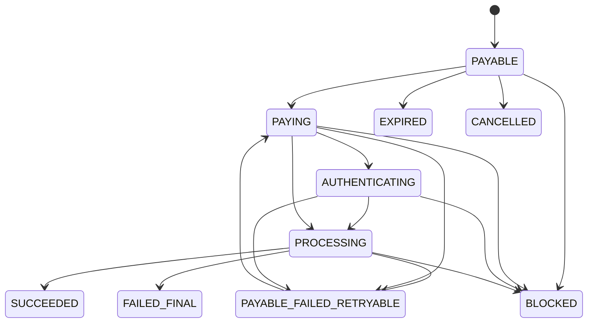

# Hosted Checkout V1 数据库与状态机设计草案

本文基于当前确认的 V1 范围：平台自建 `hosted-checkout` 收银台采集银行卡信息，通过 `service-gateway -> service-openapi -> service-payment` 完成 MPGS 卡支付和 3DS。V1 不使用 MPGS Hosted Checkout / Hosted Session，也不把 `service-checkout` 放入主支付链路。

dev/test 建表脚本见 `docs/sql/checkout-session-ddl-dev.sql`。本文和 DDL 均不能由自动化直接在生产执行。

## 1. 核心结论

1. 收银台交易流程由 `service-payment` 承载持久化和状态机，`service-openapi` 承载商户 OpenAPI 安全入口和浏览器 token API 编排。
2. `service-checkout` V1 不参与主链路，暂时保留作为后续独立收银台域服务或国家配置服务，不建议现在删除。
3. 收银台表只记录会话体验状态、URL 令牌、支付尝试、页面事件和安全事件，不复制交易金额累计、结算、对账、渠道日志等交易事实。
4. 支付提交成功进入交易核心后，使用 `checkout_session_id` 反向关联 `transaction_additional_info.checkout_session_id`，并在收银台表冗余 `operation_id`、`latest_transaction_id`、`transaction_date_time` 作为查询路由锚点。
5. opaqueToken 只在响应中出现，数据库只保存 HMAC-SHA256 摘要；URL 的 `{cover}` 只是视觉遮盖字段，不参与查询、验签或状态变更。

## 2. 服务边界

| 模块 | V1 职责 | 不承担 |
|---|---|---|
| `hosted-checkout` | 展示订单、收集付款人信息和卡信息、渲染 3DS challenge、轮询结果页 | 不决定金额、币种、支付方式、交易终态 |
| `service-gateway` | 统一入口、路由、限流、基础安全头、CORS 白名单 | 不承载交易状态机 |
| `service-openapi` | 商户创建收银台 OpenAPI、浏览器 token API、参数校验、安全审计、调用 `service-payment` | 不直接落交易核心事实，不保存卡敏感信息 |
| `service-payment` | 收银台会话、token、attempt、事件落库；交易创建；MPGS 请求；3DS 编排；状态 CAS 推进 | 不暴露公网接口，不保存 PAN/CVV 明文 |
| `channel-library` | MPGS 请求/响应映射、渠道状态归一、3DS 字段适配 | 不写平台状态机、不访问平台表 |

## 3. 表设计

| 表名 | 职责 | 是否建议分表 |
|---|---|---:|
| `payment_checkout_session` | 收银台会话主表，保存订单展示快照、状态、允许支付方式、商户返回地址和交易关联 | 否，P0 先单表；高量后按 `create_time` 月/季度分表评估 |
| `payment_checkout_token` | URL token 摘要、状态、过期、使用审计；支持重复创建请求重新签发 URL | 否 |
| `payment_checkout_attempt` | 每次付款人提交银行卡支付的一次尝试，记录 MPGS 和 3DS 编排摘要 | 否，P0 先单表；后续可按 `create_time` 分表 |
| `payment_checkout_event` | 会话打开、提交、3DS 回跳、轮询、结果渲染等业务事件 | 否，量大后优先归档或按月分表 |
| `payment_checkout_security_event` | 非法 token、过期、来源异常、CSRF、限流、安全拦截事件 | 否，量大后优先归档或按月分表 |

### 3.1 与交易核心表的关系

| 关系 | 说明 |
|---|---|
| `payment_checkout_session.checkout_session_id -> transaction_additional_info.checkout_session_id` | 支付提交后写入交易附属信息，支持从交易详情回看收银台来源 |
| `payment_checkout_session.latest_transaction_id -> transaction_operation.transaction_id` | 最近一次尝试对应的交易动作 |
| `payment_checkout_attempt.transaction_id -> transaction_operation.transaction_id` | 单次支付尝试对应的交易动作 |
| `payment_checkout_attempt.operation_id -> transaction_order.operation_id` | 原始交易生命周期聚合 |
| `payment_checkout_attempt.channel_request_id -> transaction_channel_request.request_id` | 最近一次渠道请求 |
| `payment_checkout_attempt.three_ds_transaction_id -> transaction_authentication_info.three_ds_transaction_id` | 3DS 认证详情 |

注意：`transaction_*` 多数是季度分表，收银台表保存 `transaction_date_time` 是为了路由查询，不作为跨分表全局索引替代品。

## 4. 字段新增处理原则

1. P0 不修改既有核心交易表结构。现有 `transaction_additional_info.checkout_session_id` 已满足 V1 关联。
2. 新增表名使用 `payment_checkout_` 前缀，避免和交易事实表 `transaction_` 混淆。
3. 新增 Java DO、Mapper、DTO 时必须逐字段对齐 DDL，不允许出现文档有字段但 DO/Mapper 缺字段的情况。
4. 枚举值必须集中定义，不允许在 Controller、Mapper XML 或前端散落字符串。
5. 所有资金状态更新 SQL 必须带当前状态条件和 `version` 条件，禁止无条件覆盖。
6. 上线前需要补充回滚脚本，回滚只允许 drop 新表或删除新索引，不允许改写交易事实数据。

## 5. 状态机设计

### 5.1 会话状态

| 状态 | 含义 | 是否终态 | 前端页面 |
|---|---|---:|---|
| `PAYABLE` | 已创建、未支付，可打开收银台 | 否 | 支付表单 |
| `PAYING` | 已提交卡信息，后端处理中 | 否 | 防重复提交或等待 |
| `AUTHENTICATING` | 需要或正在完成 3DS | 否 | 3DS 页面 |
| `PROCESSING` | 渠道结果处理中或等待回调/查单 | 否 | 处理中 |
| `PAYABLE_FAILED_RETRYABLE` | 上一次支付失败，但可重新支付 | 否 | 失败页带重新支付 |
| `SUCCEEDED` | 支付成功 | 是 | 成功页 |
| `FAILED_FINAL` | 支付失败且不可重试 | 是 | 失败页不允许重新支付 |
| `EXPIRED` | 会话过期 | 是 | 拦截或过期页 |
| `CANCELLED` | 付款人或商户取消 | 是 | 取消页 |
| `BLOCKED` | 安全策略拦截 | 是 | 异常请求拦截页 |

建议流转：



终态 `SUCCEEDED`、`FAILED_FINAL`、`EXPIRED`、`CANCELLED`、`BLOCKED` 不允许被普通页面轮询、重复回调或重复提交覆盖。若渠道后续出现与终态冲突的结果，只能记录异常事件并进入人工核查。

### 5.2 支付尝试状态

| 状态 | 含义 |
|---|---|
| `INIT` | 创建尝试记录 |
| `CARD_SUBMITTED` | 付款人已提交卡信息并通过基础校验 |
| `THREE_DS_INITIATED` | 已向 MPGS 发起 3DS 初始化 |
| `THREE_DS_REQUIRED` | MPGS 要求付款人完成 challenge |
| `THREE_DS_RETURNED` | 浏览器已从 3DS 返回 |
| `THREE_DS_PASSED` | 3DS 认证通过或 frictionless 完成 |
| `THREE_DS_FAILED` | 3DS 认证失败、取消或不可用且策略拒绝 |
| `CHANNEL_SUBMITTED` | 已向 MPGS 提交支付/授权 |
| `SUCCEEDED` | 本次尝试成功 |
| `FAILED` | 本次尝试失败 |
| `PROCESSING` | 本次尝试结果处理中 |
| `ABANDONED` | 新尝试创建后，旧未完成尝试被废弃 |

建议规则：

1. 同一会话最多允许一个未终态 attempt；重新支付前应将旧 attempt 推进为 `FAILED`、`PROCESSING` 或 `ABANDONED`。
2. `attempt_no` 从 1 递增，唯一键 `checkout_session_id + attempt_no` 防止并发创建重复序号。
3. 前端每次提交必须传 `attemptRequestId`，唯一键 `checkout_session_id + attempt_request_id` 兜底浏览器重复点击和网络重试。
4. attempt 成功后用 CAS 推进 session 到 `SUCCEEDED`，并写 `success_attempt_id`。

## 6. 幂等与并发

| 场景 | 幂等维度 | 数据库约束 |
|---|---|---|
| 商户创建收银台 | `merchant_id + merchant_request_id` | `payment_checkout_session.uk_merchant_request` |
| URL token 查询 | `token_hash` | `payment_checkout_token.uk_token_hash` |
| 支付提交 | `checkout_session_id + attempt_request_id` | `payment_checkout_attempt.uk_session_attempt_request` |
| 会话尝试序号 | `checkout_session_id + attempt_no` | `payment_checkout_attempt.uk_session_attempt_no` |
| 3DS 回跳 | `three_ds_return_token_hash` | `payment_checkout_attempt.uk_three_ds_return_token_hash` |
| 页面/安全事件 | 独立事件 ID | `payment_checkout_event.uk_checkout_event_id`、`payment_checkout_security_event.uk_security_event_id` |

状态更新必须使用 CAS：

```sql
UPDATE payment_checkout_session
SET checkout_status = ?,
    process_stage = ?,
    last_status_time = ?,
    version = version + 1
WHERE checkout_session_id = ?
  AND checkout_status IN (...)
  AND version = ?;
```

支付成功推进必须同时满足：

```sql
WHERE checkout_session_id = ?
  AND checkout_status IN ('PAYING', 'AUTHENTICATING', 'PROCESSING')
  AND success_attempt_id IS NULL
  AND version = ?;
```

## 7. Token 与 URL

URL 格式：

```text
https://domain.com/checkout/{opaqueToken}/{cover}
```

规则：

1. `{opaqueToken}` 必须是高熵随机值，建议至少 128 bit 熵，前端不可解析。
2. `{cover}` 是随机遮盖字符串，只用于隐藏真实 token 位置感，不参与查询、验签或幂等。
3. 数据库保存 `HMAC_SHA256(opaqueToken, platformPepper)` 的十六进制摘要，不保存 token 明文。
4. token 过期时间不得晚于 session 过期时间。
5. 商户重复创建命中幂等时，不返回旧 token 明文，而是签发新 token 并组装新的 `checkoutUrl`。
6. token 被过期、吊销或命中风控后，只展示异常请求拦截页，不返回订单细节。

## 8. 3DS 与 MPGS 编排

V1 以 MPGS 卡支付为例。根据 Mastercard 官方 MPGS 文档，Direct Payment/Payer Authentication 模式需要先执行 `Initiate Authentication`，当响应表示可认证时再执行 `Authenticate Payer`；挑战流会返回需要在页面中呈现的 HTML，并通过请求中指定的 `authentication.redirectResponseUrl` 回到收银台。

平台内部建议映射：

1. 前端提交卡信息和浏览器信息到 `service-openapi`。
2. `service-payment` 创建 checkout attempt，卡敏感信息只在内存中透传至渠道请求。
3. `channel-library` 构造 MPGS `Initiate Authentication` 请求。
4. 如果可 frictionless，继续 `Authenticate Payer` 并保存认证摘要到 attempt 和 `transaction_authentication_info`。
5. 如果需要 challenge，attempt 状态为 `THREE_DS_REQUIRED`，前端只渲染后端返回的 `threeDsAction`，不自行拼 MPGS 字段。
6. 浏览器从 `authentication.redirectResponseUrl` 回到 `/checkout/api/v1/3ds/return` 后，后端校验一次性 return token，再继续完成支付提交或查询认证结果。
7. 拿到渠道支付结果后，以交易核心状态为准渲染成功、失败、待处理或处理中页；`PENDING` 提示付款人避免重复支付并继续轮询，`PROCESSING` 表示平台仍在主动确认结果。

## 9. 数据安全

1. `hosted-checkout` 不得持久化 PAN、CVV、PIN、3DS CAVV、JWT 或渠道认证原文。
2. 后端日志、事件 JSON、result snapshot 只保存脱敏摘要。
3. `card_bin`、`card_last4`、`card_number_masked` 可以保存；`payment_account_hash` 必须不可反推。
4. 浏览器 token API 不使用商户 JWT，使用 opaqueToken + CSRF/Origin/RateLimit/设备摘要校验。
5. 商户 OpenAPI 仍必须走 `@VerificationAndProcessing`、JWT、防重放、请求体解密和响应 `data` 加密。
6. 内部 `/internal/**` 接口只能被服务间调用，不允许公网直接访问。

## 10. 数据库上线流程

| 阶段 | 动作 | 验收点 |
|---|---|---|
| 设计评审 | 评审 DDL、索引、唯一键、状态枚举、字段敏感性 | 无 PAN/CVV/JWT 明文列；幂等唯一键完整 |
| dev 建表 | 手工在 dev 执行评审后的 DDL | 表、索引、字符集、注释符合草案 |
| DO/Mapper 对齐 | 新增 DO、Mapper、XML 或注解 SQL | 字段名、类型、nullable、索引查询路径一致 |
| 单元测试 | token hash、幂等、状态 CAS、字段脱敏 | 重复请求、重复提交、终态保护通过 |
| 集成测试 | OpenAPI 创建 URL、前端查询、支付提交、3DS 回跳、结果轮询 | 主链路可闭环 |
| UAT 灰度 | 小商户/测试 MID 灰度 | 渠道响应、3DS challenge、处理中补偿正常 |
| 生产发布 | 先建表，再发布后端，再发布前端 | 可回滚到不生成 checkout URL |

## 11. 验收清单

P0 验收：

1. 商户创建收银台接口重复请求不会创建重复 session。
2. 重复创建命中幂等时不会泄露旧 token 明文，可重新签发新 URL。
3. 打开非法、过期、吊销 token 时不返回订单金额、商户信息或支付方式。
4. 未支付订单渲染收银台时，金额、币种、订单号、商户名、允许支付方式全部来自后端。
5. 支付成功后 session 和交易核心终态一致，重复轮询不覆盖终态。
6. 支付失败可重试时创建新 attempt，不复用旧 attempt 的渠道流水。
7. 支付待处理或处理中时前端轮询后端状态，不自行推导成功或失败，也不得把 `PENDING` 与 `PROCESSING` 合并展示。
8. 3DS challenge 和 return token 只允许当前 session/attempt 使用一次。
9. 数据库、日志、事件、快照中没有 PAN、CVV、JWT、私钥、完整 opaqueToken、CAVV 明文。
10. 所有状态推进 SQL 具备当前状态条件和 `version` 条件。

P1 验收：

1. 支付结果页返回商户 URL 必须命中白名单。
2. 同一 session 的最大尝试次数生效。
3. `next_channel_match_time` 可被补偿任务查询处理中会话。
4. 后台可通过 `checkout_session_id` 从交易详情回看收银台来源。
5. 安全事件表能记录 token 异常、来源异常、限流、CSRF 失败。

## 12. 后续落地任务拆分

| 优先级 | 任务 | 主要文件范围 |
|---|---|---|
| P0 | 新增收银台表 DO、Mapper、枚举、DDL dev 脚本 | `service-payment`、`docs/sql` |
| P0 | 新增内部 checkout session 创建、查询、提交、3DS return 接口 | `service-payment` |
| P0 | 新增商户 OpenAPI 创建收银台接口 | `service-openapi` |
| P0 | 新增浏览器 token API 转发和安全控制 | `service-openapi`、`service-gateway` |
| P0 | `hosted-checkout` 接入真实 session 查询、支付提交、状态轮询、3DS 渲染 | `acquiring-frontend/apps/hosted-checkout` |
| P1 | MPGS 3DS 完整渠道适配和 emulator 测试用例 | `channel-library`、`service-payment` |
| P1 | 后台交易详情补充收银台来源展示 | `service-payment`、管理前端 |
| P2 | `service-checkout` 是否转为独立收银台域服务的二阶段评估 | 架构文档、服务边界 |

## 13. 后续产品能力登记

### 13.1 收单支付链接

状态：2026-11-18 首批收单支付链接已实施并完成隔离环境验收；普通 Hosted Checkout 维持原有 24 小时上限，链接会话经拥有者核验后沿用最长 30 天的冻结期限。固定金额、单次成功、失败重试、双端创建/代发邮件、权限、数据结构和实施口径统一见[支付链接系统与功能设计](payment-link-design.md)。

目标是在商户系统的“交易管理”下新增“支付链接”，让商户不经过 OpenAPI 开发即可创建一次付款入口，并支持管理端按权限代创建、代发邮件：

1. 商户输入交易币种和金额；链接名称选填，收银台语言默认跟随浏览器，可明确指定中英文。
2. 平台生成不可猜测的支付链接，商户可以复制链接，也可以填写付款人邮箱并由平台发送。
3. 付款人打开链接后进入现有 Hosted Checkout 收银台，并在收银台内完成支付。
4. 支付结果进入现有交易、通知、清分和结算链路，不建立独立于交易核心的支付结果。
5. 商户只能查询和操作归属本商户的链接，包括有权限管理员代创建的链接；创建、发送、复制、停用和查看结果均需独立权限及审计记录。

该能力不能直接长期复用普通 Checkout 会话。正式设计时至少需要明确支付链接实体、Checkout 会话签发关系、链接状态、有效期、支付次数和邮件投递记录，并保护以下约束：

- 链接 token 使用高熵随机值，数据库只保存不可逆摘要，不在日志、审计或通知中记录完整 token。
- 金额和币种由服务端冻结，付款人页面不能修改；金额继续使用精确十进制语义并遵守币种精度。
- 链接过期、停用、已完成或超过允许支付次数后不得继续创建有效支付尝试。
- 邮件发送失败不能改变链接和交易状态；失败原因、重试和发送审计与支付状态分离。
- 支付提交继续复用现有 Checkout 幂等、3DS、风控、渠道路由和交易状态机，不新增旁路交易入口。

首批已确定：

1. 金额由商户或有权限管理员在创建时输入，付款人不能改金额；同商户订单可失败重试，最多成功一次。
2. 默认 24 小时，有效期可选 15 分钟至 30 天，支持快捷与自选到秒；可停用，不恢复；在途交易继续合法收敛。
3. 订单号可输入或自动生成；商品资料可选，未填写不展示；邮件每次单收件人，可重发。
4. 双端均提供独立权限与真实操作人审计；邮件模板沿用品牌并做中英文和手机样式；短信/WhatsApp 通过分享。
5. 直接创建发布；真实支付汇总与异步导出纳入首批，访问趋势不纳入。受控可选通知地址与现有单返回地址按主设计执行。


### 13.2 开发环境钱包模拟流水

- Apple Pay 和 Google Pay 在准备授权页时保存原渠道金额、币种和汇率快照。付款人打开钱包时，在会话行锁和同一个交易事务内复用商户订单流幂等，创建带平台编号的交易主单、动作单、渠道请求与交易定位记录。
- API 收银台和 PayByLink 的新钱包尝试在准备授权页时预留平台交易号，作为渠道 `merchantOrderNo`。打开钱包时沿用该编号正式建单，交易定位记录保存实际建单时间。旧尝试继续使用原 `DEV-IW-` 渠道引用查单、提交和接收回调。
- 渠道请求记录保存实发商户订单号及回调地址。交易内部保留原钱包标识供专用回调、清分费率快照和后续资金动作限制识别。经验证的回调和查单共用终态更新，商户通知在事务提交后投递。
- 开发钱包单仅由 dev 钱包组件创建。建单时冻结商户费率，核心交易终态和标准状态变更 Outbox 在同一事务内写入。清分和补偿需要已冻结的费率快照，钱包无底层卡品牌时使用该支付方式的 ALL 费率维度。清分完成后交由正常结算流程处理。普通渠道回调、勾兑和后续渠道资金动作仍由各自的既有入口校验。上线顺序为清分服务、支付服务，结算服务运行既有链路。

## 国家地区字典与加载性能（2026-11-19）

### 缓存调用链与失效

`GET /checkout/config/countries` → `CheckoutCountryConfigApplicationService.listCountries()` → `IsoDictionaryService.listCountries()` → `IsoDictionaryServiceImpl`。入口未直接调用国家表 Mapper。

- 常态读取环境隔离的 Redis `iso:country:all` 常驻快照，不设置物理 TTL；缓存的空数组也是有效命中。每次 HTTP 请求不等于每次查库。
- Redis 缺失、载荷损坏或不可用时才沿既有策略从 SLAVE 回源；数据库成功后，受失效门禁约束重建快照和代码 Hash。无字典时不伪造两国列表，故障时不返回虚假成功。
- 管理端国家/地区数据修改沿既有事务后可靠失效链路更新快照和代码 Hash；本轮不额外增加长期本地/浏览器缓存，避免绕过失效机制。
- 公开展示保留 alpha-2，付款提交保留对应 alpha-3，不能在性能优化时缩减字典或提交两位代码。100 个并发暖缓存入口请求的隔离测试验证实际 ISO 服务未调用国家或币种 Mapper；底层冷缓存、空结果、Redis 故障及管理端失效继续由既有专项覆盖。

### 传输与入口加载

- Checkout 展示服务的 `server.compression` 对超过 2KB 的 `application/json` 启用客户端协商压缩，不改变数据字段；不支持 gzip 的客户端继续收到未压缩 JSON。隔离 HTTP 测试从真实 application.yml 读取参数，验证 gzip 解压字节一致及无协商客户端兼容。该开关不应用于 OpenAPI/Payment 的付款协议。
- 前端 main 按当前路径动态导入 `PaymentLinkEntry.vue` 或 `App.vue`，预览不下载完整付款表单；付款页不下载未使用的链接入口。收据 PDF 相关库保持点击后加载。
- 本机修改前连续 10 次真实网关读取均返回 249 项，国家表累计查询从 3 到 3，未增加；耗时 7.25–20.63ms、中位 9.63ms。响应原始 124,486 字节，本机原先未协商压缩；离线 gzip 为约 9KB。这是本机暖缓存观测，不是容量承诺。
- IDE 重启新 Checkout 进程后，经真实 Gateway 协商的 gzip 响应为 9,285 字节，无协商响应为 124,486 字节，249 项字典解压后内容摘要一致；另 10 次请求的国家表累计查询仍为 3 → 3。
- 生产构建的桌面 1440 / 移动 390 浏览器验收中，链接预览实际加载 JS 为 250,016 字节，相比修改前约 352,130 字节减少约 29%；入口主文件从约 352KB 拆为约 172KB。付款页共加载 344,005 字节，不将入口主文件的降幅冒充整个付款页降幅。预览不请求国家列表；付款页获取完整字典并可按 alpha-3 搜索和选择。两类入口都未加载 PDF/截图依赖，无控制台错误、页面溢出或真实付款调用。
- 本轮不修改付款参数、安全令牌、会话/尝试状态机或资金链路；故障降级仍沿用既有策略。生产入口的压缩覆盖、真实带宽、冷启动/Redis 故障及高并发容量需在目标环境独立压测，不能用小规模本机耗时替代。

### 发布与回退

Admin/Merchant/Payment 的查询资源通过既有业务库依赖交付；Checkout 的压缩基线来自本服务 application.yml，无新增 Nacos 键或基础设施。部署后验证共享 Mapper 加载、本地管理查询、完整国家代码、gzip 与无协商客户端。回退入口分包和压缩配置只涉及代码/配置，不涉及表结构或数据；继续保持管理查询由本服务执行。
