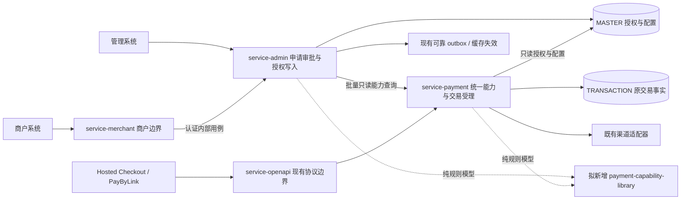
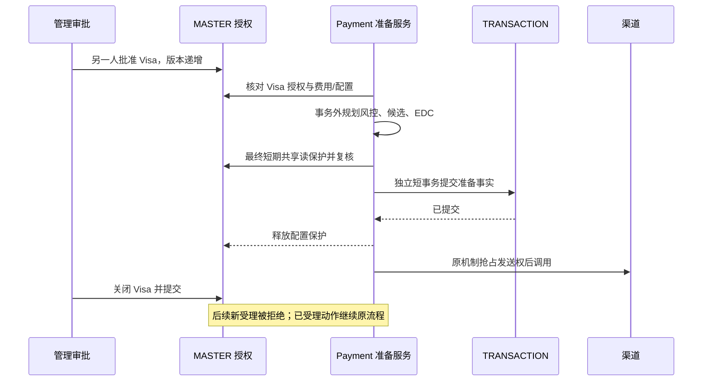

# 商户支付方式准入与收银台联动方案

版本：技术核验版 V1.3。日期：2026-11-20。状态：**五项基线核验已记录，开发准入仍有阻塞项；本期功能尚未实施**。

本方案以用户整理的《商户支付方式开通与收银台联动完整需求 V1.4》、本会话后续明确确认，以及当前两个仓库的代码为依据。后续确认优先于 V1.4 中尚未定稿的表述，尤其是高权限开通仍须另一人复核、收银台展示真实方式而前端钱包组件可以尚未适配、缺费率或候选冲突不展示。

本轮用户明确授权在现有稿中补齐评审结果并逐项确认业务规则，仅修订文档，不开发、不执行 SQL、不启动服务。尚未指定正式私有台账，本地修订不生成正式 REQ 或阶段批准。风险 R0；拟实施内容涉及授权、交易受理、费用快照、内部接口、数据库和收银台，整体按 **R3** 管理。P0 为权限、资金事实、幂等、状态和隐私不变量；P1 为本期完整业务交付；P2 为后续优化。本文所有新类、表、接口、状态和权限都是拟议契约，不代表当前代码已经提供。

## 一、结论与范围

采用“**单一授权事实、统一能力计算、入口按场景投影、交易核心最终受理**”的增量方案。

1. 管理端持有支付方式申请、逐项审批、正式授权和变更历史；商户端通过受控用例使用这些事实。
2. 支付核心统一计算有效方式、费率覆盖、固定/多候选及 EDC 结果，双端和收银台复用同一计算口径。
3. 不把费率、MID 绑定或前端 SDK 状态当成授权；不把授权当成全部执行条件已经齐备。
4. 保留现有交易状态机、先准备后调用渠道的机制、费用不可变版本、订单幂等、3DS 和原交易后续动作。
5. 前端先完成真实方式的列表与容器；组件尚未接好时显示真实状态，不虚构未开通方式，也不发起未具备的付款动作。
6. 历史商户按受控基线逐个切换，不以费率覆盖自动开通全部方式，不批量误停既有业务。
7. 数据模型优先复用现有表、关联键、审核记录和可靠失效设施。主方案仅新增申请明细与当前授权两张业务表；其余采用有明确归属的增量扩展。新增数量为源码核对后的设计建议，正式迁移前仍须核验目标库实际结构。

本期不新增独立微服务，不接入新的钱包渠道，不重做费率引擎、路由策略、清分结算、完整 VAMP/拒付看板，也不继续已暂停的支持工单。

## 二、代码基线与可验证事实

初次设计只读检查的分支均为 `feat_scott_channel`：后端提交 `258438f7`，前端提交 `a54dc11`。本轮复用评审进一步核对了工作区表结构与商户审核/待办代码；工作区同时存在其他进行中的修改，提交号不代表所有工作区文件内容，也不是远程分支或运行进程版本的证明。设计检查没有连接数据库、启动服务或运行真实付款。

2026-11-20 评审复核时后端 HEAD 已为 `29a760f9`；本次根据该轮源码证据补充可靠消息、创建指纹、尝试事实及原表复用设计。工作区既有其他改动仍保留，未来实施须重新固定输入与候选版本，不能把本地文档修订当作新的业务实现提交。

| 当前代码位置 | 已确认行为 | 本方案如何接入 |
|---|---|---|
| `service-admin/.../MerchantPaymentCapabilityReadinessService.java` | 从绑定、MID、渠道能力展开交易动作、品牌、币种，检查候选与费用覆盖；暂无独立的逐项授权事实参与 | 作为兼容入口，改为消费统一能力结果，不继续复制另一份判断 |
| `service-merchant/.../JdbcMerchantAccessOverviewQueryService.java` | SQL 从 MID/渠道直接生成支付能力；应用层六阶段判断据此得出支付方式阶段是否 READY | 原商户资料/结算/费用/风控/技术检查保留，只替换支付能力来源及分组统计 |
| `service-merchant/.../MerchantFinanceServiceImpl.java` | 查询当前商户生效费用版本和规则 | 继续是费用详情来源，新增方式与规则的关联投影 |
| `service-payment/.../DefaultMerchantFeeVersionSnapshotService.java` | ACTIVE 指针主库读取，版本明细按同一版本读取和冻结 | 准入覆盖检查与持久化使用同一份冻结版本，避免检查与落库选中两版费用 |
| `service-payment/.../DefaultMerchantTransactionSnapshotService.java` | 当前在记录商户快照时调用费用冻结，写入 `transaction_merchant_snapshot` | 首次交易可接收准备阶段已冻结的可信快照；后续动作保持自身现有冻结策略 |
| `service-payment/.../DefaultPaymentTransactionPreparationService.java` | 事务外规划风控/路由/换汇，再短事务落库，返回后才允许调用渠道；先处理已有动作幂等记录 | 新准入判断接入规划与最终准备边界；不在 Controller 拼接资金规则 |
| `service-payment/.../DefaultPaymentChannelRouteService.java` | 原币候选优先，再按既有能力优先级选唯一目标；必要时使用渠道默认交易币种 | 提取并复用相同的候选规划规则，不新增动态路由算法 |
| `payment-link-library/.../PaymentLinkCapabilityResolver.java` | 当前指定币种时直接检查支持币种，且保留请求方式/品牌交集 | 对齐 EDC；保留链接级限制；由统一结果生成展示投影 |
| `service-payment/.../PaymentCheckoutCardCapabilityService.java` | 银行卡品牌识别与展示能力入口；展示部分已委托上述 resolver | 保留 BIN/IIN 识别职责；展示能力委托新聚合服务 |
| `service-payment/.../DefaultPaymentCheckoutService.java` | 当前真实提交明确只允许 BANK_CARD；已有会话允许方式与品牌校验 | 保留银行卡真实提交；新增真实方式展示结果；钱包执行不通过放宽银行卡校验冒充实现 |
| `PaymentCheckoutPaymentSubmitCommandDTO` | 当前卡数据密文信封必填 | 本期不删除必填约束；未来钱包提交使用单独的已批准协议扩展 |
| `apps/hosted-checkout/src/App.vue` | 当前付款选项过滤 BANK_CARD | 改为按服务端真实展示结果组织 Card 和非卡选项，组件状态单独处理 |
| `DefaultMerchantRouteProfileCacheService`、`ManagedCacheInvalidationCoordinator` | 路由缓存已有 pending 门禁、主库回源、提交后失效和 outbox 机制 | 继续复用；授权的最终受理仍以主库事实为准 |
| `InternalAuthAccount`、内部 HMAC 拦截器 | 有 appCode、accountId、userId、merchantId 和服务间防重放基础 | 操作者从可信上下文取得，复核比较用户主体，不仅比较账号名 |
| `merchant_review_record` 及两套现有 DO/Mapper | 已按 review_scope 支持开户与资料变更，当前尚无支付方式目标定位、成功回执唯一键和完整用户主体字段 | 在原商户审核域内增量扩展，复用不可变轨迹；同时校正旧查询范围及映射 |
| `admin_operational_work_item` 及其 history | 只持有负责人、SLA、状态与处理轨迹，真实业务状态读取来源；来源有数据库 CHECK 与服务白名单 | 支付方式审批接入现有来源机制，不将待办改成授权事实表 |

详细代码目录在二十一节。V1.4 存放于 `docs/ListofRequirements/商户支付方式准入及收银台联动需求/`；本方案不改写原需求附件和原型图。

## 三、确认规则与设计默认值

### 已确认且不可在研发中改变

- 本期只按具体支付方式申请，币种/地区/交易动作继续受后台能力约束。
- 商户申请目录显示平台已启用的全部方式，包含卡品牌和非卡方式。
- 首次开通、终止后重新申请均逐项双人审批；平台代申请与高权限开通不能自审。暂停、恢复、终止及有效期调整由授权人员单人处理并审计。
- 费率沿用现有审批；有效费率是交易条件；MID 绑定不扩大授权。
- 钱包独立授权，不附加检查底层直接卡支付授权；底层品牌受渠道/MID 限制，直接卡入口与钱包入口不会相互授予资格。
- 支付方式开通不新增逐交易动作审批；原商户业务权限、动作能力、渠道/MID 及后续状态机继续生效。
- 本期完整包含暂停、恢复、终止和到期；终止须重新申请，到期阻止新受理。
- 单候选固定，多个候选复用现有有效选择规则，不能随机选择。
- 缺费用、无有效 MID、候选冲突的方式不进入付款选项。
- 真实方式的前端钱包按钮尚未适配，不意味着商户未开通；可以保留其名称、Logo 与交互容器，但不能执行不存在的付款动作。
- 当前系统表能承接的优先复用；新增必须说明现有结构不能承接的原因，并保持商户、支付方式、费用、MID、审批与交易事实的稳定关联。

### 页面建议与已确认边界

| 决策 | 推荐实现 | 性质 |
|---|---|---|
| 管理端入口 | 商户管理下支付方式工作台与审批页签，复用商户详情、费用和 MID 原页面 | 页面设计提案 |
| 商户入口 | 商户信息管理下支付方式管理，关联当前费率与接入概览 | 页面设计提案 |
| 生命周期 | 暂停、恢复、终止、有效期调整由授权人员单人处理；首次开通和终止后重新申请双人复核 | 已由本轮第 3、4 项确认，替代旧建议 |
| 折叠 | Card 算一个入口，默认 N=4；选中项始终可见，不能折叠后切回 Card | 沿用 V1.4 建议值 |
| 新链接仅含未接通组件 | 允许创建；真实授权/费用/MID 仍须满足，创建结果和收银台明确当前无法付款 | 已由第 6 项确认；不新增假草稿或成功状态 |
| EDC 本期范围 | 保持既有交互；报价确认与商户级 EDC 开通控制登记为后续需求 | 已由第 5 项确认，本轮不实施新报价协议或开关 |

这些默认值不妨碍输出完整方案；在进入涉及该行为的代码前形成明确决定。

## 四、业务身份与事实分层

### 4.1 不重建业务字典

为申请、授权、查询使用稳定的技术标识 `itemKey`：

| itemKey 示例 | 字典来源 | 原交易协议 | 费用匹配维度 |
|---|---|---|---|
| `CARD_BRAND:VISA` | `card_brand=VISA`，同时 BANK_CARD 启用 | `paymentMethod=BANK_CARD`、服务端识别品牌 VISA | `paymentType=BANK_CARD`、`paymentMethod=VISA` |
| `CARD_BRAND:MASTERCARD` | `card_brand=MASTERCARD` | BANK_CARD 与对应品牌 | BANK_CARD、MASTERCARD |
| `METHOD:APPLE_PAY` | `acquiring_payment_method=APPLE_PAY` 存在且启用时 | 沿用已有方式编码 | `paymentType=APPLE_PAY`、`paymentMethod=ALL`，沿现有非卡费率配置 |

这里的前缀用于区分来源。现有费率编辑器和商户开户就绪检查一致使用“非卡方式编码为费用类型，`ALL` 为费用匹配维度”。底层卡品牌未知时继续保留真实的空值；当前清分要求品牌非空，须在真钱包交易接入前完成连续链路兼容。设计以钱包方式命中该方式的通配费率，保留直接银行卡的品牌校验，复验费用快照、清分、查询与统计。

名称、Logo、展示顺序和语言来自已有字典及共享资产。授权保存稳定编码，不保存一份可独立编辑的品牌名称或图片。字典值不得在存在引用时随意改名；标签修改不影响授权身份。

ALL/NONE/UNKNOWN 等匹配或未知标记不是商户申请项；BANK_CARD 协议容器也不作为绕过逐品牌批准的全品牌授权项。

平台启用以既有字典的业务启用口径为源，不新增第二套互相冲突的公开开关。多语言行的启用必须一致，后台发布检查按类型/值定位规范项，不能让用户切换语言改变授权范围。目录启用属于平台提供能力的业务承诺，不能从“有一张图标”推断已经实现支付。

### 4.2 五层事实

1. **目录事实**：平台当前是否启用该项。
2. **申请事实**：谁申请、谁复核、各轮意见。
3. **授权事实**：该商户当前是否获准，版本及来源。
4. **业务能力**：当前费用、MID、渠道、币种/EDC、动作与条件是否匹配。
5. **入口执行能力**：对应后端协议是否实际实现，当前前端组件是否就绪。

后三者分别输出，不能用一个 `enabled` 合并。关闭授权不会删除申请历史；前端组件失败不会修改商户授权。

## 五、职责与依赖



### 模块分工

| 模块 | 本期职责 | 不拥有的职责 |
|---|---|---|
| service-admin | 目录读取、申请、逐项复核、授权变更、审计、管理查询与通知意图 | 不改交易终态，不执行扣款 |
| service-merchant | 从登录身份确定商户；商户申请/补充/查询和公开投影 | 不直写第二份授权，不信任前端 merchantId |
| service-payment | 当前授权只读检查、统一业务能力、入口执行支持声明、交易最终受理与快照 | 不决定管理人员可审批哪些商户 |
| payment-capability-library（拟新增） | 规范身份、纯候选筛选/选择、能力结果与原因模型 | 不读数据库，不持有 Spring Bean，不执行状态写入或渠道调用 |
| finance-library | 维度匹配的纯函数和已有计算模型；按需做等价抽取 | 不处理商户申请、MID、审批或路由 |
| payment-link-library | 链接规则与已有持久化；消费统一能力投影 | 不再独立发明另一套币种/品牌展示算法 |
| service-openapi | 保持安全协议、DTO 校验、加密、防重放与受众错误投影 | 不因前端需要预留而开放未实现的资金接口 |
| service-checkout | 保持当前轻配置/国家等能力，按真实现状接入所需元数据 | 不把 service-payment 已拥有的会话状态机复制过来 |
| service-data / service-job | 按已有方式处理必要异步导出、通知/补偿 | 不越权直改授权或交易 |

运行时 Payment 不同步调用 Admin 检查每笔授权，使用其主库只读边界，避免 Admin → Payment → Admin 环形依赖及运营服务故障拖住全部交易。Admin 写端是授权事实唯一写入者；Payment 的只读 Mapper 不包含授权更新方法。

纯业务库独立于 `component-library`，避免把支付方式政策塞进公共技术组件。新模块属于本方案待评审架构决定，实际新增前检查 Maven 依赖无环。

## 六、数据模型与复用边界

本节按用户补充要求重新收敛：**先复用已有权威事实和持久化设施，只为缺失的申请明细与正式授权新增两张表。** 本轮依据仓库中的 `docs/sql/payment_acquiring_表结构.sql`（文件标记导出时间 2026-11-19 11:51）及对应 DO/Mapper/业务调用核对，尚未连接目标数据库确认已部署结构；本节不构成执行 SQL 的授权。

### 6.1 现有表复用清单

| 业务事实/能力 | 已有表 | 本期处理与边界 |
|---|---|---|
| 规范目录、启停、名称、Logo、多语言 | `sys_dict_type`、`sys_dict_data` | 沿用现有类型/值和共享资产；不另建支付方式主数据表 |
| 商户主体、准入修订与历史切换 | `base_merchant_info` | 主体事实仍在原表；增量增加支付准入模式、授权修订号、基线批次引用和切换时点，不独立建商户支付政策表 |
| 逐项审批与授权变更轨迹 | `merchant_review_record` | 已有 review_scope、request_no、动作、前后状态、操作者和意见；扩展业务范围与必要关联/幂等字段，作为商户准入治理的不可变记录 |
| 待审分派、负责人、SLA 和处理轨迹 | `admin_operational_work_item`、`admin_operational_work_item_history` | 新增受控来源类型与来源适配；来源指向申请明细，申请/授权状态仍从业务事实读取；完成待办不等于批准授权 |
| 技术操作日志与追踪 | `sys_oper_log` | 继续原审计链路；不以异步日志充当准入写命令的唯一持久幂等保障 |
| 费用模板、版本、规则与阶梯 | `fee_plan`、`fee_plan_version`、`fee_rule`、`fee_rule_tier` | 原生效指针、审批和规则继续使用；方式页按规范映射关联查询，不复制一份商户方式费率 |
| 商户执行目标与能力 | `merchant_channel_mid_binding`、`channel_mid_config`、`channel_info`、`channel_payment_capability` 及品牌/币种能力表 | 原约束继续生效；不新增“授权后复制出的绑定”或“商户就绪方式”表 |
| 配置可靠失效 | `merchant_security_cache_invalidation_outbox` | 复用原受管缓存注册、pending 门禁、事务后失效和补偿；不为本功能新造 outbox |
| 业务变更可靠消息与邮件 | `sys_mq_outbox`、`msg_email_send_record`、`msg_email_template` | 准入变更事件与业务同事务，邮件使用原异步设施；消费者幂等及事件关联按本方案补齐，不增加专用通知表 |
| 付款尝试、事件、API 交互 | `payment_checkout_attempt`、`payment_checkout_event`、`transaction_merchant_api_interaction_log` | 复用已有事实，补最小准入上下文及跨入口去重口径；不能仅按日志条数计交易 |
| 链接范围及交易受理证据 | `payment_link`、`transaction_merchant_snapshot`、`transaction_payment_method_info` | 在原事实表做必要兼容扩展；不新增平行支付订单或交易分析明细表 |

审批事实、当前授权、配置就绪和执行事实在业务语义上分别定义，不意味着每个概念各建一张表。所有引用沿用 merchant_id、规范 itemKey、费用版本、真实绑定/MID、申请明细 ID 和系统订单号；显示名称不是关联键。

### 6.2 仅新增两张业务表

两表均位于 MASTER，字段名为设计候选。商户号等类型按既有权威表对齐；时间沿用 `DATETIME(3)`。审核意见和历史轨迹不复制成第二套专用历史表。

| 表 | 核心字段 | 关键约束和索引 |
|---|---|---|
| `merchant_payment_application_item` | itemId、applicationNo、merchantId、itemKey、operation、status、round、source、createRequestId、initialSubmittedActor、currentSubmittedActor、reason、expectedGrantVersion、activeSlot、version、提交/审核时间 | merchantId+itemKey+activeSlot 唯一；活动项为 1、终态为 NULL；merchantId+createRequestId+itemKey 唯一；申请编号/明细 ID、商户/状态/时间、审批队列索引 |
| `merchant_payment_authorization` | id、merchantId、itemKey、authorizationStatus、version、source、sourceRef、approvedActor、effectiveTime、expireTime、suspendedTime、terminatedTime、lastReviewRecordId | merchantId+itemKey 永久唯一；无记录表示从未授权；暂停/终止保留行；版本 CAS；时间与状态按七节矩阵；lastReviewRecordId 指向原审核记录 |

必要性：现有 `merchant_profile_change_request` 是单商户单活动资料变更，保存完整资料加密快照，不能直接表达同一批多支付方式的独立结果。现有 MID 绑定是一对执行目标的配置关系，同一方式可能对应多个 MID，解绑后授权仍须保留；它不能承接一商户一方式的独立授权。费用规则、菜单权限和派生待办也不具有上述基数、生命周期及交易语义。因此保留两张窄业务表，而不扩大资料变更、费率或待办表的含义。

一次批量申请用同一个 applicationNo 关联多行，来源、初始申请主体和初始集合在创建时固定；详情与列表按该编号聚合。整单待审/部分完成/全部完成从明细计算，不另存易失真的主单状态。分页先按商户与申请编号取分组页，再批量取该页明细，不以全量内存分组代替数据库分页。

`RETURNED` 仍占活动槽，补充后递增 round，前轮内容从不可变审核记录还原；APPROVED/REJECTED/WITHDRAWN 不被新申请覆盖。恢复暂停项使用受控 RESTORE 命令及预期授权版本，追加原审核记录；终止项只能重新申请并经双人批准，不通过恢复命令绕过历史。每一轮实际提交主体均保留；仍构成本轮申请内容的提交/修改主体不能充当其复核人，平台转交不能清空原提交记录以规避双人规则。

### 6.3 原审核记录承接历史与成功回执

现有 `merchant_review_record` 已同时承担 ONBOARDING 和 PROFILE_CHANGE。拟增加 PAYMENT_METHOD、PAYMENT_ADMISSION_POLICY 等受控业务范围；request_no 承接对应申请或变更编号。按实际查询需要扩展以下可空字段，原范围保持原写入契约：

- 目标关联：targetType、targetKey、applicationItemId、round，定位整批提交、申请明细、授权或商户准入模式变更。
- 可信主体：operatorAppCode、operatorUserId；保留现有 operatorId/accountId 与名称，用于证明同人不同账号不能自审。
- 命令成功回执：commandRequestId、payloadHash、resultJson；不增加异步任务的 INIT/RUNNING 状态机。
- 有界事实：factSnapshotJson，保存本轮申请内容、必要授权前后版本/状态与来源引用；不复制全量费率、路由、敏感资料或通道报文。

约束候选为 `(review_scope, merchant_id, command_request_id)` 唯一；原记录新字段为 NULL，旧范围不受该唯一约束干扰。成功命令的事实更新和不可变回执必须处于同一 MASTER 事务。重复请求先按唯一键查回执，再校验动作、目标、规范载荷摘要及操作者；相同键异载荷或异主体返回冲突，同键成功重试返回原结果，不受后续状态改变影响。

整批创建在锁商户行后校验完整集合，同事务写明细及一条包含原始集合摘要、申请编号/明细引用的批量提交记录。重试不能把同一键改为另一个子集再追加。后续逐项审批各用稳定子请求键，审核记录与明细/授权更新同事务；批量接口组装逐项真实结果，沿用原键恢复已成功项。未提交成功的事务不留下虚假成功回执，数据库不确定结果按原键查询恢复。上述回执只承接商户准入治理的成功业务动作，不把审核记录扩成全系统任意命令/异步任务平台，也不套用技术操作日志的清理策略删除仍需保留的审核与幂等证据。

所有新范围查询必须显式限定 review_scope 与归属。当前 `MerchantOnboardingService.loadReviewRecords` 只按 merchantId 查询；实施时必须收窄为开户范围，并回归资料变更历史，避免新记录混入开户列表。两套现有审核记录 DO/Mapper 的映射需一致扩展或通过兼容委托收敛，避免同表字段在不同调用端丢失。

统一待办表本身有来源类型 CHECK 和服务白名单，接入需同步扩展数据库约束、来源查询、同步、权限、导出与前端定位。仅写入一个新 source_type 字符串不能算已复用完成。待办可按申请明细及轮次生成来源键，旧轮次结束后关闭，补充轮次按真实来源重新进入队列。

### 6.4 商户主表承接修订与迁移

在 `base_merchant_info` 增量增加 payment_admission_mode、payment_authorization_revision、payment_baseline_batch_ref、payment_admission_cutover_time 等候选列。原开户/审核/激活状态和 merchant_status 的含义保持原样，不挪用其取值。授权变更及准入模式切换递增专用修订号，必要时 CAS；不借用主体名称更新时间作为授权版本。

商户行作为已存在的稳定锁定点，替代独立 policy 表。授权写命令先锁该商户行，再按稳定 itemKey 顺序处理明细/授权；交易最终保护对该行使用共享读锁。多笔交易读者可并行，但主体修改也会与该锁竞争，需纳入锁等待、死锁顺序、连接与容量验证，不能声称复用主表没有代价。原资料编辑不得用旧对象全行覆盖这些新字段，必须审查实际 UPDATE 列集。

新商户创建显式写 ENFORCED；旧行新增模式列可以暂为 NULL，但仅经登记的历史商户才能转 LEGACY_OBSERVE，未知模式不默认放行。历史基线授权来源为 HISTORICAL_BASELINE，引用真实核验批次；审核记录写实际登记与复核事实，不补造过去的商户申请和审批人。

上述复用取代原候选方案的申请主表、专用授权历史表、专用命令表、独立政策表。后续迭代优先扩展既有业务范围、明确关联键和查询契约；新增表须附“现有表无法承接的基数/生命周期/一致性原因、数据归属、关联与迁移方案”，不按页面或接口数量决定表数量。

### 6.5 原交易表的最小扩展

`transaction_merchant_snapshot` 新增可空的 `payment_admission_snapshot_json`（候选名），按原动作保存：itemKey、授权 ID/版本、核验时间、迁移模式、能力规则版本、所选 MID/能力引用、费用版本引用、执行支持版本。原费用 JSON/hash/金额保持既有结构，不向老费用快照塞入新字段破坏摘要。

新增快照均带 schemaVersion，按白名单只存必要引用、版本和结果摘要，设计上限制为有界小对象（建议初始上限 8 KiB，实施前按真实字段核算）；大路由集合、完整费用规则和原始风控/通道响应不复制进去。

`transaction_payment_method_info` 继续保存原 paymentMethod/paymentBrand/walletType。增加稳定分析键或在受理快照提供该键，不把钱包附带品牌覆盖成主支付方式。缺失附加品牌留未知，不伪造 BIN。

改表须覆盖真实逻辑表、所有已发布物理表及未来分表模板/建表机制；先核验当前拓扑，不在方案中猜季度表名。旧行允许 NULL，前端显示历史口径，不批量回填假的授权版本。

### 6.6 链接方式范围的兼容扩展

当前 `payment_link` 保存 `allowed_brands_json`，天然是银行卡品牌范围。要在链接中允许真实非卡方式，需要增量的带版本 `allowed_methods_json`：

- 旧链接新列 NULL：继续按原品牌范围生成 BANK_CARD 范围，不解释成“允许全部”。
- 新链接：保存创建时明确确定的规范方式范围；创建界面从真实授权与能力中选择。
- 若同时传旧 cardBrands 与新范围，含义冲突则拒绝，不能悄悄取并集。
- 会话同样保留创建时允许范围；以后新授权不能自动扩大原链接/会话。
- 允许仅包含组件尚未接通方式的新链接，前提是真实方式授权及基础配置成立；创建响应、预览和最终页面明确当前无法付款。
- 创建判断依据入口实现/适配登记，不在尚无付款人的创建时猜测具体设备支持、SDK 临时加载结果。
- 链接仍按原 ACTIVE/失效等生命周期管理，不把不可付款写成支付失败或虚构新资金状态；有效期照常流逝，不自动延长。组件以后接通时在原允许集合内重算，无须伪造新授权。

### 6.7 创建指纹与准入失败事实

支付链接新增方式范围时，同步升级 `PaymentLinkCreationFingerprint` 的契约版本和规范字段，将明确允许的方式集合及关联品牌范围纳入摘要；排序、去重、大小写及缺省值使用同一规范化函数。同一 requestId 改变非卡范围必须冲突；旧摘要兼容只接受可证明等价的旧银行卡请求，不能将带新非卡范围的请求退回旧摘要匹配。

创建指纹固定请求语义与实际保存的范围，不把每次变化的费率、授权修订号或组件加载状态掺入稳定业务输入。创建重放先核对可信原结果；未来新授权不能扩张已创建链接。会话创建中如有新增请求范围，同样复核其既有指纹契约，不能只改单据 JSON。

| 入口 | 复用事实 | 准入上下文与计数约束 |
|---|---|---|
| Checkout/PayByLink | payment_checkout_attempt、payment_checkout_event | sessionId+attemptRequestId 表达有效提交；checkoutAttemptId 关联实际尝试；eventPayloadJson 按版本白名单记录规范方式、失败阶段、原因与授权修订引用 |
| OpenAPI | transaction_merchant_api_interaction_log 与原操作幂等身份 | 经认证且进入付款受理的请求，按 merchantId+动作+原业务幂等键去重；按需在原表增加可空 admission_context_json，不以每条网络日志作为独立尝试 |
| 已生成真实系统订单 | 原订单、transaction_merchant_snapshot | 仅在确有订单事实时关联系统订单号/业务时间，保存当次准入与费用版本；预分配编号不作为真实订单证据 |

最小上下文为 entry、itemKey、transactionType、attemptKey/幂等引用、admissionStage、outcome、reasonCode、authorizationRevision、occurredAt、可空真实订单关联，含 schemaVersion。禁止写入 PAN/CVV、钱包令牌或原始敏感报文。阶段与原因是拟议契约，实施前登记，不随意赋数字错误码。

业务有效尝试与认证失败、安全拦截、纯页面选择、组件未就绪分别统计。两个独立有效提交即使同一 URL 且建单前失败，仍保留两份尝试；同键重放只增加请求/事件记录，不新增独立业务尝试。需要采集的事实使用现有持久化/可靠消息机制，不能依赖采样或可丢失文本日志。OpenAPI 准入拒绝须补齐现有记录链路的早期失败分支，不能仅修改已有订单的快照。

后续统计使用独立尝试键去重，保留请求次数、尝试次数、真实订单数、渠道发送数等不同口径。仓库基线的 API 交互逻辑表和三张分表均要求 `transaction_id` 非空，现有写入依赖核心结果。继续复用该表时，写入契约必须允许已认证的建单前准入拒绝使用可空订单关联，并以受信任的请求进入时刻落定分片键。旧读链只以真实订单号关联，按商户、动作、业务幂等键保留早期准入事实。需验证目标分片模板、Mapper、无订单日志查询与旧版读写兼容。

## 七、状态与双人复核

### 7.1 状态分开

申请明细：`PENDING_REVIEW → APPROVED / REJECTED / RETURNED / WITHDRAWN`；RETURNED 经补充进入新轮次待审。正式授权候选持久状态为 ACTIVE、SUSPENDED、TERMINATED，无记录表示从未授权。EXPIRED/NOT_YET_EFFECTIVE 为依据生效/到期时间产生的有效状态，不依靠任务先改行才能拒绝新受理；最终枚举及错误码在实施契约中登记。

优先级为终止 → 暂停 → 生效时间/到期判断 → 有效。时间采用半开区间 effectiveTime ≤ now < expireTime（空到期表示长期），终止或暂停均不能被延长有效期隐式解除。配置就绪、入口组件状态与授权状态分别表达。

| 当前情况 | 操作及条件 | 结果与审批边界 |
|---|---|---|
| 从未授权 | 开通申请获批 | ACTIVE；必须另一人逐项复核 |
| ACTIVE | 暂停 | SUSPENDED；授权人员单人，原因/版本必填 |
| SUSPENDED | 恢复 | ACTIVE；授权人员单人；重新判断时间及能力，到期则仍不可新受理 |
| ACTIVE/SUSPENDED | 终止 | TERMINATED；授权人员单人；保留全部历史 |
| TERMINATED | 恢复/直接延期 | 拒绝；必须重新申请，另一人批准后更新同一授权身份和版本 |
| ACTIVE/SUSPENDED，含已到期 | 调整有效期 | 授权人员单人，校验时间与版本；不改变暂停状态，业务能力重新计算 |
| 到期边界 | 时间推进 | 新受理立即不满足有效授权；刷新/通知任务的延迟不影响真实门禁 |

原 V1.1 的 CLOSED 是未实施的两状态候选，V1.2 已替换为上述明确语义，不需要对实际不存在的旧授权表虚构迁移。本期管理端持有已确认的生命周期操作，商户端提供查询及首次/重新申请；不由管理端单人规则自动扩大商户端操作权限。

申请通过与授权写入在同一 MASTER 事务内完成。目录停用、商户范围变更或预期授权版本变化时，审批命令拒绝并要求刷新，不能基于旧页面扩大权限。

### 7.2 操作语义

| 操作 | 行为 |
|---|---|
| 商户申请 | 可信会话生成申请身份，多个方式逐项去重 |
| 平台代申请/高权限发起 | 均形成待复核明细，操作原因必填；不存在单人直接授权特例 |
| 批准 | 验证审核人主体不同、权限/范围/版本后更新授权；无费用/MID 仍可批准，但结果为待配置 |
| 退回/拒绝 | 原因必填；只影响本轮申请，不撤掉其他已经生效的合法授权 |
| 暂停/终止 | 授权人员单人立即处理，原因/预期版本必填；不删除数据；终止不能直接恢复 |
| 恢复/有效期调整 | 授权人员单人处理并记录前后事实；不能直接标可交易，不绕过原业务权限和渠道/MID |
| 终止后重新申请 | 使用新申请明细，仍由另一人复核；保留原授权身份与历史 |

首次开通及终止后重新申请中，同一 `userId` 的不同账号不能完成双人复核；同时保存 accountId/appCode 以说明实际登录入口。userId 缺失时拒绝敏感审批，不能退回比较显示姓名。若现有身份体系对跨账号人员身份有例外，先明确该主体映射再上线，不假定账号名不同就是不同人。

### 7.3 事务与批量

写入顺序固定：先查成功回执 → 锁 base_merchant_info 对应商户行 → 用主库当前读复核回执 → 锁申请明细/授权（稳定 itemKey 顺序）→ 校验版本、主体与范围 → 更新业务事实及 merchant_review_record 不可变成功记录 → 同事务登记既有设施支持的通知和失效意图 → 提交后投递。不能在通用异步日志落库后才声称业务命令已完成幂等保护。

批量提交申请先整体校验所选集合；存在无效/重复活动项时返回逐项原因，用户明确修改后再提交，不能静默少申请。批量审批采用每项独立事务与幂等键，结果返回成功/失败/未处理集合及数量；前端只有全部成功才提示全部完成，部分成功保留失败项并可按原键重试。

## 八、统一能力计算

### 8.1 输出模型

拟议 `PaymentCapabilityDecision` 包含：规范 itemKey、授权状态/版本、费用覆盖与版本、候选摘要、DIRECT/EDC 路径、READY/BLOCKED/CONDITIONAL/UNKNOWN、原因集合、评估时间、入口执行状态。

管理端可查看具体配置引用和修复入口；商户只看安全的限制原因；付款人只收到必要的可展示选项和安全原因。不能把同一个含 MID/内部成本的对象直接返回三种受众。

有订单时按实际金额、币种、动作和已知付款地区计算。无订单的商户列表只能说明已知适用范围，缺少上下文时标条件性，不伪造“任意金额/地区均可用”。

### 8.2 统一算法

1. 验证目录规范项和启用、商户状态及迁移模式。
2. 取商户正式授权与准入模式：ENFORCED 下无授权、暂停、终止、未生效或已到期均阻断；这些显式限制在任何模式均优先。钱包只检查钱包 itemKey，不附加商户底层卡品牌授权。LEGACY_OBSERVE 仅可在十六节冻结的历史兼容清单内沿用原规则；HOLD 或未知模式不允许新受理。
3. 收窄至链接/会话明确允许的方式与品牌。
4. 取得当前有效费用版本，检查该动作与方式的必要主费用覆盖；合法 0 费率与缺规则分开。
5. 从真实有效绑定、MID、渠道与能力取交集，沿用既有国家/币种/动作/品牌等约束。
6. 生成原币或结构上可 EDC 的候选；执行现有原币优先和优先级唯一选择，不引入新随机/权重策略。
7. 对选定 EDC 路径读取合法汇率；缺失时给出明确不可用，不自行发明自动切换到另一 MID 的策略。
8. 产生业务结果与安全投影；再独立判断对应入口的真实后端执行支持。

同一银行品牌可能由多个 MID 支持，结果按真实目标去重。单候选直接使用；多候选在既有选择规则下可唯一确定则使用，否则 ROUTE_AMBIGUOUS。

### 8.3 共享规则的边界

将当前 `DefaultPaymentChannelRouteService` 的纯候选筛选/原币优先/唯一选择提取为统一 planner，原路由服务保留适配与受控参数读取；展示层不能各抄一份。

当前商户概览 SQL、Admin 就绪、链接 resolver 与运行时的口径并不完全相同。先用现有规则 fixture 固化预期，逐项说明差异，再迁移调用点；不将“统一口径”变成扩大资金能力的隐式修改。

MID 的币种范围对当前路由快照构建已参与交集，不能在 EDC 预检里错误地再次把标签币种当渠道执行币种检查。金额/地区规则只消费真实已有且语义明确的字段，不新增一个无人配置的限制当作无限制。

### 8.4 费用覆盖不等于重新计费

新增 `FeeScopeMatcher` 纯维度匹配函数作为 finance-library 内的等价抽取候选，复用费用现有 transactionType/paymentType/paymentMethod/ALL 语义。Admin、Payment 的覆盖查询使用它；清分完整 matcher 的收费触发点、风险服务和结算换汇条件保持原逻辑，必要时只委托同一维度函数。

收款前只检查必要规则可确定，不预先执行阶梯累计或收取费用。不同费用类别可以同时适用，不能把所有命中规则总数大于一都认作冲突；歧义按现有原子规则同一适用维度/类别的约束判断。NO_CHARGE 是明确配置，不等于丢失费率，也不代表授权给所有方式。

## 九、费用冻结与 EDC

### 9.1 同一动作一份费用事实

首次交易规划时从 MASTER 读取 ACTIVE 指针，使用 `freezeActiveVersion` 得到既有规范快照；费用覆盖检查和最终落库均引用这一版本。

当前 `DefaultMerchantTransactionSnapshotService.recordMerchant` 会再冻结一次，费用版本查询使用 `REQUIRES_NEW`。实施时对首次动作传入服务器生成的冻结对象，直接保存同一 JSON/hash/version，锁内只复核所用版本的有效性。客户端 DTO、浏览器或商户 API 不得提交该对象；不得接受外部构造的费用 JSON。

在最终受理检查发现 ACTIVE 指针已变化时，释放当前规划、按新版本有界重新规划或返回刷新指引；不能拿旧版覆盖检查通过、却落库新版。已受理动作及重复请求继续原快照；后续动作按照自身既有费用策略处理，不统一改成根交易费用。

### 9.2 EDC 统一规则

- Label 金额/币种保留商户原始语义；transaction 金额/币种由选定路径生成。
- 原币候选优先；无原币候选再按既有唯一选择规则选 EDC 目标。
- 选定目标汇率缺失或不合法，不发渠道请求；不得 1:1 假定、偷偷覆盖标签币种或随机改投其他目标。
- 后端使用 BigDecimal、真实币种指数和现有舍入点；前端只展示精确字符串，不计算最终扣款金额。
- 预检可以只读汇率，不预占风险额度、不创建资金交易、不调用渠道扣款。
- 预检结果不是锁价承诺；实际提交必须复核，并保存最终汇率来源、时间和双币种事实。

本轮第 5 项已确认：本期保持既有 EDC 交互，不增加付款人报价确认、报价锁定或新提交协议，也不因为本次准入设计改变当前换汇开关。上述一致性要求用于保持既有算法和事实，不能把一次预检解释为锁价。

后续独立需求 F-EDC-01 记录两个相关但须另行评审的方向：付款执行报价确认；由商户选择是否开通 EDC，未开通时对必须换汇才能执行的当前币种交易拒绝，已开通则按既有约束转换。原币可执行时不因未开通 EDC 拒绝。商户选择/平台授权、默认值、存量迁移、配置归属与生效时点在后续需求定稿，不能在本期先新增字段、表或隐式默认。

## 十、最终受理与关闭并发

### 10.1 判断放在真实链路

接入 `DefaultPaymentTransactionPreparationService.prepareInitialTransaction`，不依赖 Controller 或 OpenAPI 单独放行：

```text
服务端解析真实方式/银行卡品牌
→ 查原动作幂等结果：有记录则返回既有准备/处理结果
→ 快速授权检查（MASTER）
→ 事务外进行费用冻结、既有风控、候选规划和 EDC
→ 最终主库检查与短期配置保护
→ TRANSACTION 短事务提交完整准备事实
→ 释放配置保护
→ 沿用现有唯一渠道发送权与真实渠道调用
→ 原状态机、结果落库、outbox
```

新付款、首次授权、首次预授权等动作统一检查方式授权，再继续检查原有商户业务权限、动作能力和渠道/MID，不增加逐动作开通审批。原交易查询、结果回调、退款、请款、撤销等不从新开通校验入口重新择路；沿用原交易权限、冻结事实和状态机。

### 10.2 授权关闭的明确顺序

将**首次交易本地准备事实成功提交**作为该次业务已受理的边界。人工暂停、终止、缩短有效期等配置写入由锁排序决定先后。授权自然到期以同一准备流程内的服务端最终受保护校验时点判定。已受理业务继续原流程，包括 3DS 进行中或已发送渠道的交易。页面预检只供展示。

单纯“读一次授权，再过一段时间写交易”存在竞态。本期推荐：

1. 所有新授权写入/关闭/恢复/切换均先锁定 base_merchant_info 对应商户行，再更新授权；保留统一锁顺序，不再创建独立 policy 行。
2. 最终准备前，在 MASTER 的短事务中以共享锁读取该商户行的模式/授权修订号、相关授权和规范目录状态；验证规划版本及有效性。
3. 对最终选中的绑定/MID/渠道/能力，以及所用费用当前指针，在确定的主键顺序下做主库复核和必要共享锁保护，防止已选目标在本地准备期间被停用。
4. 保护范围内只调用 **TRANSACTION 独立短事务**提交准备事实，不进行风控、汇率远程读取、SDK 加载或渠道网络调用。
5. 核心准备提交后释放 MASTER 读保护，再执行原渠道发送；关闭命令如先完成，则新准备检查失败；若准备先提交，关闭只影响后续新请求。

这不是跨库原子写事务：MASTER 侧不写业务事实，只用锁排序与授权变更建立先后；交易事实仍只由 TRANSACTION 事务提交。实现必须使用明确的物理数据源/事务管理边界及服务代理，不能假定在一个已开启事务里切换 `@DS` 就拥有两库原子性，也不能使用一条本地事务回滚另一库已提交事实。

MySQL 共享锁需在显式事务中使用，事务结束后释放，依据 [MySQL 8.4 锁定读说明](https://dev.mysql.com/doc/refman/8.4/en/innodb-locking-reads.html)。不要把该事务配置成禁止锁定读的只读模式；逻辑上无写入不等于随意更改事务属性。

该方案的代价是短时间持有 MASTER 连接及共享锁，必须测连接预算、锁等待和关闭延迟。读者之间不应以同一行 FOR UPDATE 串行化全部交易。主库/锁不可用时不发新渠道请求；不允许退回陈旧授权缓存放行。

若选定目标之外新增候选发生在一次已完成的受理规划之后，不回溯重选已受理动作。要把全部配置变更都纳入更强的全局线性化，需要另行版本屏障设计，不能在这里声称所有配置天然跨库原子生效。

### 10.3 事务保护的实施验证门禁

技术任务 T-02 须列出实际 MASTER/TRANSACTION 数据源、事务管理器 Bean、传播方式、代理边界与连接持有范围，验证外层 MASTER 保护和内层交易提交确实分别使用预期连接。现有路由数据源上的默认 REQUIRED 准备事务可能加入外层事务；验证须覆盖 Spring 资源绑定、ShardingSphere 逻辑连接到物理池的路径，各配置写入口的锁顺序，以及锁内采用同一已冻结费率版本，避免另开费用事务。

验证矩阵覆盖暂停/终止先提交、准备先提交、授权/绑定自然到期、费用版本切换、锁等待/死锁、核心提交后响应丢失、外层保护结束失败、主库/Redis 不可用及连接耗尽。

授权自然到期按 QPM-11 判定。最终判定时间取自锁保护内的服务端权威时间，授权有效区间的结束时点排除在外。11:59:59.900 通过该次最终校验，即使 12:00:00.020 才提交也允许继续；12:00:00.000 或之后才完成最终校验则拦截。允许继续仅适用于同一次受保护准备，释放保护后重新规划或原准备未提交时，新的准备须重新校验。已提交的同键请求走原结果恢复。该规则适用于商户授权自然到期；MID、路由和费用仍按各自既有有效性检查及冻结契约处理。

全部证明应使用目标 MySQL 和实际数据源拓扑，记录连接占用、锁超时与关闭时延。保护段只允许短事务所需的本地数据库调用，远程补偿、风控和渠道调用安排在两层事务结束后。目标拓扑的验证留待单独授权。

### 10.4 失败与恢复

- 最终授权版本变化：原规划作废，释放风险预占并有界重新规划；不能带旧规划继续发送。
- 本地准备失败或重复分支：先结束两层事务并释放锁，再按权威准备事实决定是否撤销相应风险预占。现有事务回调及准备入口同步撤销路径均需纳入改造；事务结果未知时先核实原请求的持久化事实。
- 核心准备可能已提交而外层释放、返回或尝试关联失败：沿原幂等键查找权威准备事实，有记录时恢复原系统订单及状态。结果暂无法确定时保留可恢复的处理中语义，避免 Checkout 通用异常路径把已受理核心订单或尝试写成失败；复验同键重放与唯一渠道发送权。
- 关闭与同一已受理请求重试并发：返回原结果，不以新授权状态把原请求改成另一个失败事实。
- 准入阶段拒绝而未生成核心订单：只记录真实的付款尝试/受理失败阶段；不拿预分配编号伪装系统订单。
- 外部网络调用绝不在 MASTER 共享锁或准备短事务内。

## 十一、缓存与事件一致性

### 11.1 现有缓存继续复用

当前 `MERCHANT_ROUTE` 已有 pending 门禁与前后置检查，门禁未知回主库。保留这条链，不另引入一个简单 TTL 缓存覆盖它。

授权列表/能力展示可新增受管的商户级缓存，键通过现有 resolver 做环境隔离；带 schemaVersion、authorizationRevision、evaluationTime。授权写入同事务登记失效意图，提交后使展示缓存失效。字典、费用、渠道/MID、绑定变化按已有关联范围使相关投影失效，不能 O(N) 扫完所有商户后才宣布配置提交成功。

实际新交易最终授权检查不依赖该展示缓存，始终走主库边界。配置事实不可得时返回 UNKNOWN/暂不可用；不把读失败当未开通，更不把异常当默认允许。

### 11.2 触发关系

| 变更 | 直接更新 | 失效/重算 |
|---|---|---|
| 批准、关闭、恢复 | 正式授权、原商户审核记录及同一回执、商户主表授权修订号 | 商户方式列表、详情、概览与会话展示 |
| 商户生效费率 | 原费用指针与不可变版本 | 当前费率及能力投影；原交易快照不变 |
| MID 绑定/停用/范围变化 | 原配置事实 | 既有 MERCHANT_ROUTE 加相关能力投影 |
| 渠道或能力变化 | 原配置事实 | 当前相关 MID/商户的投影；最终受理仍检查真实事实 |
| 平台字典停用 | 原规范字典项 | 目录投影；新受理强检查；历史标签仍可回显 |

事件携带商户/方式/聚合版本/变更原因和事件号，不含密钥、卡数据或完整付款响应。消费者按版本与事件号幂等，不能晚到旧事件覆盖新关闭状态。通知失败不回滚已经批准的授权。

### 11.3 自然生效、到期与派生结果时效

原 MERCHANT_ROUTE 缓存继续保存配置事实和时间边界，真实路由每次按当前时间筛选。新能力展示结果带 evaluatedAt、nextChangeAt、有效范围及版本引用；nextChangeAt 为相关授权、绑定、MID 等最近生效/到期边界。读到过界结果必须重算，不继续把旧 READY 当作当前事实。

配置变更经可靠事件触发受影响范围的重算；自然生效、到期由现有任务设施按可索引时间边界分批复核。配置事件、自然时间复核、补偿均调用同一 evaluator，现有每分钟待办同步用于兜底。页面查询重算；新受理即时校验。正常 1 分钟从配置提交或生效/到期时点起算，分别记录待办提交、通知任务持久化及投递状态，需在代表性批量变更和同一时间集中到期下验证。事实不可得时使用 UNKNOWN 并告警。

事件重复或多个配置同时变更仅触发必要重算。对业务约定范围真实 READY/BLOCKED 的变化建立稳定世代；查询本身不产生通知，READY→不可用→READY 是两个真实转移，不以每次读取重复发送。时限验收分别记录变化发生、重算、待办同步、通知任务创建/发送状态，外部邮件最终收件不伪装成系统可严格保证的时点。

### 11.4 审批与配置跟进的任务闭环

复用 admin_operational_work_item：审批来源按申请项/轮次定位，批准后关闭该审批待办；若该方式在约定配置范围仍缺条件，则使用独立配置跟进来源、稳定 merchantId+itemKey+条件范围键进入统一待分派队列，不默认分配给批准人。候选 source_type 及 CHECK/白名单在实现契约中统一登记。

同一事项维护当前全部缺项与原费用/MID 修复入口，负责人认领、分派、转派沿用现有权限。跟进负责人不自动获得费率、渠道或 MID 修改权限；失去商户数据范围后不能继续处理，须可回待分派。人工完成仅更新运营处理记录，来源事实仍不可用时不得关闭来源或篡改 READY。

条件配齐后由来源同步自动关闭；后续真正退化时按同一来源键重开并追加历史，首次退化且无历史任务时创建待分派事项。增量批次只变更已可靠重算的来源键，未出现在本批、分段不完整或结果为 UNKNOWN 的事项保留原状态。仅在能证明指定范围快照完整时使用既有缺席关闭逻辑。主动暂停、终止、未来生效分别表达，缺项原因继续从原配置事实查询。

能力转移通知可在来源同步 CAS/行锁下，通过现有待办历史记录固定转移身份，并在同一 MASTER 事务登记可靠事件。相同来源与转移重放只生成一次业务通知意图；初次批准即已就绪可随批准事件传达，已有未就绪跟进转为就绪时使用其真实转移世代，不为每次查询创建事件。

### 11.5 可靠业务事件与通知

准入状态修改、merchant_review_record 成功记录和业务事件在同一 MASTER 事务提交，复用 ReliableMqPublisher.publish 的 REQUIRED 路径写 sys_mq_outbox。不要将现有 sendAfterCommit 邮件回调误当作业务意图的持久化，也不能在这里调用独立事务发布路径提前保存一个业务可能回滚的事件。缓存失效继续使用专用受管失效设施，两者用途分别明确。

事件使用版本化白名单模型：eventId、eventType、schemaVersion、merchantId、itemKey、aggregateVersion、reviewRecordId 或配置转移引用、occurredAt、reasonCode。eventId 从真实业务变更/转移稳定派生；同一成功回执重放不重新生成事件号，载荷不含敏感卡/令牌/凭据及内部成本。

通知消费者验证来源、商户与受众，用稳定 eventId+通知类型定位业务通知；若一个事件按约定受众拆成多份任务，纳入稳定的受众分组。复用 msg_email_send_record 的候选可空业务事件关联列及唯一约束，与邮件任务/投递 outbox 同事务保存。现有唯一约束只覆盖邮件流水号，biz_type/biz_no 为普通索引。已有相同任务返回原结果，同键异载荷冲突；现有邮件继续验证可空字段与调用兼容。

复用 msg_email_template 与实际可用的邮件通道，登记场景、模板变量、语言与收件人规则；配置缺失、无收件人或发送失败保留可见状态和补偿，不吞掉事实。按原可靠 MQ 重试/死信/补偿设施处理，不承诺外部 SMTP 端到端恰好一次，也不把投递不确定改写为授权失败。

正常处理遵守 1 分钟目标，基础设施故障进入告警/补偿，并以原事件号重试。必须验证业务提交后、邮件入库前中断可恢复；邮件入库后 ACK 丢失不重复建任务；旧事件晚到不覆盖当前权限或把历史通知呈现为当前状态。

## 十二、接口方案

以下路径、DTO 与权限均为拟议契约，进入实现前登记并与现有命名规范核对。对外统一沿用 `CommonResult`、分页模型、内部 HMAC/防重放、原会话与 API 安全链路；不增加匿名业务接口。

### 12.1 商户端

| 方法与路径 | 用途 | 约束 |
|---|---|---|
| `POST /merchant/payment-methods/search` | 真实目录+本商户申请/授权/能力分页 | merchantId 来自会话；列表与总数同一权限范围 |
| `GET /merchant/payment-methods/{itemKey}` | 详情、费用关联、公开原因 | 不返回 MID、渠道成本、内部风险细节 |
| `POST /merchant/payment-method-applications` | 多项申请 | requestId、items、reason；不增加币种/地区选择 |
| `POST /merchant/payment-method-applications/search` | 申请记录 | 真实分页，按明细聚合状态 |
| `GET /merchant/payment-method-applications/{applicationNo}` | 各项结果与轮次 | 商户与申请归属一致 |
| `POST /merchant/payment-method-application-items/{itemId}/resubmit` | 补充后再提交 | requestId、expectedVersion、reason |
| `POST /merchant/payment-method-application-items/{itemId}/withdraw` | 撤回尚未完成项 | 不影响已批准授权 |

### 12.2 管理端

| 方法与路径 | 用途 |
|---|---|
| `POST /admin/merchants/{merchantId}/payment-methods/search` | 商户方式工作台 |
| `POST /admin/merchants/{merchantId}/payment-method-applications` | 代申请/高权限发起，仍待另一人复核 |
| `POST /admin/merchant-payment-applications/search` | 跨获授权商户的审批队列 |
| `GET /admin/merchant-payment-applications/{applicationNo}` | 审批详情及诊断 |
| `POST /admin/merchant-payment-application-items/{itemId}/decisions` | 单项批准、退回、拒绝 |
| `POST /admin/merchants/{merchantId}/payment-methods/{itemKey}/suspend` | 授权人员单人暂停，原因/版本/幂等 |
| `POST /admin/merchants/{merchantId}/payment-methods/{itemKey}/restore` | 授权人员单人恢复暂停项，终止项拒绝 |
| `POST /admin/merchants/{merchantId}/payment-methods/{itemKey}/terminate` | 授权人员单人终止，不允许直接恢复 |
| `POST /admin/merchants/{merchantId}/payment-methods/{itemKey}/validity` | 授权人员单人调整有效期，不改变暂停或终止状态 |
| `GET /admin/merchants/{merchantId}/payment-methods/{itemKey}/history` | 审批与授权变更历史 |

详情入口回到既有费用/MID 页面维护原事实，不在工作台嵌入第二套配置编辑器。

### 12.3 内部与兼容接口

- Merchant → Admin：受控申请、查询、撤回和补充用例。签名只证明服务身份，还要验证服务白名单、原始操作者、商户范围及动作受众；不能只验 HMAC 后信任任意 merchantId。
- Admin → Payment：`POST /internal/payment/merchant-capabilities/evaluate`，一次按商户及有界 itemKeys 查询，禁止每行一次 RPC；无查询条件时不暴露无限枚举。
- Merchant 当前费率、接入概览、Admin 商户就绪：增量字段，旧字段继续提供可解释兼容投影。
- OpenAPI 支付协议保持原 paymentMethod/brand 语义；不因为业务申请项使用 VISA，就把原 BANK_CARD 请求枚举直接改成 VISA。

### 12.4 查询结果示例

```json
{
  "itemKey": "METHOD:APPLE_PAY",
  "authorizationStatus": "ACTIVE",
  "authorizationVersion": 3,
  "businessReadiness": "READY",
  "fee": { "versionNo": 7, "coverageStatus": "COVERED" },
  "executionByEntry": {
    "HOSTED_CHECKOUT": { "backendExecutionState": "UNKNOWN" }
  },
  "evaluatedAt": "2026-11-19 16:00:00",
  "reasonCodes": []
}
```

这是合成的契约示例，不是真实商户状态；UNKNOWN 不等于后端已实现。浏览器端的组件适配/SDK 加载状态不由上述授权字段推断。

写命令统一含 requestId、expectedVersion 和必要理由；不接受 caller 自报 reviewerId。服务端返回允许动作仅辅助 UI，后端每次仍重新授权。

错误原因拟议为 METHOD_NOT_AUTHORIZED、METHOD_SUSPENDED、METHOD_TERMINATED、METHOD_EXPIRED、FEE_NOT_COVERED、MID_UNAVAILABLE、ROUTE_AMBIGUOUS、FX_UNAVAILABLE、EXECUTION_NOT_READY、VERSION_CONFLICT 等语义；**不随意分配数字错误码**，按现有错误码注册流程定稿。内部原因投影成安全、可操作的商户或付款人提示。

## 十三、收银台与 PayByLink

### 13.1 增量查询契约

推荐在会话查询结果中新增 `paymentOptions` 作为分组后的付款展示投影：Card 单入口承载当前真实允许品牌，非卡按真实方式一项。旧 `paymentMethods` 作为同一决策结果的兼容投影保留，先服务现有银行卡客户端，不另维护事实。

每个新选项包含：optionKey、paymentMethod、允许品牌、共享图标键、presentationKind、serverSubmitAllowed、backendExecutionState、安全不可用原因。不向新投影增加渠道名、MID、密钥或后台修复 URL。原有 channelCode 的兼容字段不擅自移除，单独登记收敛窗口。

新前端只将这些真实选项渲染出来；不能本地补一个“平台可能以后支持”的列表。Card 品牌不按 8 个硬编码，也不按 logo 文件数量推算开通数。

### 13.2 展示与提交的交集

```text
真实展示基础 = 平台启用 ∩ 商户当前授权 ∩ 链接/会话范围
              ∩ 有效费用 ∩ 有效候选与确定选择 ∩ 当前已知订单限制

可提交 = 真实展示基础成立
       且服务端该入口/方式/渠道确实支持执行
       且当前前端组件与设备环境就绪
```

EDC 按九节判断，不只检查标签币种直连。输入尚未确定的卡品牌/付款地区等条件在实际提交时强校验，不将预检解释成无条件放行。

### 13.3 前端适配状态

前端共享一个有类型的呈现注册表，按已有方式编码选择 CARD_FORM、WALLET_CONTAINER、REDIRECT_INFO、QR_INFO 等交互，不重建支付方式目录。状态为未适配、加载中、就绪、不支持当前环境、加载失败；这是技术呈现状态，不是商户授权状态。

- 未适配：真实 Logo/名称仍可展示，选中后有合适的容器与暂不可付款说明，按钮不可用。
- 加载中：有界等待，可取消/切换；不能无限转圈。
- 加载失败：保留其他方式及卡表单数据，提供安全重试或切换；不改授权。
- 就绪：使用真实已接入的组件；不能只画一个品牌按钮就把前端标 READY。
- 后端执行状态 UNKNOWN/未具备：serverSubmitAllowed=false，不能通过前端组件存在而绕过。

当前后端 SPI 的 PAYMENT 操作支持不等于自动支持全部钱包方式；需要按实际渠道+方式+动作确认执行支持。首期可增加受控的 `CheckoutExecutionSupportRegistry`，只登记经实现与验证的组合；未登记明确不可提交，不能从能力配置自动推断代码支持。该 registry 不参与商户是否获批的决定。

### 13.4 当前银行卡协议保留

Card 继续使用现有 RSA-OAEP-256+A256GCM、nonce、密文信封、BIN/IIN 品牌校验和 3DS。只允许会话真实品牌，UNKNOWN 不默认当任意品牌。

本期不删除 `PaymentCheckoutPaymentSubmitCommandDTO.cardDataEnvelope` 的银行卡约束来“兼容钱包”。钱包真实提交在后续接入阶段使用带鉴别类型的受控协议或独立请求，再补齐签名令牌、渠道执行、回调和结果流程；不是本期隐藏的一部分研发。

### 13.5 交互规则

Card 真正可提交时优先默认；否则选择首个真实可提交项。有真实方式但组件都未就绪时，可展示并说明暂不可付款，不给可点击的扣款动作。

N=4 按入口计数，Card 无论多少品牌算一项。收起时保留当前选中行，不静默选择 Card。品牌 Logo 多时保持单行滚动，沿用现有左右浏览，不重新增加用户已要求删除的暂停按钮或重复品牌展示。

顶部支付方式 Logo 若作为本次可用展示，必须来自同一 paymentOptions/允许品牌投影，不能继续拿全平台或全部 MID 能力冒充本次付款范围。兼容轮转与结果页的实际支付方式 Logo。

刷新重算不扩大创建时范围；失效方式提示并更新选项，但不在后台静默替付款人选择另一种工具。已经进入处理/3DS 的尝试按其原受理事实查询，不回到未提交态要求重付。

## 十四、双端产品页面

### 商户支付方式管理

列表按 itemKey 展示真实 Logo/名称、最新申请摘要、当前授权、业务配置状态、适用范围、当前费率摘要和允许操作。申请与授权分列或同单元明确分层，不以最新驳回申请覆盖既有有效授权。

批量申请选择器显示平台已启用项，已授权/活动申请项给出明确禁选原因；本期不添加币种/地区申请字段。申请历史保留每项轮次与结果。

费用详情复用当前生效费用页面；缺规则显示待配置而非 0%。复杂计费展示完整规则，不显示内部模板来源、成本和 MID。

### 管理端工作台

商户维度下查看授权与配置缺项，关联原费用/MID/商户详情。审批队列展示来源与实际提交人，详情逐项批准/退回/拒绝。高权限入口也叫作发起/提审，不能表现为无需复核立即生效。

暂停、恢复、终止、有效期调整按本轮确认实行授权人员单人处理；首次/终止重新申请保持双人。批量只在可预览具体明细并正确返回部分结果后开放，不提供没有逐项事实的“一键全部成功”。

### 接入概览与商户开户就绪

保留现有六阶段。支付方式阶段改用统一能力摘要，至少有一项在相关接入场景具备有效授权、费用、执行配置及真实后端支持的收款能力才算 READY；新增待配置项不拖垮已具备的其他方式。Checkout 前端组件未接通或当前浏览器 SDK 未就绪单独呈现，不据此撤销商户授权、停用商户或改变已成立的业务配置就绪；也不将本次新增的组件检查反向用于否定已确认的链接创建规则。

计数分别给出已授权、业务配置就绪、待配置、已暂停或终止；前端钱包组件状态单列，不将“钱包按钮没接好”写成未授权。OpenAPI 可受理与 Checkout 前端可付款按入口表达，不能用一个入口的未适配错误阻断其他入口。

原 `capabilities` 兼容投影只返回其声明含义的真实子集，新增汇总字段来自同一次评估。商户端不能继续用老 SQL 得到 15，再与新授权页的 3 并列称“已开通”。

新授权计数和新就绪口径按已核验商户范围启用。未形成历史基线时保留原口径并明确“历史授权核验中”，不提前把缺少新授权行显示为零项、从未开通或开户突然未完成；正式迁移仍受十六节模式和显式关闭规则约束。

所有主列表使用各应用 StandardTable、稳定独立 table-key、原权限菜单和 i18n；保留主题、时间格式和既有公共支付展示组件。

## 十五、权限与可审计性

拟议权限分组：商户 payment-method:view/apply/application:view/withdraw/resubmit；管理 payment-method:view/apply/review/suspend/restore/terminate/validity/history。最终前缀遵从现有注册方式，不只加前端按钮权限。

Merchant 身份从会话推导；Admin 对每个商户执行数据范围检查；内部请求有调用方/受众/原操作者/merchant 约束。列表总数、详情、审批、诊断、导出、缓存命中后的投影均采用一致范围。

审批主体、变更前后、理由、请求键、版本、来源、核验批次写入持久历史；通用操作日志作为查询入口而非唯一证据。日志不复制卡号、CVV、钱包授权令牌、密钥、完整响应或内部成本。

PAYER 原因简短且可操作；MERCHANT 可看自己配置缺项但不看底层 MID；INTERNAL 可看授权范围内的配置引用。恢复或特殊配置失败不能返回成功弹窗。

## 十六、历史商户迁移与灰度

### 模式

- `LEGACY_OBSERVE`：只在已登记、冻结的历史兼容方式清单内沿用原有效规则，记录新授权判断差异；未知商户、未知方式或无兼容清单均不能默认放行。
- `ENFORCED`：新授权规则正式受理；新商户创建时必须有明确模式，缺失模式不默认允许。
- `HOLD`：停止尚未受理的新业务并保留在途/历史处理，作为安全隔离手段。

显式暂停/终止/到期限制 始终优先于历史兼容，不能因回退观察模式重新启用。新商户不能通过伪装旧商户获得兼容待遇。

### 历史兼容范围上限

观察资格与兼容方式清单必须在启用新门禁前一起登记，基线按真实核验记录冻结，不随当前全部 MID 能力动态扩大。可复用 merchant_review_record 的受控 LEGACY_SCOPE 范围按 itemKey 记录基线事实，通过原 request_no/目标关联及商户主表基线批次引用定位；它是兼容依据，不伪装历史申请或批准。必要查询索引在原表扩展，不新增兼容清单表。

基线按环境、截止时间、商户及规范方式逐项登记。无成功交易时，可用可核实的历史字典/费用生效版本、绑定/MID 与渠道能力变更记录或同期配置快照，证明截止时具备收款条件。记录证据引用、范围、登记人、复核人与批次；只有当前配置且无法还原当时条件的项目进入待核验。相同批次重跑须得到相同纳入范围和差异列表。

候选读取为“当前正式有效授权”或“该商户明确观察模式且方式处于冻结清单”，再与原业务权限、当前费用及执行能力取交集；显式暂停、终止或到期始终优先。基线缺失或不可校验时不走例外，发布顺序应先准备清单，不能全量打开新守卫后才补救历史商户。

观察期间新 MID 可以替换执行同一已允许方式，但不能带出新支付方式；平台新启用项、未在清单中的 Mastercard/钱包等仍须正式申请。新增交易动作继续按既有商户权限和渠道/MID 规则处理，不从历史模式额外获取动作权限。清单扩大或观察转强制必须有实际审核/核验和版本记录。

观察期只有兼容依据、尚无正式授权行的方式也必须可以暂停或终止。可在同一授权表保存明确的历史限制记录，来源指向真实本次操作和兼容基线，不填造过去批准人；字段可空与来源约束由 T-01 统一核验。恢复暂停限制仍须处于合法兼容范围，终止后只能重新申请并经双人批准，不能通过重建兼容记录复活。

测试至少包括：原 Visa 商户新绑双品牌 MID 仍不能新增 Mastercard；停用/到期不因基线存在而继续可用；重试旧请求恢复原结果；回观察不复活终止项；清单来源不可读时可解释拒绝。

### 六步迁移

1. 只读盘点平台字典、商户生效费率、绑定、实际使用方式、成功与失败事实，输出待核验差异，不把成功记录等同全部授权。
2. 运营提交按商户和方式登记的清单，业务负责人及另一复核主体确认；技术提供带截止时间、证据和差异的可重复只读盘点。设定真实责任人、批次与灰度时段，样本覆盖无成功交易但证据充分、多 MID、待核验及已有关闭限制。
3. 将复核通过的范围登记为冻结的 LEGACY_SCOPE，写入商户主表批次引用。准备切换强制模式的方式，根据复核结果以 HISTORICAL_BASELINE 来源幂等初始化授权，保留真实复核记录及原有限制。兼容登记和授权初始化分别核对结果，旧交易与旧申请保持原始记录。
4. 双读观察：新老可用方式、EDC、费用覆盖和概览数字逐项比较；差异有原因和负责人。
5. 按商户切换 ENFORCED，切换时锁商户主表行、递增授权修订号、登记生效时点并失效投影；观察真实成功率、准入拒绝与锁等待。
6. 满足退出标准后扩大范围；未核验商户不自动全量切换。

### 回退

优先冻结新申请/审批写入或暂停受影响的新受理；保留申请、授权、准备事实和在途处理。经业务批准的历史 cohort 可回观察模式，但 暂停/终止/到期及撤销仍阻断，新增商户不回无授权放行。

数据库采用两张必要业务表及原表兼容列/索引的扩展式发布，不删除或重新建造现有数据表。回退应用版本前验证旧版本不会忽略新产生的关闭事实；若不能保证，不能直接回到旧支付二进制，只能在新版本保留授权 guard 并关闭新增 UI/功能。

## 十七、环境、配置与发布顺序

| 项目 | dev/test | 预发布 | 生产 |
|---|---|---|---|
| 两张业务表及原表/物理表扩展 | 备份后执行经批准迁移，前后检 | 核对实际结构、旧审核范围与真实拓扑 | 单独发布审批、可恢复备份及后检 |
| 内部调用权限 | 既有 HMAC 机制，新增最小调用范围 | 真实服务身份验证 | 不提供默认密钥或免签回退 |
| 主库读/锁权限 | 验证共享锁、独立事务及连接预算 | 并发与故障演练 | 未通过不切强制模式 |
| 字典/菜单权限 | 幂等登记及真实角色验证 | 双端权限矩阵复验 | 分角色/商户启用 |
| 前端执行注册 | 未适配状态真实呈现 | 真 SDK/适用设备另行验收 | 未接通的动作不放行 |
| 商户主表准入字段 | 只读盘点后指定模式 | 灰度样本与旧资料编辑覆盖 | 禁止缺省全体强切或全体放行 |

发布顺序：先核对原表与库扩展 → 兼容查询/审批及只读能力 → 核验样本商户历史基线 → 对已核验范围开放新计数/页面与收银台展示 → 小范围受理强制 → 扩大范围。UI 可以先部署但按商户控制启用，不在基线前全量改变已开通/开户就绪口径。

现有服务由用户管理 IDE 启停。实施交付时提供精确的迁移和重启清单，只请求必要服务；不自行启动重复实例、改 Nacos 或执行生产 SQL。

## 十八、测试与验收设计

下列是计划，不是已通过结果。先单元/契约，再真实 MySQL 并发与受控运行验收；H2 不替代 MySQL 唯一空槽、共享锁与多数据源证明。

| 组 | 必测内容 | 主要证据 |
|---|---|---|
| 规范身份 | 卡品牌与非卡、字典停用/改标签、多语言、重复编码、未知方式 | 纯规则与契约 |
| 双人审批 | 代申请自审、同用户不同账号、跨商户、部分审批、补充轮次、重复键异载荷、并发批准 | MASTER 集成与 API 权限 |
| 既有表复用 | 审核 scope 隔离、两套 DO 映射、原资料编辑不覆盖准入字段、批量同键不能改集合、成功回执与授权同提交、待办完成不等于批准 | 原开户/资料变更及新准入集成回归 |
| 链接幂等 | 新方式范围入指纹、集合规范化、同键改范围、旧摘要回退边界；全未接通方式允许创建并提示 | 链接创建契约、真实页面 |
| 生命周期 | 首次/终止重申请双人，暂停/恢复/终止/时间单人；延期不复活终止、不解除暂停；自然到期即时门禁 | 时间矩阵与权限集成 |
| 可靠通知 | 提交后入邮前宕机、任务入库后 ACK 丢失、模板/收件人缺失、重复/乱序消息 | 原 outbox 与邮件兼容回归 |
| 配置跟进与时效 | 待分派/分配/转派、真实完成/重开、查询重算、正常 1 分钟内处理、时钟推进与设施异常 | 待办与调度/事件证据 |
| 建单前失败 | Checkout/OpenAPI 两次独立尝试、同键重放、同键异载荷、真实订单为空、纯选择不计失败 | 原尝试/事件/API事实核对 |
| 授权能力 | 仅批 Visa 而 MID 支持两品牌；费率 ALL 不授权；零费率/缺失/冲突分别处理 | 统一 evaluator 测试 |
| 费用快照 | 规划后 ACTIVE 变化；验证与落库同版本；原清分规则与阶梯口径不变 | 现有费用快照/清分 fixture 等价回归 |
| 固定目标 | 零/单/多候选、同渠道多个 MID、不同币种、原币优先、同优先级冲突 | planner 与运行时一致性 |
| EDC | 标签 EUR/执行 USD；所选路径汇率缺失；币种指数与舍入；预检不扣款；本期保持原交互，不增加报价确认或商户开关 | 既有换汇单测+本期兼容契约 |
| 并发受理 | 关闭先提交/准备先提交；MID 停用；复核与关闭冲突；只读锁保护不跨渠道调用 | MySQL 8.4 并发时序和数据库连接验证 |
| 幂等与在途 | 重复请求在新授权检查前恢复；3DS/PROCESSING 后关闭；未知渠道结果不重付 | 真实服务受控流程与原状态机测试 |
| 缓存 | pending、Redis 不可用、延迟/重复失效、乱序通知、主从延迟、缓存重建 | 故障注入及主库访问证据 |
| 旧链接/会话 | 原仅 Visa 不自动加入新 Mastercard/钱包；旧 JSON NULL 不解释 ALL | 兼容集成测试 |
| 新展示 | 真实非卡列表、组件未适配/加载失败、N 折叠保留选择、无卡默认、无可提交项、图标统一 | 三端类型/lint/构建与浏览器 |
| 接入概览 | 保持六阶段，至少一项真正相关入口可用；新待配置项不误阻断其他项 | 双端实际接口与页面 |
| 迁移/回退 | 无申请历史、真实基线、模式未知、显式关闭、回观察不绕过撤销 | 迁移前后检及灰度样本 |
| 隐私与投影 | 无 PAN/CVV/token/密钥日志，商户不见 MID、前端篡改范围无效 | 自动脱敏检查与权限矩阵 |

### 核心验收时序



### 计划中的验证命令

实现后按实际新增测试类运行 owner/dependent 模块与 `-am`；使用仓库规定的 Java 17。典型目标为 service-admin、service-merchant、service-payment、payment-link-library、新纯规则库，触及费用维度抽取时加 finance-library、service-clearing。新测试名在实现时登记，不能在文档中伪造已存在且已执行的命令。

前端已有命令：`npm run typecheck`、`npm run lint`、`npm run build:admin`、`npm run build:merchant`、`npm run build:checkout`，并按影响执行现有状态、提交、文件模板治理。先运行受影响 workspace；环境依赖较大的全量回归与外部钱包测试单独约定。

浏览器验收使用真实授权、真实字典/接口和可区分的受控测试数据；桌面与 390px 窄屏、多语言、主题、权限、空/错/加载、焦点、折叠保留选择均检查。不以原型截图、旧测试或编译通过替代运行验收。

## 十九、实施批次与完成门槛

| 批次 | 交付 | 进入下一批条件 |
|---|---|---|
| A 契约与数据 | 身份、状态、权限、两张必要业务表、原审核/商户主表/待办复用、迁移前后检、内部调用契约 | 复用清单、基数/归属、约束与状态评审通过，旧功能兼容验证 |
| B 统一能力 | 纯 planner、费用覆盖与快照一致、EDC 对齐、Admin/Merchant 批量只读查询 | 跨入口相同输入得同结论，旧行为 fixture 有解释 |
| C 双端闭环 | 申请/逐项复核/关闭恢复、费用关联、六阶段概览、通知审计 | 双端权限与完整业务场景通过 |
| D 收银台联动 | 新真实展示投影、前端组件状态、Card 保持、N 折叠、链接范围兼容 | 无伪造方式、旧卡链不回归、三端运行验收 |
| E 交易与灰度 | 最终主库准入、共享读保护/独立短事务、快照与在途幂等、历史基线和切换 | MySQL 并发/性能/回退演练通过，再灰度真实服务 |

批次可以在隔离分支并行组织开发，但上线不能先把不完整门禁全量打开。申请列表完成不代表整个阶段完成；单纯钱包容器完成也不代表新钱包支付接入完成。

### 完成交付条件

授权事实真实、逐项复核正确、费用/MID/EDC 一致、真实入口可解释、旧范围不扩大、关闭/在途/幂等不互相冲突、迁移基线有责任人、回退不重新授权，且当前进程和真实页面已复验，才可宣布本阶段通过。

## 二十、本轮决定、评审闭环与准入条件

### 20.1 已确认决定与适用边界

[需求稿第十三节](merchant-payment-capability-requirements.md)记录 QPM-01 至 QPM-11 的用户答复与状态。历史兼容允许凭可核实的配置记录逐项登记、复核后纳入；授权自然到期以同一次准备流程中最终受保护校验的时点判定。环境隔离继续按 T-04 取证。

首次开通/终止重新申请的双人要求不能套到所有生命周期命令。单人命令仍须每次核对角色、商户范围、版本、原因及稳定请求键。允许创建当前不可付款链接不降低真实授权、费用与 MID 条件，不伪造已接通钱包执行。

后续议题 F-EDC-01 只是本稿关联键，不是已登记正式 REQ 或已批准研发范围；原 EDC 路径的兼容核对仍属于本期，新的报价确认和商户级控制不属于本期实现。

### 20.2 八项评审发现的对应补充

| 评审项 | 已补内容 | 对应需求验收 | 技术状态 |
|---|---|---|---|
| RV-01 历史兼容上限 | 十六节冻结清单，新增配置不扩张方式 | A31 | 真实名单/记录索引与迁移待核验 |
| RV-02 生命周期 | 七节完整时间/状态及权限矩阵 | A39 | 业务已确认；枚举、DDL、操作契约待登记 |
| RV-03 配置跟进 | 11.4 待分派、权限、真实完成和重开 | A35 | 复用来源、CHECK/白名单待验证 |
| RV-04 通知窗口 | 11.5 业务同事务 outbox、任务唯一关联和补偿 | A33 | 原邮件字段与事务集成待验证 |
| RV-05 链接指纹 | 6.7 规范范围入指纹与旧版严格兼容 | A32 | 待实施与回归 |
| RV-06 自然时间推进 | 11.3 nextChangeAt、查询重算、时间复核及 1 分钟目标 | A34 | 调度/通知容量待实测 |
| RV-07 建单前失败 | 6.7 跨入口事实和去重、真实订单可空 | A36 | 早期失败采集和物理表兼容待验证 |
| RV-08 多数据源保护 | 10.3 真实事务、锁、容量与故障矩阵 | A42、A44 | 到期口径已确认；真实并发与故障证明待完成 |

### 20.3 进入实施前必须完成的技术核验

| 编号 | 核验内容 | 退出条件 |
|---|---|---|
| T-01 | 规范身份与非卡费用映射、两张候选表及原审核/邮件字段/索引、所有读写调用和分表兼容 | 目标库结构、Mapper/DO、唯一约束和迁移前后检均有版本化方案；两表名称/数量仍非执行批准 |
| T-02 | 真实 MASTER/TRANSACTION 事务、共享保护、有效期与受理边界、连接/锁/恢复 | 目标拓扑的正反并发与故障证据；不以 H2、编译或设计推演替代 |
| T-03 | 批量能力查询、待办同步、事件和邮件幂等、时间复核及容量 | 正常 1 分钟目标可复验；异常告警、补偿及无重复业务任务有证据 |
| T-04 | 实际环境、商户身份、数据源及各类键的隔离 | 以实际部署证明边界；本期不新增环境选择/跨环境同步；发现新冲突再提具体决定 |
| T-05 | 历史核验责任人、方式清单、灰度样本、窗口与回退 | 真实基线、可重复校验与责任确认；回退不放开暂停/终止/到期 |

本轮业务决定补齐不等于上述核验已通过，更不等于获准开发。当前原稿在业务仓库内按用户明确授权修订；正式 V2 需求和证据仍须在已确认的私有台账登记、冻结候选后逐阶段办理。没有正式台账和候选绑定时，不制造 REQ 号、阶段批准或验收通过结论。

### 20.4 本轮核验记录与开发准入

核验日期为 2026-11-20。后端工作区基线 `29a760f9`，核验读当前工作树。仓库 SQL 文件仅作为结构文本读取。离线 Maven 定向回归退出码为 0，共 37 项，覆盖现有费率和能力检查、支付链接创建指纹、待办结构文本契约、路由缓存、可靠消息中继与 Redis 环境防护。已有本机 Admin、Merchant、OpenAPI、Payment、Job 健康检查均返回 HTTP 200。

| 编号 | 当前证据与结论 | 尚需收口的证据 |
|---|---|---|
| T-01 | **复用方向成立，有兼容缺口。** 字典已有含 locale 的唯一键；费率编辑器和能力检查一致使用非卡方式加 ALL，清分入口仍要求品牌非空；审核现有索引和邮件流水号不能保证业务命令/业务通知去重。API 交互日志的仓库逻辑表与三张物理表示例均要求真实交易关联非空。支付链接旧指纹只包含旧品牌范围。 | 锁定字典跨语言启停口径、钱包未知品牌清分、审核/邮件幂等、无订单交互及创建指纹版本兼容。核对目标环境分表和建表模板，形成现有表扩展、预检/后检及回退的版本化字段与索引清单。 |
| T-02 | **存在受理顺序阻塞。** 自然到期口径已确认；默认 REQUIRED 事务可能复用已绑定连接，准备失败/重复分支和事务回调可能同步撤销 Risk。Checkout 现有异常归并能将已准备交易收敛为失败。 | 依据 10.3–10.4 在获准验证环境证明连接身份、锁顺序、内层提交和外层释放、授权时间边界、连接预算及故障恢复。验证同幂等键回读且渠道只发送一次。 |
| T-03 | **可复用待办和可靠消息，当前调度不能保证 60 秒。** 仓库待办注册值每分钟触发一次、超时上限 120 秒；现有全量对账会关闭源快照缺席事项。已补事件触发、时间复核、增量安全和收件任务幂等契约。 | 明确批量范围、可索引的待复核边界及容量，证明实际变更到待办和通知任务持久化正常在 60 秒内；断点能补偿，重复/迟到消息、部分扫描与缺失事实不会关闭或重复建立事项。 |
| T-04 | **部分验证。** 已复核仓库分环境配置入口与 Redis 防护；本机进程和健康检查成立。 | 取得目标环境有效 profile/命名空间、主从及交易数据源/分片、Redis 命名空间、MQ broker/topic/group、Job 执行端及商户数据范围的脱敏证据；验证测试和正式配置与身份互不串用。 |
| T-05 | **取证规则已确认，真实灰度未核验。** 确定无成功交易的历史方式可凭同期可核实证据逐项登记复核。复用原审核记录和商户主表批次引用。 | 由实际运营/复核人提供截止时点、基线批次、可重复盘点、真实灰度样本、回退窗口与演练结果。回退仍须执行显式暂停、终止或到期限制。 |

证据索引

- T-01 现有费率配置、清分入口与仓库表结构。[管理端费率配置](../../service-admin/src/main/java/com/scott/payment/admin/service/impl/AdminFeeServiceImpl.java) · [清分准备](../../service-clearing/src/main/java/com/scott/payment/clearing/service/impl/DefaultClearingPreparationService.java) · [结构快照](../sql/payment_acquiring_表结构.sql)
- T-02 准备事务、风险预占撤销及 Checkout 失败处理。[核心准备](../../service-payment/src/main/java/com/scott/payment/payment/service/impl/DefaultPaymentTransactionPreparationService.java) · [风控补偿](../../service-payment/src/main/java/com/scott/payment/payment/service/impl/PaymentRiskReservationCompensation.java) · [Checkout](../../service-payment/src/main/java/com/scott/payment/payment/service/impl/DefaultPaymentCheckoutService.java)
- T-03 待办同步语义、调度基线和可靠消息入口。[待办服务](../../service-admin/src/main/java/com/scott/payment/admin/service/impl/JdbcAdminOperationalWorkItemService.java) · [仓库任务定义](../../service-admin/src/main/resources/sql/operational-work-item-migration.sql) · [可靠发布](../../component-library/component-mq/src/main/java/com/scott/payment/component/mq/publisher/ReliableMqPublisher.java)
- T-04 运行环境保护范围及本机检查所对应的配置入口。[Redis 环境防护](../../component-library/component-redis/src/main/java/com/scott/payment/component/redis/config/PaymentRedisEnvironmentGuardAutoConfiguration.java) · [Payment 正式环境配置入口](../../service-payment/src/main/resources/application-prod.yml)
- T-05 历史兼容业务决定及迁移步骤。[需求决定](merchant-payment-capability-requirements.md#本轮逐项决定2026-11-20) · [历史兼容设计](#十六历史商户迁移与灰度)

基线回归只证明当前实现的既有路径。T-02 和 T-03 需明确验证工作包及目标环境，取得授权再做验证；T-04 和 T-05 的目标环境与实际数据证据应分别记录。当前结论为**未达到正式开发准入**，保留两张候选业务表的范围，余下复用原表及现有流程。按 Acquiring Delivery V2 的开发就绪条件（`workflows/definition-of-ready.md`）登记业务决定、固定候选及证据后再做正式阶段判定。

## 二十一、主要改动位置

以下为定位清单，存在文件在本轮已读或检索确认；标“新增”的均为拟议。

### 后端

- 新增：`payment-capability-library/` 纯模型、候选与决策规则及测试。
- 新增：`service-admin/.../application/merchantpayment/`、领域服务、Mapper/DTO/Controller；仅申请明细与正式授权两张业务表的迁移。
- 复用扩展：`merchant_review_record` 两套既有 DO/Mapper 与旧查询范围、`base_merchant_info` 准入字段、统一运营待办来源 CHECK/白名单及适配；不新增专用申请主表、历史表、命令表或政策表。
- 新增：`service-merchant/.../application/merchantpayment/`、受控 Admin client 与公开 DTO/Controller。
- 新增：`service-payment/.../service/capability/`、授权只读边界、能力聚合、最终受理保护、执行支持声明。
- 调整：`service-admin/src/main/java/com/scott/payment/admin/service/impl/MerchantPaymentCapabilityReadinessService.java`。
- 调整：`service-merchant/src/main/java/com/scott/payment/merchant/service/impl/JdbcMerchantAccessOverviewQueryService.java` 和 `application/access/MerchantAccessOverviewApplicationService.java`。
- 调整：`service-payment/src/main/java/com/scott/payment/payment/service/impl/DefaultPaymentTransactionPreparationService.java`、`PaymentTransactionServiceImpl.java`、`DefaultMerchantTransactionSnapshotService.java`。
- 调整：同目录 `DefaultPaymentChannelRouteService.java`、`PaymentCheckoutCardCapabilityService.java`、`DefaultPaymentCheckoutService.java`。
- 调整：`payment-link-library/src/main/java/com/scott/payment/link/service/PaymentLinkCapabilityResolver.java` 与链接范围模型/持久化；`PaymentLinkCreationFingerprint.java` 同步新范围的指纹版本与兼容校验。
- 复用扩展：原 `PaymentCheckoutAttemptDO`、`PaymentCheckoutEventDO`、`TransactionMerchantApiInteractionLogDO` 及记录调用，覆盖核心建单前拒绝与跨入口去重。
- 复用：`ReliableMqPublisher`/`sys_mq_outbox`、现有邮件任务/模板及投递链；按需兼容增加业务事件唯一关联，不新增专用通知表。
- 增量 DTO：`service-payment/.../api/internal/dto/PaymentCheckoutSessionQueryResultDTO.java`，以及 service-openapi 对应 client/公开响应契约。
- 按需等价抽取：finance-library 维度函数、`service-clearing/.../domain/service/ClearingFeeRuleMatcher.java` 的兼容委托。
- 复用：`component-library/component-db/.../cache/service/ManagedCacheInvalidationCoordinator.java` 和原可靠消息基础设施；不将业务状态机放入 component。

### 前端

- 新增：Admin 商户支付方式工作台/审批页签，Merchant 支付方式管理/申请记录；对应 API、类型、i18n 与菜单权限注册。
- 调整：`apps/admin-system/src/views/merchant/info/components/MerchantProfileDetailDrawer.vue`、现有费用/MID 页的关联入口。
- 调整：`apps/merchant-portal/src/pages/access-config/overview/index.vue`、`src/api/accessConfigApi.ts`、`pages/finance/fee/index.vue`。
- 调整：`apps/hosted-checkout/src/App.vue` 与现有查询/提交类型；新增受控方式容器和组件状态处理。
- 复用：`packages/shared` 现有 PaymentMethodDisplay、品牌/支付方式资产与显示映射；必要时新增纯呈现状态模型，不复制业务开通名单。
- 校正 V1.4 原型的折叠丢失选择与流程图箭头，属于后续需求稿同步，不把原型中的假图标或演示单据复制到实际系统。

---
