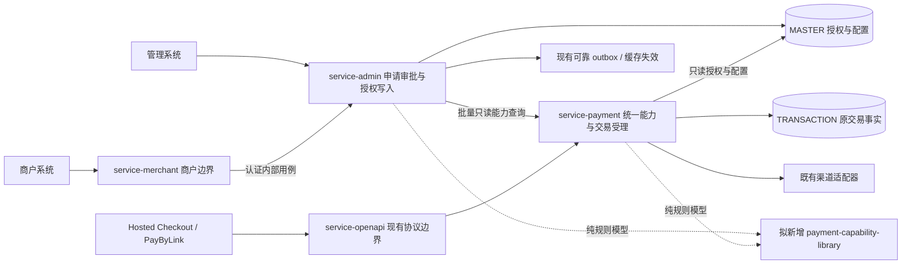
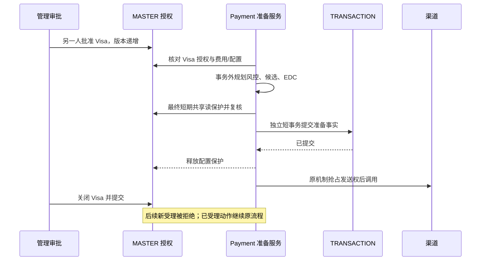

# 商户支付方式准入与收银台联动方案

版本：技术设计候选 V1.5。日期：2026-11-20。管理端商户详情能力修复已在本机 dev 验收（§20.7）。[第一批开发提审材料](#209-第一批开发提审材料待确认)待确认。

本方案以用户整理的《商户支付方式开通与收银台联动完整需求 V1.4》、本会话后续明确确认，以及当前两个仓库的代码为依据。后续确认优先于 V1.4 中尚未定稿的表述，尤其是高权限开通仍须另一人复核、收银台展示真实方式而前端钱包组件可以尚未适配、缺费率或候选冲突不展示。

本轮用户明确授权在现有稿中补齐评审结果并逐项确认业务规则，仅修订文档，不开发、不执行 SQL、不启动服务。尚未指定正式私有台账，本地修订不生成正式 REQ 或阶段批准。风险 R0；拟实施内容涉及授权、交易受理、费用快照、内部接口、数据库和收银台，整体按 **R3** 管理。P0 为权限、资金事实、幂等、状态和隐私不变量；P1 为本期完整业务交付；P2 为后续优化。本文所有新类、表、接口、状态和权限都是拟议契约，不代表当前代码已经提供。

## 一、结论与范围

采用“**单一授权事实、统一能力计算、入口按场景投影、交易核心最终受理**”的增量方案。

1. 管理端持有支付方式申请、逐项审批、正式授权和变更历史；商户端通过受控用例使用这些事实。
2. 支付核心统一计算有效方式、费率覆盖、固定/多候选及 EDC 结果，双端和收银台复用同一计算口径。
3. 不把费率、MID 绑定或前端 SDK 状态当成授权；不把授权当成全部执行条件已经齐备。
4. 保留现有交易状态机、先准备后调用渠道的机制、费用不可变版本、订单幂等、3DS 和原交易后续动作。
5. 前端先完成真实方式的列表与容器；组件尚未接好时显示真实状态，不虚构未开通方式，也不发起未具备的付款动作。
6. 历史商户按受控基线逐个切换，不以费率覆盖自动开通全部方式，不批量误停既有业务。
7. 数据模型优先复用现有表、关联键、审核记录和可靠失效设施。主方案仅新增申请明细与当前授权两张业务表；其余采用有明确归属的增量扩展。新增数量为源码核对后的设计建议，正式迁移前仍须核验目标库实际结构。

本期不新增独立微服务，不接入新的钱包渠道，不重做费率引擎、路由策略、清分结算、完整 VAMP/拒付看板，也不继续已暂停的支持工单。

## 二、代码基线与可验证事实

初次设计只读检查的分支均为 `feat_scott_channel`：后端提交 `258438f7`，前端提交 `a54dc11`。本轮复用评审进一步核对了工作区表结构与商户审核/待办代码；工作区同时存在其他进行中的修改，提交号不代表所有工作区文件内容，也不是远程分支或运行进程版本的证明。设计检查没有连接数据库、启动服务或运行真实付款。

2026-11-20 评审复核时后端 HEAD 已为 `29a760f9`；本次根据该轮源码证据补充可靠消息、创建指纹、尝试事实及原表复用设计。工作区既有其他改动仍保留，未来实施须重新固定输入与候选版本，不能把本地文档修订当作新的业务实现提交。

| 当前代码位置 | 已确认行为 | 本方案如何接入 |
|---|---|---|
| `service-admin/.../MerchantPaymentCapabilityReadinessService.java` | 从绑定、MID、渠道能力展开交易动作、品牌、币种，检查候选与费用覆盖；暂无独立的逐项授权事实参与 | 作为兼容入口，改为消费统一能力结果，不继续复制另一份判断 |
| `service-merchant/.../JdbcMerchantAccessOverviewQueryService.java` | SQL 从 MID/渠道直接生成支付能力；应用层六阶段判断据此得出支付方式阶段是否 READY | 原商户资料/结算/费用/风控/技术检查保留，只替换支付能力来源及分组统计 |
| `service-merchant/.../MerchantFinanceServiceImpl.java` | 查询当前商户生效费用版本和规则 | 继续是费用详情来源，新增方式与规则的关联投影 |
| `service-payment/.../DefaultMerchantFeeVersionSnapshotService.java` | ACTIVE 指针主库读取，版本明细按同一版本读取和冻结 | 准入覆盖检查与持久化使用同一份冻结版本，避免检查与落库选中两版费用 |
| `service-payment/.../DefaultMerchantTransactionSnapshotService.java` | 当前在记录商户快照时调用费用冻结，写入 `transaction_merchant_snapshot` | 首次交易可接收准备阶段已冻结的可信快照；后续动作保持自身现有冻结策略 |
| `service-payment/.../DefaultPaymentTransactionPreparationService.java` | 事务外规划风控/路由/换汇，再短事务落库，返回后才允许调用渠道；先处理已有动作幂等记录 | 新准入判断接入规划与最终准备边界；不在 Controller 拼接资金规则 |
| `service-payment/.../DefaultPaymentChannelRouteService.java` | 原币候选优先，再按既有能力优先级选唯一目标；必要时使用渠道默认交易币种 | 提取并复用相同的候选规划规则，不新增动态路由算法 |
| `payment-link-library/.../PaymentLinkCapabilityResolver.java` | 当前指定币种时直接检查支持币种，且保留请求方式/品牌交集 | 对齐 EDC；保留链接级限制；由统一结果生成展示投影 |
| `service-payment/.../PaymentCheckoutCardCapabilityService.java` | 银行卡品牌识别与展示能力入口；展示部分已委托上述 resolver | 保留 BIN/IIN 识别职责；展示能力委托新聚合服务 |
| `service-payment/.../DefaultPaymentCheckoutService.java` | 当前真实提交明确只允许 BANK_CARD；已有会话允许方式与品牌校验 | 保留银行卡真实提交；新增真实方式展示结果；钱包执行不通过放宽银行卡校验冒充实现 |
| `PaymentCheckoutPaymentSubmitCommandDTO` | 当前卡数据密文信封必填 | 本期不删除必填约束；未来钱包提交使用单独的已批准协议扩展 |
| `apps/hosted-checkout/src/App.vue` | 当前付款选项过滤 BANK_CARD | 改为按服务端真实展示结果组织 Card 和非卡选项，组件状态单独处理 |
| `DefaultMerchantRouteProfileCacheService`、`ManagedCacheInvalidationCoordinator` | 路由缓存已有 pending 门禁、主库回源、提交后失效和 outbox 机制 | 继续复用；授权的最终受理仍以主库事实为准 |
| `InternalAuthAccount`、内部 HMAC 拦截器 | 有 appCode、accountId、userId、merchantId 和服务间防重放基础 | 操作者从可信上下文取得，复核比较用户主体，不仅比较账号名 |
| `merchant_review_record` 及两套现有 DO/Mapper | 已按 review_scope 支持开户与资料变更，当前尚无支付方式目标定位、成功回执唯一键和完整用户主体字段 | 在原商户审核域内增量扩展，复用不可变轨迹；同时校正旧查询范围及映射 |
| `admin_operational_work_item` 及其 history | 只持有负责人、SLA、状态与处理轨迹，真实业务状态读取来源；来源有数据库 CHECK 与服务白名单 | 支付方式审批接入现有来源机制，不将待办改成授权事实表 |

详细代码目录在二十一节。用户的原始需求 V1.4 存放于 `docs/ListofRequirements/商户支付方式准入及收银台联动需求/`；本轮修订在技术方案与配套需求稿中记录。

## 三、确认规则与设计默认值

### 已确认且不可在研发中改变

- 本期只按具体支付方式申请，币种/地区/交易动作继续受后台能力约束。
- 商户申请目录显示平台已启用的全部方式，包含卡品牌和非卡方式。
- 首次开通、终止后重新申请均逐项双人审批；平台代申请与高权限开通不能自审。暂停、恢复、终止及有效期调整由授权人员单人处理并审计。
- 费率沿用现有审批；有效费率是交易条件；MID 绑定不扩大授权。
- 钱包独立授权，不附加检查底层直接卡支付授权；底层品牌受渠道/MID 限制，直接卡入口与钱包入口不会相互授予资格。
- 支付方式开通不新增逐交易动作审批；原商户业务权限、动作能力、渠道/MID 及后续状态机继续生效。
- 本期完整包含暂停、恢复、终止和到期；终止须重新申请，到期阻止新受理。
- 单候选固定，多个候选复用现有有效选择规则，不能随机选择。
- 缺费用、无有效 MID、候选冲突的方式不进入付款选项。
- 真实方式的前端钱包按钮尚未适配，不意味着商户未开通；可以保留其名称、Logo 与交互容器，但不能执行不存在的付款动作。
- 当前系统表能承接的优先复用；新增必须说明现有结构不能承接的原因，并保持商户、支付方式、费用、MID、审批与交易事实的稳定关联。

### 页面建议与已确认边界

| 决策 | 推荐实现 | 性质 |
|---|---|---|
| 管理端入口 | 商户管理下支付方式工作台与审批页签，复用商户详情、费用和 MID 原页面 | 页面设计提案 |
| 商户入口 | 商户信息管理下支付方式管理，关联当前费率与接入概览 | 页面设计提案 |
| 生命周期 | 暂停、恢复、终止、有效期调整由授权人员单人处理；首次开通和终止后重新申请双人复核 | 已由本轮第 3、4 项确认，替代旧建议 |
| 折叠 | Card 算一个入口，默认 N=4；选中项始终可见，不能折叠后切回 Card | 沿用 V1.4 建议值 |
| 新链接仅含未接通组件 | 允许创建；真实授权/费用/MID 仍须满足，创建结果和收银台明确当前无法付款 | 已由第 6 项确认；不新增假草稿或成功状态 |
| EDC 本期范围 | 保持既有交互；报价确认与商户级 EDC 开通控制登记为后续需求 | 已由第 5 项确认，本轮不实施新报价协议或开关 |

这些默认值不妨碍输出完整方案；在进入涉及该行为的代码前形成明确决定。

## 四、业务身份与事实分层

### 4.1 不重建业务字典

为申请、授权、查询使用稳定的技术标识 `itemKey`：

| itemKey 示例 | 字典来源 | 原交易协议 | 费用匹配维度 |
|---|---|---|---|
| `CARD_BRAND:VISA` | `card_brand=VISA`，同时 BANK_CARD 启用 | `paymentMethod=BANK_CARD`、服务端识别品牌 VISA | `paymentType=BANK_CARD`、`paymentMethod=VISA` |
| `CARD_BRAND:MASTERCARD` | `card_brand=MASTERCARD` | BANK_CARD 与对应品牌 | BANK_CARD、MASTERCARD |
| `METHOD:APPLE_PAY` | `acquiring_payment_method=APPLE_PAY` 存在且启用时 | 沿用已有方式编码 | `paymentType=APPLE_PAY`、`paymentMethod=ALL`，沿现有非卡费率配置 |

这里的前缀用于区分来源。现有费率编辑器和商户开户就绪检查一致使用“非卡方式编码为费用类型，`ALL` 为费用匹配维度”。底层卡品牌未知时继续保留真实的空值；当前清分要求品牌非空，须在真钱包交易接入前完成连续链路兼容。设计以钱包方式命中该方式的通配费率，保留直接银行卡的品牌校验，复验费用快照、清分、查询与统计。

名称、Logo、展示顺序和语言来自已有字典及共享资产。授权保存稳定编码，不保存一份可独立编辑的品牌名称或图片。字典值不得在存在引用时随意改名；标签修改不影响授权身份。

ALL/NONE/UNKNOWN 等匹配或未知标记不是商户申请项；BANK_CARD 协议容器也不作为绕过逐品牌批准的全品牌授权项。

平台启用以既有字典的业务启用口径为源，不新增第二套互相冲突的公开开关。多语言行的启用必须一致，后台发布检查按类型/值定位规范项，不能让用户切换语言改变授权范围。目录启用属于平台提供能力的业务承诺，不能从“有一张图标”推断已经实现支付。

### 4.2 五层事实

1. **目录事实**：平台当前是否启用该项。
2. **申请事实**：谁申请、谁复核、各轮意见。
3. **授权事实**：该商户当前是否获准，版本及来源。
4. **业务能力**：当前费用、MID、渠道、币种/EDC、动作与条件是否匹配。
5. **入口执行能力**：对应后端协议是否实际实现，当前前端组件是否就绪。

后三者分别输出，不能用一个 `enabled` 合并。关闭授权不会删除申请历史；前端组件失败不会修改商户授权。

## 五、职责与依赖



### 模块分工

| 模块 | 本期职责 | 不拥有的职责 |
|---|---|---|
| service-admin | 目录读取、申请、逐项复核、授权变更、审计、管理查询与通知意图 | 不改交易终态，不执行扣款 |
| service-merchant | 从登录身份确定商户；商户申请/补充/查询和公开投影 | 不直写第二份授权，不信任前端 merchantId |
| service-payment | 当前授权只读检查、统一业务能力、入口执行支持声明、交易最终受理与快照 | 不决定管理人员可审批哪些商户 |
| payment-capability-library（拟新增） | 规范身份、纯候选筛选/选择、能力结果与原因模型 | 不读数据库，不持有 Spring Bean，不执行状态写入或渠道调用 |
| finance-library | 维度匹配的纯函数和已有计算模型；按需做等价抽取 | 不处理商户申请、MID、审批或路由 |
| payment-link-library | 链接规则与已有持久化；消费统一能力投影 | 不再独立发明另一套币种/品牌展示算法 |
| service-openapi | 保持安全协议、DTO 校验、加密、防重放与受众错误投影 | 不因前端需要预留而开放未实现的资金接口 |
| service-checkout | 保持当前轻配置/国家等能力，按真实现状接入所需元数据 | 不把 service-payment 已拥有的会话状态机复制过来 |
| service-data / service-job | 按已有方式处理必要异步导出、通知/补偿 | 不越权直改授权或交易 |

运行时 Payment 不同步调用 Admin 检查每笔授权，使用其主库只读边界，避免 Admin → Payment → Admin 环形依赖及运营服务故障拖住全部交易。Admin 写端是授权事实唯一写入者；Payment 的只读 Mapper 不包含授权更新方法。

纯业务库独立于 `component-library`，避免把支付方式政策塞进公共技术组件。新模块属于本方案待评审架构决定，实际新增前检查 Maven 依赖无环。

## 六、数据模型与复用边界

本节按用户补充要求重新收敛：**先复用已有权威事实和持久化设施，只为缺失的申请明细与正式授权新增两张表。** 本轮依据仓库中的 `docs/sql/payment_acquiring_表结构.sql`（文件标记导出时间 2026-11-19 11:51）及对应 DO/Mapper/业务调用核对，尚未连接目标数据库确认已部署结构；本节不构成执行 SQL 的授权。

### 6.1 现有表复用清单

| 业务事实/能力 | 已有表 | 本期处理与边界 |
|---|---|---|
| 规范目录、启停、名称、Logo、多语言 | `sys_dict_type`、`sys_dict_data` | 沿用现有类型/值和共享资产；不另建支付方式主数据表 |
| 商户主体、准入修订与历史切换 | `base_merchant_info` | 主体事实仍在原表；增量增加支付准入模式、授权修订号、基线批次引用和切换时点，不独立建商户支付政策表 |
| 逐项审批与授权变更轨迹 | `merchant_review_record` | 已有 review_scope、request_no、动作、前后状态、操作者和意见；扩展业务范围与必要关联/幂等字段，作为商户准入治理的不可变记录 |
| 待审分派、负责人、SLA 和处理轨迹 | `admin_operational_work_item`、`admin_operational_work_item_history` | 新增受控来源类型与来源适配；来源指向申请明细，申请/授权状态仍从业务事实读取；完成待办不等于批准授权 |
| 技术操作日志与追踪 | `sys_oper_log` | 继续原审计链路；不以异步日志充当准入写命令的唯一持久幂等保障 |
| 费用模板、版本、规则与阶梯 | `fee_plan`、`fee_plan_version`、`fee_rule`、`fee_rule_tier` | 原生效指针、审批和规则继续使用；方式页按规范映射关联查询，不复制一份商户方式费率 |
| 商户执行目标与能力 | `merchant_channel_mid_binding`、`channel_mid_config`、`channel_info`、`channel_payment_capability` 及品牌/币种能力表 | 原约束继续生效；不新增“授权后复制出的绑定”或“商户就绪方式”表 |
| 配置可靠失效 | `merchant_security_cache_invalidation_outbox` | 复用原受管缓存注册、pending 门禁、事务后失效和补偿；不为本功能新造 outbox |
| 业务变更可靠消息与邮件 | `sys_mq_outbox`、`msg_email_send_record`、`msg_email_template` | 准入变更事件与业务同事务，邮件使用原异步设施；消费者幂等及事件关联按本方案补齐，不增加专用通知表 |
| 付款尝试、事件、API 交互 | `payment_checkout_attempt`、`payment_checkout_event`、`transaction_merchant_api_interaction_log` | 复用已有事实，补最小准入上下文及跨入口去重口径；不能仅按日志条数计交易 |
| 链接范围及交易受理证据 | `payment_link`、`transaction_merchant_snapshot`、`transaction_payment_method_info` | 在原事实表做必要兼容扩展；不新增平行支付订单或交易分析明细表 |

审批事实、当前授权、配置就绪和执行事实在业务语义上分别定义，不意味着每个概念各建一张表。所有引用沿用 merchant_id、规范 itemKey、费用版本、真实绑定/MID、申请明细 ID 和系统订单号；显示名称不是关联键。

### 6.2 仅新增两张业务表

两表均位于 MASTER，字段名为设计候选。商户号等类型按既有权威表对齐；时间沿用 `DATETIME(3)`。审核意见和历史轨迹不复制成第二套专用历史表。

| 表 | 核心字段 | 关键约束和索引 |
|---|---|---|
| `merchant_payment_application_item` | itemId、applicationNo、merchantId、itemKey、operation、status、round、source、createRequestId、initialSubmittedActor、currentSubmittedActor、reason、expectedGrantVersion、activeSlot、version、提交/审核时间 | merchantId+itemKey+activeSlot 唯一；活动项为 1、终态为 NULL；merchantId+createRequestId+itemKey 唯一；申请编号/明细 ID、商户/状态/时间、审批队列索引 |
| `merchant_payment_authorization` | id、merchantId、itemKey、authorizationStatus、version、source、sourceRef、approvedActor、effectiveTime、expireTime、suspendedTime、terminatedTime、lastReviewRecordId | merchantId+itemKey 永久唯一；无记录表示从未授权；暂停/终止保留行；版本 CAS；时间与状态按七节矩阵；lastReviewRecordId 指向原审核记录 |

必要性：现有 `merchant_profile_change_request` 是单商户单活动资料变更，保存完整资料加密快照，不能直接表达同一批多支付方式的独立结果。现有 MID 绑定是一对执行目标的配置关系，同一方式可能对应多个 MID，解绑后授权仍须保留；它不能承接一商户一方式的独立授权。费用规则、菜单权限和派生待办也不具有上述基数、生命周期及交易语义。因此保留两张窄业务表，而不扩大资料变更、费率或待办表的含义。

一次批量申请用同一个 applicationNo 关联多行，来源、初始申请主体和初始集合在创建时固定；详情与列表按该编号聚合。整单待审/部分完成/全部完成从明细计算，不另存易失真的主单状态。分页先按商户与申请编号取分组页，再批量取该页明细，不以全量内存分组代替数据库分页。

`RETURNED` 仍占活动槽，补充后递增 round，前轮内容从不可变审核记录还原；APPROVED/REJECTED/WITHDRAWN 不被新申请覆盖。恢复暂停项使用受控 RESTORE 命令及预期授权版本，追加原审核记录；终止项只能重新申请并经双人批准，不通过恢复命令绕过历史。每一轮实际提交主体均保留；仍构成本轮申请内容的提交/修改主体不能充当其复核人，平台转交不能清空原提交记录以规避双人规则。

### 6.3 原审核记录承接历史与成功回执

现有 `merchant_review_record` 已同时承担 ONBOARDING 和 PROFILE_CHANGE。拟增加 PAYMENT_METHOD、PAYMENT_ADMISSION_POLICY 等受控业务范围；request_no 承接对应申请或变更编号。按实际查询需要扩展以下可空字段，原范围保持原写入契约：

- 目标关联：targetType、targetKey、applicationItemId、round，定位整批提交、申请明细、授权或商户准入模式变更。
- 可信主体：operatorAppCode、operatorUserId；保留现有 operatorId/accountId 与名称，用于证明同人不同账号不能自审。
- 命令成功回执：commandRequestId、payloadHash、resultJson；不增加异步任务的 INIT/RUNNING 状态机。
- 有界事实：factSnapshotJson，保存本轮申请内容、必要授权前后版本/状态与来源引用；不复制全量费率、路由、敏感资料或通道报文。

约束候选为 `(review_scope, merchant_id, command_request_id)` 唯一；原记录新字段为 NULL，旧范围不受该唯一约束干扰。成功命令的事实更新和不可变回执必须处于同一 MASTER 事务。重复请求先按唯一键查回执，再校验动作、目标、规范载荷摘要及操作者；相同键异载荷或异主体返回冲突，同键成功重试返回原结果，不受后续状态改变影响。

整批创建在锁商户行后校验完整集合，同事务写明细及一条包含原始集合摘要、申请编号/明细引用的批量提交记录。重试不能把同一键改为另一个子集再追加。后续逐项审批各用稳定子请求键，审核记录与明细/授权更新同事务；批量接口组装逐项真实结果，沿用原键恢复已成功项。未提交成功的事务不留下虚假成功回执，数据库不确定结果按原键查询恢复。上述回执只承接商户准入治理的成功业务动作，不把审核记录扩成全系统任意命令/异步任务平台，也不套用技术操作日志的清理策略删除仍需保留的审核与幂等证据。

所有新范围查询必须显式限定 review_scope 与归属。当前 `MerchantOnboardingService.loadReviewRecords` 只按 merchantId 查询；实施时必须收窄为开户范围，并回归资料变更历史，避免新记录混入开户列表。两套现有审核记录 DO/Mapper 的映射需一致扩展或通过兼容委托收敛，避免同表字段在不同调用端丢失。

统一待办表本身有来源类型 CHECK 和服务白名单，接入需同步扩展数据库约束、来源查询、同步、权限、导出与前端定位。仅写入一个新 source_type 字符串不能算已复用完成。待办可按申请明细及轮次生成来源键，旧轮次结束后关闭，补充轮次按真实来源重新进入队列。

### 6.4 商户主表承接修订与迁移

在 `base_merchant_info` 增量增加 payment_admission_mode、payment_authorization_revision、payment_baseline_batch_ref、payment_admission_cutover_time 等候选列。原开户/审核/激活状态和 merchant_status 的含义保持原样，不挪用其取值。授权变更及准入模式切换递增专用修订号，必要时 CAS；不借用主体名称更新时间作为授权版本。

商户行作为已存在的稳定锁定点，替代独立 policy 表。授权写命令先锁该商户行，再按稳定 itemKey 顺序处理明细/授权；交易最终保护对该行使用共享读锁。多笔交易读者可并行，但主体修改也会与该锁竞争，需纳入锁等待、死锁顺序、连接与容量验证，不能声称复用主表没有代价。原资料编辑不得用旧对象全行覆盖这些新字段，必须审查实际 UPDATE 列集。

新商户创建显式写 ENFORCED；旧行新增模式列可以暂为 NULL，但仅经登记的历史商户才能转 LEGACY_OBSERVE，未知模式不默认放行。历史基线授权来源为 HISTORICAL_BASELINE，引用真实核验批次；审核记录写实际登记与复核事实，不补造过去的商户申请和审批人。

上述复用取代原候选方案的申请主表、专用授权历史表、专用命令表、独立政策表。后续迭代优先扩展既有业务范围、明确关联键和查询契约；新增表须附“现有表无法承接的基数/生命周期/一致性原因、数据归属、关联与迁移方案”，不按页面或接口数量决定表数量。

### 6.5 原交易表的最小扩展

`transaction_merchant_snapshot` 新增可空的 `payment_admission_snapshot_json`（候选名），按原动作保存：itemKey、授权 ID/版本、核验时间、迁移模式、能力规则版本、所选 MID/能力引用、费用版本引用、执行支持版本。原费用 JSON/hash/金额保持既有结构，不向老费用快照塞入新字段破坏摘要。

新增快照均带 schemaVersion，按白名单只存必要引用、版本和结果摘要，设计上限制为有界小对象（建议初始上限 8 KiB，实施前按真实字段核算）；大路由集合、完整费用规则和原始风控/通道响应不复制进去。

`transaction_payment_method_info` 继续保存原 paymentMethod/paymentBrand/walletType。增加稳定分析键或在受理快照提供该键，不把钱包附带品牌覆盖成主支付方式。缺失附加品牌留未知，不伪造 BIN。

改表须覆盖真实逻辑表、所有已发布物理表及未来分表模板/建表机制；先核验当前拓扑，不在方案中猜季度表名。旧行允许 NULL，前端显示历史口径，不批量回填假的授权版本。

### 6.6 链接方式范围的兼容扩展

当前 `payment_link` 保存 `allowed_brands_json`，天然是银行卡品牌范围。要在链接中允许真实非卡方式，需要增量的带版本 `allowed_methods_json`：

- 旧链接新列 NULL：继续按原品牌范围生成 BANK_CARD 范围，不解释成“允许全部”。
- 新链接：保存创建时明确确定的规范方式范围；创建界面从真实授权与能力中选择。
- 若同时传旧 cardBrands 与新范围，含义冲突则拒绝，不能悄悄取并集。
- 会话同样保留创建时允许范围；以后新授权不能自动扩大原链接/会话。
- 允许仅包含组件尚未接通方式的新链接，前提是真实方式授权及基础配置成立；创建响应、预览和最终页面明确当前无法付款。
- 创建判断依据入口实现/适配登记，不在尚无付款人的创建时猜测具体设备支持、SDK 临时加载结果。
- 链接仍按原 ACTIVE/失效等生命周期管理，不把不可付款写成支付失败或虚构新资金状态；有效期照常流逝，不自动延长。组件以后接通时在原允许集合内重算，无须伪造新授权。

### 6.7 创建指纹与准入失败事实

支付链接新增方式范围时，同步升级 `PaymentLinkCreationFingerprint` 的契约版本和规范字段，将明确允许的方式集合及关联品牌范围纳入摘要；排序、去重、大小写及缺省值使用同一规范化函数。同一 requestId 改变非卡范围必须冲突；旧摘要兼容只接受可证明等价的旧银行卡请求，不能将带新非卡范围的请求退回旧摘要匹配。

创建指纹固定请求语义与实际保存的范围，不把每次变化的费率、授权修订号或组件加载状态掺入稳定业务输入。创建重放先核对可信原结果；未来新授权不能扩张已创建链接。会话创建中如有新增请求范围，同样复核其既有指纹契约，不能只改单据 JSON。

| 入口 | 复用事实 | 准入上下文与计数约束 |
|---|---|---|
| Checkout/PayByLink | payment_checkout_attempt、payment_checkout_event | sessionId+attemptRequestId 表达有效提交；checkoutAttemptId 关联实际尝试；eventPayloadJson 按版本白名单记录规范方式、失败阶段、原因与授权修订引用 |
| OpenAPI | transaction_merchant_api_interaction_log 与原操作幂等身份 | 经认证且进入付款受理的请求，按 merchantId+动作+原业务幂等键去重；按需在原表增加可空 admission_context_json，不以每条网络日志作为独立尝试 |
| 已生成真实系统订单 | 原订单、transaction_merchant_snapshot | 仅在确有订单事实时关联系统订单号/业务时间，保存当次准入与费用版本；预分配编号不作为真实订单证据 |

最小上下文为 entry、itemKey、transactionType、attemptKey/幂等引用、admissionStage、outcome、reasonCode、authorizationRevision、occurredAt、可空真实订单关联，含 schemaVersion。禁止写入 PAN/CVV、钱包令牌或原始敏感报文。阶段与原因是拟议契约，实施前登记，不随意赋数字错误码。

业务有效尝试与认证失败、安全拦截、纯页面选择、组件未就绪分别统计。两个独立有效提交即使同一 URL 且建单前失败，仍保留两份尝试；同键重放只增加请求/事件记录，不新增独立业务尝试。需要采集的事实使用现有持久化/可靠消息机制，不能依赖采样或可丢失文本日志。OpenAPI 准入拒绝须补齐现有记录链路的早期失败分支，不能仅修改已有订单的快照。

后续统计使用独立尝试键去重，保留请求次数、尝试次数、真实订单数、渠道发送数等不同口径。仓库基线的 API 交互逻辑表和三张分表均要求 `transaction_id` 非空，现有写入依赖核心结果。继续复用该表时，写入契约必须允许已认证的建单前准入拒绝使用可空订单关联，并以受信任的请求进入时刻落定分片键。旧读链只以真实订单号关联，按商户、动作、业务幂等键保留早期准入事实。需验证目标分片模板、Mapper、无订单日志查询与旧版读写兼容。

### 6.8 T-01 第一批字段、索引与迁移契约

以下为 V1.5 第一批提审口径。以 2026-11-19 11:51 的仓库结构快照及当前读写代码为依据，开发候选需再与目标库实物对照。两张新增业务表落在 MASTER，使用 InnoDB。商户号的类型、字符集、排序规则与 `base_merchant_info.merchant_id` 一致。支付方式键及请求键使用校验后的 ASCII 和二进制排序规则，方式键取本设计中的规范 `itemKey`。缺省均为必填，表中明确标注可空项。时间统一为 `DATETIME(3)`，按系统既有时间口径存储和比较。对外发送长整型 ID 与版本时使用字符串，保留精度。

#### 申请明细与当前授权

| 表 | 字段与类型 | 约束/写入规则 |
|---|---|---|
| `merchant_payment_application_item` | `id BIGINT` 自增主键，`application_no VARCHAR(40)`，`merchant_id VARCHAR(32)`，`item_key VARCHAR(64)`，`operation VARCHAR(16)`，`status VARCHAR(32)`，`round_no INT DEFAULT 1`，`source VARCHAR(24)`，`create_request_id VARCHAR(64)` | 一次提交共用一个全局申请编号，沿用现有全局编号机制。来源为商户自助或平台代办。操作区分首次／被拒后再申请（APPLY，无原授权）和终止后重新申请（REAPPLY，有原授权版本）。状态按第七节。 |
| 同上 | `initial_submitter_app_code VARCHAR(32)`、`initial_submitter_account_id BIGINT`、`initial_submitter_user_id BIGINT`，以及同类型的 `current_submitter_*`。另有 `reason VARCHAR(1000) NULL`、`expected_grant_version BIGINT DEFAULT 0`、`active_slot TINYINT NULL`、`version BIGINT DEFAULT 1`、`submitted_at`、`closed_at NULL`、`gmt_create`、`gmt_modified` | 可信会话提供身份。代办原因及退回/拒绝意见必填。初始身份不可变，补充后更新本轮提交身份、轮次及版本，前轮和实质修改主体保存在原审核轨迹。待审、退回占槽 1，终态槽为 NULL。授权版本 0 表示提交时无授权。终态写入关闭时间。 |
| `merchant_payment_authorization` | `id BIGINT` 自增主键，`merchant_id VARCHAR(32)`，`item_key VARCHAR(64)`，`authorization_status VARCHAR(16)`，`version BIGINT DEFAULT 1`，`source VARCHAR(24)`，`source_ref VARCHAR(64)`，`approved_app_code VARCHAR(32)`、`approved_account_id BIGINT`、`approved_user_id BIGINT` | 一商户一方式一条当前授权。首批审批来源为 APPLICATION，来源引用保存原申请明细 ID 的十进制字符串。第一批可通过终止授权夹具验证重新申请，真实终止操作随生命周期批次接入。重新批准沿用授权 ID，更新版本与当前来源，完整历史留在审核表。 |
| 同上 | `effective_time`、`expire_time NULL`、`suspended_time NULL`、`terminated_time NULL`、`last_review_record_id BIGINT`、`gmt_create`、`gmt_modified` | 首批批准立即生效，创建时到期时间为空。表结构预留后续生命周期字段。有效期检查采用半开区间，到期状态由时间推导。审批事务内先写含前后事实的审核记录，取得其 ID 后写授权、申请状态和商户修订号。跨表引用由同一事务按商户和方式校验，避免循环外键。 |

| 索引名称 | 字段顺序 | 目的 |
|---|---|---|
| `uk_mpai_active` | `merchant_id, item_key, active_slot` | 只允许一个待审/待补充项。MySQL 的 NULL 保留同方式多条历史终态。数据库约束同时验证状态与槽位一致，非法空槽不能绕过唯一性。 |
| `uk_mpai_create_request` | `merchant_id, create_request_id, item_key` | 防止重放批量申请时重复生成同一明细。整批同键不同集合由审核回执的指纹拦截。 |
| `idx_mpai_application` / `idx_mpai_merchant_created` | 分别为 `merchant_id, application_no, id` 和 `merchant_id, gmt_create, id` | 按商户与批次查明细，支持商户申请时间查询。按范围在库内进行批次分页，再取本页明细。 |
| `idx_mpai_review_queue` | `status, submitted_at, id` | 管理端待审队列及稳定游标。数据权限在查询阶段收敛，受限商户账号的执行计划随查询验收。 |
| `uk_mpa_merchant_method` | `merchant_id, item_key` | 当前授权永久唯一，保留终止行和版本。自然扫描批次再根据实际执行计划增补 `effective_time, id`、`expire_time, id` 索引。 |

#### 复用表的增量与权限

| 复用对象 | 第一批增量 | 兼容及校验 |
|---|---|---|
| `base_merchant_info` | 增加 `payment_authorization_revision BIGINT NOT NULL DEFAULT 0`。复用已有 `uk_base_merchant_info_mid(merchant_id)`。 | 审批授权成功递增，重复回放和退回/拒绝保持原修订号。主体编辑验证按列更新。准入模式、基线引用和切换时间随灰度批次加入。 |
| `merchant_review_record` | 新增范围 `PAYMENT_METHOD`。复用 `request_no VARCHAR(40)`、动作、意见、前后状态及 `operator_id VARCHAR(64)`。增量可空字段为 `target_type VARCHAR(24)`、`target_key VARCHAR(64)`、`application_item_id BIGINT`、`round_no INT`、`operator_app_code VARCHAR(32)`、`operator_user_id BIGINT`、`command_request_id VARCHAR(64)`、`payload_hash BINARY(32)`、`result_json JSON`、`fact_snapshot_json JSON`。 | 首批写入实际登录账号 ID 到现有 `operator_id`，同时记录 `sys_account.user_id → sys_user.id` 和应用标识。审批检查本轮申请事实中的所有有效提交/实质修改主体，同一 `userId` 跨账号或转交后仍拒绝自审。缺可信身份时拒绝。旧行新字段允许 NULL，旧流程继续使用原列和语义。 |
| 同上 | 新增 `uk_mrr_scope_merchant_cmd (review_scope, merchant_id, command_request_id)` 和 `idx_mrr_method_item (review_scope, merchant_id, application_item_id, gmt_create, id)`。原 `review_scope + request_no` 索引继续承接批次聚合。 | 批次提交使用一个成功回执，审核命令每个明细各有回执。指纹为版本化规范输入的 SHA-256，包含可信操作者、动作、业务目标、期望版本和规范申请内容。权限检查通过后，同键同指纹返回原成功结果，异指纹冲突。结果和事实 JSON 使用版本化白名单，单列上限 8 KiB。批次回执保存申请编号和计数，每个明细的首轮提交事实同事务写入审核表，关联明细并沿用批次号，此类轨迹的命令键留空。批量审批重放复用逐项命令键。 |
| 目录、费率和渠道 | 沿用 `sys_dict_type/sys_dict_data` 及支付方式资产目录。费率、渠道、MID 和商户绑定沿用各自既有结构。 | 目录按规范方式归并，语言版本用于显示。核对当前目录统一启停口径以及同一键不同语言配置冲突时的拒绝和告警。费率、MID 和渠道可用于只读说明，审批记录只表达授权。 |
| 运营待办、消息、邮件、Job 和交易表 | 第一批无迁移。T-03 采用 11.8 的源类型、检查点和通知幂等增量。订单快照、链接范围、分表及正式历史授权随各自后续批次。 | 第一批待审列表直接从申请明细查询。统一待分派、通知和入口交易门禁各自保留完整验收条件。 |

首批审核目标分为 APPLICATION_BATCH 和 APPLICATION_ITEM。首条记录的 `from_status` 写固定值 `NOT_CREATED`，申请项的后续记录使用真实前后状态，继续满足原表非空约束。批次回执的结果仅描述该提交命令。批准回执固定申请明细、商户与方式、批准后的授权版本，审核 ID 由回执行主键提供。首次分配的授权主键不作为重放读取条件，避免把后来变更的授权行当作原批准结果。

#### 迁移清单与顺序

1. **冻结结构基线。** 对照候选版本与目标库目录信息，核实 MASTER 落点、InnoDB、商户号排序规则、旧审核的空值与默认值、实际索引/CHECK 名称及同名残留。核对 Admin、Merchant 的两套审核映射和所有读取、导出入口。抽验旧范围的读写及当前写入主体来源，核查主体更新列集。当前记录的仓库快照核对仅供设计评审。
2. **先扩展兼容结构。** 第一批包含两张业务表和上述两个原表的增量。存量商户修订初始化为 0，审核增量列允许 NULL。历史授权不从费率、MID 或交易历史自动补写。MySQL DDL 按逐项检查点执行，发现半应用先复核实际结构，再续跑，避免盲目重放或整批事务假设。
3. **先部署兼容读取，再启用新写入。** 已有开户查询只按商户号读取审核表。旧页面逐入口明确原支持的审核范围，纯开户限定 `ONBOARDING`，原来承诺汇总资料变更的轨迹显式保留对应既有范围。支付方式轨迹专读 `PAYMENT_METHOD`。新写入前用开户、资料变更、支付方式三类样本验证双端、导出和排序隔离。审批入口开启在所有相关读取实例就绪之后。
4. **后检与恢复。** 核对索引命中、约束、版本更新、同键重放和应用/授权/审核引用。验证原审核记录数量和代表性查询结果，保留业务监控与迁移记录。启用前可退回兼容应用版本。已有新事实后，先关闭新增写入口并保留兼容读取、申请、授权、回执和审计。恢复时复核原回执再重开。删除数据或逆向 DDL 须另立变更。

[仓库结构快照](../sql/payment_acquiring_表结构.sql) · [当前开户审核读取](../../service-admin/src/main/java/com/scott/payment/admin/service/impl/MerchantOnboardingService.java) · [现有资料变更审批](../../service-admin/src/main/java/com/scott/payment/admin/service/impl/AdminMerchantProfileChangeService.java)

## 七、状态与双人复核

### 7.1 状态分开

申请明细：`PENDING_REVIEW → APPROVED / REJECTED / RETURNED / WITHDRAWN`；RETURNED 经补充进入新轮次待审。正式授权候选持久状态为 ACTIVE、SUSPENDED、TERMINATED，无记录表示从未授权。EXPIRED/NOT_YET_EFFECTIVE 为依据生效/到期时间产生的有效状态，不依靠任务先改行才能拒绝新受理；最终枚举及错误码在实施契约中登记。

优先级为终止 → 暂停 → 生效时间/到期判断 → 有效。时间采用半开区间 effectiveTime ≤ now < expireTime（空到期表示长期），终止或暂停均不能被延长有效期隐式解除。配置就绪、入口组件状态与授权状态分别表达。

| 当前情况 | 操作及条件 | 结果与审批边界 |
|---|---|---|
| 从未授权 | 开通申请获批 | ACTIVE；必须另一人逐项复核 |
| ACTIVE | 暂停 | SUSPENDED；授权人员单人，原因/版本必填 |
| SUSPENDED | 恢复 | ACTIVE；授权人员单人；重新判断时间及能力，到期则仍不可新受理 |
| ACTIVE/SUSPENDED | 终止 | TERMINATED；授权人员单人；保留全部历史 |
| TERMINATED | 恢复/直接延期 | 拒绝；必须重新申请，另一人批准后更新同一授权身份和版本 |
| ACTIVE/SUSPENDED，含已到期 | 调整有效期 | 授权人员单人，校验时间与版本；不改变暂停状态，业务能力重新计算 |
| 到期边界 | 时间推进 | 新受理立即不满足有效授权；刷新/通知任务的延迟不影响真实门禁 |

原 V1.1 的 CLOSED 是未实施的两状态候选，V1.2 已替换为上述明确语义，不需要对实际不存在的旧授权表虚构迁移。本期管理端持有已确认的生命周期操作，商户端提供查询及首次/重新申请；不由管理端单人规则自动扩大商户端操作权限。

申请通过与授权写入在同一 MASTER 事务内完成。目录停用、商户范围变更或预期授权版本变化时，审批命令拒绝并要求刷新，不能基于旧页面扩大权限。

### 7.2 操作语义

| 操作 | 行为 |
|---|---|
| 商户申请 | 可信会话生成申请身份，多个方式逐项去重 |
| 平台代申请/高权限发起 | 均形成待复核明细，操作原因必填；不存在单人直接授权特例 |
| 批准 | 验证审核人主体不同、权限/范围/版本后更新授权；无费用/MID 仍可批准，但结果为待配置 |
| 退回/拒绝 | 原因必填；只影响本轮申请，不撤掉其他已经生效的合法授权 |
| 暂停/终止 | 授权人员单人立即处理，原因/预期版本必填；不删除数据；终止不能直接恢复 |
| 恢复/有效期调整 | 授权人员单人处理并记录前后事实；不能直接标可交易，不绕过原业务权限和渠道/MID |
| 终止后重新申请 | 使用新申请明细，仍由另一人复核；保留原授权身份与历史 |

首次开通及终止后重新申请中，同一 `userId` 的不同账号不能完成双人复核；同时保存 accountId/appCode 以说明实际登录入口。userId 缺失时拒绝敏感审批，不能退回比较显示姓名。若现有身份体系对跨账号人员身份有例外，先明确该主体映射再上线，不假定账号名不同就是不同人。

### 7.3 事务与批量

写入顺序固定：先查成功回执 → 锁 base_merchant_info 对应商户行 → 用主库当前读复核回执 → 锁申请明细/授权（稳定 itemKey 顺序）→ 校验版本、主体与范围 → 更新业务事实及 merchant_review_record 不可变成功记录 → 同事务登记既有设施支持的通知和失效意图 → 提交后投递。不能在通用异步日志落库后才声称业务命令已完成幂等保护。

批量提交申请先整体校验所选集合；存在无效/重复活动项时返回逐项原因，用户明确修改后再提交，不能静默少申请。批量审批采用每项独立事务与幂等键，结果返回成功/失败/未处理集合及数量；前端只有全部成功才提示全部完成，部分成功保留失败项并可按原键重试。

## 八、统一能力计算

### 8.1 输出模型

拟议 `PaymentCapabilityDecision` 包含：规范 itemKey、授权状态/版本、费用覆盖与版本、候选摘要、DIRECT/EDC 路径、READY/BLOCKED/CONDITIONAL/UNKNOWN、原因集合、评估时间、入口执行状态。

管理端可查看具体配置引用和修复入口；商户只看安全的限制原因；付款人只收到必要的可展示选项和安全原因。不能把同一个含 MID/内部成本的对象直接返回三种受众。

有订单时按实际金额、币种、动作和已知付款地区计算。无订单的商户列表只能说明已知适用范围，缺少上下文时标条件性，不伪造“任意金额/地区均可用”。

### 8.2 统一算法

1. 验证目录规范项和启用、商户状态及迁移模式。
2. 取商户正式授权与准入模式：ENFORCED 下无授权、暂停、终止、未生效或已到期均阻断；这些显式限制在任何模式均优先。钱包只检查钱包 itemKey，不附加商户底层卡品牌授权。LEGACY_OBSERVE 仅可在十六节冻结的历史兼容清单内沿用原规则；HOLD 或未知模式不允许新受理。
3. 收窄至链接/会话明确允许的方式与品牌。
4. 取得当前有效费用版本，检查该动作与方式的必要主费用覆盖；合法 0 费率与缺规则分开。
5. 从真实有效绑定、MID、渠道与能力取交集，沿用既有国家/币种/动作/品牌等约束。
6. 生成原币或结构上可 EDC 的候选；执行现有原币优先和优先级唯一选择，不引入新随机/权重策略。
7. 对选定 EDC 路径读取合法汇率；缺失时给出明确不可用，不自行发明自动切换到另一 MID 的策略。
8. 产生业务结果与安全投影；再独立判断对应入口的真实后端执行支持。

同一银行品牌可能由多个 MID 支持，结果按真实目标去重。单候选直接使用；多候选在既有选择规则下可唯一确定则使用，否则 ROUTE_AMBIGUOUS。

### 8.3 共享规则的边界

将当前 `DefaultPaymentChannelRouteService` 的纯候选筛选/原币优先/唯一选择提取为统一 planner，原路由服务保留适配与受控参数读取；展示层不能各抄一份。

当前商户概览 SQL、Admin 就绪、链接 resolver 与运行时的口径并不完全相同。先用现有规则 fixture 固化预期，逐项说明差异，再迁移调用点；不将“统一口径”变成扩大资金能力的隐式修改。

MID 的币种范围对当前路由快照构建已参与交集，不能在 EDC 预检里错误地再次把标签币种当渠道执行币种检查。金额/地区规则只消费真实已有且语义明确的字段，不新增一个无人配置的限制当作无限制。

### 8.4 费用覆盖不等于重新计费

新增 `FeeScopeMatcher` 纯维度匹配函数作为 finance-library 内的等价抽取候选，复用费用现有 transactionType/paymentType/paymentMethod/ALL 语义。Admin、Payment 的覆盖查询使用它；清分完整 matcher 的收费触发点、风险服务和结算换汇条件保持原逻辑，必要时只委托同一维度函数。

收款前只检查必要规则可确定，不预先执行阶梯累计或收取费用。不同费用类别可以同时适用，不能把所有命中规则总数大于一都认作冲突；歧义按现有原子规则同一适用维度/类别的约束判断。NO_CHARGE 是明确配置，不等于丢失费率，也不代表授权给所有方式。

## 九、费用冻结与 EDC

### 9.1 同一动作一份费用事实

首次交易规划时从 MASTER 读取 ACTIVE 指针，使用 `freezeActiveVersion` 得到既有规范快照；费用覆盖检查和最终落库均引用这一版本。

当前 `DefaultMerchantTransactionSnapshotService.recordMerchant` 会再冻结一次，费用版本查询使用 `REQUIRES_NEW`。实施时对首次动作传入服务器生成的冻结对象，直接保存同一 JSON/hash/version，锁内只复核所用版本的有效性。客户端 DTO、浏览器或商户 API 不得提交该对象；不得接受外部构造的费用 JSON。

在最终受理检查发现 ACTIVE 指针已变化时，释放当前规划、按新版本有界重新规划或返回刷新指引；不能拿旧版覆盖检查通过、却落库新版。已受理动作及重复请求继续原快照；后续动作按照自身既有费用策略处理，不统一改成根交易费用。

### 9.2 EDC 统一规则

- Label 金额/币种保留商户原始语义；transaction 金额/币种由选定路径生成。
- 原币候选优先；无原币候选再按既有唯一选择规则选 EDC 目标。
- 选定目标汇率缺失或不合法，不发渠道请求；不得 1:1 假定、偷偷覆盖标签币种或随机改投其他目标。
- 后端使用 BigDecimal、真实币种指数和现有舍入点；前端只展示精确字符串，不计算最终扣款金额。
- 预检可以只读汇率，不预占风险额度、不创建资金交易、不调用渠道扣款。
- 预检结果不是锁价承诺；实际提交必须复核，并保存最终汇率来源、时间和双币种事实。

本轮第 5 项已确认：本期保持既有 EDC 交互，不增加付款人报价确认、报价锁定或新提交协议，也不因为本次准入设计改变当前换汇开关。上述一致性要求用于保持既有算法和事实，不能把一次预检解释为锁价。

后续独立需求 F-EDC-01 记录两个相关但须另行评审的方向：付款执行报价确认；由商户选择是否开通 EDC，未开通时对必须换汇才能执行的当前币种交易拒绝，已开通则按既有约束转换。原币可执行时不因未开通 EDC 拒绝。商户选择/平台授权、默认值、存量迁移、配置归属与生效时点在后续需求定稿，不能在本期先新增字段、表或隐式默认。

## 十、最终受理与关闭并发

### 10.1 判断放在真实链路

接入 `DefaultPaymentTransactionPreparationService.prepareInitialTransaction`，不依赖 Controller 或 OpenAPI 单独放行：

```text
服务端解析真实方式/银行卡品牌
→ 查原动作幂等结果：有记录则返回既有准备/处理结果
→ 快速授权检查（MASTER）
→ 短事务登记本次准备归属，释放事务后进行费用冻结、既有风控、候选规划和 EDC
→ 最终主库检查与短期配置保护
→ TRANSACTION 短事务提交完整准备事实
→ 释放配置保护
→ 沿用现有唯一渠道发送权与真实渠道调用
→ 原状态机、结果落库、outbox
```

新付款、首次授权、首次预授权等动作统一检查方式授权，再继续检查原有商户业务权限、动作能力和渠道/MID，不增加逐动作开通审批。原交易查询、结果回调、退款、请款、撤销等不从新开通校验入口重新择路；沿用原交易权限、冻结事实和状态机。

### 10.2 授权关闭的明确顺序

将**首次交易本地准备事实成功提交**作为该次业务已受理的边界。人工暂停、终止、缩短有效期等配置写入由锁排序决定先后。授权自然到期以同一准备流程内的服务端最终受保护校验时点判定。已受理业务继续原流程，包括 3DS 进行中或已发送渠道的交易。页面预检只供展示。

**事务边界。** 复用现有 MASTER 与 TRANSACTION 数据源，在 Payment 内显式绑定两个事务入口和对应的 DAO。外层在指定 MASTER 主库连接开启兼容锁定读的短事务，只做配置保护和核验。内层通过独立事务入口在 TRANSACTION 逻辑数据源的写路径开启短事务，提交准备归属、原动作幂等、交易订单和动作、费用与准入快照、渠道请求 INIT 及既有事务内事件。内层提交后立即结束外层保护；随后才走原渠道发送权。最终受理阶段没有跨库业务写入；任何一层的异常都基于已落库事实恢复。使用独立事务管理边界、数据源资源绑定和内层事务同步，逐项证明真实连接，不沿用默认 REQUIRED 加路由上下文切换。两路可能共享一个底层连接池，限制同时进入保护段的请求数，按实测的内外层物理连接峰值为内层与其他业务预留容量。[MySQL 锁定读](https://dev.mysql.com/doc/refman/8.4/en/innodb-locking-reads.html) · [Spring 事务传播](https://docs.spring.io/spring-framework/reference/data-access/transaction/declarative/tx-propagation.html)

**MASTER 锁顺序。** 读方用共享锁，配置变更对同一保护点用排他锁。各类按主键升序，按需只取得所需资源，写方在更新子行或新增子关系前拿父锚。顺序为：`base_merchant_info` → 授权/历史基线及商户关联 → 规范字典类型和值 → 路由父锚及相关规则 → `channel_info` → 能力父/币种品牌子项 → `channel_mid_config` → `merchant_channel_mid_binding` → 所用 `fee_plan` 当前指针。费用明细在保护段前冻结，保护段只复核指针和版本引用；费率写方先锁计划，再按主键锁需变更的版本。资金动作内部继续既有 TRANSACTION 写序，准备归属锁在动作幂等和订单流持久写前取得。全局渠道、字典和费率写方如需锁商户或其他排在前面的资源，须在同一写事务开头按顺序取得，或将派生计算移至提交后。

商户行保护其绑定、规则关联和授权集合；共享配置使用现有父行保护其子项范围及状态。保护范围覆盖可能影响**本次请求选择结果**的限定候选，使用索引按业务范围确定，不扫平台全量配置。锁内用主库数据验证集合和依赖版本；出现新候选、旧候选失效或选择冲突则释放后按既有规则重新判定，禁止带旧计划继续。如果某共享谓词找不到现有父锚或有入口可绕开锁序（包括批量导入、系统 Job、受控维护入口），该变更必须纳入写路径改造清单并通过 T-02 后才启用受理。完成受理的动作保留原路由及冻结快照。

已确认的写路径调整包括费用审批按商户→计划→版本取得锁，按序加锁后重查归属和状态；现有代码在版本/计划之后锁商户同步结算币种，会与受理按商户→计划形成逆序。渠道能力和 MID 级联须统一父锚及多行主键升序；字典多语言行和路由发布均要核对增删路径。[费用审批](../../service-admin/src/main/java/com/scott/payment/admin/service/impl/AdminFeeServiceImpl.java) · [结算币种同步](../../service-admin/src/main/java/com/scott/payment/admin/service/impl/AdminMerchantSettlementCurrencyService.java) · [渠道配置](../../service-admin/src/main/java/com/scott/payment/admin/service/impl/AdminChannelServiceImpl.java)

**生效时序。** 关闭先拿到排他锁并提交，新准备必须读到关闭；准备先通过校验并提交，再释放共享锁，后续关闭只影响新请求。授权自然到期沿 QPM-11；配置漂移、锁无法获取、数据库暂不可用均不使用陈旧缓存放行。锁超时有界退出，完整释放后才允许重新规划；风险调用、渠道、消息网络投递及外部查询均放在保护段外。

### 10.3 事务保护的实施验证门禁

T-02 以实际 MySQL、驱动、连接池和 ShardingSphere 拓扑验证，记录两个事务管理入口、连接标识和物理落点、事务开始/提交/释放顺序、锁定读的索引范围、池占用与锁等待。按二十一节列出每个写入口实测的锁取得顺序和版本变化，包括字典启停、能力子项增删、MID/绑定变更、路由发布与费用版本切换。验证时暂停线程在指定边界，用有序屏障安排两个并发会话，保留数据库锁/提交证据、应用时间线和最终行状态；确认冻结快照与审核回执版本一致。

验证矩阵覆盖暂停/终止先提交、准备先提交、授权/绑定自然到期、费用版本切换、锁等待/死锁、核心提交后响应丢失、外层保护结束失败、主库/Redis 不可用及连接耗尽。

授权自然到期按 QPM-11 判定。最终判定时间取自锁保护内的服务端权威时间，授权有效区间的结束时点排除在外。11:59:59.900 通过该次最终校验，即使 12:00:00.020 才提交也允许继续；12:00:00.000 或之后才完成最终校验则拦截。允许继续仅适用于同一次受保护准备，释放保护后重新规划或原准备未提交时，新的准备须重新校验。已提交的同键请求走原结果恢复。该规则适用于商户授权自然到期；MID、路由和费用仍按各自既有有效性检查及冻结契约处理。

| 必验故障注入点 | 验收结果 |
|---|---|
| 关闭先提交、准备先提交、到期等于校验时间、通过校验后跨过到期才提交 | 分别得到阻断、正常受理、阻断、正常受理。新版费率/绑定/候选变化时不能提交旧规划 |
| 重复同键、不同指纹、旧准备归属接管、准备事务回滚 | 同键同指纹最多一套真实交易；不同指纹冲突；旧归属无法再提交；已回滚没有系统订单 |
| 内层提交确认丢失、外层释放异常、Checkout 尝试关联 CAS 失败、线程退出 | 主库以原键和指纹恢复订单/动作，Checkout 关联可重试；无法确认时保留处理中，渠道最多获取一次原发送权 |
| 预占成功后进程退出、查不到准备事实但旧事务仍可能提交、旧补偿迟到 | 归属被持久化终止后才能撤销相应尝试预占；已承接的预占保持有效。对账按原业务时间和实际分片查证 |
| 锁等待、死锁、连接紧张、Redis 异常、读主库或分片故障 | 无未授权新发送和错误终态；保护与连接有界释放；记录可观测告警、峰值物理连接、支付延迟和关闭时延 |

验收门禁为上述资金与状态结果全部符合预期，池和时延达到目标环境既定容量指标；容量指标及测试负载以 T-04 的真实基线固定。先制定注入和回退方案，经授权后在相同拓扑的隔离环境验证。

### 10.4 失败与恢复

**准备归属和补偿凭据。** 本期采用现有非分片 `transaction_idempotency` 的独立准备范围，复用 scope/key 唯一性，保持原操作幂等范围、指纹和交易状态语义。配置保护前通过独立短事务登记内部准备归属，记录原请求键、指纹、原业务时间、归属代次与期限、供本代预占使用的候选交易引用。归属生命周期是内部准备事实，候选引用不进入系统订单查询。新归属无法覆盖已提交动作或不同指纹。每次接管使用新的候选交易引用，Checkout 继续按原尝试键标识用户操作，真实订单提交后 CAS 关联原尝试。原 `transaction_idempotency` 查询、终态同步和保留策略按范围隔离。风险预占复用 `risk_merchant_limit_reservation`，按需增加最小、可空的归属引用及原业务时间。新增候选业务表仍为两张。

内层事务锁住同一准备归属并核对当前代次，把“归属已承接”与完整交易事实同事务提交。超时接管或补偿须通过 Payment 原主库对同一行 CAS 终止旧归属，先确认未被承接，终止后旧归属无法再提交。当前 Risk 撤销接口按交易号作用于该号下的预占，撤销只允许使用该代独占的候选交易引用；重复、旧回调及孤儿恢复同样校验归属。数据库读空、查询失败、单纯超过宽限期均不能单独作为释放条件。若 Risk 预占在归属终止后迟到，由持久预占记录触发 Job 后续核对与清理。原预占完成回调只保留本地结果信号，远程补偿在两个保护事务结束后执行；失败由 Job 派发幂等恢复。

| 权威回读 | 恢复行为 |
|---|---|
| 原动作及准备事实完整 | 按原指纹恢复系统订单、动作、原分片时间和快照。Checkout 仅在确认真实订单后关联，支付链接复用原尝试和订单。渠道 INIT 只有持有安全原始付款上下文的流程才可拿原 CAS 发送权；无安全上下文则进入既有确认/勾兑。SENT/TIMEOUT 或结果未知走原查询/回调 |
| 确认回滚或已成功终止该代归属，且无已承接事实 | 仅补偿该代独占预占。允许的同键重试仍要取得新归属并重新进行授权和费用检查。真实准入拒绝记原尝试，交易列表不从候选编号合成订单 |
| 主库或分片不可验证、原提交尚可能完成、证据不一致 | 保留可恢复的处理中状态，按原动作和分片由 Job/既有确认链路复查。禁止落终态失败、撤销可能已承接的预占，或创建替代订单 |

已有终态与原幂等命中继续返回原结果。恢复 Job 用原请求键、原业务时间和持久状态，复用现有渠道确认和 CAS；Job 参数、持久恢复上下文及日志仅保留允许的标识，禁止复制 PAN/CVV、钱包令牌或原支付载荷。恢复设计包含内部归属、指纹兼容、归属清理期限和旧写入者混跑验证，待办或 Job 运行成功不代表支付成功。

## 十一、缓存与事件一致性

### 11.1 现有缓存继续复用

当前 `MERCHANT_ROUTE` 已有 pending 门禁与前后置检查，门禁未知回主库。保留这条链，不另引入一个简单 TTL 缓存覆盖它。

授权列表/能力展示可新增受管的商户级缓存，键通过现有 resolver 做环境隔离；带 schemaVersion、authorizationRevision、evaluationTime。授权写入同事务登记失效意图，提交后使展示缓存失效。字典、费用、渠道/MID、绑定变化按已有关联范围使相关投影失效，不能 O(N) 扫完所有商户后才宣布配置提交成功。

实际新交易最终授权检查不依赖该展示缓存，始终走主库边界。配置事实不可得时返回 UNKNOWN/暂不可用；不把读失败当未开通，更不把异常当默认允许。

### 11.2 触发关系

| 变更 | 直接更新 | 失效/重算 |
|---|---|---|
| 批准、关闭、恢复 | 正式授权、原商户审核记录及同一回执、商户主表授权修订号 | 商户方式列表、详情、概览与会话展示 |
| 商户生效费率 | 原费用指针与不可变版本 | 当前费率及能力投影；原交易快照不变 |
| MID 绑定/停用/范围变化 | 原配置事实 | 既有 MERCHANT_ROUTE 加相关能力投影 |
| 渠道或能力变化 | 原配置事实 | 当前相关 MID/商户的投影；最终受理仍检查真实事实 |
| 平台字典停用 | 原规范字典项 | 目录投影；新受理强检查；历史标签仍可回显 |

事件携带商户/方式/聚合版本/变更原因和事件号，不含密钥、卡数据或完整付款响应。消费者按版本与事件号幂等，不能晚到旧事件覆盖新关闭状态。通知失败不回滚已经批准的授权。

### 11.3 自然生效、到期与派生结果时效

原 MERCHANT_ROUTE 缓存继续保存配置事实和时间边界，真实路由每次按当前时间筛选。新能力展示结果带 evaluatedAt、nextChangeAt、有效范围及版本引用；nextChangeAt 为相关授权、绑定、MID 等最近生效/到期边界。读到过界结果必须重算，不继续把旧 READY 当作当前事实。

配置提交后通过可靠事件即时触发受影响范围的重算。自然生效、到期和补偿由 `service-job` 调度，按可索引时间边界分批复核。配置事件、自然时间复核和补偿均调用同一 evaluator，现有每分钟待办同步只用于补漏对账。页面查询即时按时间和版本重算，新交易独立执行受理门禁。事实不可得时使用 UNKNOWN 并告警。

事件重复或多个配置同时变更仅触发必要重算。对业务约定范围真实 READY/BLOCKED 的变化建立稳定世代；查询本身不产生通知，READY→不可用→READY 是两个真实转移，不以每次读取重复发送。时限验收分别记录变化发生、重算、待办同步、通知任务创建/发送状态，外部邮件最终收件不伪装成系统可严格保证的时点。

### 11.4 审批与配置跟进的任务闭环

复用 admin_operational_work_item：审批来源按申请项/轮次定位，批准后关闭该审批待办；若该方式在约定配置范围仍缺条件，则使用独立配置跟进来源、稳定 merchantId+itemKey+条件范围键进入统一待分派队列，不默认分配给批准人。候选 source_type 及 CHECK/白名单在实现契约中统一登记。

同一事项维护当前全部缺项与原费用/MID 修复入口，负责人认领、分派、转派沿用现有权限。跟进负责人不自动获得费率、渠道或 MID 修改权限；失去商户数据范围后不能继续处理，须可回待分派。人工完成仅更新运营处理记录，来源事实仍不可用时不得关闭来源或篡改 READY。

条件配齐后由来源同步自动关闭；后续真正退化时按同一来源键重开并追加历史，首次退化且无历史任务时创建待分派事项。增量批次只变更已可靠重算的来源键，未出现在本批、分段不完整或结果为 UNKNOWN 的事项保留原状态。仅在能证明指定范围快照完整时使用既有缺席关闭逻辑。主动暂停、终止、未来生效分别表达，缺项原因继续从原配置事实查询。

能力转移通知可在来源同步 CAS/行锁下，通过现有待办历史记录固定转移身份，并在同一 MASTER 事务登记可靠事件。相同来源与转移重放只生成一次业务通知意图；初次批准即已就绪可随批准事件传达，已有未就绪跟进转为就绪时使用其真实转移世代，不为每次查询创建事件。

### 11.5 可靠业务事件与通知

准入状态修改、merchant_review_record 成功记录和业务事件在同一 MASTER 事务提交，复用 ReliableMqPublisher.publish 的 REQUIRED 路径写 sys_mq_outbox。不要将现有 sendAfterCommit 邮件回调误当作业务意图的持久化，也不能在这里调用独立事务发布路径提前保存一个业务可能回滚的事件。缓存失效继续使用专用受管失效设施，两者用途分别明确。

事件使用版本化白名单模型：eventId、eventType、schemaVersion、merchantId、itemKey、aggregateVersion、reviewRecordId 或配置转移引用、occurredAt、reasonCode。eventId 从真实业务变更/转移稳定派生；同一成功回执重放不重新生成事件号，载荷不含敏感卡/令牌/凭据及内部成本。

通知消费者验证来源、商户与受众，用稳定 eventId+通知类型定位业务通知；若一个事件按约定受众拆成多份任务，纳入稳定的受众分组。复用 msg_email_send_record 的候选可空业务事件关联列及唯一约束，与邮件任务/投递 outbox 同事务保存。现有唯一约束只覆盖邮件流水号，biz_type/biz_no 为普通索引。已有相同任务返回原结果，同键异载荷冲突；现有邮件继续验证可空字段与调用兼容。

复用 msg_email_template 与实际可用的邮件通道，登记场景、模板变量、语言与收件人规则；配置缺失、无收件人或发送失败保留可见状态和补偿，不吞掉事实。按原可靠 MQ 重试/死信/补偿设施处理，不承诺外部 SMTP 端到端恰好一次，也不把投递不确定改写为授权失败。

正常处理遵守 1 分钟目标，基础设施故障进入告警/补偿，并以原事件号重试。必须验证业务提交后、邮件入库前中断可恢复；邮件入库后 ACK 丢失不重复建任务；旧事件晚到不覆盖当前权限或把历史通知呈现为当前状态。

### 11.6 service-job 的调度职责

本期全部业务定时触发统一由 `service-job` 注册、调度、派发、续租/接管和记录；业务服务提供有签名、受限范围、有界批量、可幂等的内部命令。提交后即时事件投递和 MQ 消费沿用原链路，Job 负责定时补偿。任务运行号用于链路追踪，业务去重继续使用归属代次、来源版本、稳定事件号或既有动作幂等键。

| 定时工作 | Job 与业务命令分工 | 复用 |
|---|---|---|
| 自然生效/到期和待办补漏 | Job 触发有界复核；Admin/各事实归属服务查询候选和提交待办轨迹，旧全量待办同步仅对完整来源范围生效 | `sys_job_task`、`sys_job_run_log`、授权/绑定有效时间、统一待办及历史 |
| 本期事件漏投、通知任务积压 | Job 定时调用消息与邮件所属服务的有界恢复接口；按本期范围复用出站、邮件领取、失效释放和补发 | `sys_mq_outbox`、原邮件记录、待办历史和原缓存失效 outbox |
| 提交结果未明、Risk 遗留预占、渠道结果确认 | Job 派发至 Payment/Risk；Payment 判定归属和原事务，Risk 变更本域记录；渠道走原勾兑和确认任务 | 原幂等范围与内部准备范围、Risk 预占、原渠道请求和已有渠道勾兑 Job |

候选运行断点采用现有 `sys_job_task` 的可空任务检查点扩展，和任务参数、Cron 分开，限定当前租约持有者及检查点版本写入。自然时间扫描按来源划分流，固定上界后按有效边界时间及稳定主键顺序分页；仅推进已持久化或已确认无需处理的连续区间，重复事件按来源版本和边界去重。配置变更同事务记录可靠事件，负责游标之后补录、改期等变更；跨越游标的晚到数据由补漏复核，不能丢弃。待办和通知以持久业务结果作为回执，失败或未知时 Job 保留可重跑状态。运行日志用于观测，不承担检查点或唯一约束。

Risk 预占对账由 `MerchantLimitReservationReconciliationScheduler` 调度，迁移时以同一归属范围切换到 Job。Admin 常规邮件恢复和公共 MQ 中继继续覆盖支付方式投递，独立 Job 可补扫同一范围，并通过已有的状态与版本条件实现逐条互斥。积压和接管沿用原事件号或邮件记录，确保 Job 禁用或未接通时仍有兜底。启用前先验证各任务归属服务和内部调用。详见[任务调度与补偿运行说明](job-scheduling-and-recovery.md)。[现有运营待办 Job](../../service-job/src/main/java/com/scott/payment/job/handler/operation/OperationalWorkItemSyncJob.java) · [Risk 当前对账调度](../../service-risk/src/main/java/com/scott/payment/risk/schedule/MerchantLimitReservationReconciliationScheduler.java) · [Admin 当前邮件恢复](../../service-admin/src/main/java/com/scott/payment/admin/mq/AdminEmailDeliveryRecoveryScheduler.java)

### 11.7 一分钟验证方案

| 观测点 | 采集定义 |
|---|---|
| T0 业务变化 | 即时变更取权威事实提交时刻，根据提交回执或采集前后时间界定；预设生效/到期取自然边界时刻。使用统一时间基准，保留事件号、作用范围及来源版本 |
| T1 进入处理 | 记录可靠事件消费时刻，或 Job 应触发、实际触发、派发、归属服务收到和接管时刻 |
| T2 待办 | 记录开立、更新、关闭或重开的持久化提交时刻；不适用时由归属命令返回原因 |
| T3 通知 | 记录持久化通知任务及进入既有投递链路的时刻，同时保留首次投递状态。外部送达或外部设施故障单独跟踪 |

成功以适用的 T2 和 T3 中较晚者减 T0，**正常样本逐项不超过 60 秒**；其中任一适用结果缺失按未达标计。内部联调预算取触发/派发 10 秒、能力重算与待办提交 35 秒、通知任务落库并进入投递链路 15 秒，可按实测重新分配但总值维持 60 秒。自然时间 Job 的触发频率和页大小由目标环境证据确定，验证时把到期点错开扫描并覆盖最坏相位。P95/P99 和最大值同时记录，P95/P99 不替代逐项上限；故障样本单独记录告警、补偿时延和数据缺口。

| 验证组 | 场景与通过线 |
|---|---|
| 单次、边界与优先级 | 费率切换、授权变更、MID 关闭、授权/MID 同时到期。每个应处理样本 60 秒内得出正确结果；页面和真实新受理在读到新事实时即可判定 |
| 常态和峰值 | 本机 dev 先验证渠道停用的扇出、同秒批量到期及事件与定时重叠。面向正式发布的容量验证在等价环境按 T-04 的真实并发及批量基线执行。记录目标数量、事务时延、池和积压，逐项核对时限、无漏项、无重复；保留每轮配置及抽样原始时间线 |
| 故障与接管 | 注入 Job 节点退出、租约过期、重复派发、分页中断、MQ 延迟、通知提交后 ACK 丢失、事实读取 UNKNOWN。证明旧节点不能越权推进检查点、单个失败不跳过未确认项、持久结果可重跑、故障有告警和补偿、重投不重复生成业务任务 |
| 切换与回退 | 验证通知常规扫描与专用 Job 逐条互斥，Job 禁用或失联后可继续补投，旧世代不能提交检查点。验证 Risk 定时入口切换、手工重跑权限及审计 |

输出每轮候选版本、环境、数据规模、故障注入点、时钟偏差、T0–T3 对账清单（含超时和缺项）、Job 证据、待办与邮件去重结果及池/延迟指标。仅通过即时路径、Job 控制台显示成功或读取测试 Mock 均不足以验收。

### 11.8 T-03 Job 触发与一分钟验收清单

此节为后续能力及双端闭环的实施候选。第一批验收申请、审批和授权事务。定时启停、待办和通知随本节依赖就绪后另批提交。

| 触发 | 任务与处理范围 | 持久结果 |
|---|---|---|
| 审批及配置变更提交 | 业务事务使用原 `sys_mq_outbox` 记录稳定事件。现有 MQ 投递和消费链路唤起归属服务，按事实版本重算。在费用版本切换、绑定/MID、渠道能力或目录变化时，可分批展开受影响的商户与方式。按当前事实重算，旧事件到达时不得覆盖更新版本。 | 管理端待办按来源、实际转移去重，员工权限及商户范围继续受统一待办控制。配置跟进先进入待分派，配齐自动关闭，重新退化按原来源重开。消息意图与其业务状态同事务。 |
| 自然生效、到期及漏触发补偿 | 在 `service-job` 注册 `MERCHANT_PAYMENT_CAPABILITY_BOUNDARY`（候选），以 5 秒 Cron 起测。源服务提供有签名、按环境和来源限定的分批复核命令。分别扫描每类可靠来源的生效/到期时间和主键。每轮冻结扫描上界，连续位置确认后才推进。改期/补录走提交事件，补漏按更新时间和有界历史扫描交叉校验游标前遗漏。 | 边界身份包含来源、主键、事实版本、边界类型和时刻。同一配置转移通过现有待办行及历史请求唯一键收敛为一个结果。未读全或结果未知时保留待办并等待重试。新请求校验和页面读取按当前事实重算。 |
| 可靠事件及邮件恢复 | 在 `service-job` 注册 `MERCHANT_PAYMENT_CAPABILITY_DELIVERY_RECOVERY`（候选），以 10 秒 Cron 起测。调用消息和邮件所属服务的现有有界恢复能力，按业务范围领取未完成记录。若已有任务可独占承接本范围，复用登记，避免重复调度。 | 复用 `sys_mq_outbox.event_id` 唯一键。邮件增加可空 `business_notification_key BINARY(32)` 及唯一索引 `uk_email_send_record_biz_notif`，键由事件、通知类型和稳定受众分组派生。保留载荷校验，邮件任务与投递意图在既有事务保存，回执丢失使用原有业务通知键重试。 |

调度复用 `sys_job_task`、`sys_job_run_log` 和 Job 执行节点。Job 负责新增周期任务的触发、接管和重跑。旧每分钟第 30 秒统一待办同步继续服务原范围，新增来源在启用前验证与旧全量缺席关闭逻辑的隔离。邮件/MQ 的常规恢复保留，单条投递由已有的状态及版本条件保护。当前源码的扫描缺省值是 5 秒，实际还叠加任务队列、同轮任务耗时与执行池等待。以秒级 Cron 和当前扫描配置作为起测值，验证最坏相位，按真实触发时间调整；长批次须有界派发，避免阻塞扫描线程。

自然扫描候选在原任务表增加可空 `checkpoint_json JSON`，以及 `checkpoint_version BIGINT DEFAULT 0`、`lease_epoch BIGINT DEFAULT 0`。检查点按来源保存固定上界和已确认的 `(boundary_time, source_id)`，设置大小上限，运行日志只保留追踪和诊断。现有抢占已校验行版本，现有续租只校验节点身份，本范围需要补执行世代保护。每次抢占递增世代，续租、完成和检查点 CAS 同时比较任务、归属、世代及有效租约，检查点更新再比较其版本。过期执行只允许通过源服务的幂等业务复核得到同一结果，无法用旧世代清锁或推进游标。Job 接口以环境、来源、截止时间和原业务命令键控制批次，`runId` 仅用于追踪。

待办复用 `uk_admin_operational_work_item_source` 与现有历史请求唯一键。登记 `PAYMENT_METHOD_APPROVAL`、`PAYMENT_METHOD_CONFIGURATION` 两个候选来源，同时扩展库内 CHECK 和应用源白名单。审批来源按明细及轮次定位，配置来源按商户、方式及明确的配置范围定位。历史转换键绑定来源、转换版本与稳定命令身份。配置事实重复重算避免额外通知，真实关闭后再次退化保留新的历史世代。

#### 验收时间线与执行矩阵

取有效事务提交时间，或自然状态生效/失效的时刻为 T0。提交时刻采用权威源时间及提交观测区间，歧义时取可证明的保守时长上界。T1 取首次实际消费/Job 派发，T2 取适用的待办提交，T3 取适用的通知任务和投递意图均已持久化。按相同时间源对账，测量 JVM、数据库、MQ 观察点之间的偏差。每条正常样本的适用终点最多 60 秒，以实际持久结果取 T2、T3 的较晚者。SMTP 送达单独记录。首次派发、事实重算和待办提交、通知就绪分别按 10 / 35 / 15 秒定位瓶颈。只在取证得到可解释时重新分配预算，总阈值保持 60 秒。

| 场景 | 执行与通过条件 |
|---|---|
| 正常触发及边界相位（A34、A45） | 分别执行审批、费用切换、绑定禁用、自然生效和自然到期，覆盖扫描前后及整秒边缘。至少包含一次同秒生效/到期扇出，以及提交事件与 Job 命中同一转移。逐项对齐来源键、事实版本、待办、通知和 T0–T3，无遗漏、无重复，所有正常样本均在 60 秒内。 |
| 待办闭环（A35） | 初始同时缺费率及 MID，验证单条待分派事项包含全部缺项。依次修复、配齐后关闭，再让一项退化并验证同一任务按新世代重开。只读取部分来源或人工标完成时，未满足的事实继续保留。 |
| 接管和消息重投（A33、A45） | 使用隔离环境模拟 Job 中断、租约过期后同节点身份重抢、旧世代迟到、分页中断、提交结果未知、通知落库前中断或落库后丢 ACK。分别验证告警、原键续跑、只推进连续确认区间、相同转移/通知只提交一次。超过 60 秒的未处理项进入可追踪告警，记录影响、恢复时间和尾部积压。 |
| 容量、切换与回退（A45） | 单条探针、小批正反例后，按目标环境可验证的峰值规模执行同秒到期和共享渠道停用。核对逐项时延、最大值、P95/P99、Hikari 等待、队列和 Job 积压。验证通知入口逐条排他抢占、停用后常规入口续跑、切换期间积压可恢复，单来源故障及整轮截止可追踪。保存原始时间线和漏项、超时、重复数。 |

[当前 Job 扫描配置](../../service-job/src/main/java/com/scott/payment/job/config/JobSchedulerProperties.java) · [现有租约读写](../../service-job/src/main/java/com/scott/payment/job/mapper/SysJobTaskMapper.java) · [统一待办现有任务定义](../../service-admin/src/main/resources/sql/operational-work-item-migration.sql)

## 十二、接口方案

以下路径、DTO 与权限均为拟议契约，进入实现前登记并与现有命名规范核对。对外统一沿用 `CommonResult`、分页模型、内部 HMAC/防重放、原会话与 API 安全链路；不增加匿名业务接口。

### 12.1 商户端

| 方法与路径 | 用途 | 约束 |
|---|---|---|
| `POST /merchant/payment-methods/search` | 真实目录+本商户申请/授权/能力分页 | merchantId 来自会话；列表与总数同一权限范围 |
| `GET /merchant/payment-methods/{itemKey}` | 详情、费用关联、公开原因 | 不返回 MID、渠道成本、内部风险细节 |
| `POST /merchant/payment-method-applications` | 多项申请 | requestId、items、reason；不增加币种/地区选择 |
| `POST /merchant/payment-method-applications/search` | 申请记录 | 真实分页，按明细聚合状态 |
| `GET /merchant/payment-method-applications/{applicationNo}` | 各项结果与轮次 | 商户与申请归属一致 |
| `POST /merchant/payment-method-application-items/{itemId}/resubmit` | 补充后再提交 | requestId、expectedVersion、reason |
| `POST /merchant/payment-method-application-items/{itemId}/withdraw` | 撤回尚未完成项 | 不影响已批准授权 |

### 12.2 管理端

| 方法与路径 | 用途 |
|---|---|
| `POST /admin/merchants/{merchantId}/payment-methods/search` | 商户方式工作台 |
| `POST /admin/merchants/{merchantId}/payment-method-applications` | 代申请/高权限发起，仍待另一人复核 |
| `POST /admin/merchant-payment-applications/search` | 跨获授权商户的审批队列 |
| `GET /admin/merchant-payment-applications/{applicationNo}` | 审批详情及诊断 |
| `POST /admin/merchant-payment-application-items/{itemId}/decisions` | 单项批准、退回、拒绝 |
| `POST /admin/merchants/{merchantId}/payment-methods/{itemKey}/suspend` | 授权人员单人暂停，原因/版本/幂等 |
| `POST /admin/merchants/{merchantId}/payment-methods/{itemKey}/restore` | 授权人员单人恢复暂停项，终止项拒绝 |
| `POST /admin/merchants/{merchantId}/payment-methods/{itemKey}/terminate` | 授权人员单人终止，不允许直接恢复 |
| `POST /admin/merchants/{merchantId}/payment-methods/{itemKey}/validity` | 授权人员单人调整有效期，不改变暂停或终止状态 |
| `GET /admin/merchants/{merchantId}/payment-methods/{itemKey}/history` | 审批与授权变更历史 |

详情入口回到既有费用/MID 页面维护原事实，不在工作台嵌入第二套配置编辑器。

### 12.3 内部与兼容接口

- Merchant → Admin：受控申请、查询、撤回和补充用例。签名只证明服务身份，还要验证服务白名单、原始操作者、商户范围及动作受众；不能只验 HMAC 后信任任意 merchantId。
- Admin → Payment：`POST /internal/payment/merchant-capabilities/evaluate`，一次按商户及有界 itemKeys 查询，禁止每行一次 RPC；无查询条件时不暴露无限枚举。
- Merchant 当前费率、接入概览、Admin 商户就绪：增量字段，旧字段继续提供可解释兼容投影。
- OpenAPI 支付协议保持原 paymentMethod/brand 语义；不因为业务申请项使用 VISA，就把原 BANK_CARD 请求枚举直接改成 VISA。

### 12.4 查询结果示例

```json
{
  "itemKey": "METHOD:APPLE_PAY",
  "authorizationStatus": "ACTIVE",
  "authorizationVersion": 3,
  "businessReadiness": "READY",
  "fee": { "versionNo": 7, "coverageStatus": "COVERED" },
  "executionByEntry": {
    "HOSTED_CHECKOUT": { "backendExecutionState": "UNKNOWN" }
  },
  "evaluatedAt": "2026-11-19 16:00:00",
  "reasonCodes": []
}
```

这是合成的契约示例，不是真实商户状态；UNKNOWN 不等于后端已实现。浏览器端的组件适配/SDK 加载状态不由上述授权字段推断。

写命令统一含 requestId、expectedVersion 和必要理由；不接受 caller 自报 reviewerId。服务端返回允许动作仅辅助 UI，后端每次仍重新授权。

错误原因拟议为 METHOD_NOT_AUTHORIZED、METHOD_SUSPENDED、METHOD_TERMINATED、METHOD_EXPIRED、FEE_NOT_COVERED、MID_UNAVAILABLE、ROUTE_AMBIGUOUS、FX_UNAVAILABLE、EXECUTION_NOT_READY、VERSION_CONFLICT 等语义；**不随意分配数字错误码**，按现有错误码注册流程定稿。内部原因投影成安全、可操作的商户或付款人提示。

## 十三、收银台与 PayByLink

### 13.1 增量查询契约

推荐在会话查询结果中新增 `paymentOptions` 作为分组后的付款展示投影：Card 单入口承载当前真实允许品牌，非卡按真实方式一项。旧 `paymentMethods` 作为同一决策结果的兼容投影保留，先服务现有银行卡客户端，不另维护事实。

每个新选项包含：optionKey、paymentMethod、允许品牌、共享图标键、presentationKind、serverSubmitAllowed、backendExecutionState、安全不可用原因。不向新投影增加渠道名、MID、密钥或后台修复 URL。原有 channelCode 的兼容字段不擅自移除，单独登记收敛窗口。

新前端只将这些真实选项渲染出来；不能本地补一个“平台可能以后支持”的列表。Card 品牌不按 8 个硬编码，也不按 logo 文件数量推算开通数。

### 13.2 展示与提交的交集

```text
真实展示基础 = 平台启用 ∩ 商户当前授权 ∩ 链接/会话范围
              ∩ 有效费用 ∩ 有效候选与确定选择 ∩ 当前已知订单限制

可提交 = 真实展示基础成立
       且服务端该入口/方式/渠道确实支持执行
       且当前前端组件与设备环境就绪
```

EDC 按九节判断，不只检查标签币种直连。输入尚未确定的卡品牌/付款地区等条件在实际提交时强校验，不将预检解释成无条件放行。

### 13.3 前端适配状态

前端共享一个有类型的呈现注册表，按已有方式编码选择 CARD_FORM、WALLET_CONTAINER、REDIRECT_INFO、QR_INFO 等交互，不重建支付方式目录。状态为未适配、加载中、就绪、不支持当前环境、加载失败；这是技术呈现状态，不是商户授权状态。

- 未适配：真实 Logo/名称仍可展示，选中后有合适的容器与暂不可付款说明，按钮不可用。
- 加载中：有界等待，可取消/切换；不能无限转圈。
- 加载失败：保留其他方式及卡表单数据，提供安全重试或切换；不改授权。
- 就绪：使用真实已接入的组件；不能只画一个品牌按钮就把前端标 READY。
- 后端执行状态 UNKNOWN/未具备：serverSubmitAllowed=false，不能通过前端组件存在而绕过。

当前后端 SPI 的 PAYMENT 操作支持不等于自动支持全部钱包方式；需要按实际渠道+方式+动作确认执行支持。首期可增加受控的 `CheckoutExecutionSupportRegistry`，只登记经实现与验证的组合；未登记明确不可提交，不能从能力配置自动推断代码支持。该 registry 不参与商户是否获批的决定。

### 13.4 当前银行卡协议保留

Card 继续使用现有 RSA-OAEP-256+A256GCM、nonce、密文信封、BIN/IIN 品牌校验和 3DS。只允许会话真实品牌，UNKNOWN 不默认当任意品牌。

本期不删除 `PaymentCheckoutPaymentSubmitCommandDTO.cardDataEnvelope` 的银行卡约束来“兼容钱包”。钱包真实提交在后续接入阶段使用带鉴别类型的受控协议或独立请求，再补齐签名令牌、渠道执行、回调和结果流程；不是本期隐藏的一部分研发。

### 13.5 交互规则

Card 真正可提交时优先默认；否则选择首个真实可提交项。有真实方式但组件都未就绪时，可展示并说明暂不可付款，不给可点击的扣款动作。

N=4 按入口计数，Card 无论多少品牌算一项。收起时保留当前选中行，不静默选择 Card。品牌 Logo 多时保持单行滚动，沿用现有左右浏览，不重新增加用户已要求删除的暂停按钮或重复品牌展示。

顶部支付方式 Logo 若作为本次可用展示，必须来自同一 paymentOptions/允许品牌投影，不能继续拿全平台或全部 MID 能力冒充本次付款范围。兼容轮转与结果页的实际支付方式 Logo。

刷新重算不扩大创建时范围；失效方式提示并更新选项，但不在后台静默替付款人选择另一种工具。已经进入处理/3DS 的尝试按其原受理事实查询，不回到未提交态要求重付。

## 十四、双端产品页面

### 商户支付方式管理

列表按 itemKey 展示真实 Logo/名称、最新申请摘要、当前授权、业务配置状态、适用范围、当前费率摘要和允许操作。申请与授权分列或同单元明确分层，不以最新驳回申请覆盖既有有效授权。

批量申请选择器显示平台已启用项，已授权/活动申请项给出明确禁选原因；本期不添加币种/地区申请字段。申请历史保留每项轮次与结果。

费用详情复用当前生效费用页面；缺规则显示待配置而非 0%。复杂计费展示完整规则，不显示内部模板来源、成本和 MID。

### 管理端工作台

商户维度下查看授权与配置缺项，关联原费用/MID/商户详情。审批队列展示来源与实际提交人，详情逐项批准/退回/拒绝。高权限入口也叫作发起/提审，不能表现为无需复核立即生效。

暂停、恢复、终止、有效期调整按本轮确认实行授权人员单人处理；首次/终止重新申请保持双人。批量只在可预览具体明细并正确返回部分结果后开放，不提供没有逐项事实的“一键全部成功”。

### 接入概览与商户开户就绪

管理端商户详情的当前收单/代付能力与开户检查分开显示，覆盖已激活商户。具体查值口径、修复范围及 200045 的验收预期见[第 20.7 节](#207-商户详情实际支付能力修复)。

保留现有六阶段。支付方式阶段改用统一能力摘要，至少有一项在相关接入场景具备有效授权、费用、执行配置及真实后端支持的收款能力才算 READY；新增待配置项不拖垮已具备的其他方式。Checkout 前端组件未接通或当前浏览器 SDK 未就绪单独呈现，不据此撤销商户授权、停用商户或改变已成立的业务配置就绪；也不将本次新增的组件检查反向用于否定已确认的链接创建规则。

计数分别给出已授权、业务配置就绪、待配置、已暂停或终止；前端钱包组件状态单列，不将“钱包按钮没接好”写成未授权。OpenAPI 可受理与 Checkout 前端可付款按入口表达，不能用一个入口的未适配错误阻断其他入口。

原 `capabilities` 兼容投影只返回其声明含义的真实子集，新增汇总字段来自同一次评估。商户端不能继续用老 SQL 得到 15，再与新授权页的 3 并列称“已开通”。

新授权计数和新就绪口径按已核验商户范围启用。未形成历史基线时保留原口径并明确“历史授权核验中”，不提前把缺少新授权行显示为零项、从未开通或开户突然未完成；正式迁移仍受十六节模式和显式关闭规则约束。

所有主列表使用各应用 StandardTable、稳定独立 table-key、原权限菜单和 i18n；保留主题、时间格式和既有公共支付展示组件。

## 十五、权限与可审计性

拟议权限分组：商户 payment-method:view/apply/application:view/withdraw/resubmit；管理 payment-method:view/apply/review/suspend/restore/terminate/validity/history。最终前缀遵从现有注册方式，不只加前端按钮权限。

Merchant 身份从会话推导；Admin 对每个商户执行数据范围检查；内部请求有调用方/受众/原操作者/merchant 约束。列表总数、详情、审批、诊断、导出、缓存命中后的投影均采用一致范围。

审批主体、变更前后、理由、请求键、版本、来源、核验批次写入持久历史；通用操作日志作为查询入口而非唯一证据。日志不复制卡号、CVV、钱包授权令牌、密钥、完整响应或内部成本。

PAYER 原因简短且可操作；MERCHANT 可看自己配置缺项但不看底层 MID；INTERNAL 可看授权范围内的配置引用。恢复或特殊配置失败不能返回成功弹窗。

## 十六、历史商户迁移与灰度

### 模式

- `LEGACY_OBSERVE`：只在已登记、冻结的历史兼容方式清单内沿用原有效规则，记录新授权判断差异；未知商户、未知方式或无兼容清单均不能默认放行。
- `ENFORCED`：新授权规则正式受理；新商户创建时必须有明确模式，缺失模式不默认允许。
- `HOLD`：停止尚未受理的新业务并保留在途/历史处理，作为安全隔离手段。

显式暂停/终止/到期限制 始终优先于历史兼容，不能因回退观察模式重新启用。新商户不能通过伪装旧商户获得兼容待遇。

### 历史兼容范围上限

观察资格与兼容方式清单必须在启用新门禁前一起登记，基线按真实核验记录冻结，不随当前全部 MID 能力动态扩大。可复用 merchant_review_record 的受控 LEGACY_SCOPE 范围按 itemKey 记录基线事实，通过原 request_no/目标关联及商户主表基线批次引用定位；它是兼容依据，不伪装历史申请或批准。必要查询索引在原表扩展，不新增兼容清单表。

基线按环境、截止时间、商户及规范方式逐项登记。无成功交易时，可用可核实的历史字典/费用生效版本、绑定/MID 与渠道能力变更记录或同期配置快照，证明截止时具备收款条件。记录证据引用、范围、登记人、复核人与批次；只有当前配置且无法还原当时条件的项目进入待核验。相同批次重跑须得到相同纳入范围和差异列表。

候选读取为“当前正式有效授权”或“该商户明确观察模式且方式处于冻结清单”，再与原业务权限、当前费用及执行能力取交集；显式暂停、终止或到期始终优先。基线缺失或不可校验时不走例外，发布顺序应先准备清单，不能全量打开新守卫后才补救历史商户。

观察期间新 MID 可以替换执行同一已允许方式，但不能带出新支付方式；平台新启用项、未在清单中的 Mastercard/钱包等仍须正式申请。新增交易动作继续按既有商户权限和渠道/MID 规则处理，不从历史模式额外获取动作权限。清单扩大或观察转强制必须有实际审核/核验和版本记录。

观察期只有兼容依据、尚无正式授权行的方式也必须可以暂停或终止。可在同一授权表保存明确的历史限制记录，来源指向真实本次操作和兼容基线，不填造过去批准人；字段可空与来源约束由 T-01 统一核验。恢复暂停限制仍须处于合法兼容范围，终止后只能重新申请并经双人批准，不能通过重建兼容记录复活。

测试至少包括：原 Visa 商户新绑双品牌 MID 仍不能新增 Mastercard；停用/到期不因基线存在而继续可用；重试旧请求恢复原结果；回观察不复活终止项；清单来源不可读时可解释拒绝。

### 六步迁移

1. 只读盘点平台字典、商户生效费率、绑定、实际使用方式、成功与失败事实，输出待核验差异，不把成功记录等同全部授权。
2. 运营提交按商户和方式登记的清单，业务负责人及另一复核主体确认；技术提供带截止时间、证据和差异的可重复只读盘点。设定真实责任人、批次与灰度时段，样本覆盖无成功交易但证据充分、多 MID、待核验及已有关闭限制。
3. 将复核通过的范围登记为冻结的 LEGACY_SCOPE，写入商户主表批次引用。准备切换强制模式的方式，根据复核结果以 HISTORICAL_BASELINE 来源幂等初始化授权，保留真实复核记录及原有限制。兼容登记和授权初始化分别核对结果，旧交易与旧申请保持原始记录。
4. 双读观察：新老可用方式、EDC、费用覆盖和概览数字逐项比较；差异有原因和负责人。
5. 按商户切换 ENFORCED，切换时锁商户主表行、递增授权修订号、登记生效时点并失效投影；观察真实成功率、准入拒绝与锁等待。
6. 满足退出标准后扩大范围；未核验商户不自动全量切换。

### 回退

优先冻结新申请/审批写入或暂停受影响的新受理；保留申请、授权、准备事实和在途处理。经业务批准的历史 cohort 可回观察模式，但 暂停/终止/到期及撤销仍阻断，新增商户不回无授权放行。

数据库采用两张必要业务表及原表兼容列/索引的扩展式发布，不删除或重新建造现有数据表。回退应用版本前验证旧版本不会忽略新产生的关闭事实；若不能保证，不能直接回到旧支付二进制，只能在新版本保留授权 guard 并关闭新增 UI/功能。

## 十七、环境、配置与发布顺序

| 项目 | dev/test | 预发布 | 生产 |
|---|---|---|---|
| 两张业务表及原表/物理表扩展 | 备份后执行经批准迁移，前后检 | 核对实际结构、旧审核范围与真实拓扑 | 单独发布审批、可恢复备份及后检 |
| 内部调用权限 | 既有 HMAC 机制，新增最小调用范围 | 真实服务身份验证 | 不提供默认密钥或免签回退 |
| 主库读/锁权限 | 验证共享锁、独立事务及连接预算 | 并发与故障演练 | 未通过不切强制模式 |
| 字典/菜单权限 | 幂等登记及真实角色验证 | 双端权限矩阵复验 | 分角色/商户启用 |
| 前端执行注册 | 未适配状态真实呈现 | 真 SDK/适用设备另行验收 | 未接通的动作不放行 |
| 商户主表准入字段 | 只读盘点后指定模式 | 灰度样本与旧资料编辑覆盖 | 禁止缺省全体强切或全体放行 |

发布顺序：先核对原表与库扩展 → 兼容查询/审批及只读能力 → 核验样本商户历史基线 → 对已核验范围开放新计数/页面与收银台展示 → 小范围受理强制 → 扩大范围。UI 可以先部署但按商户控制启用，不在基线前全量改变已开通/开户就绪口径。

现有服务由用户管理 IDE 启停。实施交付时提供精确的迁移和重启清单，只请求必要服务；不自行启动重复实例、改 Nacos 或执行生产 SQL。

## 十八、测试与验收设计

下列是计划，不是已通过结果。先单元/契约，再真实 MySQL 并发与受控运行验收；H2 不替代 MySQL 唯一空槽、共享锁与多数据源证明。

| 组 | 必测内容 | 主要证据 |
|---|---|---|
| 规范身份 | 卡品牌与非卡、字典停用/改标签、多语言、重复编码、未知方式 | 纯规则与契约 |
| 双人审批 | 代申请自审、同用户不同账号、跨商户、部分审批、补充轮次、重复键异载荷、并发批准 | MASTER 集成与 API 权限 |
| 既有表复用 | 审核 scope 隔离、两套 DO 映射、原资料编辑不覆盖准入字段、批量同键不能改集合、成功回执与授权同提交、待办完成不等于批准 | 原开户/资料变更及新准入集成回归 |
| 链接幂等 | 新方式范围入指纹、集合规范化、同键改范围、旧摘要回退边界；全未接通方式允许创建并提示 | 链接创建契约、真实页面 |
| 生命周期 | 首次/终止重申请双人，暂停/恢复/终止/时间单人；延期不复活终止、不解除暂停；自然到期即时门禁 | 时间矩阵与权限集成 |
| 可靠通知 | 提交后入邮前宕机、任务入库后 ACK 丢失、模板/收件人缺失、重复/乱序消息 | 原 outbox 与邮件兼容回归 |
| 配置跟进与时效 | 待分派/分配/转派、真实完成/重开、查询重算、正常 1 分钟内处理、时钟推进与设施异常 | 待办与调度/事件证据 |
| 建单前失败 | Checkout/OpenAPI 两次独立尝试、同键重放、同键异载荷、真实订单为空、纯选择不计失败 | 原尝试/事件/API事实核对 |
| 授权能力 | 仅批 Visa 而 MID 支持两品牌；费率 ALL 不授权；零费率/缺失/冲突分别处理 | 统一 evaluator 测试 |
| 费用快照 | 规划后 ACTIVE 变化；验证与落库同版本；原清分规则与阶梯口径不变 | 现有费用快照/清分 fixture 等价回归 |
| 固定目标 | 零/单/多候选、同渠道多个 MID、不同币种、原币优先、同优先级冲突 | planner 与运行时一致性 |
| EDC | 标签 EUR/执行 USD；所选路径汇率缺失；币种指数与舍入；预检不扣款；本期保持原交互，不增加报价确认或商户开关 | 既有换汇单测+本期兼容契约 |
| 并发受理 | 关闭先提交/准备先提交；MID 停用；复核与关闭冲突；只读锁保护不跨渠道调用 | MySQL 8.4 并发时序和数据库连接验证 |
| 幂等与在途 | 重复请求在新授权检查前恢复；3DS/PROCESSING 后关闭；未知渠道结果不重付 | 真实服务受控流程与原状态机测试 |
| 缓存 | pending、Redis 不可用、延迟/重复失效、乱序通知、主从延迟、缓存重建 | 故障注入及主库访问证据 |
| 旧链接/会话 | 原仅 Visa 不自动加入新 Mastercard/钱包；旧 JSON NULL 不解释 ALL | 兼容集成测试 |
| 新展示 | 真实非卡列表、组件未适配/加载失败、N 折叠保留选择、无卡默认、无可提交项、图标统一 | 三端类型/lint/构建与浏览器 |
| 接入概览 | 保持六阶段，至少一项真正相关入口可用；新待配置项不误阻断其他项 | 双端实际接口与页面 |
| 迁移/回退 | 无申请历史、真实基线、模式未知、显式关闭、回观察不绕过撤销 | 迁移前后检及灰度样本 |
| 隐私与投影 | 无 PAN/CVV/token/密钥日志，商户不见 MID、前端篡改范围无效 | 自动脱敏检查与权限矩阵 |

### 核心验收时序



### 计划中的验证命令

实现后按实际新增测试类运行 owner/dependent 模块与 `-am`；使用仓库规定的 Java 17。典型目标为 service-admin、service-merchant、service-payment、payment-link-library、新纯规则库，触及费用维度抽取时加 finance-library、service-clearing。新测试名在实现时登记，不能在文档中伪造已存在且已执行的命令。

前端已有命令：`npm run typecheck`、`npm run lint`、`npm run build:admin`、`npm run build:merchant`、`npm run build:checkout`，并按影响执行现有状态、提交、文件模板治理。先运行受影响 workspace；环境依赖较大的全量回归与外部钱包测试单独约定。

浏览器验收使用真实授权、真实字典/接口和可区分的受控测试数据；桌面与 390px 窄屏、多语言、主题、权限、空/错/加载、焦点、折叠保留选择均检查。不以原型截图、旧测试或编译通过替代运行验收。

## 十九、实施批次与完成门槛

| 批次 | 交付 | 进入下一批条件 |
|---|---|---|
| A 申请、逐项审批与授权记录 | 双来源批量申请、待审查询、逐项审批、退回补充与撤回、当前授权及原审核轨迹。固定现有身份、权限、表复用、迁移及内部调用契约。 | 冻结第一批提审范围，验证双端权限、事务幂等、字段索引与原审核范围兼容。 |
| B 统一能力 | 纯 planner、费用覆盖与快照一致、EDC 对齐、Admin/Merchant 批量只读查询 | 跨入口相同输入得同结论，旧行为 fixture 有解释 |
| C 双端闭环 | 暂停、恢复、终止及有效期调整，费用关联、六阶段概览、统一待办、通知及 Job 调度接入 | 双端权限、完整业务场景及一分钟验收通过 |
| D 收银台联动 | 新真实展示投影、前端组件状态、Card 保持、N 折叠、链接范围兼容 | 无伪造方式、旧卡链不回归、三端运行验收 |
| E 交易与灰度 | 最终主库准入、共享读保护/独立短事务、快照与在途幂等、历史基线和切换 | MySQL 并发/性能/回退演练通过，再灰度真实服务 |

批次可以在隔离分支并行组织开发，但上线不能先把不完整门禁全量打开。申请列表完成不代表整个阶段完成；单纯钱包容器完成也不代表新钱包支付接入完成。

### 完成交付条件

授权事实真实、逐项复核正确、费用/MID/EDC 一致、真实入口可解释、旧范围不扩大、关闭/在途/幂等不互相冲突、迁移基线有责任人、回退不重新授权，且当前进程和真实页面已复验，才可宣布本阶段通过。

## 二十、本轮决定、评审闭环与准入条件

### 20.1 已确认决定与适用边界

[需求稿第十三节](merchant-payment-capability-requirements.md)记录 QPM-01 至 QPM-13 的用户决定与状态。历史兼容允许凭可核实的配置记录逐项登记、复核后纳入；授权自然到期以同一次准备流程中最终受保护校验的时点判定；本期业务定时任务由 `service-job` 统一调度。管理端详情对已激活商户展示当前收单与代付能力。环境隔离继续按 T-04 取证。

首次开通/终止重新申请的双人要求不能套到所有生命周期命令。单人命令仍须每次核对角色、商户范围、版本、原因及稳定请求键。允许创建当前不可付款链接不降低真实授权、费用与 MID 条件，不伪造已接通钱包执行。

后续议题 F-EDC-01 只是本稿关联键，不是已登记正式 REQ 或已批准研发范围；原 EDC 路径的兼容核对仍属于本期，新的报价确认和商户级控制不属于本期实现。

### 20.2 八项评审发现的对应补充

| 评审项 | 已补内容 | 对应需求验收 | 技术状态 |
|---|---|---|---|
| RV-01 历史兼容上限 | 十六节冻结清单，新增配置不扩张方式 | A31 | 真实名单/记录索引与迁移待核验 |
| RV-02 生命周期 | 七节完整时间/状态及权限矩阵 | A39 | 业务已确认；枚举、DDL、操作契约待登记 |
| RV-03 配置跟进 | 11.4 待分派、权限、真实完成和重开 | A35 | 复用来源、CHECK/白名单待验证 |
| RV-04 通知窗口 | 11.5 业务同事务 outbox、任务唯一关联和补偿 | A33 | 原邮件字段与事务集成待验证 |
| RV-05 链接指纹 | 6.7 规范范围入指纹与旧版严格兼容 | A32 | 待实施与回归 |
| RV-06 自然时间推进 | 11.3、11.6–11.7 的时间边界、Job 职责和一分钟验证 | A34、A45 | Job 切换及目标时效待实测 |
| RV-07 建单前失败 | 6.7 跨入口事实和去重、真实订单可空 | A36 | 早期失败采集和物理表兼容待验证 |
| RV-08 多数据源保护 | 10.3 真实事务、锁、容量与故障矩阵 | A42、A44 | 到期口径已确认；真实并发与故障证明待完成 |

### 20.3 进入实施前必须完成的技术核验

| 编号 | 核验内容 | 退出条件 |
|---|---|---|
| T-01 | 规范身份与非卡费用映射、两张候选表及原审核/邮件字段/索引、所有读写调用和分表兼容 | 目标库结构、Mapper/DO、唯一约束和迁移前后检均有版本化方案；两表名称/数量仍非执行批准 |
| T-02 | 真实 MASTER/TRANSACTION 事务、共享保护、有效期与受理边界、连接/锁/恢复 | 目标拓扑的正反并发与故障证据；不以 H2、编译或设计推演替代 |
| T-03 | 批量能力查询、待办同步、事件和邮件幂等、时间复核及容量 | 正常 1 分钟目标可复验；异常告警、补偿及无重复业务任务有证据 |
| T-04 | 实际环境、商户身份、数据源及各类键的隔离 | 首轮验证本机 dev 的依赖与数据范围；生产隔离以正式部署证据在发布前证明 |
| T-05 | 历史方式核对、样本、灰度与回退 | 首轮重建 dev 商户 200045 的可复核样本；正式历史基线、责任及回退在发布前核定，回退继续执行暂停/终止/到期 |

本轮业务决定补齐不等于上述核验已通过，更不等于获准开发。当前原稿在业务仓库内按用户明确授权修订；正式 V2 需求和证据仍须在已确认的私有台账登记、冻结候选后逐阶段办理。没有正式台账和候选绑定时，不制造 REQ 号、阶段批准或验收通过结论。

### 20.4 基线证据及本轮设计结论

V1.3 的历史基线为 `29a760f9`，当时离线 Maven 37 项定向回归通过，本机 Admin、Merchant、OpenAPI、Payment、Job 健康检查返回 HTTP 200。V1.4 以 `d538079d` 的当前工作区为源码走查基线，只复核事务、费率/渠道写路径、Risk 补偿、Job 和通知调度并修订文档。以下目标环境验证仍待开展。

| 编号 | 当前证据与结论 | 尚需收口的证据 |
|---|---|---|
| T-01 | **复用方向成立，有兼容缺口。** 字典已有含 locale 的唯一键；费率编辑器和能力检查一致使用非卡方式加 ALL，清分入口仍要求品牌非空；审核现有索引和邮件流水号不能保证业务命令/业务通知去重。API 交互日志的仓库逻辑表与三张物理表示例均要求真实交易关联非空。支付链接旧指纹只包含旧品牌范围。 | 锁定字典跨语言启停口径、钱包未知品牌清分、审核/邮件幂等、无订单交互及创建指纹版本兼容。核对目标环境分表和建表模板，形成现有表扩展、预检/后检及回退的版本化字段与索引清单。 |
| T-02 | **设计候选已补齐。** 明确独立事务、共同锁序、已提交/确定未提交/结果未知的恢复、准备归属与 Risk 补偿。源码确认旧费用审批逆序、共享底层池以及现有异常归并缺口。 | 依据 10.3–10.4 验证目标拓扑、所有相关写入口、故障矩阵及物理连接容量，证明同键恢复、唯一渠道发送和不会撤销已承接的预占。 |
| T-03 | **验证方案已补齐。** 即时事件触发，加 `service-job` 处理自然时间和补偿；原每分钟待办只用于补漏。 | 按 11.6–11.7 验证真实峰值、逐项 60 秒上限、任务租约接管、事务回执、切换互斥和故障闭环。 |
| T-04 | **本机 dev 范围已确认，运行侧部分验证。** 七个在运行的相关 JVM 都由其当前 PID 对应的启动日志确认激活 dev；本机 MySQL、Nacos 和 RocketMQ 进程已观察到。 | 本机验证仍需取得实际主写及交易分片、连接池和锁、Redis 命名空间、MQ 和 Job 任务范围的运行证据，验证 T-02/T-03。本机证据用于开发环境，正式环境隔离另在发布前核验。 |
| T-05 | **已完成 dev 商户 200045 的首轮管理端取证。** 八个卡品牌查到成功支付，列为历史兼容候选；九个非卡方式均已逐项查询，按现有费率与渠道配置记录证据缺口。 | 按正式基线时点复核卡品牌候选，并为四个钱包补齐同一时点的可收款条件。正式灰度名单、真实历史基线及发布回退演练在发布准备中独立取证。 |

证据索引

- T-01 现有费率配置、清分入口与仓库表结构。[管理端费率配置](../../service-admin/src/main/java/com/scott/payment/admin/service/impl/AdminFeeServiceImpl.java) · [清分准备](../../service-clearing/src/main/java/com/scott/payment/clearing/service/impl/DefaultClearingPreparationService.java) · [结构快照](../sql/payment_acquiring_表结构.sql)
- T-02 准备事务、风险预占撤销及 Checkout 失败处理。[核心准备](../../service-payment/src/main/java/com/scott/payment/payment/service/impl/DefaultPaymentTransactionPreparationService.java) · [风控补偿](../../service-payment/src/main/java/com/scott/payment/payment/service/impl/PaymentRiskReservationCompensation.java) · [Checkout](../../service-payment/src/main/java/com/scott/payment/payment/service/impl/DefaultPaymentCheckoutService.java)
- T-03 待办同步语义、调度基线和可靠消息入口。[待办服务](../../service-admin/src/main/java/com/scott/payment/admin/service/impl/JdbcAdminOperationalWorkItemService.java) · [仓库任务定义](../../service-admin/src/main/resources/sql/operational-work-item-migration.sql) · [可靠发布](../../component-library/component-mq/src/main/java/com/scott/payment/component/mq/publisher/ReliableMqPublisher.java)
- T-04 运行环境保护范围及本机检查所对应的配置入口。[Redis 环境防护](../../component-library/component-redis/src/main/java/com/scott/payment/component/redis/config/PaymentRedisEnvironmentGuardAutoConfiguration.java) · [Payment 正式环境配置入口](../../service-payment/src/main/resources/application-prod.yml)
- T-05 历史兼容业务决定及迁移步骤。[需求决定](merchant-payment-capability-requirements.md#本轮逐项决定2026-11-20) · [历史兼容设计](#十六历史商户迁移与灰度)

### 20.5 T-04 与 T-05 验证范围及证据

用户已确定首轮验证使用当前本机 `dev`，历史兼容首个样本为该环境的商户 `200045`，其配置以系统数据库为数据源。环境与样本选定后优先从系统现有运行和业务记录取证，无需用户重复提交同一配置的截图或另做一份清单。正式环境隔离和真实灰度仍作为发布准备证据。材料只保留必要标识、业务时间、版本、来源和结果。

**T-04 本机已核对。** Admin、Merchant、Checkout、OpenAPI、Payment、Risk、Job 的当前 PID 与各自启动日志匹配，七个进程均激活 dev。已有 TCP 连接显示七个服务连接本机回环的 MySQL 与 Nacos 客户端端口，部分服务连接本机 RocketMQ；Docker 列表显示相应容器运行。进程、端口与日志可证明这一时点的本机运行路径。实际 Nacos 命名空间、Redis 键前缀、交易分片落点、池和锁行为、MQ 消费组、Job 执行范围仍需相应运行证据。

#### T-05 本机 dev 样本记录（商户 200045）

2026-11-20 通过现有管理端只读取证。当前为商户费率 v4，2026-11-08 12:32:04 生效，结算币种 USD。已替代的 v1、v2、v3 分别于 2026-08-19 18:31:33、2026-09-01 10:28:57、2026-09-08 15:42:20 生效，四版展示的支付方式覆盖一致。卡支付手续费为标签金额 × 2.3% + USD 1.30，最低 USD 1.50、最高 USD 5；本地支付为 × 5% + USD 1.50，最低 USD 2、最高 USD 10；转账为 × 6% + USD 1，最低 USD 1.50、最高 USD 8。[商户费率详情](http://localhost:5173/fee/merchant?merchantId=200045)

商户有三条绑定。A 渠道收单 MID `MID202609121510536AB662` 的绑定及 MID 均启用，允许 USD、CNY、EUR、HKD，默认 USD。M 渠道收单 MID `TESTDEVMER031` 的绑定及 MID 均停用。另有一条启用的 A 渠道代付绑定，排除在收单范围外。[商户 MID 绑定](http://localhost:5173/channel/merchant-mid-binding?merchantId=200045) · [渠道 MID 管理](http://localhost:5173/channel/mid) · [渠道支付能力](http://localhost:5173/channel/capability)

交易查询窗口为 2026-08-19 00:00 至 2026-11-20 15:24:28（UTC+08:00），按商户 200045、交易类型「支付」及状态「成功」筛选，共 52,018 笔，覆盖下列八个卡品牌。九个非卡方式使用相同窗口逐项筛选，均未查到成功支付。证据适用于所观察的本机 dev 期间。[交易查询](http://localhost:5173/transaction/operation)

| 方式 | 可复核证据 | T-05 样本结论 |
|---|---|---|
| Visa、Mastercard | v1–v4 费率，A 渠道当前可匹配收单配置，A、M 均有成功支付记录 | 历史兼容候选；M 历史执行证据不改变当前停用状态 |
| JCB、Maestro、American Express、Diners Club、Discover、UnionPay | v1–v4 费率，A 渠道当前可匹配收单配置，六个品牌均查到 A 成功支付 | 历史兼容候选，待按正式基线时点复核 |
| PayPal、Apple Pay、Google Pay、Cash App Pay | v1–v4 费率，A 收单 MID 列有相应方式，渠道支付/退款能力启用 | 有费率历史和当前配置，尚缺同一历史时点的 MID、渠道状态及可执行证据，保持待核验 |
| ACH Debit、Bank Transfer | v1–v4 费率；A 收单 ACH Debit 能力停用且不在启用 MID，Bank Transfer 未见匹配的 A 收单能力或 MID | 有费率历史，缺可收款证据，暂不列为候选 |
| UPI、Bitcoin、PYUSD | A 收单能力及 MID 有配置；v1–v4 未见对应费率 | 缺费率与成功支付证据，暂不列为候选 |

**商户详情「有效绑定 0」已定位。** 本机重新打开 200045 详情，页面复现两个计数均为 0 和空列表。同次详情 GET 返回 HTTP 200、业务码 T200，字段为 `activationStatus=ACTIVE`、`activationReady=true`、`readinessIssues=[]`、`paymentCapabilityReadiness=null`。后端 `MerchantOnboardingService.enrich` 在已激活分支设置 `activationReady=true` 和空问题列表后直接返回，跳过支付能力评估与填充。前端 `MerchantProfileDetailDrawer.vue` 对缺失计数使用 `|| 0`，对缺失列表使用空状态；顶部阶段则根据空的问题数组显示「已就绪」。因此卡片上的 0 是缺失数据的展示结果，T-05 样本继续以独立配置页及交易页为依据。取证期间未修改系统配置或数据、未执行 SQL。[商户信息管理](http://localhost:5173/merchant/info) · [后端详情组装](../../service-admin/src/main/java/com/scott/payment/admin/service/impl/MerchantOnboardingService.java)

| 编号 | 提供方 | 最少材料与验收用途 |
|---|---|---|
| T-04a 运行版本与依赖 | 本机核验、发布运维 | 先核实本机实际版本、Nacos 命名空间、MASTER/TRANSACTION 到逻辑库、物理分片和连接池的映射。正式环境部署拓扑和隔离证据在发布前单独记录 |
| T-04b 环境与商户隔离 | 本机核验、测试负责人 | 核对 Redis 前缀、MQ broker/topic/group、Job 执行节点与任务范围，使用授权测试数据验证角色、商户的允许/拒绝路径 |
| T-04c 容量与窗口 | 测试、运维负责人 | 先在本机 dev 做确定性并发、故障恢复和一分钟功能用例。生产峰值 QPS、P95/P99、连接池、单渠道影响、同秒集中到期及容量结论在发布前用对应基线验证 |
| T-05a 本地历史兼容样本 | 本机核验、业务复核人 | 从 dev 的商户 200045 起步，核对配置和历史记录，形成可复核的按方式候选清单。未取得历史证据时记录缺口，不默认登记为兼容 |
| T-05b 正式基线、灰度与回退 | 业务运营、发布和验收负责人 | 正式发布前确认批次和截止时点、实际名单、登记和复核人、灰度窗口及回退条件。样本覆盖单/多 MID、无成功但证据充分、资料不足、已暂停/终止/到期；复验回退仍执行关闭限制，且在途和历史可处理 |

### 20.6 准入和回退边界

T-02 和 T-03 设计可据此评审。开发准入按 Acquiring Delivery V2 固定候选及证据，仍需收口本机验证条件、T-01 字段和迁移契约、T-02/T-03 验证计划与授权，以及相关负责人确认。正式环境隔离、生产容量及实际历史名单、灰度和回退证据在发布准备中单独核定。回退时优先停止新增写入口，保持在途恢复、渠道发送门禁和关闭限制生效。定时处理按同一范围有序切回具备同等判定能力的兼容入口并补漏；含准备归属的新记录仍在处理中时，保留能识别该归属并安全恢复的版本。

### 20.7 商户详情实际支付能力修复

适用范围是管理端商户详情。已有诊断见上节样本记录。当前开户评估器的绑定初筛只按商户、启用状态和时间窗口取行；下游只读收单渠道能力、也只接受收单 MID。直接对已激活商户重跑整个开户评估，会延续先混合计数、再按收单判定的问题。[现有评估器](../../service-admin/src/main/java/com/scott/payment/admin/service/impl/MerchantPaymentCapabilityReadinessService.java)

#### 后端查询与业务口径

1. 复用现有管理端详情 `GET /admin/merchants/{id}`，在详情用例组织独立的当前能力只读结果。已激活和待激活商户均按现时条件查询；原 `activationStatus`、`activationReady`、`readinessIssues` 及现有激活命令继续承担原职责。新结果不驱动激活，也不写入授权、T-05 历史基线或交易记录。
2. 通过现有绑定的 `midConfigId` 关联 MID 的业务类型，将数据分为 `ACQUIRING` 和 `PAYOUT`，先分组，再计数和计算。复用商户绑定、MID、渠道、业务能力与对应币种/品牌数据，按单个商户批量读取，并使用同一服务端评估时点。按业务分别校验渠道是否启用、是否支持对应业务、MID 状态和有效期以及能力范围。收单明细沿用该商户现行准入口径以及动作、方式、币种、费用与路由约束；代付配置使用现有代付动作与币种，执行支持由代付归属模块的实际能力提供。交易入口是否接通单列，历史成功只作为证据。
3. **有效绑定**统计该业务已启用、未删除且在有效期内的绑定行，按绑定身份去重。**不可用绑定**是其中已经确认因渠道、MID 或对应业务能力条件无法形成配置候选的子集。过期、尚未生效及已停用的绑定不进入这两个计数。存在配置候选时，明细仍应分别标明费率/路由缺项与执行接通状态；存在启用绑定仅说明绑定事实。若 MID 引用缺失或业务类型无法确定，标记数据不完整，受影响的计数保留未知；不把该绑定自动归为任一业务，也不补默认 0。
4. 现有表和归属模块即可承接此修复。拟在详情响应增量提供 `currentPaymentCapabilities`，包含两个业务对象。每组含 `evaluationStatus`（`EVALUATED`、`NOT_EVALUATED`、`UNAVAILABLE`）、可信计数、评估时间和能力明细。配置候选与可执行状态分别表达，已知未接通属于执行状态。仅 `EVALUATED` 且计数齐全时展示数字；已确认没有配置候选或可执行组合时，对应列表为空。查询失败保留脱敏原因并可重查；单组失败不覆盖另一组。旧字段及既有服务端商户范围和权限继续沿用。[详情 API](../../service-admin/src/main/java/com/scott/payment/admin/api/merchant/AdminMerchantInfoController.java) · [渠道业务校验](../../service-admin/src/main/java/com/scott/payment/admin/service/impl/AdminChannelServiceImpl.java)

#### 页面状态

「当前实际支付能力」内分「收单能力」「代付能力」两组，用现有后台组件、i18n 和统一时间显示。已激活商户保持「已激活」的开户标识；能力区依据本次结果显示状态。现有「开通检查」的空问题列表不用于推断已激活商户的当前能力。刷新和切换商户时以最新请求为准。

| 情形 | 页面预期 |
|---|---|
| 正在取数 | 显示「加载中」，计数为「—」 |
| 未执行评估，或兼容旧响应缺失/null | 显示「未评估」，计数为「—」 |
| 读取失败、超时或关键数据不完整 | 受影响组显示「暂不可用」及可重查提示，计数为「—」；另一组独立展示 |
| 评估完成且确实没有生效绑定 | 显示有效绑定 **0**、不可用绑定 **0** 及「没有有效绑定」 |
| 评估完成，存在生效绑定，但配置条件不足 | 保留有效绑定计数，展示不可用绑定或费率/路由缺项，以及「暂无可执行能力」 |
| 评估完成且已有绑定，已确认执行入口尚未接通 | 保留真实绑定计数和可核对的配置，执行单列「未接通」；可执行列表为空 |

#### 200045 的预期与验收

目标是当前本机 `dev`，以 §20.5 已记录的商户配置为样本。通过管理端进入「商户信息管理 → 200045 → 详情」，核对真实返回和页面。验收须记录浏览器画面、两组脱敏响应和实际核验时点。

| 项目 | 修复后的预期 |
|---|---|
| 商户状态 | 商户仍为「已激活」；详情正常返回两组当前能力 |
| 收单 | **有效绑定 1、不可用绑定 0**。A 渠道收单 MID `MID202609121510536AB662` 形成收单候选，显示已核对的 Visa、Mastercard、JCB、Maestro、American Express、Diners Club、Discover、UnionPay 卡品牌及实际匹配范围。A 的 MID 允许 USD、CNY、EUR、HKD；具体组合按现有业务筛选。M 渠道的 `TESTDEVMER031` 当前停用，不进入收单计数和明细；A 的代付 MID 不进入收单栏 |
| 代付 | **有效绑定 1**，对应启用的 A 渠道代付 MID `MID20260912151053DAE32C`，MID 允许 USD。配置可查，执行显示「未接通」，无可执行代付明细。当前 `createPayout` 明确返回 `PAYOUT_CORE_UNAVAILABLE`，通过代码契约验证执行状态，无需发起代付 |
| 其他方式 | A 的钱包配置可以按现状展示，是否可执行按对应入口判定。UPI、Bitcoin、PYUSD 在样本中缺对应费率，ACH Debit、Bank Transfer 缺有效收单路径，均不能被新详情误标成已可收款 |

除 200045 正常样本外，按需求 A47–A51 覆盖未评估、超时、真实零值、绑定有效而渠道/MID 停用、业务类型无法归属、跨组隔离、切换商户、权限及原激活门禁回归。异常和零值场景使用隔离夹具或测试桩，验收不通过停用 200045 的现有 MID 来造数据。影响范围为后端 Admin 详情读取和 DTO、前端 Admin 详情呈现与测试，风险按跨模块读接口 R2 识别。若需回退，保留客户端对旧响应安全显示「未评估」的兼容逻辑。[代付执行边界](../../service-payout/src/main/java/com/scott/payment/payout/service/impl/PayoutTransactionServiceImpl.java) · [需求验收](merchant-payment-capability-requirements.md#十二验收标准草案)

#### 本机 dev 验收记录

2026-11-20 15:54:47（UTC+08:00）在重启后的 AdminApplication 上读取商户 200045 的真实详情。HTTP 200，业务码 T200，商户为 `ACTIVE`。收单和代付均为 `EVALUATED`，两组均为有效绑定 1、不可用绑定 0。收单响应含 8 个卡品牌及 292 条匹配配置组合；代付含 32 条匹配配置组合，动作仅为代付和取消，执行状态 `NOT_CONNECTED`。受控响应夹具只作用于浏览器中的相关查询，验收完毕已清除。

| 编号 | 实际证据 |
|---|---|
| A46 | 200045 真实页面与同次详情响应均核实两组计数；商户显示「已激活」，代付执行显示「未接通」 |
| A47 | 旧版真实响应在新前端显示「未评估」且计数为「—」。浏览器夹具令一组失败，失败组显示「暂不可用 —」，另一组仍展示结果。后端测试覆盖读取异常与缺失 MID 归属 |
| A48 | 浏览器夹具验证评估完成且无绑定时显示 0 和「没有有效绑定」；后端夹具验证停用 MID 时有效绑定为 1、不可用为 1、明细为空 |
| A49 | 真实详情按收单、代付分组，代付动作未混入收单；后端同渠道混合绑定测试校验两组独立计数和动作 |
| A50 | 浏览器暂停 200045 响应并打开 200046，后返回的 200045 响应未替换 200046；加载时计数为「—」，真实响应显示评估时间 |
| A51 | 既有开户门禁与已激活商户测试通过；后端接口测试验证缺少详情权限时 HTTP 403 且不进入详情，真实未登录请求返回 HTTP 401。权限不足场景用隔离测试账号上下文 |

定向 Maven 测试 35 项通过，管理端构建、类型检查和变更文件 ESLint 通过。未改服务配置、未执行 SQL，验收使用详情查询及隔离夹具。

### 20.8 开发准入准备记录（2026-11-20）

本轮以两仓商户详情已交付的提交作为代码核对起点。后端为 `d34f6d60`，前端为 `56c6cd1`。代码仓库保留各自正在进行的其他改动。以下是技术设计附件，供固定正式候选时使用。

#### T-04 本机 dev 取证

| 证据 | 本轮核对结果 | 仍需补齐 |
|---|---|---|
| 最近一次应用运行 | 2026-11-20 16:36:49（UTC+08:00）左右，Admin、Merchant、Checkout、OpenAPI、Payment、Risk、Job 的日志均记录了正常关停。本次复查这些应用的端口均没有监听。Docker 中 MySQL 8.4.9、Nacos 2.3.2、RocketMQ 5.3.2 仍在运行，本机 Redis 7001–7006 有监听。 | 应用恢复后采集当前进程和依赖映射，核对实际连接目标及角色隔离。 |
| 最近一次数据源初始化 | 七个应用此前均以 `dev` 启动，日志显示分别初始化 Hikari 的 `master` 和 `slave`。Admin、Merchant、Payment 和 Risk 的分片注册日志均记录交易规则 `2026.08.25-002-candidate-clearing-28-candidate-202701`，校验和前缀为 `sha256:09aac307008d`。 | 确认新进程装载的完整规则标识，取得一次受控读写对应的分片、物理连接和池占用。 |
| 当前配置与仓库候选 | 按仓库默认 dev 命名空间向本机 Nacos 查询数据源、分片、Redis、RocketMQ、XXL-JOB 五个 DataId，均返回 HTTP 403。仓库同名分片文件与上述注册日志的版本和前缀一致，文件声明 `master` 写、`slave` 读，以及 28 个逻辑表和 `202603`、`202604`、`202701` 三个季度节点。数据源文件的默认值为本机 MySQL `payment_acquiring`，支持环境变量覆盖。 | 用已登录的配置中心只读核对实际 DataId 和脱敏有效值。随后比较启动记录，检查池上限、Redis 命名空间、MQ 消费组与 Job 执行范围。 |
| 源码共享连接池 | `TRANSACTION` 注册时复用原物理数据源，`MASTER` 保留对原池的代理。两个事务使用独立连接时，仍会争用同一主写池的容量。 | 对比同一进程内外层的连接标识和借还时序，记录双连接峰值、等待队列、超时退出和连接归还。 |

[数据源注册与资源归属](../../component-library/component-db/src/main/java/com/scott/payment/component/db/sharding/TransactionShardingDataSourceConfiguration.java) · [仓库分片配置](../deployment/nacos/sharding-dev.yaml) · [仓库数据源配置](../deployment/nacos/dataSource-dev.yaml)

#### T-01 现有表和索引核对

以下结构来自仓库快照和现行代码，目标库的实物结构仍需对照。

| 范围 | 沿用现有结构 | 设计定稿和验证条件 |
|---|---|---|
| 商户主体与逐项审核 | `base_merchant_info` 已有商户号唯一键，可作为商户锁定点。继续用 `merchant_review_record` 保存审核轨迹，现有索引支持商户历史及 `review_scope + request_no` 查询。 | 核对两套现有 DO/Mapper，旧开户查询须限定原审核范围。新增字段以可空兼容旧记录，成功回执以业务范围、商户及命令键去重。仅保留申请明细、当前授权两张候选新表，分别验证逐方式独立审核与授权生命周期所需的唯一约束。 |
| 费率与执行配置 | 沿用 `fee_plan.current_version_id`、费率规则维度唯一键，以及现有渠道、MID、能力和商户绑定。 | 固定规范支付方式编码和钱包费率维度，验证底层卡品牌未知时费用快照与清分兼容。按商户、费率计划、版本的统一顺序验证费率更改与交易保护。 |
| 待办、事件、邮件与 Job | 待办已有来源唯一键，待办历史有请求号唯一键，`sys_mq_outbox` 有事件号唯一键。邮件记录已有唯一流水号和业务号普通索引。沿用 `sys_job_task`、`sys_job_run_log`。 | 扩展现有待办来源约束和读取范围。验证同一业务事件重复投递只创建一份邮件任务，流水号唯一不能覆盖该场景。Job 续租、接管和检查点按现有任务归属设计，业务服务承接有界的归属命令。 |
| 链接、交易快照与早期失败 | 链接已有商户与创建请求唯一键、旧品牌范围和指纹。交易幂等表已有范围及键的唯一约束，真实交易号可空。交互日志的逻辑表及三个季度样例均要求 `transaction_id` 非空。 | 核对旧链接指纹兼容和快照版本。固定交易早期失败事实的兼容采集方案，允许事实先于真实订单产生。同步核对目标库逻辑表、所有适用物理表以及续建模板的结构。 |

[仓库结构快照](../sql/payment_acquiring_表结构.sql) · [链接结构](../sql/20261117_01_payment_link_schema.sql) · [目前的开户审核查询](../../service-admin/src/main/java/com/scott/payment/admin/service/impl/MerchantOnboardingService.java)

#### T-02 与 T-03 验证安排

| 顺序 | 验证准备 | 判定证据 |
|---|---|---|
| 1. 核对运行基线 | 恢复现有 dev 应用后，先做健康检查、核对数据源与分片有效配置、查看既有只读监控。以当前证据确定连接池上限和运行依赖。 | 记录同一进程的版本、DataId、规则校验和、连接池及 Job 范围。物理表与索引的直接核对需另行确认只读查询范围。 |
| 2. T-02 验证并发与故障 | 采用同拓扑隔离夹具和可控线程屏障。验证关闭先提交、准备先提交、最终检查前后到期、费率与绑定变更，以及核心提交结果未知后的同键重试。连接耗尽、进程退出和其他故障注入使用隔离运行实例。 | 对齐两条物理连接的锁、提交和释放时间线。核对交易事实、预占归属、渠道发送权与原幂等键。到期前已完成最终受保护检查的当次准备可以跨到期提交。 |
| 3. T-03 验证一分钟窗口 | 预先定义 T0 至 T3 的时间来源，覆盖自然到期跨扫描相位、同秒批量到期、配置即时事件与 Job 重叠。现有待办任务种子的调度为每分钟第 30 秒，最坏等待可接近一分钟，新功能需以实际触发与处理之和验证。用隔离数据和通知接收端验证租约接管、ACK 丢失、告警和补偿。 | 每条正常样本以适用的待办提交和通知任务提交较晚者计时，最多 60 秒。记录超时、漏处理、重复任务和补偿结果，以持久业务结果核对。 |

[事务故障矩阵](#103-事务保护的实施验证门禁) · [一分钟计时口径](#117-一分钟验证方案) · [现有待办任务种子](../../service-admin/src/main/resources/sql/operational-work-item-migration.sql)

**T-05 样本边界。** 200045 新版详情的只读验收已显示收单配置可用 12 种，另有 3 种缺费率。当前可用范围包括八个已有成功支付历史的卡品牌，以及已有当前配置证据的四种钱包。历史兼容仍按正式基线时点逐项登记和复核。四种钱包需要对应历史时点的费率、MID、渠道和其他可收款条件证据。

**准备记录。** 上表记录当时的验证安排。T-02 专用库实测结果及第一批剩余条件见 20.9。T-01 目标库实物比对、T-03 一分钟实测和正式台账候选固定仍待完成。

### 20.9 第一批开发提审材料（待确认）

**候选范围。** 商户端查询平台已启用方式、按方式批量申请、查看逐项进度、补充或撤回本人业务范围内的未批准项。管理端在权限和商户范围内代申请、查待审、逐项通过/退回/拒绝、查当前授权及审核轨迹。首开及终止后重新申请均由另一名有权限的自然人主体复核。整批提交整体校验，批量审批逐项独立事务。新授权与支付方式申请对外提供单独查询的事实，已有交易入口继续执行当前口径。

| 评审面 | 第一批候选与验收退出条件 |
|---|---|
| 数据及影响范围 | [T-01 第一批字段、索引与迁移契约](#68-t-01-第一批字段索引与迁移契约) 定义两张新增表、两个现有表的增量与先读后写。仅新增 Admin、Merchant 对应的业务入口及共享契约，Admin 是写入归属，商户侧以可信身份调用。目录、商户身份和操作审计沿用原来源。 |
| 业务与权限 | A02、A03、A15、A21、A22、A26。以合成商户复验混合审批结果、自审拒绝、同人跨账号拒绝、越权商户不可访问、非卡方式可申请及平台未启用项不可申请。原资料变更、开户、商户详情审核轨迹继续按各自范围展示。 |
| 状态与数据一致性 | A12、A14，以及 A01/A04 的授权记录部分。覆盖退回后同明细新轮次、撤回未批准项、重复活动项、同键异载荷、双审批竞争、旧页面版本、失败回滚、提交后原键恢复和终止后重新申请。启用原有费率或绑定时，授权记录仍由审批事实生成，批准也只表示方式获准。 |
| T-02 支持证据 | 本机专用 MySQL 隔离库的基础事务 1 项、并发与到期 13 项、提交结果未知恢复 1 项均通过。最后一组模拟一次已提交后返回异常，三次同键同指纹重试取得同一回执、订单和动作，各实际只有一条。此处是合成验证事实，现有 Payment 真实生产链路、完整写入口和目标容量仍按 E 批次复验。 |
| T-03 依赖边界 | [Job 触发与一分钟验收清单](#118-t-03-job-触发与一分钟验收清单) 已给出触发、归属、去重、检查点、告警与测量方案。统一待分派、自然时间调度、通知和一分钟实测随后续闭环批次。第一批以待审列表、逐项结果和授权审计独立验收。 |
| 验收基线与剩余事项 | 后端代码对照点 `d34f6d60`，前端 `56c6cd1`，文档候选当前为本地 V1.5。目标库目录信息仍待核对，当前未记录正式私有台账绑定或候选批准。T-05 历史兼容登记、交易门禁、PayByLink/收银台联动和正式发布切换按各自批次推进。 |

**提交评审结论。** 第一批可进入设计确认，当前处于 V2 的 02 技术设计准备。正式提审应将本批文档候选固定到已确认的私有台账。开发批准需对应固定版本与明确范围。进入代码阶段后，先在隔离验证环境验证迁移前后检查和兼容部署顺序。目标业务库迁移、配置变更与发布需各自批准。本轮只记录设计及已有证据。

## 二十一、主要改动位置

以下为定位清单，存在文件在本轮已读或检索确认；标“新增”的均为拟议。

### 后端

- 新增：`payment-capability-library/` 纯模型、候选与决策规则及测试。
- 新增：`service-admin/.../application/merchantpayment/`、领域服务、Mapper/DTO/Controller；仅申请明细与正式授权两张业务表的迁移。
- 复用扩展：`merchant_review_record` 两套既有 DO/Mapper 与旧查询范围、`base_merchant_info` 准入字段、统一运营待办来源 CHECK/白名单及适配；不新增专用申请主表、历史表、命令表或政策表。
- 新增：`service-merchant/.../application/merchantpayment/`、受控 Admin client 与公开 DTO/Controller。
- 新增：`service-payment/.../service/capability/`、授权只读边界、能力聚合、最终受理保护、执行支持声明。
- 调整：`service-admin/src/main/java/com/scott/payment/admin/service/impl/MerchantPaymentCapabilityReadinessService.java`。
- 调整：`service-merchant/src/main/java/com/scott/payment/merchant/service/impl/JdbcMerchantAccessOverviewQueryService.java` 和 `application/access/MerchantAccessOverviewApplicationService.java`。
- 调整：`service-payment/src/main/java/com/scott/payment/payment/service/impl/DefaultPaymentTransactionPreparationService.java`、`PaymentTransactionServiceImpl.java`、`DefaultMerchantTransactionSnapshotService.java`。
- 复用扩展：`transaction_idempotency` 的内部准备范围、`risk_merchant_limit_reservation` 的可空恢复引用、原渠道请求的发送权及既有勾兑恢复。涉及本期主库锁的 Admin 费用、渠道/能力、字典、路由和商户绑定写入口统一复核。
- 复用扩展：`service-job` 负责本期各定时触发；Admin、Payment、Risk 和消息所属服务提供受控业务命令；沿用 Job 定义、租约、记录及内部签名客户端，按需增量保存检查点。
- 调整：同目录 `DefaultPaymentChannelRouteService.java`、`PaymentCheckoutCardCapabilityService.java`、`DefaultPaymentCheckoutService.java`。
- 调整：`payment-link-library/src/main/java/com/scott/payment/link/service/PaymentLinkCapabilityResolver.java` 与链接范围模型/持久化；`PaymentLinkCreationFingerprint.java` 同步新范围的指纹版本与兼容校验。
- 复用扩展：原 `PaymentCheckoutAttemptDO`、`PaymentCheckoutEventDO`、`TransactionMerchantApiInteractionLogDO` 及记录调用，覆盖核心建单前拒绝与跨入口去重。
- 复用：`ReliableMqPublisher`/`sys_mq_outbox`、现有邮件任务/模板及投递链；按需兼容增加业务事件唯一关联，不新增专用通知表。
- 增量 DTO：`service-payment/.../api/internal/dto/PaymentCheckoutSessionQueryResultDTO.java`，以及 service-openapi 对应 client/公开响应契约。
- 按需等价抽取：finance-library 维度函数、`service-clearing/.../domain/service/ClearingFeeRuleMatcher.java` 的兼容委托。
- 复用：`component-library/component-db/.../cache/service/ManagedCacheInvalidationCoordinator.java` 和原可靠消息基础设施；不将业务状态机放入 component。

### 前端

- 新增：Admin 商户支付方式工作台/审批页签，Merchant 支付方式管理/申请记录；对应 API、类型、i18n 与菜单权限注册。
- 调整：`apps/admin-system/src/views/merchant/info/components/MerchantProfileDetailDrawer.vue`、现有费用/MID 页的关联入口。
- 调整：`apps/merchant-portal/src/pages/access-config/overview/index.vue`、`src/api/accessConfigApi.ts`、`pages/finance/fee/index.vue`。
- 调整：`apps/hosted-checkout/src/App.vue` 与现有查询/提交类型；新增受控方式容器和组件状态处理。
- 复用：`packages/shared` 现有 PaymentMethodDisplay、品牌/支付方式资产与显示映射；必要时新增纯呈现状态模型，不复制业务开通名单。
- 校正 V1.4 原型的折叠丢失选择与流程图箭头，属于后续需求稿同步，不把原型中的假图标或演示单据复制到实际系统。

---
