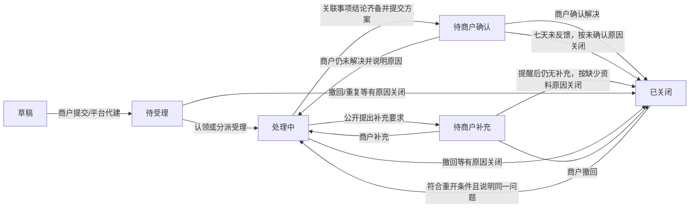

# 商户支持工单双端闭环设计

## 2026-11-19 12:03

**阶段状态更新：2026-11-19 用户要求暂缓商户支持工单，保留本设计，暂不进入研发、测试或上线。**

本文定义商户系统与管理系统的商户支持工单能力，作为后续接口、数据结构、页面和验收的共同设计基线。当前状态为**完整设计提案，待产品评审**。本文中的新菜单、状态、权限、接口和参数均为拟议契约，不代表现有系统已经实现，也不代表已启用对外服务承诺。

本次交付为 R0 文档设计；后续实现涉及双端、权限、文件、内部接口、持久化和消息，为 R2。若增加退款、补单、重发回调等实际业务执行命令，必须按所属交易能力重新分析，不能从工单设计直接取得资金操作授权。

要求分级：P0 为商户隔离、字段与附件权限、公开/内部可见范围、文件扫描、真实交易事实和状态/幂等一致性；P1 为本阶段必交付的双端单笔/多笔、图文、受理协作、反馈、确认/关闭/重开与基本运营提醒；P2 为知识库、智能建议、独立搜索、深度统计等后续增强。不能以 P2 增强替代 P1 闭环。

## 一、产品定位与完成标准

建立商户与平台之间统一、可追踪、可协作的问题处理入口。支持一笔交易、多笔交易，以及没有交易的系统功能问题、商户对接障碍、操作咨询和产品建议。

核心闭环：**提出问题 → 校验与受理 → 分派负责人 → 双方沟通和内部协作 → 逐项处理 → 给出结果 → 商户确认或有原因地关闭 → 评价与复盘。**

完成标准：

1. 商户能清楚知道问题由谁跟进、当前等谁处理、下一次预计反馈时间，以及最终结论。
2. 平台能知道哪些问题未受理、等待自己回复、即将超时、需要协作，以及哪些问题重复发生。
3. 一个工单可关联 0～200 笔属于同一商户的系统订单；交易类工单至少关联一笔系统订单，或明确关联尚未生成系统订单的付款尝试。
4. 多笔交易逐笔保留核对结论，不能一条笼统回复覆盖全部未处理交易。
5. 支持图文混排、粘贴截图、附件及补充说明；所有文件均须授权、格式/大小校验和安全扫描。
6. 工单状态不改变交易状态，不直接触发扣款、退款、补单、清分或结算。
7. 商户可见回复、管理端内部备注、业务事实和审计记录有明确边界。

### 现状核对

截至本次源代码检查：

| 能力 | 当前证据 | 本阶段处理方式 |
|---|---|---|
| 独立商户支持工单 | 未发现独立工单页面、领域模型和完整接口 | 新增业务能力，不能用假数据或公告替代 |
| 管理端统一运营待办 | `AdminOperationalWorkItemController`、`JdbcAdminOperationalWorkItemService`；前端 `views/operations/work-item/index.vue` | 复用工作入口与治理方式；工单事实仍由工单领域托管 |
| 私有文件存储 | 双端 `ObjectStorageService`、`S3ObjectStorageService` 与商户资料上传实现 | 复用协议与基础设施，不复用商户合规资料的业务归属和表记录 |
| 上传安全检查 | `UploadSecurityService`、`ClamAvMalwareScanner` | 复用服务端校验与扫描，新增工单用途、额度与授权检查 |
| 邮件投递 | 双端已有模板邮件、发送记录与失败恢复实现 | 评估复用投递通道；新增工单事件、订阅与去重契约 |
| 个性化站内消息 | 公告、交易回调记录不等价于逐用户工单消息 | 新增工单通知及逐用户已读能力，不冒充现有能力 |
| 表格、权限、多语言 | Admin/Merchant 各自的 `StandardTable`、后端菜单与按钮权限、i18n | 保留并复用，无新增 UI 框架 |

这里只确认代码存在性与可复用边界，没有验证本机扫描服务、对象存储或邮件通道的实时可用性。

## 二、问题分类与信息采集

### 统一分类，按问题补充字段

| 一级分类 | 二级问题示例 | 关联对象与补充字段 |
|---|---|---|
| 交易问题 | 支付失败、处理中、结果不一致、疑似重复付款、退款进度、回调问题 | 系统订单、商户订单、付款尝试；问题时间、期望结果；不要求重复录入已有交易信息 |
| 清分与结算咨询 | 清分结果、手续费说明、保证金、结算批次、到账查询 | 系统订单可选；结算批次等作为明确类型的关联对象，不能填入系统订单号字段 |
| 系统功能问题 | 页面打不开、按钮失效、数据显示不一致、导入导出失败 | 所属应用、功能模块、页面名称、发生时间、复现步骤、实际结果、预期结果、截图 |
| 商户对接障碍 | 鉴权、签名/加密、接口参数、SDK、收银台跳转、回调验签、测试环境 | 测试/生产环境、接口或 SDK 版本、请求时间及时区、requestId/traceId、脱敏错误信息、复现步骤 |
| 账号与权限 | 子账号权限、登录/MFA 使用咨询、菜单权限 | 影响账号的受控标识、所需操作；不收集密码、验证码或密钥 |
| 操作咨询 | 配置方式、业务流程、资料说明 | 功能模块、咨询内容，可附图 |
| 产品建议 | 功能改进、新需求、体验建议 | 当前场景、遇到的问题、建议方案、影响范围 |

产品建议的“已处理”可表示已评估并给出采纳/不采纳/待规划结论，不能表示已承诺开发或已上线。采纳后可关联内部研发编号与后续跟进工单；只有产品决定发布的进度才向商户展示。

### 创建表单

创建使用独立页面，按三个区域组织，不把复杂交易选择和长图文塞进窄弹窗。

| 字段 | 规则与交互 |
|---|---|
| 问题分类 | 必填；选择后二级分类和字段随之变化，不删除已输入正文 |
| 工单标题 | 必填，5～120 字；不把整段问题自动拼成标题 |
| 问题描述 | 必填，10～10,000 字；有效文字计数不包含图片节点；支持段落、列表、强调、代码块和行内图片 |
| 影响程度 | 商户选择“咨询 / 部分功能受影响 / 核心业务受阻”，配合影响范围、首次发生时间；平台核定处理优先级 |
| 关联交易 | 按分类必填或可选；单笔、多笔共用选择器；支持从交易页面带入 |
| 环境和发生时间 | 对接类必填环境；故障类要求发生时间并显示时区；无法确定可选择“不确定”并说明 |
| 复现步骤、预期与实际结果 | 故障/对接类结构化引导；不强迫纯咨询填写技术字段 |
| 附件 | 可选；拖拽、选择文件、粘贴截图；图片可在正文定位，附件区统一管理 |
| 通知接收人 | 默认当前提交账号；可在有权限的本商户成员中增加关注者；邮箱从已验证账号资料取值 |
| 草稿 | 服务端保存，展示最后保存时间；未提交时对平台不可见；切换页面提醒未保存内容 |

正文为空但仅有截图时，引导补充一句问题说明；不要求用户把截图中的所有文字再录一遍。

### 按入口自动带入信息

1. 交易列表行操作“发起工单”：带入单笔系统订单。
2. 交易列表勾选多笔后“发起工单”：带入显式选中的订单集合。跨页选择要展示总数；不能把“全选当前页”误作“所有查询结果”。
3. 交易详情“发起工单”：带入系统订单及商户可见的交易摘要。
4. PayByLink 详情/支付尝试“发起工单”：有真实系统订单则关联订单；没有则关联链接和付款尝试，明确“未生成系统订单”。
5. 功能页面的帮助入口“反馈此页面”：带入应用、页面标识、当前语言与浏览器基础版本，不自动上传页面数据、截图、URL 查询串或用户输入。
6. 工单列表“新建工单”：从分类开始，允许不关联交易。

菜单：商户端建议在“帮助与支持 → 支持工单”；管理端建议在“运营中心 → 商户支持工单”。新目录/菜单通过后端菜单权限注册，不硬编码静态兜底菜单。

## 三、单笔与多笔交易设计

### 选择交易

选择器提供“查询选择”和“粘贴/导入编号”两种方式。

- 查询选择：系统订单号、商户订单号、时间、状态、交易类型、支付方式、币种；结果真实分页。
- 精确系统订单号直接定位；商户订单号可能对应多次支付尝试，必须列出可见候选并让用户确认，不能自动挑最后一笔。
- 粘贴：每行一个系统订单号，支持去除空白、去重；返回原输入位置与逐项校验结果。
- 导入：首期支持受管 CSV 模板，列为“系统订单号、该笔问题说明（可选）”；模板进入模板中心，不自建下载模板端点。
- 每单上限 200 笔是本设计建议值；手动、跨页、粘贴、导入、后续追加共同计数，不能靠多次调用绕过。
- 超限先提示缩小范围；超大事故用平台事件关联多张工单管理，不生成无限附件式交易集合。

### 多笔校验与提交

展示“输入数量 / 重复数量 / 可关联数量 / 未通过数量”。每个失败项展示可操作原因；“不存在或无权访问”合并提示，避免泄露其他商户交易是否存在。

商户必须明确“仅保留校验通过的交易”并确认实际数量，或修正全部错误；禁止静默丢弃错误项并提示全部成功。正式提交再次校验全部关联对象权限和版本；不能只信任预览校验令牌。

一个工单只能属于一个商户。管理端代建工单也必须先锁定单一商户，不允许跨商户订单混入同一工单。交易自身是否成功、失败不决定能否提问。

### 逐笔核对与结论

关联交易页至少展示：系统订单号、商户订单号、交易类型、币种及金额、支付方式 Logo、交易实时状态、该笔问题、核对进度、公开结论、最近更新时间。

**交易状态**来自交易所属服务；**核对进度**属于工单，是两列独立事实。

| 核对进度 | 含义 |
|---|---|
| 待核对 | 已关联，尚无处理结论 |
| 核对中 | 平台正在排查 |
| 待商户补充 | 该笔需要额外信息；有明确补充问题 |
| 已给出结论 | 有结论类别、商户可见说明、处理人和时间 |

结论类别建议包括“已解释说明、已恢复并复核、未发现异常、已关联后续处理、经商户确认移出本次范围”。使用“已给出结论”而非“交易已解决”，防止误认为交易转为成功。

关键规则：

1. 一张工单可以有不同交易类型、状态和币种；金额按币种展示，不将跨币种金额相加。
2. 首次关联保存最小摘要快照用于追溯，同时展示带查询时间的最新状态。实时查询失败时显示“状态暂无法获取”，不回退成失败或成功。
3. 部分结论完成时显示“已给出结论 3/5”，不提前宣告整单解决。
4. 批量填同一结论前，预览涉及订单和数量；版本冲突逐笔返回，整单不能误报全部成功。
5. 整单提交处理方案前，所有活动关联项必须有结论，或已取得商户确认的范围调整。
6. “已关联后续处理”只有后续工单/案件真实存在、商户可理解后续责任与时间且同意范围调整，才允许完成本单；不能用它规避未处理事项。
7. 追加交易需要相同问题原因、同一商户与权限校验，并计入总上限；待确认状态追加会退回处理中；关闭状态须先重开。
8. 移除交易保留关联历史、原因及操作者；已提交关联不能物理抹除。商户端只展示本商户可见的历史。
9. 未生成系统订单的付款尝试以独立对象类型展示，系统订单号列显示“未生成系统订单”；尝试编号不能冒充系统订单号。
10. 交易成功或状态变化不自动关闭工单，仍须核对商户提出的具体问题。

### 重复问题与平台事件

同一交易允许关联不同问题工单。新建时提示本商户相同订单、相同问题类型的活动工单，引导继续补充，但不强制拦截独立问题。

同一商户重复工单可由管理端标记主单和重复单：保留原编号、原对话和审计；商户看到跳转主单的入口。原单消息不迁移、不删除，重复关闭单继续留言会提示进入主单。

跨商户同源故障用仅管理端可见的“平台事件”聚合，不合并商户工单，不共享商户名、交易、截图和回复。事件修复只能生成待确认处理建议；逐张工单核验后再对外发送，不能一键暴露内部事件正文。

## 四、商户端页面

### 工单列表

默认进入“全部工单”，提供“需要我回复、平台处理中、待我确认、已关闭、我的草稿”视图。计数来自后端同一授权范围；已读状态按账号记录，不因其他同事打开而替自己标已读。

筛选项：工单号、标题关键词、问题分类、工单状态、系统订单号、商户订单号、提交人、创建/更新时间。常用字段首屏，其他条件折叠；查询与重置遵循现有布局。

列：工单号、标题/问题分类、关联交易数、工单状态、待办方、最近公开回复、更新时间、操作。显示真实未读标记。标题因可读性左对齐，数字列按现有表格规范，其余沿用 Merchant 表格约定。工单号和操作列保护，不允许列配置隐藏关键身份和入口。

列表中的“最近回复”和排序默认只看商户可见活动。内部备注、分派与内部附件不能改变商户端的摘要、未读数和公开更新时间，从侧面暴露内部信息。

### 工单详情

采用完整详情页，可从列表抽屉快速预览后打开完整页。桌面主区显示沟通，右侧显示摘要；窄屏变为上下布局。

```text
工单号 · 标题                       状态 / 需要谁处理
问题分类 · 提交时间 · 下一次预计反馈时间
──────────────────────────────────────────────
问题说明 / 沟通记录 / 关联交易（5） / 附件
  商户最初描述、截图、系统受理回执
  平台公开回复、补充要求、处理方案
  商户补充、确认或“仍未解决”
──────────────────────────────────────────────
补充说明编辑器 · 上传附件                  发送回复
右侧：本商户摘要、提交人/关注者、工单状态、通知设置
```

只有实际公开回复出现在对话流；提交成功回执标记为“系统回执”，不伪装人工回复。图片缩略图点击预览，支持前后切换、放大与下载；扫描未通过文件不能进入可见历史。

待商户补充状态顶部突出需要补充的具体问题；待确认状态突出处理结论，并提供“确认解决”“仍未解决”。“撤回工单”使用次级入口，要求说明原因；不与“确认解决”混用。

### 新建与回复体验

1. 分类与标题 → 问题描述及关联对象 → 提交前摘要，页面内组织，无需反复弹窗。
2. 交易选择支持已选区、分页、批量粘贴、导入结果和移除；不把 200 个编号堆成满屏标签。
3. 草稿在服务器保存；编辑器上传后显示“已上传并通过检查”，失败逐个重试；未完成上传的文件使提交按钮提示等待或移除该文件。
4. 成功后进入详情，展示工单号和预计首次反馈时间；不因通知发送失败弹出“工单提交失败”。
5. 网络超时显示“正在确认是否已提交”，按原请求键查询结果，不能自动换请求键重新建单。
6. 离开页面有未保存编辑时提供离开确认；登录过期后不能把正文或附件转存到不受控浏览器存储。

## 五、管理端页面与协作

### 工作台与列表

默认“我的待处理”，同时提供“待受理、未分派、待我回复、即将超时、已超时、待商户补充、待商户确认、全部工单”。按权限展示团队与全量范围。

筛选：工单号、商户号/主体名称、分类、状态、优先级、受理队列、负责人、标签、关联订单、平台事件、时间、超时标记。顶部只保留需要采取行动的真实计数，不做装饰性大数字看板。

列表列：优先级、工单号、商户、标题/分类、关联数量、状态、待办方、负责人、下一次反馈期限、最近公开/内部活动、操作。临期和超时以时间、文字和颜色共同区分，不能只靠红色。

默认排序为超时/临期优先，再按优先级与等待时长；排序规则可切换且可解释。负责人转移、分类调整不重置时效。

### 详情工作区

桌面左侧为问题说明与对话，中间按需展示交易核对表，右侧为商户摘要、分类、优先级、责任队列、负责人、期限与关联平台事件。顶部固定当前待办与主动作。

回复区域提供明确分离的两个编辑入口：

- **回复商户**：商户可见；编辑器、附件和发送按钮明确标识；有问题描述与附件预览。
- **内部备注**：仅管理端授权成员可见；可 @有效管理账号、记录排查证据和协作需求；使用不同底色与文案。

切换入口不能把已有正文和附件带到另一种可见范围。默认回复模式及焦点要可预期；内部信息如需对外说明，应新建脱敏公开回复，不提供“内部备注转公开”的一键操作。

### 处理动作

| 动作 | 必要约束 |
|---|---|
| 认领/受理 | 校验当前版本；原子产生单一负责人；受理后进入处理中 |
| 分派/转交 | 接收人为有效且有该商户范围权限的账号；说明原因；保留原负责人和时效 |
| 请求商户补充 | 必须发送具体的公开问题，不能仅改状态；说明需要补充哪些订单/信息 |
| 邀请内部协作 | 添加协作人和需要反馈的问题、期限；主负责人保留对外责任 |
| 等待外部反馈 | 记录外部对象、原因和下次跟进时间；商户只看到合适的公开进度 |
| 提交处理方案 | 校验逐项结论齐备；填写公开结论、结果类别、建议和必要证据，进入待商户确认 |
| 特殊关闭 | 有关闭原因、公开说明和权限；非解决关闭不计为解决成功 |
| 批量操作 | 首期开放分派、标签、关注；不开放无复核的批量关闭、批量确认解决 |
| 代商户建单 | 明确单一商户、问题来源和沟通依据；显示“平台代建”；不伪造商户发言或商户确认 |

涉及退款、重新发送回调、交易状态核查等，提供带权限的原业务页面入口。实际命令仍在所属模块执行其权限、审批、幂等和审计；工单只关联执行记录及脱敏结果。

## 六、状态机与关闭规则

### 主状态

| 状态代码（拟议） | 双端名称 | 当前主要行动方 |
|---|---|---|
| `DRAFT` | 草稿 | 创建人；不进入平台受理队列 |
| `OPEN` | 待受理 | 平台受理队列 |
| `IN_PROGRESS` | 处理中 | 平台负责人 |
| `WAITING_MERCHANT` | 待商户补充 | 商户，同时保留平台负责人 |
| `RESOLVED` | 待商户确认 | 商户；平台已给出完整处理方案 |
| `CLOSED` | 已关闭 | 无活动处理；显示关闭原因 |

“排查中、内部协作中、等待外部反馈”是管理端处理中子阶段，不另造三套主状态。商户端显示经过控制的进度说明，不暴露人员/供应商/内部系统信息。“已超时、已升级、未读”是独立标记，不是工单状态。



### 状态迁移规则

1. 商户提交时从草稿进入待受理；可自动路由责任队列。自动路由不等于人工受理或人工首响。
2. 管理端认领、主管分派或获准的自动分派进入处理中；负责人失效时回退未分派队列并报警，工单不丢失。
3. 管理端一般回复不自动变成已解决。必须选择“继续处理 / 请求补充 / 提交处理方案”之一，并满足对应必填内容。
4. 商户在待补充时回复，回到处理中；由原负责人继续；@、标签和点赞等不算有效补充。
5. 商户在待确认时选择“仍未解决”并说明原因，退回处理中；原处理方案和确认轮次保留。
6. 待确认中普通补充回复也回到处理中，防止系统七天自动关闭时忽略新问题。
7. 管理员内部备注、协作人评论、系统提醒不改变商户等待状态。
8. 关闭不能删除历史。已关闭不允许直接追加聊天，先重开或创建关联的新工单。

### 关闭原因与重开

| 关闭场景 | 建议规则 | 统计含义 |
|---|---|---|
| 商户确认解决 | 商户有确认权限；关联事项已有完整结论 | 商户确认解决 |
| 已给出处理方案，商户未反馈 | 待确认第 3 天提醒，第 7 天有通知地关闭 | 自动关闭、未经商户确认；不能计入商户确认解决率 |
| 等待商户补充，长期无回复 | 第 3 天提醒，第 7 天关闭；必须确实存在公开补充要求且无新回复 | 缺少资料关闭，未解决 |
| 商户主动撤回 | 商户填写原因 | 商户撤回，未宣称解决 |
| 同商户重复工单 | 指定可见主工单并说明；主工单必须实际可访问 | 重复关闭，不重复计为解决 |
| 不属于受理范围 | 有权限人员给出公开理由及合适下一步；不能把难处理问题归此类 | 非解决关闭 |

上述天数为自然日的产品建议值，和工作时效日历分开定义。提醒/关闭任务按版本及状态条件更新，回复与关闭并发时以数据库条件判断，不能关闭已收到回复的工单。

同一问题关闭后 7 天内允许重开，填写未解决原因；因待补充关闭后补齐资料同样支持重开。超过窗口或属于新问题时创建关联工单，并引用原单而非复制敏感内容。重复关闭单引导去主单；权限撤销、账户冻结等情况下禁止绕过正常授权重开。

重新打开优先恢复原队列与仍有效负责人；保留原始首次响应、历次处理和超时记录。产生新处理轮次，但不通过重开抹掉历史超时。

### 评价

提供一次可修改的 1～5 分评价和可选原因：处理结果、响应速度、解释清晰度。评价不控制关闭，不强制好评，不因低分自动把业务状态改成处理中。低分进入主管回访队列，可另行重开但保留评价事实。

“确认解决”与“满意度”分开：商户可以确认问题解决但评价较低，也可以给好评但仍有未完成事项。

## 七、责任、处理时效与升级

### 责任模型

- 每张已受理工单一个责任队列、一名主负责人，可有多名协作人和商户关注者。
- 责任队列建议为交易运营、商户技术支持、结算支持、账号支持；实际队列来自配置与有效成员，不写死人员。
- 分类自动推荐队列；无人可接收则进入默认受理队列，并向值班主管提示。
- 协作人负责内部任务，主负责人负责持续对外反馈，不能把转交当作解除责任。
- 商户可选择影响程度，主管可核定优先级；调低优先级、转交、特殊关闭都记录原因。

### 时效建议值

下表是待评审的运营目标，**不是已承诺的 7×24 服务**。

| 优先级 | 示例 | 首次人工公开回复 | 后续有效公开回复 | 处理方案目标 |
|---|---|---|---|---|
| 紧急 | 核心业务大面积受阻、疑似重大资金风险需紧急核查 | 0.5 工作小时 | 1 工作小时 | 4 工作小时 |
| 高 | 多笔交易异常或单个核心功能不可用 | 2 工作小时 | 4 工作小时 | 8 工作小时 |
| 普通 | 单笔排查、常规对接障碍 | 4 工作小时 | 8 工作小时 | 24 工作小时 |
| 低 | 操作咨询、非阻断建议 | 8 工作小时 | 16 工作小时 | 40 工作小时 |

服务日历建议工作日 09:00～18:00、Asia/Shanghai，支持节假日和队列差异。紧急工单只有配置真实值班能力后才能启用 7×24 目标；未配置日历时显示“响应时间待受理确认”，不能生成虚假的倒计时。

计时口径：

1. 首次响应从正式提交开始，只以平台人工公开的有效回复完成；自动回执、内部备注、分派不算。
2. 后续回复从每次产生商户待回复需求开始，同一等待周期的多条商户留言不延长已有最早期限；有效公开回复后才能开启新周期。
3. 处理目标计算从提交到提交完整方案的累计工作时间；待商户补充可暂停，暂停原因和起止记录必须可见。等待内部或外部反馈不暂停对外反馈责任。
4. 待确认期间暂停方案处理计时；被退回/重开时恢复原累计消耗并新建处理轮次，不能洗掉已有超时。报表同时给出首次方案时长与最终闭环时长。
5. 商户侧显示“预计下次反馈时间”，不把处理方案目标展示成保证修复日期。确需延长时要给原因和新预计反馈时间，原期限违约记录保留。
6. 优先级和政策有版本；创建时冻结适用日历/政策。调级按明确规则重算剩余期限，保留旧期限和已发生超时，不重写历史。

### 催办与升级

商户可催办，每单建议 4 工作小时最多一次，且只在平台承担当前行动或已超时后开放；不通过重复建单抢优先级。催办不重置任何时钟。

到目标时长 80% 提醒负责人，100% 标记超时并通知主管；持续超时按配置提升到上级队列。重复任务按“工单、轮次、时效类型、提醒级别”去重。临期/超时提醒只给实际有范围权限的管理账号。

## 八、图文、附件与安全

### 图文能力

支持段落、加粗、有序/无序列表、引用、代码块、行内截图及图片说明。截图可拖入或从剪贴板粘贴，也能在附件区上传后插入正文；正文图片引用与附件区共用同一文件记录，避免上传两份。

正文保存受限结构化内容；服务端验证节点、长度及文件引用归属。展示时执行允许列表，不接收任意 HTML、脚本、iframe、外链图片或可执行链接。公开内容和内部内容分开授权、检索、渲染。

### 首期文件建议值

| 类型 | 单文件上限 | 展示与处理 |
|---|---|---|
| PNG/JPEG | 5 MiB，解码像素不超过 2,000 万 | 缩略图、受控预览、放大、下载；图片解码校验，去掉 EXIF 定位等元数据；变换后的文件重新校验和扫描 |
| PDF | 10 MiB | 文件卡片、鉴权下载；首期不在同源页面执行嵌入式活跃内容 |
| UTF-8 TXT/CSV | 5 MiB | 文件卡片、受控纯文本预览或下载；CSV 导入与普通附件用途明确区分 |

每次提交/回复最多 10 个文件，总计不超过 20 MiB；正文内图片计入同一额度。每张工单建议累计不超过 100 个文件/200 MiB，防止通过连续回复无限上传。额度以服务端返回为准，并受现有全局更小限制约束。

现有 `UploadSecurityService` 已支持 PNG/JPEG、PDF、CSV 等格式；**TXT 和图片解码/去元数据等能力需要单独补齐并验证**。不得为了工单放宽其他业务端点的白名单。ZIP、可执行文件、SVG、HTML 等不在首期白名单；Office 文件和视频留作经安全评审后的扩展，不以改扩展名绕过。

### 文件闭环

**登录与对象权限 → 配额/频率 → 扩展名与实际格式/大小 → 内容校验 → ClamAV 扫描通过 → 私有保存 → 绑定草稿或消息 → 授权预览/下载 → 按保留策略清理。**

1. 每一个文件都经过服务端检查。扫描失败、超时、繁忙、病毒库过期或扫描服务不可用均拒绝；不能显示上传成功后再补扫。
2. 上传状态分为上传中、检查中、可使用、失败；失败给出可重试或换文件指引。正文不因单张图片失败全部丢失。
3. 上传成功仅生成属于当前账号、商户、草稿/消息和可见范围的文件标识，不返回永久对象存储链接。
4. 提交消息时校验文件已通过检查、未过期、未被其他消息绑定、可见范围一致。消息与附件引用原子提交。
5. 文件删除：未提交草稿可移除；已发送内容不可自行抹除，由具备权限的管理人员基于原因隐藏/隔离，保留审计和商户可见占位说明。
6. 每次预览/下载重新鉴权，内部附件不可通过复制 ID 在商户端下载；缩略图、预览图与原图具有相同访问边界。
7. 私有桶不公共读，不给浏览器拼接对象地址；下载设置正确类型、`nosniff`、受控文件名与缓存策略；校验完整性摘要。
8. 安全提醒聚焦操作：截图请遮盖完整卡号、验证码、密钥和个人信息；对接示例用 requestId、时间和错误码定位，不索取完整报文。
9. 对高确定性的密钥、授权头、完整卡数据等输入阻断或要求脱敏；不能宣称正则或 OCR 能识别所有图片敏感内容。原始正文不先落日志再脱敏。
10. 内容疑似泄露时，受控隔离、记录访问审计并按现有账号安全流程处理；普通客服不通过工单读取或重置商户密钥。
11. 文件扫描完成后保存与展示必须使用相同的已验证字节快照，防止检查之后替换文件。
12. 截图/日志不自动采集；商户明确选择后上传。请求标识不会自动让商户获得内部日志查询权限。

## 九、通知、已读与查找

### 通知事件

| 事件 | 商户侧 | 管理侧 |
|---|---|---|
| 提交成功/平台代建 | 回执；代建通知给授权接收人 | 新工单进入队列 |
| 分派/转交 | 可展示“平台已受理”，不必公开内部人员信息 | 新负责人及必要协作人 |
| 平台公开回复/补充要求 | 提交人、关注者；有权限且未退订的接收人 | 可选关注提醒 |
| 商户补充/仍未解决 | 商户作者不通知自己 | 主负责人，未分派则责任队列 |
| 提交处理方案 | 明确待确认及确认期限 | 主负责人 |
| 催办/超时/内部 @ | 不暴露内部事件 | 主负责人、被提及者或主管 |
| 关闭/重开 | 原因与后续入口 | 主负责人及必要关注者 |

站内通知是可靠主入口，邮件作为可配置补充；初期不引入邮件回信自动写工单。邮件只给工单号、事件类型和需要登录的站内入口，不附交易明细、截图、内部内容或带会话凭据的链接。

逐用户通知记录包含事件、接收账号、可见范围、投递和已读状态。业务提交与通知 outbox 同事务；失败重试和补偿不回滚已成功建单/回复。重复投递按业务事件与接收人去重；邮件发送成功不等于收件人已读。

打开详情只推进本账号已加载的公开消息已读游标；切换到内部备注有独立授权与游标。不能仅打开列表就标记整单已读，也不能让一个商户同事清掉全商户未读。

### 搜索和刷新

工单号/系统订单号精确查询，标题和公开正文支持受控关键词搜索；首期不引入独立全文搜索集群。商户检索必须从公开投影执行，不能检索内部备注后只把正文隐藏。

详情建议活动窗口每 15 秒增量刷新消息、列表每 30 秒刷新待办/未读，后台标签降频或暂停，失败退避。新增消息时保留当前阅读位置，显示“有新回复”入口，不强行滚到底部。后续如使用 SSE，仍沿用相同授权和游标契约。

## 十、权限、审计与数据保留

### 权限矩阵

| 能力 | 商户提交人/获准成员 | 商户主管 | 平台处理人 | 平台主管 |
|---|---|---|---|---|
| 新建、查看、公开回复 | 本商户且有工单权限 | 按本商户权限 | 已授权商户范围 | 已授权商户范围 |
| 查看同商户其他成员工单 | 按商户角色的数据范围配置 | 可授权全部本商户 | 按平台范围 | 按平台范围 |
| 关联交易、打开交易详情 | 还需交易查询与字段权限 | 同左 | 同左 | 同左 |
| 确认、撤回、重开 | 创建人或具备相应管理权限者 | 可授权 | 不代替商户确认 | 特殊关闭须独立权限和原因 |
| 认领、公开处理、内部备注 | 不可 | 不可 | 指定动作权限与范围 | 同左 |
| 分派、调优先级、配置策略 | 不可 | 不可 | 按授权部分开放 | 明确分派/策略管理权限 |
| 隐藏内容、隔离附件、导出 | 不默认开放 | 按授权导出本商户公开内容 | 独立高敏权限 | 独立高敏权限 |

默认同一商户拥有工单查看权限的成员可协作查看本商户工单；如角色仅允许本人范围，列表、详情、搜索、附件和通知同时收窄。权限命名遵循两端现有风格，接口定义阶段登记具体代码。

工单可见权限不自动授予交易详情权限。用户权限变化后，重新校验所有附件、交易链接和通知跳转；必要时只显示“关联信息无权查看”，不能展示历史快照中的受限金额和字段。

审计覆盖：提交、编辑草稿、公开回复、内部备注、分派/转交、优先级、关联增删、逐笔结论、状态迁移、关闭/重开、特殊处置、附件下载、导出、策略修改。正文和文件留在受控业务存储，审计日志保存标识、摘要和变更前后结构化事实，不复制敏感全文。

### 保留策略建议

| 数据 | 建议值 | 说明 |
|---|---|---|
| 未绑定临时上传 | 24 小时 | 仅清理确定未被提交引用且已过期的对象；失败可重试 |
| 未提交草稿 | 最后编辑后 7 天 | 到期前提示；删除草稿时按引用关系清理文件 |
| 工单与消息元数据/正文 | 关闭后 24 个月 | 属于产品建议，须按公司实际合规/合同政策配置 |
| 已绑定附件 | 关闭后 180 天 | 到期前显示期限；过期后保留文件名、时间及“附件已过期”占位 |

调查保全、争议证据或法律保留标记覆盖常规清理；重开后重新计算可清理时间。数据库清理和对象清理分阶段、可重试、有审计，不能先删仍被活动消息引用的文件。具体保留期限须在发布前确定，本文不声称其为法定期限。

## 十一、数据与服务边界

### 领域归属建议

首期在 `service-admin` 下建设独立支持工单应用/领域包，拥有工单、消息、关联、状态与时效事实；`service-merchant` 作为商户入口，完成会话身份和权限解析，再调用鉴权内部工单用例。两端不得各存一份工单状态。

采用现有内部认证与防重放机制，明确可调用服务、受众、商户范围和原始操作者；内部地址本身不是安全边界。商户身份由可信会话推导，不接受前端随意指定商户。管理端工单内部入口必须验证调用方有权代表该商户，不能只验证 HMAC 就信任任意 merchantId。

不新增独立微服务；若后续工单量与协作能力要求独立伸缩，再抽取 `service-support`，本阶段先建立清晰边界。该领域归属是待评审架构决定，不代表现有模块已拥有这些事实。

- `service-payment` 等业务所属服务：提供授权后的交易/尝试/批次查询，拥有实际业务状态与业务命令。
- `service-admin`：工单主写入、平台处理、内部协作、统一待办投影。
- `service-merchant`：商户用例、商户公开投影和商户通知入口。
- `service-job`：到期扫描、提醒与关闭触发；调用工单命令，不越权直写表。
- `service-data`：如启用导出，使用冻结授权范围和分页读取，异步生成受控文件。
- 共享组件：上传检查、存储协议、标识生成、认证等技术能力；不承载工单状态机。

统一待办可新增工单来源类型，但负责人、状态、升级事实由工单领域维护，待办跳转原工单。不能出现待办与工单各自可转交、各自关闭的两套状态。

### 概念数据模型

下列为概念名，SQL 和字段命名在实现前按现有规范确定；本次不新增或执行 SQL。

| 模型 | 主要事实与约束 |
|---|---|
| 工单主表 | 工单号、商户、分类、标题、提交人/来源、状态、优先级、队列、负责人、公开更新时间/内部更新时间、处理轮次、政策版本、到期时间、关闭原因、并发版本 |
| 问题说明与消息 | 消息标识、工单、作者、公开/内部可见范围、消息类型、受限结构化正文、发送时间；已发送不可无痕修改；草稿与正式消息分开 |
| 关联对象 | 工单、对象类型、所属商户、真实对象标识/分片定位、最小摘要、核对进度、公开结论、版本、移除原因与时间；避免只凭预分配编号推断系统订单存在 |
| 逐笔结论历史 | 对象、处理轮次、结论类别、公开说明、操作者、时间；修改保留旧版本 |
| 附件 | 文件标识、商户、上传者、工单/草稿、消息、用途/可见范围、类型、大小、摘要、扫描结果、私有存储定位、到期与隔离状态 |
| 参与人/关注者 | 工单、账号、角色、订阅偏好；每次操作重新检查账号权限 |
| 时效与处理轮次 | 轮次、首响/跟进/方案目标、暂停区间、旧新期限、违约事实、提醒与升级级别 |
| 通知与已读 | 事件、接收账号、渠道、状态、读取游标、去重键；不能仅保存商户级已读标志 |
| 评价 | 工单、评价人、分数、原因、时间及修改历史 |
| 操作审计/命令记录 | 请求幂等键、操作者、预期版本、动作、结果标识、前后状态、原因、时间；不存明文秘密 |
| 事件 outbox | 业务事件、来源版本、目标接收范围、投递状态与重试信息 |
| 平台事件与工单关系 | 管理端事件摘要、影响范围、关联工单；无跨商户公开消息共享 |

标识复用统一全局唯一标识规范；对外“工单号”和“系统订单号”明确区分。时间按现有标准保存并用统一组件显示到秒，业务日历另存时区/版本。金额复用所属业务的精确字符串和币种指数，不做 JavaScript 浮点计算。

### 一致性、幂等与分页

1. 建单、发消息、确认、关闭、重开、分派、关联增删、批量结论均有持久化幂等键；相同键不同载荷拒绝，相同键重放返回原结果。
2. 状态命令使用版本与条件更新；乐观锁冲突提示刷新当前状态，不静默覆盖另一人处理。
3. 工单状态、关联结论、公开消息和 outbox 在拥有者数据库事务内完成；对象存储失败有孤儿对象回收和提交失败清理，不声称跨对象存储原子事务。
4. 所有列表、消息、附件集合与关联交易真实分页；大对象批量解析有上限，按交易所属查询契约与分片定位执行，不无界跨季度扫描。
5. 索引覆盖商户/授权范围、状态、队列/负责人、公开更新时间、到期时间及对象反查；以实际查询计划和数据量验收。
6. 对象不可访问时不能靠快照恢复本来已撤销的字段权限。

## 十二、拟议用例与接口范围

以下是业务用例清单，非已实现 API。具体路径、DTO、状态和权限需在进入代码实现前定稿，不从原型直接推断可用接口。

| 用例组 | 商户端 | 管理端 |
|---|---|---|
| 元数据 | 分类、约束、有效操作、服务日历摘要 | 分类、队列、有效接收人、策略 |
| 建单 | 保存/读取/移除本人草稿、校验与提交 | 代建、校验商户范围、登记来源 |
| 查询 | 授权列表、公开详情、公开消息增量、逐笔关联分页 | 授权工作台、详情、内部/公开消息、完整处理轨迹 |
| 交易关联 | 搜索、批量解析/导入、追加/范围调整申请 | 同范围查询、核对、逐笔或受控批量结论 |
| 沟通 | 公开补充、关注、通知设置、标已读 | 公开回复、内部备注、协作与 @ |
| 状态命令 | 催办、确认解决、仍未解决、撤回、重开 | 认领、分派、转交、要求补充、提交处理方案、特殊关闭 |
| 文件 | 鉴权上传/预览/下载、移除未发送文件 | 同左，额外隔离/隐藏权限 |
| 治理 | 查看本人可见通知与评价 | 超时升级、平台事件关联、处理报表、策略与回访 |

共同命令包络建议包含 `requestId`、`expectedVersion`、动作数据；商户标识不由商户浏览器指定。查询结果包含服务端允许的动作与具体受限原因，前端据此控制入口，后端仍逐次强校验。

统一错误语义包括无权或不存在、状态已变化、重复键载荷冲突、关联项校验未通过、文件检查失败、文件已过期、配额/频控、交易查询暂不可用。错误码复用现有错误规范，新增码必须正式登记；商户错误不返回堆栈和内部拓扑。

## 十三、体验和异常场景

| 场景 | 期望行为 |
|---|---|
| 无工单 | 展示简短说明与“新建工单”；无权限时不显示可点击的假入口 |
| 交易服务暂不可用 | 工单正文和历史仍可读；实时状态明确不可用；不能伪造订单验证成功 |
| 图片上传一半失败 | 保留文字和成功文件；逐个重试或移除；不整单清空 |
| 扫描/存储服务不可用 | 附件拒绝并可重试；纯文字工单仍可提交，明确哪些附件未提交 |
| 建单成功但浏览器超时 | 原请求键查询既有结果，防止重复工单 |
| 回复发送时他人已关闭 | 拒绝过时动作，保留当前编辑内容，提示重开或转关联新单 |
| 账号权限失效 | 停止数据刷新和附件访问；不把正文缓存到 localStorage；按会话流程重新登录 |
| 内部 @对象无范围权限 | 禁止加入，不以 @扩大商户数据范围 |
| 超长标题、长订单号、大图 | 列表省略与详情完整查看，交易分页、图片约束，不撑破布局 |
| 邮件失败 | 工单与站内通知保留；管理端看投递失败并重试，不要求商户重复提交 |
| 商户想投诉处理方式 | 可评价、申请主管回访；公开处理人与内部调查身份分离 |
| 无法登录的商户求助 | 使用现有账户恢复/人工支持渠道，平台可代建；本期不开放匿名文件上传绕过登录 |

双端保留现有品牌、主题、国际化和表格能力。中文/英文术语一致；状态不仅靠颜色，上传可键盘操作，图片有说明，焦点和禁用理由可感知。管理端至少验证常用桌面宽度，商户端同时验证桌面和平板/390px 窄屏。

## 十四、运营指标与复盘

按权限、队列、分类、商户及时间统计，指标均需真实记录：

- 新增、积压、未分派、待商户回复、待商户确认、超时数量及等待分布。
- 首次人工回复达标率、后续反馈达标率、提交处理方案时长、最终闭环时长；报表明确工作/自然时间。
- 商户确认解决率、自动关闭未确认数、缺资料关闭数、撤回数、重复数、重开率、满意度及评价覆盖率。
- 多笔工单逐项结论完成度、重复问题分类、平台事件影响范围。

解决率不能把所有 `CLOSED` 都当解决。响应速度不能只取平均值，至少给出 P50/P90 和超时数量；样本少时显示样本数。内部备注不得计入公开回复指标。

首次上线提供必要队列统计和主管列表；复杂 BI、跨商户事故趋势分析可后续增强，不成为基本闭环上线的借口或假看板。

## 十五、实施拆分与验收门槛

拆批用于控制变更风险，以下第一阶段闭环全部完成才可宣称商户支持工单交付，不能只做新建和列表。

| 批次 | 范围 | 交付条件 |
|---|---|---|
| A：契约和基础 | 状态、权限、领域归属、数据/索引、分类、服务日历与文件策略 | 契约定稿，迁移/后检/兼容/回退方案可评审 |
| B：双端主流程 | 草稿、新建、单笔/多笔关联、图文附件、真实列表和详情 | 越权、导入部分失败、文件检查、实际双端联调通过 |
| C：处理闭环 | 分派、公开/内部沟通、逐笔结论、补充、待确认、关闭/重开、评价 | 状态机、并发、通知、审计、同一对象事实一致 |
| D：运营可靠性 | 未读/提醒、时效、催办/升级、任务补偿、必要统计、重复单主单关联 | 任务重复、服务不可用、权限变化和重启后复验通过 |

平台事件的跨商户聚合、深度统计、知识库、自动建议、邮件回信、独立搜索集群可作为后续增强；基本的单笔/多笔、图文、安全、双端回复与关闭重开不延后。

### 必须通过的场景

1. 单笔交易从交易列表发起，自动带入真实系统订单，双方回复、方案、商户确认、评价闭环。
2. 五笔不同状态/币种交易同单排查：逐笔核对、部分完成、追加同原因交易、全部结论齐备才可提交方案；不汇总跨币种金额。
3. 商户订单号对应两次付款尝试：候选不遗漏、不自动选最后一笔；未生成系统订单的尝试正确展示。
4. 混入无权订单、无效号、重复号、超限输入：逐项提示，不泄露其他商户，不静默成功。
5. 不关联交易的系统功能问题：复现步骤、粘贴多张截图、附件、公开沟通闭环。
6. 商户对接问题：环境、接口/SDK 版本、请求时间、requestId、脱敏错误；不收集密钥和完整支付报文。
7. 上传格式伪造、超限、损坏图片、超大像素、病毒、扫描超时/不可用、存储失败均有真实拒绝和可恢复提示。
8. 内部备注及其图片在商户列表、详情、搜索、未读、通知、附件下载、导出中均不可见。
9. 双击提交/回复、网络超时重试、同幂等键不同载荷、双人抢单、同时关闭/回复、自动关闭与新回复并发正确。
10. 部分订单未结论时拒绝整体方案；普通客服回复不能变成确认解决；非解决关闭不计入解决率。
11. 商户补充后恢复处理；待确认退回、七天未反馈关闭、缺资料关闭、合法重开、超窗关联新单可追溯。
12. 分派或调级不抹除超时；自动回执不算首响；连续商户留言不把反馈期限一直顺延。
13. 负责人离职/禁用、权限撤回、商户账号数据范围变化后，队列和所有访问边界仍正确。
14. 邮件失败、通知重复、任务重跑、应用重启和对象清理中断后恢复，工单事实不丢、不重复迁移。
15. 同商户重复工单和跨商户同源故障按不同规则处理，不把另一商户内容并入公开对话。
16. 附件到期、隔离、删除与保全冲突、引用中的孤儿清理正确，活动文件不可误删。
17. 真实分页、长消息历史、200 笔关联、并发提交、文件额度具备明确预算并经验证；不以演示数据等价容量验收。
18. 双端菜单/按钮/字段权限、国际化、表格偏好、主题、空/错/加载状态和键盘焦点可用；商户窄屏不溢出。

### 发布与回退边界

实现前登记新表、菜单权限、内部调用、扫描/存储/邮件依赖和各环境配置；准备幂等迁移、发布前检与后检。发布可按商户/角色灰度。未配置或依赖故障时保持诚实的不可用状态，不绕过扫描或授权。

回退优先关闭新建/写入入口并保留历史只读与受控文件访问，暂停相应任务；不能删除已产生工单、清空状态或回退交易事实。数据库采用向后兼容增量迁移，已发送通知和文件清理不可被“回滚”假装撤销。

## 十六、评审时需要定稿的运营参数

业务结构和闭环按本文设计；下列参数给出建议值供评审调整，不是阻止完成设计的前置问题：

1. 支持队列、值班人员、服务时区、节假日及是否具备紧急 7×24 响应。
2. 四级时效目标、催办间隔、第三/第七天提醒关闭、关闭后七天重开窗口。
3. 每单 200 笔交易、每消息 10 文件/20 MiB、每单 100 文件/200 MiB 等额度，以及商户/账号频控。
4. 默认同商户协作范围、哪些角色可确认/撤回、平台主管的特殊关闭权限。
5. 正文/附件保留期限、保全政策和导出权限。
6. 管理端领域归属、受控 TXT 能力、工单通知与统一待办的正式接口契约。

---
