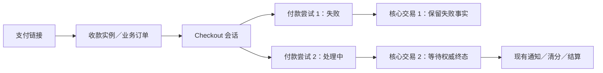
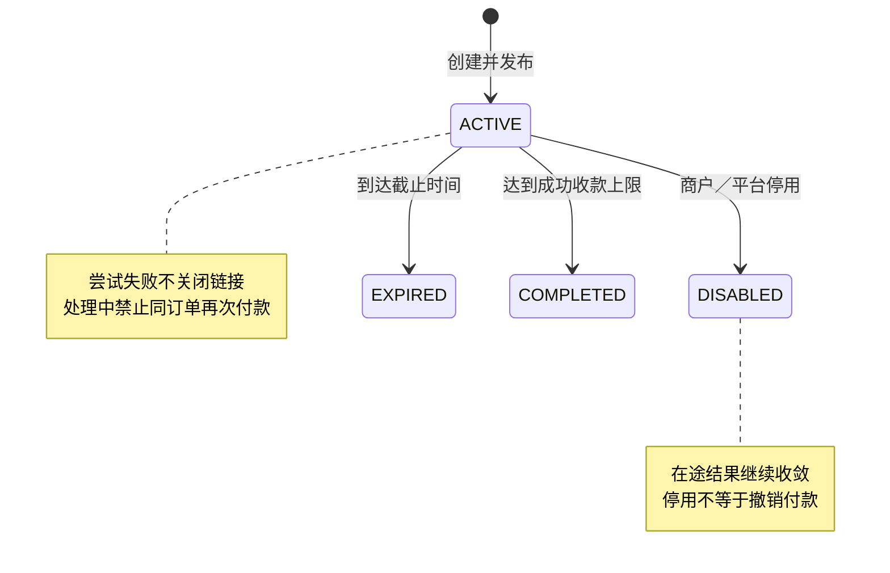
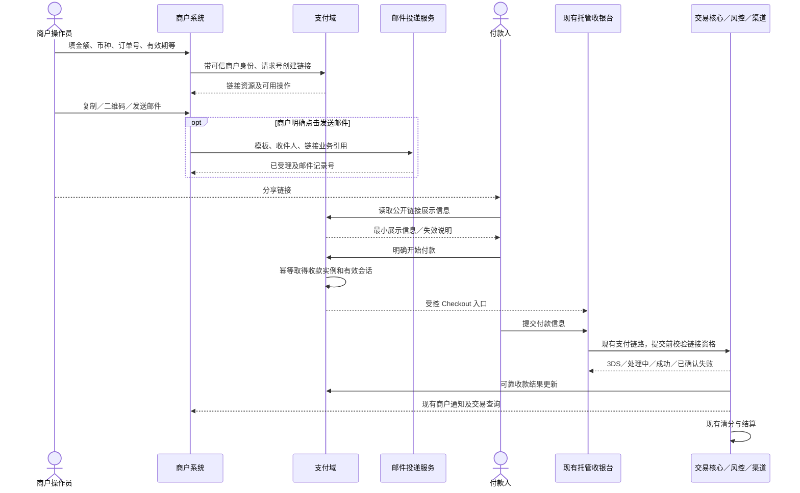

# 支付链接系统与功能设计

本文整理支付链接的产品行为、系统边界、页面、权限、接口、数据结构和验收要求，供需求细化与实现评审使用。

当前状态：**首批银行卡支付链接已实现；本地主路径、后续缺陷修正及展示验收的逐项证据与未验收边界见 [部署与验收记录](../deployment/payment-link-rollout.md)。** 本文保留 2026-11-17 的设计基线（前端 `3c797be`、后端 `961a1e0d`）及后续修订；早期接口草案以当前 Controller、DTO 和可执行测试为准，不能把历史设计阶段的描述当作当前实施状态。其他支付方式实付、外部渠道与完整 3DS 挑战、外部邮件收信及目标环境发布仍需各自联调验收。

## 1. 名称与目标

- 产品中文名称：**支付链接**。
- 产品英文名称：**Pay by Link**；对外说明也可使用 **Payment Link / Payment Links**。
- `Link Payment` 可以表达链接付款，但产品、菜单、文档和代码统一采用前两种名称，避免同一功能多套术语。
- 菜单：商户端、管理端均建议放在“交易管理 → 支付链接”。
- 代码领域名建议使用 `paymentLink`，持久化表建议使用 `payment_link_` 前缀。

目标是为商户提供独立的**收单支付入口**：创建链接、复制或分享、平台邮件发送、二维码、查看支付结果，并复用既有托管收银台与交易核心。付款人向商户付款，交易使用现有 `PAYMENT` 收单链路，成功后进入该商户的通知、清分和结算；不是代付、转账或提现功能，不调用 `service-payout`。不以“生成一个 Checkout URL”代替完整产品。

行业名称参考：[Adyen Pay by Link](https://docs.adyen.com/unified-commerce/pay-by-link/)、[Stripe Payment Links](https://docs.stripe.com/payment-links)。外部产品只用于术语核对，不作为本平台已实现功能的证据。

## 2. 当前代码核对结果

### 2.1 可复用与缺口

| 能力 | 当前源码事实 | 支付链接需要补充 |
|---|---|---|
| 收银台服务归属 | `service-payment` 承担会话、令牌、尝试、交易编排；`service-openapi` 承担浏览器 API；`service-checkout` 不在支付主链路 | 沿用此归属，不新建重复交易核心 |
| 会话创建 | 已有商户 OpenAPI 和支付内部创建命令；创建按商户请求号及指纹幂等 | 新增经过登录鉴权的商户支付链接用例，再调用支付域，不模拟商户密钥调用自己的公开 OpenAPI |
| 支付提交 | 已有会话查询、银行卡提交、BIN 识别、3DS 回跳和状态轮询 API | 增加支付链接解析、付款资格校验及 Checkout 关联 |
| 失败重试 | Checkout 允许已确认失败且允许重试的会话再次提交；核心命令保留商户订单号，新尝试使用新的尝试请求号 | 支付链接继承该语义，不能覆写旧失败交易或把同次网络重发当新尝试 |
| 并发控制 | 会话提交有数据库 CAS，交易核心有订单生命周期与动作幂等保护 | 补单次成功资格、收款实例和跨会话的持久化保护 |
| 提交期限 | `resolveExpireTime` 将单个 Checkout 会话提交期限限制在创建后最多 24 小时 | 链接有效期不能直接填入普通会话假装已支持更长期限；见第 5 节 |
| 支付方式 | 公开 Checkout 创建入口组装 `BANK_CARD`；付款人前端也过滤银行卡；能力来自有效 MID/渠道交集 | 当前先按真实银行卡能力设计；钱包或其他方式需另补完整付款人流程后开放 |
| 语言 | 收银台已具备 `en-US`、`zh-CN` 和浏览器语言处理 | 明确链接默认语言与付款人手动选择优先级，新增文案进入现有 i18n |
| 品牌 | 会话模型已有商户展示名与 Logo；当前公开创建映射将 Logo 设为 `null` | 需补可信商户品牌读取和安全图片展示映射，不能仅凭模型字段宣称品牌已完整接通 |
| 通知与清结算 | 已有交易事件、商户通知和下游链路 | 关联来源，继续按真实交易事实进入现有链路，链接不直接写资金 |
| 通知/返回地址来源 | 当前 Checkout 取创建请求中的 `transactionInfo.callbackUrl/redirectUrl`；本轮未找到商户端可直接复用的默认地址配置契约 | 复用已有地址校验和通知投递；地址默认配置来源或链接级录入需补契约，不能声称已自动接通 |
| 邮件 | 商户模板邮件服务已有模板、变量检查、敏感变量掩码、投递内容加密、发送记录和可靠投递 | 新增支付链接模板、业务关联、权限、频控及发送界面 |
| 权限与页面 | 双端动态菜单、按钮权限、商户隔离、共享格式、标准表格已存在 | 新增领域权限及页面注册，沿用已有规范 |
| 店铺 | 本轮未找到可直接复用的完整店铺业务模型与支付链接契约 | 示例图中的“店铺”不能直接当作现有能力；第一期建议按商户归属 |
| 访问趋势 | 当前 Checkout 有打开事件，不等于已有支付链接访问统计 | 需明确统计口径、防扫描和去重；不生成示例曲线或环比 |

“存在源码和测试用例”不等于本轮完成了运行时验证。钱包接入、店铺、退款/争议案件等也不因示例图出现而自动纳入已完成能力。

### 2.2 源码定位

以下路径相对于后端仓库，前端路径注明另仓库。

| 位置 | 本轮核对依据 |
|---|---|
| `docs/architecture/hosted-checkout-v1-database-design.md` 第 13.1 节 | 原支付链接登记与保护边界 |
| `service-openapi/.../api/rest/checkout/v1/HostedCheckoutBrowserController.java` | `/checkout/api/v1` 浏览器入口 |
| `service-openapi/.../service/impl/HostedCheckoutServiceImpl.java` | 创建请求映射、银行卡选择、默认语言、URL 校验 |
| `service-payment/.../service/impl/DefaultPaymentCheckoutService.java` | `createSession`、`createPaymentSubmission`、`ensureSessionPayable`、`resolveExpireTime`、`corePaymentCommand` |
| `service-payment/.../service/impl/PaymentCheckoutCardCapabilityService.java` | 有效 MID、品牌范围与渠道能力交集 |
| `service-payment/.../service/impl/PaymentTransactionServiceImpl.java` | 交易准备、幂等及生命周期锁 |
| `service-payment/.../service/PaymentTransactionPreparationService.java` | 本地准备事务归属 |
| `service-payment/src/test/.../PaymentTransactionServiceImplTests.java` | `shouldAllowRetryWhenExistingInitialFlowFailed` 等既有契约用例 |
| `service-payment/.../entity/PaymentCheckoutSessionDO.java`、`PaymentCheckoutAttemptDO.java` | 会话、尝试及分片定位字段 |
| `service-merchant/.../service/impl/MerchantTemplateEmailServiceImpl.java` | 模板、敏感变量、加密内容和可靠发送 |
| `service-gateway/.../filter/GatewayTraceIdFilter.java` | 现有日志会记录 path；新增带凭据链接路径必须处理脱敏 |
| 前端 `apps/hosted-checkout/src/api/hostedCheckout.ts`、`src/App.vue` | 浏览器契约、页面状态、银行卡过滤、重试和 3DS |
| 双端 `AGENTS.md`、前端 `docs/standards/frontend-development-standard.md` | 表格、权限、国际化、金额时间与状态显示约束 |

## 3. 领域对象与整体关系

必须区分五层对象：

| 对象 | 业务含义 | 示例 |
|---|---|---|
| 支付链接 | 可分享的收单支付规则与访问入口 | 某一商户订单的支付链接 |
| 收款实例 | 链接与一次成功收单目标之间的关联身份，不替代已有核心订单 | 同商户订单号的唯一收款身份 |
| Checkout 会话 | 付款人完成这一笔收款的交互和安全会话 | 金额快照、截止时间、浏览器访问令牌 |
| Checkout 尝试 | 付款人某次明确点击付款 | 第一次支付被拒绝、第二次 3DS 失败、第三次成功 |
| 核心交易 | 已进入支付核心的实际动作和权威资金结果 | 各尝试对应的交易 ID、分片时间、渠道结果 |

- 单次链接：一个有效收款实例，可以有多个失败尝试，最多一个成功收款；同一商户号、商户订单号保持不变。
- 首批不开放多次成功链接、不开放付款人输入金额，不提供隐藏后仍可调用的多次成功/自定义金额写接口。
- 后续如恢复多次成功模式，才需要多个独立订单的规则；本期不增加相关配置、名额计数和额度预留字段。
- 新尝试生成新的 `attemptRequestId`、核心动作/交易身份，旧失败事实保留。相同尝试请求号重发只返回原尝试结果。
- 退款和拒付属于成功交易后续动作，不把已成功单次链接重新打开，也不减少“历史成功收款次数”。退款净额另行展示。

## 4. 已确定的首批范围

用户已明确业务选择；草稿按“直接创建发布”执行，统计与导出按用户委托采用“真实汇总＋异步导出，访问趋势后续处理”。以下范围作为首批实现边界。

| 功能 | 首批行为 | 范围边界 |
|---|---|---|
| 金额 | 仅商户或有权限的管理员创建时输入金额币种；发布后冻结 | 付款人不能修改，无金额模式选项 |
| 次数 | 可以失败重试，只能成功一次 | 成功后禁止继续付款，不提供次数模式选项 |
| 链接操作 | 创建、查询、详情、复制、二维码、分享、停用 | 全部纳入 |
| 邮件 | 平台邮件一键发送、结果记录、重发 | 纳入；单个收件人/次 |
| 短信、WhatsApp、社交媒体 | 通过复制、二维码、系统分享转发 | 首批不接平台短信和 WhatsApp 直发 |
| 管理端 | 授权范围内代创建、代发/重发邮件、查询、分享、导出、停用与审计 | 实际操作者和目标商户分开记录；强制停用必须填写原因 |
| 草稿 | 直接创建并发布 | 不提供草稿、编辑、单独发布流程 |
| 品牌与商品 | 沿用收银台品牌和商品展示；商品说明/已有商品资料可选 | 没写就不显示商品区块，不出现空卡片或示例商品；不扩展店铺或新商品图片上传 |
| 支付方式 | 商户、币种、交易类型、有效 MID、渠道及付款人场景均支持的交集 | 真实可用银行卡；其他方式按真实能力单独接入 |
| 统计 | 链接数、成功支付订单数、处理中数、失败尝试数、按币种金额 | 纳入真实汇总；不做访问趋势、环比曲线或模拟数据 |
| 导出 | 双端受控异步导出及下载中心 | 纳入，复用既有任务与下载权限；不新增全量同步导出；不重开用户已暂缓的容量专项 |
| OpenAPI | 程序化创建和管理支付链接 | 本阶段不默认新增公开 API/SDK；双端页面使用各自登录接口 |

域模型保留“链接与订单/尝试分离”，但数据库和页面不为未开放的多次成功、自定义金额增加无用字段或入口。

## 5. 链接与订单的业务规则

### 5.1 创建、订单与金额

1. 商户号从可信登录会话解析，不接受浏览器自选另一个商户号。管理端从授权数据范围查询。
2. 链接名称选填，仅用于识别；列表、详情与邮件在名称为空时显示商户订单号，付款页面不展示空商品标题。链接编号使用 `L` 加现有 `GlobalIdGenerator.nextId()` 的 22 位数字，便于与订单区分；留空时的商户订单号仍直接使用系统 22 位编号，不另建一套生成算法。完整分享凭据仍包含独立 HMAC，编号本身不能访问付款。此前纯数字和 UUID32 链接兼容解析。商户订单号可输入；留空时由服务端自动生成，前端预览不是最终幂等身份。创建请求号确保重复点击只生成一份结果。
3. 单次链接对 `(merchantId, merchantOrderNo)` 建立持久化唯一关联，并与现有订单生命周期核对，防止 OpenAPI 和链接同时收同一张订单。若已存在成功或处理中订单，不再创建新的可付款入口；返回可操作提示。
4. 已有关联链接时返回已有资源或明确冲突，不通过逻辑删除绕过唯一约束。失败尝试不删除链接、不重写旧交易。
5. 固定金额在发布后冻结；币种、金额、订单身份、次数模式和支付方式上限不可随意修改。需要更正时停用旧链接、复制配置创建新链接；不能换一个 URL 绕过同订单收款保护。
6. 金额使用 `BigDecimal` 和已确认币种精度；API 使用精确金额字符串，不用 JavaScript 浮点做金额合法性或资金计算。
7. 币种选项来自系统币种字典，默认商户结算币种；实际支付方式来自当前商户和币种的真实能力。前端选择不等于渠道已选择；实际路由继续由支付核心决定。

### 5.2 有效期、收银台会话与到期结果（2026-11-18 修订）

- 默认 1 小时，最短 15 分钟，最长 30 天。创建页提供 1 小时、2 小时、24 小时、72 小时、7 天、30 天快捷项，以及精确到秒的自选到期时间。
- 相对参数 `expireMinutes` 与绝对参数 `expireTime` 互斥，均未填时默认 60 分钟；自选时刻沿用既有 `Asia/Shanghai` 本地时间契约。页面依据所选时区转换后传输，库内 `DATETIME(3)` 不增加冗余时区字段。
- 创建时冻结最终截止时间；创建请求重放返回原记录，不因时间流逝延长有效期。首次进入托管收银台与失败重试使用同一链接、同一商户订单、同一会话和冻结期限。
- 普通 Checkout 仍保留原有 24 小时上限。仅支付链接拥有者领域校验商户、订单、请求身份、金额、币种及冻结截止时间后，链接会话才沿用最多 30 天的提交期限，不能仅凭 `PAY_BY_LINK` 字符串放大普通入口。
- 链接从未开始支付时，公开查询只读取链接，不创建收款实例、Checkout 或交易。到期后打开显示“付款链接已过期”，不调用开始接口。
- 已尝试且最新一次确认失败：公开页面同时显示链接过期和最后一次失败的时间、原金额与通用失败说明，不含其他付款人的姓名、邮箱、卡片或渠道原文，不展示再次付款按钮。
- 最新会话仍处理中／未知时，不用更早失败覆盖，保持只读确认；已成功仍展示成功，绝不重新开放付款。链接停用状态与交易处理结果分别保留。
- 到期与停用都实时拒绝新增提交；已进入 3DS、渠道处理的尝试及其合法回调、查单继续收敛，迟到成功进入既有通知和清结算。浏览器倒计时和调度延迟均不决定资金终态。

### 5.3 重试、停用和修改

| 场景 | 预期行为 |
|---|---|
| 已确认失败，链接未过期未停用，允许重试 | 同商户、同商户订单号再发起新尝试；保留旧失败交易 |
| 客户端请求超时，服务端结果未知 | 使用原尝试请求号查状态或重发原请求，不生成新尝试 |
| 正在付款、3DS 或渠道处理中 | 展示当前尝试并等待结果；其他浏览器不能再创建同订单资金动作 |
| 单次链接成功 | 停止新付款，显示已完成；不向其他持有链接的人泄露完整付款人或卡信息 |
| 商户停用或到期，但已有在途交易 | 关闭新增提交；原回调、查单、3DS 必要续程继续；迟到成功仍计入收款并进入通知和清结算 |
| 停用后想恢复 | 首批不提供恢复；重新创建需继续受订单唯一性和原在途交易约束 |
| 取消浏览器页面或关闭标签页 | 不等于取消交易，不标记核心失败 |
| 已支付后退款或拒付 | 链接保持完成，关联交易中查看后续动作，不再开放第二次付款 |

停用与付款提交的先后由支付域同一持久化资格校验决定：停用先提交则付款被拒绝；付款先取得有效在途资格，则停用只阻止后续提交，不能承诺撤回已经受理的渠道交易。

## 6. 状态模型

### 6.1 链接状态与收款状态分开

拟新增链接生命周期：`ACTIVE`、`DISABLED`、`EXPIRED`、`COMPLETED`。首批不增加 `DRAFT` 或恢复状态。

这些是首批设计定义的新领域枚举，尚未在后端实现。交易、Checkout 和邮件继续使用各自已有状态，不套用链接枚举。

| 链接状态 | 含义 | 允许新增付款 |
|---|---|---:|
| 有效 | 允许在规则内发起付款 | 是，仍需收款资格校验 |
| 已停用 | 商户或平台主动关闭入口 | 否 |
| 已过期 | 入口截止时间已到 | 否 |
| 已完成 | 该链接关联订单已成功支付 | 否 |

收款实例展示状态建议为：待付款、处理中、成功、已确认失败、已取消/到期；是否允许失败重试作为独立资格字段。链接 `ACTIVE` 不表示支付 `PROCESSING`，也不表示必然有交易。

对外聚合展示可给出“有效 · 支付处理中”“已停用 · 在途交易处理中”“已过期 · 已收款”等组合。平台停用原因必须保留，迟到成功更新收款事实而不抹去停用审计。

### 6.2 统计口径

- 成功次数：成功收款实例数，以核心成功事实为准，不统计回调次数、重复通知或页面成功渲染次数。
- 尝试次数：付款尝试数，不等于订单数；重复网络请求不重复计数。
- 访问次数：如开放，明确普通页面访问、机器人/邮件安全扫描、独立访客的区别，不将其用于资金判断。
- 汇总金额按币种分别展示，禁止把 USD、EUR 等直接相加。
- 首批概览建议为全部、有效、已完成、已停用/过期。支付处理中另作收款维度，避免混淆。
- 缺少可比较期间数据时不显示环比和曲线，不补造示例数据。

## 7. 用户流程

### 7.1 创建到付款

邮件打开扫描、聊天预览和二维码读取不得创建核心交易、占用收款资格或触发付款。读接口无资金副作用；收款实例/会话在明确开始操作时幂等创建，核心交易仍在实际付款提交时创建。

### 7.2 失败与处理中

1. 已确认失败：结果页显示可公开原因；服务端返回可重试资格才显示“重新支付”。
2. 重新支付保留同一收款实例和商户订单号，新尝试号区分新的主动付款。
3. 不修改旧交易 `FAILED` 为 `PROCESSING`；新尝试产生自己的核心事实。
4. 处理中或未知：轮询、回调或核心查单更新结果；浏览器停止轮询不会停止后端收敛。
5. 不以 HTTP 200、请求级 `A0000`、3DS 完成或浏览器跳转认定收款成功。
6. 跳转商户页面属于用户体验，Webhook 属于服务器通知，两者都不能取代交易核心事实。

## 8. 页面与交互

### 8.1 商户列表

- 入口：“交易管理 → 支付链接”；使用商户动态菜单与自己的 `StandardTable`、独立 `table-key`。
- 筛选：链接编号、名称、商户订单号、生命周期、支付结果、币种、创建时间、到期时间；首批不显示店铺筛选。
- 列：链接编号、名称、商户订单号、币种金额、付款尝试次数、链接状态、最近支付状态、有效期、创建系统/创建人、创建时间、操作。
- 所有链接均为固定金额、单次成功，不显示金额模式、使用次数模式等无实际选择的字段。
- 详情直显，其他操作收进“更多”：复制、二维码、发送邮件、停用、复制配置；按照权限、状态和适用模式决定是否显示或禁用。
- 停用弹窗说明在途交易仍可能成功；操作前后重新读取版本。无权限菜单入口隐藏，后端仍校验。
- 不在列表批量返回完整可付款 URL、明文客户邮箱或二维码内容。

### 8.2 创建页与预览

| 分组 | 字段与规则 |
|---|---|
| 基础信息 | 链接名称选填；订单号可输入/服务端自动生成；商品/订单说明可选、纯文本、最多 500 字；沿用现有 Checkout 商品字段，不要求必须录入商品 |
| 金额与币种 | 币种、固定金额必填，必须受商户/平台精度和限额约束；付款人不能改金额 |
| 使用规则 | 仅设置有效截止时间，默认 1 小时、范围 15 分钟至 30 天；只允许成功一次 |
| 语言 | 默认英语；可选简体中文或自动；实际可选项来自现有收银台语言包 |
| 支付方式 | 展示真实支持的品牌/方式，默认选中可用项；商户只能缩小范围，不能扩大能力 |
| 客户信息 | 邮件发送收件人与支付资料分开；是否必填姓名/电话/地址不能低于实际渠道要求 |
| 通知与返回 | 首批采用受控链接级可选录入：通知地址、现有单一返回地址；地址必须受权限和已批准域名策略控制；不填写时保留后台查询/收银台结果页 |
| 品牌与商品 | 使用可信商户名称、Logo、政策/联系信息；商品资料有值才展示，未填写隐藏整个商品区块；不引入新商品图片上传 |

右侧为桌面/手机预览，沿用现有收银台组件和样式。预览必须标为预览，不能产生真实链接或交易。实际 URL 和二维码仅在创建成功并通过分享权限后提供。

付款人信息预填只接受受控服务端数据，不把邮箱、姓名等明文拼在 URL 中；不按示例直接允许任意 URL 参数覆盖。预填不会证明付款人身份。

### 8.3 详情页

分区建议：

1. 基本信息：链接编号、名称、商户、创建系统及实际创建人、商户订单号、币种金额、可选商品说明、有效期、状态与停用原因。
2. 分享：受权限控制的 URL、复制、二维码展示/下载、系统分享；失败时允许重试，不将链接保存到浏览器持久化。
3. 收款汇总：成功收款、付款尝试、处理中数量及按币种金额；无访问统计时隐藏访问曲线。
4. 关联订单/交易：分页，保留交易 ID、交易时间、状态、方式、脱敏客户摘要；详情复用现有交易详情。
5. 邮件发送记录：收件人掩码、模板语言、受理/发送/失败状态、时间、可公开原因和有权限的重发入口。
6. 事件时间线：创建即发布、分享请求、进入收银台、提交、3DS、停用、到期、权威付款结果；来源明确。邮件受理/投递在独立权限的邮件投递页签展示，普通详情权限不扩大到邮件数据。

复制按钮只能审计“已发放分享地址/客户端报告复制完成”，不能声称证明用户已把链接发送给了谁。系统分享取消不记录为实际送达。

### 8.4 管理端

- 列表增加商户、创建账号、停用来源/原因、异常收款筛选，受管理员商户数据范围约束。
- 渠道不是链接的固定归属：创建时未必已选路，不同失败尝试也可能使用不同渠道。渠道筛选定义为“存在使用该渠道的关联交易”，使用查询投影去重分页。
- 明确“全部关联交易”与“仅匹配渠道交易”的详情口径；不将最近渠道误显示为链接唯一渠道。
- 可查详情、关联交易、投递和审计；强制停用需独立权限、原因和版本。
- 首批支持代商户创建、代发和重发邮件。创建表单先从授权商户范围选择目标商户，再加载该商户的真实币种、方式、限额和身份；发送始终代表该链接所属商户。
- 代创建与代发分别使用独立权限；商户数据归属不因管理员操作而改变，不使用管理员身份代替商户收单身份。管理员也不能绕过同订单唯一性、单次成功或停用/过期规则。
- 记录 `actorAppCode=ADMIN`、实际操作账号、目标 `merchantId`、请求号和审计事件；商户侧能识别平台代创建，不伪装成商户账号操作。
- 不修改已发布金额，不直接更改核心交易状态，不因增加代创建权限自动获得一般邮件管理权限。
- 管理员如无分享权限，即使能看详情也不能得到完整付款 URL 或二维码；客户个人信息由独立字段权限决定。

### 8.5 付款人页面

- 分享 URL 建议形如 `https://<平台受控支付域名>/l/<不可猜测凭据>`，不是后台域名，也不是顺序 ID。
- 入口展示可信商户、名称说明、准确金额币种、有效期和可用方式；进入现有 Checkout 后完成付款。
- 有效、已完成、已过期、已停用、无可用支付方式、网络异常、3DS、处理中、失败可重试等均需明确页面。
- 已完成页面只展示必要结果，不向重新打开者提供其他付款人的姓名、邮箱、卡号、认证信息或完整回执。
- 手机优先，覆盖 375/390px；继续使用现有成功页、金额、状态和安全提示风格。

## 9. 权限与审计设计

以下为**拟新增**权限码，命名沿用现有冒号分隔规范，实施前需进入权限字典、菜单 SQL、接口和前端契约，不代表已经存在。

| 能力 | 商户拟用权限 | 管理端拟用权限 | 服务端限制 |
|---|---|---|---|
| 列表与概览 | `merchant:transaction:payment-link:list` | `transaction:payment-link:list` | 商户会话/管理员数据范围 |
| 详情、链接基础事件 | `merchant:transaction:payment-link:detail` | `transaction:payment-link:detail` | 逐对象鉴权 |
| 创建并发布 | `merchant:transaction:payment-link:add` | `transaction:payment-link:add` | 商户收款资质、币种方式、幂等；管理员还需目标商户数据范围 |
| 获取 URL、复制、二维码、系统分享 | `merchant:transaction:payment-link:share` | `transaction:payment-link:share` | 生命周期与字段投影；全 URL 不进入普通列表 |
| 邮件发送、重发 | `merchant:transaction:payment-link:send` | `transaction:payment-link:send` | 功能状态、收件人、频控、请求幂等、目标商户归属 |
| 查看脱敏投递记录 | `merchant:transaction:payment-link:delivery` | `transaction:payment-link:delivery` | 不泄露通用邮件账号/其他业务邮件 |
| 停用 | `merchant:transaction:payment-link:disable` | `transaction:payment-link:disable` | 范围、版本、原因、服务端审计 |
| 异步导出 | `merchant:transaction:payment-link:export` | `transaction:payment-link:export` | 同列表数据及字段范围，复用下载中心；不含可付款 URL、二维码或明文客户资料 |
| 完整客户联系方式（若需要） | 单独字段权限待定 | 单独字段权限待定 | 默认脱敏，不能借详情权限顺带开放 |

- 分享与发送可作为不同授权能力：允许发送模板邮件不意味着可以读出完整 URL；发送接口在服务端取得链接并投递。
- 关联交易详情仍需现有 `merchant:transaction:order:detail` 或管理端相应权限，链接详情权限不能绕过它。
- 退款、请款、撤销继续使用现有交易权限与交易类型/状态/金额规则，不增加“支付链接退款”旁路。
- 页面按钮判断“权限 + 功能开放 + 类型/模式适用 + 当前状态”；后端独立执行同样的资格校验。
- 付款人公开入口使用不可猜测凭据和受原始提交截止时间约束的会话能力，不使用商户登录 token，也不向付款人暴露内部权限码。
- 审计字段：操作者、系统、可信商户、链接 ID、动作、结果、原因、请求号、前后版本、时间；不含完整 URL/token、收件人原文、付款敏感载荷。
- 操作记录分别展示“操作来源”和“操作人”。Admin/Merchant 在对象鉴权后按当前页账号 ID 批量补充当前账号姓名及登录账号，保留原始来源和 ID 作为审计身份，不改写历史事件。商户端仅查询本商户的商户账号名称；其他账号或已删除账号保留明确的 ID 回退展示。匿名付款人显示“链接持有人”，系统事件显示“系统自动处理”，均不猜测真实姓名。链接详情创建人和邮件投递操作人复用相同投影，不向匿名付款入口增加账号字段。

## 10. 系统归属与接口草案

### 10.1 服务职责

| 模块 | 新增职责 | 保护边界 |
|---|---|---|
| `merchant-portal` | 商户列表、创建、详情、分享、邮件 | 复用组件与动态权限，不掌握核心凭据或推导成功 |
| `admin-system` | 代创建、代发邮件、授权范围查询、分享/导出、异常定位、强制停用 | 不直接写支付表或改变终态 |
| `hosted-checkout` | 链接入口与现有付款页衔接 | 不新造一套支付表单、结果或卡信息存储 |
| `service-merchant` | 登录商户用例、邮件编排 | 商户来自会话；通过支付内部客户端操作链接 |
| `service-admin` | 管理员代创建/代发邮件、管理查询与受控停用 | 逐对象权限及数据范围；实际操作者与目标商户分离 |
| `service-payment` | 链接、单次收款资格、会话关联、事实事件 | 唯一写入责任；交易状态仍由原核心决定 |
| `service-openapi` | 付款人链接解析/开始入口、原 Checkout 浏览器 API | 明确公开信任边界，不要求浏览器伪造商户 OpenAPI 签名 |
| `service-gateway` | 路由、限流、安全头、日志脱敏 | 路由路径本身不是鉴权 |
| 现有邮件/可靠消息与数据处理能力 | 投递、重试、查询投影及统计 | 接收事实事件，不成为资金判断来源 |

### 10.2 拟新增双端接口

所有下列路径均为待评审草案，不是当前已发布 API。返回继续使用现有 `CommonResult`、分页和稳定错误码规范，错误码实施前登记，不在页面写临时字符串。

| 系统 | 方法与建议路径 | 用途 |
|---|---|---|
| 商户 | `POST /merchant/transactions/payment-links/search` | 分页和筛选 |
| 商户 | `POST /merchant/transactions/payment-links/summary` | 与筛选范围一致的概览，按币种金额 |
| 商户 | `POST /merchant/transactions/payment-links/options` | 可用币种/方式、期限、语言及字段策略 |
| 商户 | `POST /merchant/transactions/payment-links` | 幂等创建并直接发布 |
| 商户 | `GET /merchant/transactions/payment-links/{linkId}` | 脱敏详情，不默认含完整 URL |
| 商户 | `POST /merchant/transactions/payment-links/{linkId}/share` | 独立授权取得 URL 或二维码载荷，`no-store` |
| 商户 | `POST /merchant/transactions/payment-links/{linkId}/send-email` | 受理模板邮件，返回发送请求与邮件记录号 |
| 商户 | `POST /merchant/transactions/payment-links/{linkId}/disable` | 版本、原因、请求号停用 |
| 商户 | `POST /merchant/transactions/payment-links/{linkId}/collections/search` | 分页关联收款实例 |
| 商户 | `POST /merchant/transactions/payment-links/{linkId}/transactions/search` | 分页关联尝试/交易，返回分片定位时间 |
| 商户 | `POST /merchant/transactions/payment-links/{linkId}/deliveries/search` | 脱敏投递记录 |
| 商户 | `POST /merchant/transactions/payment-links/{linkId}/events/search` | 受控分页时间线 |
| 商户 | `POST /merchant/transactions/payment-links/export` | 复用异步导出任务与下载中心 |
| 管理端 | `/admin/transactions/payment-links/...` 的查询、详情、概览、关联交易、投递、事件、分享、停用 | 与商户端分开 Controller、DTO 投影、权限和数据范围 |
| 管理端 | `POST /admin/transactions/payment-links/options` | 按授权目标商户读取真实创建能力 |
| 管理端 | `POST /admin/transactions/payment-links` | 代创建，目标商户需服务端校验授权范围；记录真实管理员 |
| 管理端 | `POST /admin/transactions/payment-links/{linkId}/send-email` | 代发/重发，归属链接商户；记录真实管理员 |
| 管理端 | `POST /admin/transactions/payment-links/export` | 复用管理端异步导出任务和数据范围 |

首批不提供 drafts/edit/publish 或恢复接口。导出端点仅适配现有导出任务创建契约，不直接拼接全量文件；需登记 Admin/Merchant 支付链接任务类型与消费处理器，不能只增加前端按钮。

### 10.3 付款人与内部接口

| 类型 | 方法与建议路径 | 规则 |
|---|---|---|
| 浏览器 | `POST /checkout/api/v1/payment-links/resolve` | body 中携带凭据；只返回最小展示和付款资格，不创建资金交易 |
| 浏览器 | `POST /checkout/api/v1/payment-links/start` | 凭据、客户端开始请求号；幂等签发/恢复收款实例及既有 Checkout 入口，付款截止时间保持冻结 |
| 浏览器 | 原 `/session/query`、`/payment/submit`、`/payment/status`、`/3ds/return` | 不改变旧普通 Checkout 用例语义；关联链接的会话多做链接资格校验 |
| 内部 | `/internal/payment/payment-links/...` 命令/查询 | 由现有内部客户端认证保护；调用身份、操作者和商户范围受服务端校验，不信任任意透传字段 |

`resolve/start` 不允许 body 覆盖金额、币种、商户、回调、路由或 3DS。公开接口和后端均拒绝自定义金额/多次成功模式，不能仅靠前端隐藏。

分页返回沿用项目现有模型。详情和列表可返回服务端计算的 `allowedActions`，前端再结合权限显示，但后端不能信任客户端回传的该字段。分享响应和支付会话响应禁止 HTTP/应用缓存。

## 11. 首批落地数据结构

不新增链接专属交易主表、资金流水、清分或结算表。链接、收款和会话关联的领域事实放在 `service-payment` 所有权下，使用其明确数据源；邮件发送请求及邮件记录由对应 `service-merchant` / `service-admin` 邮件用例拥有，不放到支付核心替它维护。正式字段、精度、索引以 `docs/sql/20261117_01_payment_link_schema.sql` 及邮件脚本为准；只在独立验收库执行，目标业务库迁移走环境发布流程。

### 11.1 主表 `payment_link`

| 字段组 | 字段及语义 |
|---|---|
| 身份 | `id`、`link_id`、`merchant_id`、`merchant_order_no` |
| 展示 | 选填 `link_name`、可选纯文本 `description`、`merchant_display_name`、`locale`（含 AUTO） |
| 金额 | `currency`、`currency_exponent`、`amount`；固定值，不增加付款人输入金额模式 |
| 单次成功资格 | 权威成功收款关联及未决资格通过唯一收款实例维护，不增加多次成功名额/预留计数字段 |
| 能力快照 | `allowed_brands_json`、可选 `notify_url` / `redirect_url`；实际提交重新校验能力 |
| 生命周期 | `status`、`expire_time`、`disabled_time`、`disabled_by`、`disable_request_id`、`disable_reason` |
| 幂等审计 | `create_request_id`、`request_fingerprint`、`created_app_code`、`created_by`、`version`、`create_time`、`update_time`；链接不软删除，避免绕过订单唯一性 |

链接金额列当前为 `DECIMAL(24,8)`，Checkout 和核心订单相关金额列为 `DECIMAL(20,6)`；输入同时受产品限额和 ISO exponent 校验，不使用浮点，不因类型规范调整而自动舍入或缩小已有存储范围。描述等展示快照不能包含任意 HTML。

### 11.2 访问身份 `payment_link_access`

`id`、`link_id`、`key_version`、`token_hash`、`create_time`。不增加未使用的随机公开标识、算法字段、凭据代次或另一套生命周期。

稳定分享地址由系统业务编号与版本化专用 HMAC 组成。库中保存摘要、密钥版本，完整 URL 仅由授权分享／发送用例重建，不进入普通详情、导出或日志。新链接编号为 L 加 22 位系统数字，兼容此前纯数字及 UUID32 测试链接；完整 MAC 仍必需，编号本身不能授权。

HMAC 使用不可变链接事实和服务专用随机密钥，服务端常量时间比较摘要；停用、到期和当前收款资格仍实时核验。密钥轮换保留有效链接所需旧版本，复制不会更换 URL。首批按链接停用撤销新付款资格，不增加未开放的恢复或凭据代次接口。新配置提供默认关闭门禁、本地 bootstrap、环境矩阵及在途兼容回退。

### 11.3 收款实例 `payment_link_collection`

首批持久化 `collection_id`、`link_id`、`merchant_id`、`merchant_order_no`、`submission_deadline` 和创建时间。金额币种由链接快照提供，会话通过绑定表关联；收款状态、在途状态、成功交易与支付时间读取既有 Checkout 权威事实，不复制另一套可变状态。

- `link_id` 唯一，确保同一链接只能关联一个收款实例；保留同商户、同订单身份。
- 重复开始请求返回同一实例/可恢复会话；只有已确认失败且仍有效时才能创建新付款尝试。
- 未知/处理中资格不能释放后让其他设备再付款；成功终态永久阻止该订单新的付款。
- 收款实例为链接到核心订单的关联身份，不建立第二套支付订单金额、授权、退款或结算账本；查询汇总是可重建投影。

### 11.4 会话与交易关联

优先在链接域增加关联表而不修改所有季度交易物理表：

- `payment_link_checkout_binding`：`link_id`、`collection_id`、`checkout_session_id`、创建时间；`checkout_session_id` 唯一。首批固定会话，不增加会话代次；截止时间由收款实例冻结。
- 付款提交时通过会话关联在支付域同一数据库事务检查链接、锁定收款资格并登记尝试，封住绕过 `/start` 直接调用旧 `/payment/submit` 的路径。
- 交易反查通过现有 `checkout_session_id` 与链接绑定完成；关联交易投影可保存 `transaction_id`、`operation_id`、`transaction_date_time`、`root_transaction_date_time`（如动作需要）、`channel_code` 等现有路由锚点。
- 交易查询不得仅凭链接创建时间猜季度，也不跨库无边界扫描所有分表。
- 普通无链接 Checkout 不受新增链接规则影响。

### 11.5 事件与邮件关联

- `payment_link_event`：唯一事件 ID、链接 ID、事件类型、来源系统、操作者、原因与时间。链接写操作在原事务保存审计，时间线再受控投影既有 Checkout 的提交/3DS 事件及尝试终态；到期为服务器时间与持久截止时间派生的系统事实。不会返回原始事件 payload。高频浏览事件如开放应单独限流/聚合，不能把每次轮询都写成操作审计。
- 应用发送请求由对应系统持久化：`merchant_payment_link_delivery_request` / `admin_payment_link_delivery_request`。记录链接、可信商户、发送请求号、收件人哈希和掩码、语言、模板码/版本、关联通用邮件记录 ID、受理结果、真实操作系统和操作人、创建时间；唯一性包含操作者系统，避免双端请求号碰撞。
- 两端发送均使用同一已发布支付链接模板与真实链接所属商户品牌；商户和管理端投递列表按链接商户范围投影，不能因平台代发而让商户读取其他邮件。
- 真正邮件投递状态继续由通用邮件记录负责，链接关联表不维护另一套 SMTP 状态机。
- 发送请求先持久化，按稳定业务身份幂等准备邮件；调用邮件服务后的响应丢失必须能按业务身份查回原记录。现有模板准备使用独立事务，实施时需验证并补足该业务身份唯一保护，不能只在支付链接页面加锁便宣称不会重复创建邮件。SMTP 接收后响应丢失仍遵循现有邮件系统的投递语义，不承诺外部邮箱严格恰好收到一封。
- 不新增卡信息、渠道私钥、Webhook 密钥或原始支付结果存储。

### 11.6 关键唯一性和查询索引

至少评审并验证：

1. `link_id`、凭据摘要分别唯一；公开 URL 的业务编号不承担授权。
2. `(merchant_id, create_request_id)` 唯一，指纹不同不能复用同请求号。
3. 单次 `(merchant_id, merchant_order_no)` 的持久唯一身份；软删除不释放资金身份。
4. 收款实例 `link_id` 唯一；开始请求号幂等，同商户订单不因入口不同增加成功资格。
5. Checkout 会话到收款实例唯一绑定。
6. 各发送用例的 `(actor_app_code, merchant_id, send_request_id)`、结果事件 ID/业务去重键唯一。
7. 列表组合索引围绕商户/状态/创建时间/ID；到期任务围绕状态/截止时间/ID；渠道筛选使用关联投影索引与去重分页。

## 12. 幂等、可靠性与安全

### 12.1 资金和状态保护

- 创建、发布、停用、开始付款、邮件发送各有稳定请求号和指纹。前端提交锁只是体验，数据库唯一性/CAS 是最终保障。
- 同一链接在多设备、多标签页及多个会话下最多一个未决收款；核心同订单保护继续保留，不能只用 Redis 锁。
- 无论 `/start`、旧 submit、3DS 续程还是后台任务，均使用支付域的有效资格；新增支付受链接状态约束，已受理尝试的认证和结果查询不能被错误阻断。
- 不在持有数据库行锁期间等待邮件、渠道或其他网络调用；本地准备事务提交后再执行外部动作，沿用原核心结构。
- 权威交易终态和出站事实继续按既有核心链路在同一事务提交；首批链接查询直接关联同库 Checkout 权威事实，不新增异步消费状态副本，也不让 MQ 顺序改变可支付判断。
- 若链接汇总异步延迟，付款门禁仍查询权威收款/在途事实；不能等列表成功计数更新才阻止重复付款。
- 邮件/分享失败不回滚已成功创建的链接；支付成功不因邮件或投影故障失败。提供可重试、可核查的状态。
- 未知结果与迟到成功必须有查单/事件重放收敛路径；不无条件改终态。异常矛盾进入受控告警/补偿，不自动退款或二次扣款。

### 12.2 访问和隐私

- URL 凭据按 bearer 能力保护；持有链接不等于验证邮箱或实名。若要求指定收件人付款，需新增 OTP 等认证方案，不能仅绑定一个邮箱字段宣称已认证。
- 对完整链接使用日志脱敏、`Referrer-Policy: no-referrer`、`Cache-Control: no-store`；检查网关/CDN/代理访问日志、APM、前端异常和浏览器引用，不仅检查应用日志。
- 落地页读取不创建会话；明确开始后将凭据转换为既有 Checkout 上下文，并通过替换导航移除历史中的链接凭据；二维码/复制地址仍可分享。Checkout 访问令牌沿用现有结果查询策略，不能据其可查询推断仍可付款。不能把完整链接存进表格偏好或 localStorage。
- 邮件必须包含真实链接才能付款；其加密投递载荷是受控运输用途，普通模板预览、变量快照、审计和发送列表须将 URL/token 标为敏感并掩码，不能误称“任何邮件数据都不包含链接”。
- 公开状态查询不返回原客户信息、原卡摘要、跨付款人完整回执或内部渠道错误。
- 身份、IP、设备等访问日志最小化并采用既有哈希/脱敏，不自行引入广告跟踪或无限保留。
- 回调与成功/取消返回地址使用已有受控 HTTPS/域名策略；页面参数不能变更，不能将任意地址传给服务器代请求。
- 链接只能收款，不能扩大商户已批准的金额、币种、支付方式、渠道、风控或 3DS 权限；人工复核继续关闭，没有 `REVIEW` 或“审核交易”入口。

## 13. 邮件、分享、通知与品牌

### 13.1 邮件

- 复用现有邮件模板管理，**邮件模板不是上传文件模板中心**，不能混淆两个模块。
- 新模板建议码 `PAYMENT_LINK_INVITATION`、业务场景 `PAYMENT_LINK`，均为待登记新值；中英文版本纳入既有模板生命周期。
- 变量：可信商户名称、链接名称、商户订单号、可选商品说明、准确币种金额、到期时间与时区、受控支付 URL、联系信息；自定义文本转义。
- 商户或有权限管理员选择链接、输入单个收件邮箱和邮件语言，预览脱敏模板后点击发送；不允许任意填写邮件 HTML 或未批准发件人。管理员代发也使用目标商户身份展示，后台保留真实管理员操作审计。
- 创建与发送默认分两步；“创建并发送”如开放也返回两个结果，不能因邮件失败诱导重复建链接。
- API 成功表示“已受理”，邮件 `SUCCESS` 表示 SMTP 已接受，不表示客户收件箱送达/阅读；退信/送达报告需邮件供应商能力，另行确定。
- 页面重发受状态、频控和新发送请求号保护；网络重发同请求号不重复发信。已完成/停用/过期链接不受理新邀请邮件。
- 频控参数放到平台配置，按商户、链接、收件人、操作者共同约束；沿用邮件系统已批准频控基线，存在缺口时实施中明确补齐，不硬编码于页面、不自动放宽全局邮件限制。
- 不以本轮设计授权向真实客户发信，验收使用虚构地址和隔离邮件接收环境。

### 13.2 分享与二维码

- 复制链接、下载二维码和支持时的系统分享作为基本能力；二维码编码同一受控 HTTPS 地址。
- 短信、WhatsApp、社交媒体首批通过复制或系统分享使用；首批不接平台直发供应商或送达契约。
- 二维码下载需同分享权限，不经过外部在线二维码服务，也不将 URL 上报第三方。

### 13.3 通知、退款和争议

- Webhook 复用现有商户通知签名/加密/重试契约，不给付款人改地址。首批采用创建链接时受权录入可选通知地址和现有单一返回地址，不扩大成一项新的商户全局配置工程。两端均使用目标商户已批准域名/URL 策略，不放宽以适应新地址。
- 未填写通知地址仍可创建和在商户系统查询结果；未填写返回地址则停留在收银台结果页。成功/取消分别返回的双地址扩展不在首批实现，沿用现有 Checkout 返回契约。
- 现有交易级成功/失败通知继续按既有契约发出；失败尝试之后同订单重试成功可能产生另一笔交易结果，商户不能仅按订单号把第一次失败当作永远不可变的订单最终结果。
- 如希望“订单最终收款状态通知”或携带 `linkId/collectionId` 的新事件，必须明确版本与接收方兼容，不静默改变旧回调字段或语义。
- 退款从现有交易详情发起，严格按原权限/交易类型/状态和金额；争议显示仅复用已存在数据，完整拒付案件管理仍是后续独立阶段。
- 页面展示已批准的商户身份、联系、条款/隐私/退款政策入口；是否已具备配置来源需实施时逐项接通，不从参考图制造虚假保证标志。

### 13.4 邮件样式与可用性

- 复用现有 Vexra 蓝白邮件品牌：浅蓝灰底色、白色内容卡、蓝色品牌区、清晰的深色文字；不为本功能覆盖其他邮件模板。
- 结构为商户品牌/付款邀请、突出显示的币种金额、订单号、可选商品说明、截止时间及时区、单一“前往支付 / Pay now”按钮、备用链接、联系与安全说明。
- 客户可选信息缺失时整个对应区块隐藏；不渲染空商品表格、虚构商品图或“支付成功”暗示。
- 内容宽度约 600–640px，手机适配 320px 以上，CTA 高度至少 44px；使用邮件兼容布局与内联样式，不依赖脚本、远程字体或复杂网页布局。
- 中英文分别维护模板和主题；金额日期使用后端已有精确格式，不在模板脚本计算。Logo 只取允许的公开品牌资源，私有带后台凭据的图片 URL 不直接放入客户邮件。
- 正文带明确商户和订单，按钮目的为进入平台托管收银台；同时提供文本链接与纯文本可读降级。普通管理预览使用虚构 URL 或掩码，不泄漏真实支付凭据。
- 预览验收包含桌面/手机、中英文、长订单号/商户名、无商品资料、Logo 不可用、长链接换行与邮件变量转义；隔离邮件接收环境核对实际 MIME 和投递渲染。

### 13.5 收单统计与异步导出

- 概览按当前授权筛选范围统计全部链接、有效链接、成功支付订单、处理中订单、失败尝试；不将失败尝试数当作失败订单数。
- 成功金额按链接标价币种分别汇总；如需展示渠道交易金额或结算金额，使用各自独立字段及币种，不与标价金额相加，也不把待清算资金显示成可用余额。
- 关联事件重复投递不重复计数；统计投影延迟不影响核心单次成功门禁。前端明确刷新，不能用示例计数填补延迟。
- 双端导出包含链接编号、所属商户（依受众）、商户订单号、币种金额、链接/支付状态、有效期、创建来源/人、创建/成功时间等已授权字段；不包含完整支付 URL、二维码内容、收件人原文或支付敏感数据。
- 任务创建、分页读取、文件生成、进度、失败重试和下载均复用现有异步导出/下载中心；下载继续复核账号、系统、商户数据范围与字段权限。
- 本期执行正常量与权限功能验收；不重启用户已明确暂缓的高量容量专项及通用故障恢复专项。

## 14. 测试与验收矩阵

实现属于 R3，以下列出验收要求；具体执行结果与边界见部署与验收记录，**本矩阵本身不构成通过证据**。

| 范围 | 必测场景 |
|---|---|
| 创建 | 双端自动/手工订单号、重复请求、相同请求不同指纹、已有同订单成功/处理中、跨 OpenAPI 与支付链接竞争、管理员目标商户校验 |
| 金额 | 零/负数/边界、零/三位小数币种、超精度、超限、字符串往返、币种方式不匹配 |
| 权限 | 无菜单、无创建、无分享可详情、无详情有列表、无邮件、无导出、跨商户与管理数据范围、直接构造接口；管理员有查询无代建/代发权限不能越权 |
| 分享 | 稳定地址反复复制、二维码本地生成、无权限不可取完整 URL、过期/撤销、密钥轮换兼容 |
| 开始付款 | 重复 start、邮件机器人仅 resolve、多标签页、多设备、过期/停用竞争、未开启付款不创建核心交易 |
| 普通 Checkout 兼容 | 无链接会话原创建/查询/付款/重试/3DS/过期行为不变 |
| 重试 | 同商户订单号失败后新尝试、重复旧请求返回旧结果、原失败事实不变、限流不变更资金状态 |
| 处理中 | 请求超时未知、长轮询、关闭浏览器、回调与查单竞争、不可创建第二次资金动作 |
| 3DS | 需要认证/通过/失败/超时、刷新恢复、停用前已受理续程、普通新尝试被停用阻止 |
| 成功 | 单次只成功一笔、重复回调/事件不重复计数、迟到成功、投影延迟仍阻止再付 |
| 有效期 | 边界毫秒、服务器时间、任务延迟、跨时区、提交前到期与已提交后到期、冻结期限不被刷新放大；普通入口 24 小时与链接 30 天上限分别验证 |
| 邮件 | 双端模板缺失/停用、变量缺失、语言回退、单接收人校验、受理失败/SMTP 失败/重试、重复发送请求、跨端业务身份隔离、频控、URL 掩码、桌面/手机实际样式 |
| 通知与下游 | 原回调协议保持、失败后重试成功结果可区分、事件重复乱序、只由真实交易进入清分结算 |
| 退款 | 退款后不重新开放链接、部分退款统计、交易操作权限与类型不回归 |
| 页面规范 | 标准表格列设置、图标/支付方式/币种金额/时间、下拉与选中值、中英文、主题、深链、空/错/加载/禁用；商品资料有值展示、无值整个区块隐藏 |
| 移动与可用性 | 375/390px、桌面、长名称、键盘焦点、分享取消、二维码可扫、重试提示清晰 |
| 敏感数据 | 网关/代理/APM/邮件快照/控制台中无完整 token 和卡敏感载荷；公开成功页无他人信息 |
| 首批边界 | 公开接口不能改金额，后端拒绝多次成功模式，成功后不可继续付款；无草稿/恢复入口；创建/付款不走代付链路 |
| 统计与导出 | 筛选口径一致、金额按币种和金额语义区分、重复事件不重复计数、双端异步任务权限及字段隔离、下载中心可取、文件中无可付款 URL 和明文客户资料 |

静态检查和聚焦单元/集成测试先执行；页面使用真实登录与隔离测试数据核对。真实扣款、外部渠道支付测试和真实客户邮件须遵守现有会话授权边界，不因编写此设计自动执行。

## 15. 首批决定与执行口径

本节替代上轮待确认清单。金额、单次成功、最长 30 天、同订单保护、停用不恢复、平台邮件、单收件人、持链接可付、可选商品信息与管理员代建/代发均已由用户决定，不重复征询。

| 编号 | 事项 | 已确定的首批行为 | 执行说明 |
|---|---|---|---|
| D1 | 金额和次数 | 创建时固定金额币种；失败可重试，只能成功一次 | 双端和公开 API 均收住，不增加多次成功/付款人自填金额 |
| D2 | 有效期 | 默认 1 小时，15 分钟至 30 天；快捷或自选到秒 | 已由用户追加确认，链接会话沿用冻结期限；普通入口仍为 24 小时 |
| D3 | 同订单 | 返回已有链接或冲突提示，不增加第二个独立成功资格 | 与现有 OpenAPI 同订单规则共同校验 |
| D4 | 草稿 | 按用户“先直接创建发布”执行 | 不增加草稿、编辑、单独发布流程；后续明确需要时再做 |
| D5 | 停用 | 不恢复；在途结果继续收敛与审计 | 双端受权停用，平台强制停用需原因 |
| D6 | 分享发送 | 复制、二维码、系统分享、平台邮件 | 短信和 WhatsApp 仅分享，不接平台直发 |
| D7 | 邮件 | 单收件人/次，可重发，提供完整中英文模板与样式 | 兼容手机，复用品牌和可靠邮件能力，不增加批量任务 |
| D8 | 客户认证 | 默认持链接可付；邮箱用于邀请 | 首批不增加 OTP，客户字段按现有收银台/渠道要求 |
| D9 | 商品与品牌 | 按现有收银台；商品未填写则不展示，填写则展示 | 不强制商品，不新建店铺或商品图片管理 |
| D10 | 回调与返回 | 无回调可查结果；首批选择受控链接级可选通知地址和现有单返回地址 | 这是用户给出的两种可行路径中的实施选择；不扩展全局配置和双返回地址 |
| D11 | 管理端代操作 | 支持代创建、代发及重发邮件 | 单独权限、目标商户数据范围、真实管理员审计；资金仍归商户收单链路 |
| D12 | 统计与导出 | 真实支付汇总＋双端异步导出；不做访问趋势 | 依据用户委托确定，复用下载中心，不重启已暂缓专项 |

已确认要求不再重复征询：名称用支付链接；商户可输入金额币种与订单号/自动生成；唯一可分享 URL；平台模板邮件；复用 Checkout、3DS、风控、通知、清结算；失败可按同商户订单号继续；处理中等待权威终态；双端管理与审计；沿用组件、权限、国际化；人工复核继续不开放。

## 16. 实施批次与保护边界

1. **本次设计交付**：记录用户决定与执行口径，收敛为固定金额/单次成功；补齐管理端代操作、邮件样式、受控通知地址和导出契约。
2. **领域与契约**：DDL/回退与索引、链接/收款/会话关联、幂等及资格、权限菜单字典、内部客户端，先用行为测试证明资金约束。
3. **双端与 Checkout**：双端创建/列表/详情/分享/停用、管理端授权商户选择、公开入口、已有收单付款流程衔接及能力映射。
4. **邮件与观测**：中英文模板、双端发送关联、频控、可靠投递、真实状态汇总、事件审计与异步导出，不接访问趋势。
5. **验收与交付**：聚焦测试、三端构建、桌面/手机真实页面和权限验收、同订单重试与在途保护验证，通过后按后续授权提交推送。

回退/隔离设计：新功能通过服务端开关阻止新增创建/新付款，菜单同步收敛；保留已产生链接、收款、交易及审计事实，继续处理在途回调、查询和已承诺通知，不删表、不删除交易、不强改终态。普通 Checkout 和 OpenAPI 支付入口保持既有契约。

本阶段不恢复人工复核，不顺带开发代付、完整拒付案件或支付路由最终治理；不会自动执行数据迁移、真实资金交易、真实邮件发送、生产发布或仓库推送。

### 实施契约补充

- 新建支付链接金额限制为 1 至 999999.99、最多两位小数，并按 ISO 币种精度校验；零辅币位必须是正整数。不四舍五入接受，链接底层 `DECIMAL(24,8)`、Checkout/核心 `DECIMAL(20,6)` 均保持现状，已有链接与其他支付入口金额规则不变。
- 匿名开始接口只为当前可新建付款的收银台状态签发入口。处理中访客使用最小状态查询等待，不获取另一付款人的 3DS 或卡片摘要。
- 支付链接结果摘要保留本次付款实际识别并持久化的卡品牌，供结果页展示对应 Logo；品牌缺失时使用通用方式图案，不猜测品牌。掩码卡号和授权码继续隐藏，链接、交易状态仍独立投影。
- 邮件发送占位指纹先独立提交，再对同一请求行加锁准备邮件；响应丢失按既有邮件业务身份恢复。
- 管理端商户选项为 `POST /admin/transactions/payment-links/merchants/search`，只返回当前数据范围的商户号/名称，不依赖商户资料权限。

管理端和商户端查询默认使用各自既有交易时间组件与规则：首次进入和重置均选中今天、填充当日零点至当前时刻；快捷时间每次查询／刷新／导出更新结束时刻，自选范围保留。表格、币种金额、支付方式、状态、弹窗、权限、i18n 与主题复用现有规范；本规则同时登记于前端长期开发规范。

### 2026-11-18 查询和展示约束补充

- 双端移除混合关键词筛选，分别提供完整链接编号、完整商户订单号的精确查询；列表、汇总与异步导出使用相同条件。旧客户端携带非空 `keyword` 明确返回参数错误，不能静默丢弃条件后导出更大范围。
- 新链接编号为 `L` 加既有全局编号生成器的 22 位数字，商户自动订单号继续使用既有 22 位规则。保留历史 22 位纯数字和 32 位 UUID 链接的解析与访问兼容，链接鉴权仍校验完整签名，前缀不承担鉴权职责。
- 管理端未选择商户时显示“请选择”。币种选项复用系统币种图标、代码与名称展示，可搜索已授权选项；管理端渠道选项只返回编码、名称，商户端不暴露内部渠道配置。选项搜索与交易事实精确查询具有不同职责。
- 只读筛选选项使用列表查询权限，不依赖创建权限；双端本地读取基础币种字典，管理端本地读取渠道轻量选项。历史内部 `filter-currencies` 契约保留兼容，匿名 OpenAPI 仍仅可调用 `resolve`／`start`。
- 全局商户订单号查询使用 `(merchant_order_no,create_time,id)` 索引；商户加订单号继续使用唯一索引，链接编号继续使用唯一索引。禁止恢复名称、订单号、链接编号混合的 `%keyword%` 条件。
- 汇总沿用交易功能的标签、数量徽标、状态色和币种金额组件，使用两列布局并在窄屏堆叠，不加入无真实数据支撑的趋势图。

### 管理查询服务归属与交易关联

- 双端筛选、列表、概览、详情、收款关联、支付尝试、操作记录及异步导出数据源，由 `service-admin` / `service-merchant` 各自的只读查询实现提供。直接读取既有链接、Checkout 和交易定位事实，不要求 `service-payment` 进程在线；不复制或维护另一套支付状态。
- 登录查询继续从可信会话解析操作者与商户范围；内部导出使用经过签名入口校验的冻结范围。每个详情明细入口先校验链接归属，空数据范围不能退化为全量查询。邮件记录沿用本地投递查询与脱敏投影。
- 新增查询 Mapper 仅包含读取方法，不继承可写 Mapper。查询不会创建会话、付款尝试、分享凭据或审计事件；系统订单号只在同商户、同订单的 `transaction_locator` 事实存在时返回。
- 列表、概览和筛选项分别处理失败；统计失败不能抹掉已成功取得的列表，列表失败不能显示成“暂无支付链接”。
- 第二阶段将创建能力选项、创建、停用、分享迁至双端本地入口，复用 `payment-link-library` 的同一份链接管理规则。邮件邀请沿用本服务投递编排，取分享地址时调用本地规则；`service-payment` 继续拥有公开解析、Checkout 建立、付款提交和实际交易状态机。旧内部管理入口保留并委托同一管理实现，支持分服务发布。
- `root_transaction_id` 表达以初始交易为根的生命周期关联，供授权、请款、退款、多次部分退款、拒付等关联动作定位；根号与真实根交易分片时间配合使用。链接、收银台会话和付款尝试不是根交易号的替代物。一个会话可包含多次独立失败重试，不能把首次尝试自动当作全部后续动作的根交易。
- 当前阶段保留会话及核心交易表中的所有根交易字段和历史值，不补造或回填根交易。查询继续使用付款尝试关联的权威核心交易定位，成功归属继续遵循既有成功尝试和支付状态机。

### 第二阶段的兼容与并发边界

- `payment-link-library` 是独立业务库，不将链接业务放进技术组件库，也不通过 Maven 依赖 Payment 服务实现。共享内容仅包括链接输入校验、金额/有效期规则、只读展示能力计算、凭据协议及链接管理事务。三端公开 DTO 名称、接口路径与权限注解保持原契约。
- 管理能力从主库读取既有商户绑定、MID、渠道能力、币种和品牌配置，一次快照计算多币种选项；不读取 MID 凭据，不执行渠道选择或卡号识别。Payment 沿用原有路由缓存及 BIN 读取边界，共用展示能力计算规则。
- 新建仍以 `(merchant_id, create_request_id)` 和 `(merchant_id, merchant_order_no)` 唯一约束兜底，访问摘要与 CREATED 事件和链接同事务提交。原有交易订单幂等及 Checkout 会话冲突校验保留，只读核心表，不写核心交易。
- 停用继续先锁 `payment_link` 的同一条记录，与 `PaymentLinkCheckoutGuard` 的提交锁互斥；使用原版本/ACTIVE 条件更新，保留操作者、原因和停用请求号。已成功、到期、越权或旧版本请求不能停用；已受理的在途付款仍由原支付链路收敛。
- 新指纹在哈希输入中加入版本域，将缺省相对期限统一为 60 分钟，将绝对截止时刻统一为 `DATETIME(3)` 毫秒精度。旧指纹不改写：只有旧摘要和冻结期限共同证明等价才接受重放。历史“未传时长实际 60 分钟但摘要为 1440”的请求，可按缺省或显式 60 重放；不能按显式 1440 冒充。历史显式 1440 同理不能按缺省重放。旧绝对时间含不可还原亚毫秒时，仅接受可由原摘要证明的输入，拒绝猜测。
- 终态时间线优先使用 `complete_time`，为空时才回退 `update_time`、`create_time`。后续元数据修改不能移动已有支付结果的事实时刻；不更新任何历史记录。

### 根交易关联核对结论

- 初始付款/授权的真实核心交易写入订单及 `transaction_locator` 时，将该笔平台交易号和真实根交易时间作为生命周期根。后续动作通过带商户范围的定位查询恢复源交易时间、根号、根时间；动作本身仍有独立交易号、动作号及发生时间。多次部分退款共用源交易的生命周期根，分别受现有动作幂等和累计额度约束。
- PayByLink 的付款尝试进入同一核心交易记录链路。独立失败重试可能形成不同核心交易根；创建尝试时预分配但未落核心事实的号码不能冒充系统订单。链接号、collection、Checkout session 和 attempt 均不能替代生命周期根。
- `payment_checkout_session.root_transaction_id` 当前未作为核心关联的权威来源，保留其定义和历史值；本阶段不补写该列，也不删除或合并它。权威来源仍是核心订单、动作和定位事实。拒付/争议归入生命周期的设计意图保留，完整拒付案件功能依旧是独立工作项，本次根关联核对不等于完整拒付闭环实付验收。

### 第三阶段结构评估与治理决策（2026-11-19）

本阶段先交付结构和技术债的设计判断，再决定是否实施兼容调整。当前决策是保留既有物理表、字段、索引和历史值，只校正与当前实现不一致的文档及实体注释。查询代码收敛和存储类型迁移分别评估，不把“存在重复”直接等同于“可以删除”。

#### 真实结构和关系核对

本机 MySQL 8.4.9、`payment_acquiring`，以会话级只读连接核对 `information_schema`、真实数据及现有代码：

| 对象 | 当前事实 | 设计判断 |
| --- | --- | --- |
| 链接和访问身份 | 9 条链接、9 份访问摘要，无孤儿关联、无非 64 位十六进制摘要 | 访问摘要和业务规则分离合理，保留；完整凭据仍不持久化 |
| 收款关联和绑定 | 6 条 collection、6 条 binding；无孤儿、身份错配、截止时间错配或金额/币种/exponent 快照错配 | 当前确实 1:1，可作为未来物理合并候选；本轮保留两个对象及其公开身份 |
| 会话根交易字段 | 384 个未删除会话的 `root_transaction_id` 均为空；核心交易定位仍有根号和根时间 | 属于预留且未维护的会话字段，不作为核心根交易来源，不删除、不猜测回填 |
| 会话尝试快照 | 链接关联的 6 个会话，其 `attempt_count` 与真实未删除尝试数一致 | 计数和 latest/success 指针服务并发状态机，保留，不改为纯展示时临时计算 |
| 链接付款尝试 | 3 次尝试，2 次已有核心定位；这 2 条定位的根号/根时间完整 | 一次尝试可以停留在核心落单前；收款关联、会话或预分配编号不能冒充系统交易 |
| 业务状态 | 主表 ACTIVE/DISABLED 与 Checkout 支付结果、服务器时间分别维护 | COMPLETED/EXPIRED 为现有查询的派生状态；不新增另一套完成/过期持久化状态 |

仅有 9 条链接的开发库不能证明生产规模的性能或所有环境的数据一致性。本次结果不等于线上迁移验收，也不等于全量授权、退款、拒付资金流程的实付验证。

#### 字段保留与候选精简

| 字段组 | 真实职责/证据 | 本轮结论 |
| --- | --- | --- |
| Link 与 Checkout 的金额、币种、品牌、展示名称及截止时间 | 分别冻结链接发布规则和付款会话；共享身份不等于共享可变快照 | 保留，不让付款页重新读取可能变化的商户配置来重建历史展示 |
| collection 的 `merchant_id` / `merchant_order_no` / `submission_deadline` | 与 Link 当前值一致，绑定稳定订单身份和冻结提交期限；对外 collections 投影已包含编号与期限 | 可标记为结构性冗余候选，但不能直接删列或切换历史取值来源 |
| `last_attempt_id`、`success_attempt_id`、`latest_transaction_id`、`operation_id`、`transaction_date_time` | 最新尝试、成功尝试及最近交易定位职责不同；提交先写预分配值，核心准备后回写权威值 | 保留；`operation_id` 的“初始动作”旧注释已纠正为“最近尝试动作” |
| `root_transaction_id` | 核心表承载完整生命周期；会话列当前预留 | 按已确认的设计意图保留，以核心事实为准，不把多次独立初始交易重试强行归同根 |
| 请求号、请求指纹、凭据摘要、密钥版本、乐观锁版本 | 分别约束重复提交、报文一致性、访问身份、旧 URL 兼容和并发状态更新 | 职责不同，不能因都是字符串/哈希/版本而合并 |
| `created_app_code` / `created_by` 与停用主体 | 区分 Admin、Merchant 的同号账号，保存审计事实 | 保留，不按当前账号资料重建历史来源 |
| `shipping_info_json` 等当前为空字段 | 384 个会话该列为空，但现有创建和转核心命令都有写入/读取路径 | 当前样本为空不足以认定无用，不删除 |

#### 收款关联表合并方案的成本判断

`payment_link_collection` 和 `payment_link_checkout_binding` 当前由唯一键形成 1:1；合并可以少一张表和一次关联，但不存在为了修复当前数据错误而必须合并的证据。当前保留的理由：

1. `collection_id` 已是查询接口和前端明细中的独立关联身份，不能把它直接替换成 link/session/core transaction ID。
2. binding 的 link、collection、session 三个唯一约束分别保护唯一收款目标及唯一会话归属；合并后必须逐项保留，不能只保留 link 唯一键。
3. 开始收银台在同一事务中建立关联；停用与提交仍以 Link 行锁协调。存储迁移必须保留这些边界，并支持旧进程滚动发布和回退。
4. 当前 6 组数据均一致；单纯减少结构的收益不足以抵消双写/回填/切读/回退的成本。

如果未来明确合并，需先批准目标模型和迁移窗口，再执行扩展列及唯一约束、按原编号确定性迁移、逐商户核对、兼容写入和切读。旧表只有在所有调用方和回退窗口结束后才讨论退出；本轮没有生成或执行删表、删字段、回填脚本。

#### 类型规范的实际差异

- **金额**：`payment_link.amount` 为 `DECIMAL(24,8)`，Checkout 的 label/channel amount 及已检查核心订单原型和当前物理表为 `DECIMAL(20,6)`。这是现存结构差异，基础 SQL、增量脚本和真实链接表的定义一致。当前 9 条链接金额都可由 `DECIMAL(20,6)` 精确表达，无超范围或六位之外非零小数。新建产品只接受 1 至 999999.99、至多两位小数，并受 ISO exponent 校验；不为“统一类型”收缩链接列，也不把核心资金表扩精度绑进本功能。未来拓宽金额产品范围前，必须核对整个转换链的可表达范围。
- **JSON**：`payment_link.allowed_brands_json` 为 TEXT，其余已检查 Checkout JSON 快照为原生 JSON；Java 使用 String 承载 MyBatis 读写并不等同于数据库列必须是 TEXT。现有 9 条品牌快照均为合法 JSON 数组，检查的会话/尝试 JSON 未发现非法 JSON。
- **JSON 迁移影响**：只读 CAST 验证中，9/9 品牌快照转换为 MySQL 原生 JSON 后，再转为文本的字节表示都发生规范化变化。虽然可以比较逻辑数组等价，不能宣称迁移不改写历史表示；需要额外核对 MyBatis String 映射、数组内容/顺序、旧数据查询、凭据不变和回退文本表示。因此本轮保留 TEXT，原生 JSON 转换或增加合法性约束作为独立 R2 方案。
- **时间与标识**：当前链接期限、快照期限和审计时刻保持 `DATETIME(3)`；link ID 的 `VARCHAR(32)` 继续容纳旧 UUID/数字编号与新 L 编号，不为当前 23 位编号缩短历史字段。金额/API 表示继续使用 BigDecimal/字符串，数量/页码与现有数据库及 JSON 契约保持一致。

#### 代码重复、索引与实施优先级

| 项目 | 优先级/风险 | 处理建议与验证 |
| --- | --- | --- |
| 注释和文档与实际写入语义不符 | P1 / R0 | 本轮已校正金额类型和最新尝试/根交易说明；Java 去除注释后与改前代码逐项一致 |
| 三份查询 XML 重复 | P2 / R2 | 三端共有 9 个 select 和 4 个 SQL 片段，去掉 resultType 后 13 项均一致；后续可在业务库复用 SQL 片段，保留三端本地 Mapper、可信身份和受众投影 |
| DTO 重复 | P2 / R2 | Admin/Merchant 当前完整 DTO 除 package 外一致；可以逐项复用内部读模型，不能把匿名投影、公开协议和内部实体合并成一个万能 DTO |
| collection/binding 物理合并 | P2 / R3 | 暂不实施；先明确公开关联身份、唯一约束、滚动兼容和回退，禁止覆盖历史编号 |
| JSON 存储类型统一 | P2 / R2 | 暂不实施；先做隔离库迁移/回退和旧快照等价测试，不直接 ALTER 现有业务表 |
| 金额精度统一或会话根号回填 | P0 保护项 / R3 | 本轮不实施；需独立批准资金可表达范围或权威成功归属规则 |

链接号、商户订单、创建请求的唯一约束，以及 binding 的 link/collection/session 唯一约束均实际存在。对实际 MyBatis 参数化 SQL 的只读 EXPLAIN 已覆盖管理端本月列表/汇总、商户本月列表及精确订单查询；精确订单使用 `idx_payment_link_order_created`，会话和核心定位使用既有唯一键。范围查询在 9 条链接/6 条绑定的小样本上选择全扫描或哈希关联，不能据此证明缺索引或生产规模性能达标。索引调整要依据目标数据规模评估，也不能因为 collection/binding 的字段重复而移除其唯一保护。查询代码收敛可按服务独立回退到原本地 SQL，不回退到依赖 Payment 在线的旧模式；物理迁移的回退需另行设计和验证，不能借代码回退推断数据可以无损回退。

### 第三阶段查询收敛实施（2026-11-19）

在上述结构评估后，按已批准范围完成代码收敛；物理表、字段、金额精度、根交易关联和历史数据仍保持原状。

- `payment-link-library/mapper/PaymentLinkQuerySql.xml` 是查询语义的唯一来源。14 个共享片段包含原有查询、状态推导、商户范围、定位事实门禁和时间线；三端的 29 个本地 select 只保留原 statement ID、返回类型和静态 include。无动态 SQL 标识符或调用方可选片段。
- Admin/Merchant 保留本地只读 Mapper、可信身份解析、数据范围、详情归属校验、受众脱敏、金额字符串投影和导出入口；Payment 保留原 Mapper 写接口及内部兼容查询。共享的是编译期资源，没有增加对 Payment 在线进程的依赖。
- 双端的 Query、View、Summary、Collection、Attempt、Event、Delivery 继承 `PaymentLinkQueryModels` 的同一份字段定义。原 `PaymentLinkDTOs` 嵌套类名、JSON 字段、默认值、校验、金额字符串和回调地址日志排除不变；本服务 Command、公开请求 records、PublicView 与 Started 不并入内部查询模型。匿名收银台对象仍独立。
- MyBatis 资源随业务库进入三个服务制品，由现有 `classpath*:/mapper/**/*.xml` 扫描加载；隔离 Mapper 测试也显式加载共享资源，避免仅解析本地 XML 时漏测跨 namespace 引用。
- 重构前后 1,160 组展开 SQL 与参数序列一致，涵盖全量/有限/空商户范围、状态、组合条件和全部三端查询。真实 H2 Mapper 用例继续验证越权、空范围关闭、分页、按币种汇总、失败尝试及无核心定位时不返回系统订单号。
- 代码回退可按单服务恢复原本地 XML 或原 DTO 字段定义；无数据迁移、缓存重建或 SQL 回滚需求。不得回退为管理查询依赖 Payment 在线的旧模式。

收银台国家字典继续复用已有 Redis 常驻快照与管理端可靠失效，未另建长期浏览器缓存。前端按路径动态加载链接预览或付款表单；Checkout 展示服务对客户端支持且超过 2KB 的 JSON 开启响应压缩，国家/地区接口路径、代码和内容不变。细节见 [收银台设计](hosted-checkout-v1-database-design.md#国家地区字典与加载性能2026-11-19)。
