# 支付收单平台系统架构说明

## 1. 文档定位与可信边界

本文是 `acquiring-orchestration` 后端仓库与 `acquiring-frontend` 前端仓库共同组成的支付收单平台架构基线，回答以下问题：

1. 系统由哪些运行单元、代码模块和基础设施组成。
2. 外部请求如何进入系统，服务之间如何同步调用和异步协作。
3. 支付、Hosted Checkout、渠道回调、清分、结算和商户通知如何形成完整链路。
4. 交易事实、配置数据、清分事实和结算事实分别由谁拥有。
5. 系统当前已经具备什么能力，哪些仍是生产完整性缺口。
6. 下一版本为什么需要演进，以及演进时必须保持哪些资金安全约束。

本文最近一次按代码校准日期为 `2026-10-11`。事实来源按可信度从高到低排序：

| 级别 | 来源 | 使用方式 |
| --- | --- | --- |
| A | Java/TypeScript 源码、POM、`package.json`、本地 `application.yml` | 作为当前实现事实 |
| B | `docs/deployment/nacos/*.yaml`、SQL 草案、运行手册 | 作为配置和部署基线，发布前仍需核验环境实际值 |
| C | 其他设计文档和路线图 | 仅作为设计意图，若与源码冲突，以源码为准 |
| D | 生产 Nacos、数据库、Broker、网络策略、监控平台 | 本次未直接连接，不能宣称已经验证 |

因此，本文所说的“已实现”是指代码中存在相应实现和契约，不等同于已经完成生产容量、灾备、灰度、数据迁移或真实渠道验收。

## 2. 系统目标与业务边界

平台当前围绕跨境收单构建，核心业务边界包括：

1. 商户 OpenAPI 接入与安全协议。
2. 一步支付、授权、预授权、增量授权、请款、预授权完成、退款、撤销和查询。
3. Hosted Checkout 会话、卡支付、3DS 和结果页。
4. 支付渠道路由、MID 选择、协议适配、回调和主动查询。
5. 实时风控、3DS 决策、商户限额预占与终态释放。
6. 交易终态后的费用、保证金、清分、结算、资金入账和冲正。
7. 商户通知、操作审计、安全审计、卡资料保管和补偿任务。
8. 平台后台、商户后台和付款人收银台三个前端入口。

当前明确未形成完整生产闭环的能力包括：

1. 代付申请、审核、渠道执行、退汇、对账和账务全生命周期。
2. 渠道对账文件、差错处理、长短款和调账闭环。
3. 拒付案件、证据、时限、仲裁和输赢结果。
4. 完整生产部署清单、前端静态站点发布、跨可用区灾备和恢复演练。
5. 生产级容量基线、峰值压测、真实 Broker Topic/消费组验收和渠道沙箱/生产验收。

## 3. 架构原则

当前代码体现的主要架构原则如下：

1. **接入与交易事实分离**：Gateway 和 OpenAPI 负责公网协议，Payment 拥有支付交易事实。
2. **同步受理、异步扩散**：受理链路同步完成鉴权、风控、路由和渠道提交；通知、清分、结算投影通过事件推进。
3. **本地事务加 Outbox**：业务事实与待发送事件同库提交，再由 Relay 投递 RocketMQ。
4. **状态单向推进**：资金状态通过枚举、CAS、版本号、终态保护和状态历史推进。
5. **金额和币种显式化**：交易、授权、请款、退款、费用、保证金和结算金额分开记录，不用浮点数表达资金。
6. **外部不可信、内部也验签**：公网请求使用 JWT、加解密、防重放和来源策略；内部请求使用调用边隔离的 HMAC。
7. **配置与代码分层**：本地文件只保留启动身份和不可远程关闭的门禁，环境参数由 Nacos DataId 管理。
8. **服务边界稳定、内部模块深化**：V2 优先拆解服务内的大编排类，不以继续增加微服务数量作为目标。

## 4. 系统全景

### 4.1 逻辑全景图

```mermaid
flowchart TB
    subgraph Users[使用方]
        PlatformOps[平台运营与管理员]
        MerchantOps[商户运营人员]
        MerchantServer[商户服务端]
        Payer[付款人浏览器]
        Channel[支付或代付渠道]
    end

    subgraph Frontend[前端仓库 acquiring-frontend]
        AdminWeb[admin-system]
        MerchantWeb[merchant-portal]
        CheckoutWeb[hosted-checkout]
        SharedWeb[packages/shared]
        SharedWeb --> AdminWeb
        SharedWeb --> MerchantWeb
        SharedWeb --> CheckoutWeb
    end

    subgraph Access[公网接入层]
        Gateway[service-gateway :8000]
        OpenApi[service-openapi :8004]
        CheckoutConfig[service-checkout :8003]
    end

    subgraph Core[业务服务层]
        Admin[service-admin :8001]
        Merchant[service-merchant :8002]
        Payment[service-payment :8005]
        Payout[service-payout :8006]
        Job[service-job :8007]
        Risk[service-risk :8008]
        Data[service-data :8009]
        Clearing[service-clearing :8010]
        Settlement[service-settlement :8011]
    end

    subgraph Libraries[进程内共享库]
        Component[component-library]
        ChannelLib[channel-library]
        Finance[finance-library]
    end

    subgraph Infra[基础设施]
        Nacos[Nacos 配置与注册]
        Redis[(Redis Cluster)]
        Master[(MySQL MASTER)]
        Slave[(MySQL SLAVE)]
        TxDB[(ShardingSphere TRANSACTION)]
        MQ[RocketMQ]
        ObjectStorage[S3 兼容对象存储]
        Metrics[日志与指标平台]
    end

    PlatformOps --> AdminWeb --> Gateway --> Admin
    MerchantOps --> MerchantWeb --> Gateway --> Merchant
    MerchantServer --> Gateway --> OpenApi
    Payer --> CheckoutWeb --> Gateway
    Gateway --> OpenApi
    Gateway --> CheckoutConfig
    Channel --> Gateway --> OpenApi

    OpenApi --> Payment
    OpenApi --> Payout
    Payment --> Risk
    Payment --> ChannelLib --> Channel
    Payout --> ChannelLib
    Admin --> Payment
    Admin --> Clearing
    Admin --> Settlement
    Admin --> Job
    Merchant --> Payment
    Job --> Payment
    Job --> Clearing
    Job --> Data

    Payment --> MQ
    MQ --> Risk
    MQ --> Clearing
    MQ --> Data
    Clearing --> MQ
    MQ --> Settlement
    Settlement --> MQ

    Core --> Component
    Clearing --> Finance
    Settlement --> Finance
    Admin --> Finance

    Core --> Master
    Core --> Slave
    Core --> TxDB
    Core --> Redis
    Admin --> ObjectStorage
    Core --> Nacos
    Access --> Nacos
    Core --> Metrics
```

### 4.2 运行时分层

| 层次 | 运行单元 | 主要职责 | 禁止承担的职责 |
| --- | --- | --- | --- |
| 浏览器层 | 三个 Vue SPA | 展示、交互、会话恢复、权限路由、卡数据浏览器侧加密 | 决定交易终态、计算资金结果 |
| 网关层 | `service-gateway` | 路径白名单、服务发现转发、CORS、安全响应头、Checkout 入口签名、统一兜底 | JWT 业务验签、数据库访问、交易规则 |
| 外部协议层 | `service-openapi`、`service-checkout` | 商户协议、浏览器 Checkout 协议、渠道回调接入、公开展示配置 | 拥有支付终态、清分或结算事实 |
| 业务入口层 | `service-admin`、`service-merchant` | 后台/商户身份、权限、查询和受控命令 | 绕过核心服务直接推进支付、清分或结算状态 |
| 核心领域层 | Payment、Payout、Risk、Clearing、Settlement | 交易、风控、清分、结算的权威状态与规则 | 将权威事实交给前端或接入层维护 |
| 异步与治理层 | Data、Job | 审计、通知、卡资料、补偿、任务和分表治理 | 创造支付或结算权威终态 |
| 进程内能力层 | 三类 Library | 技术能力、渠道适配、纯财务计算 | 承担跨服务工作流和数据库事实所有权 |

## 5. 仓库、技术栈与构建单元

### 5.1 仓库边界

```text
acquiring/
├── acquiring-orchestration/   Java 后端、SQL、Nacos 模板、运行手册
└── acquiring-frontend/        Vue 前端 Monorepo
```

两个仓库共同构成一个产品，但发布产物独立：后端按服务构建 Spring Boot 应用，前端按应用构建三份静态资源。

### 5.2 后端技术基线

| 类别 | 当前基线 |
| --- | --- |
| 语言与运行时 | Java 17 |
| 应用框架 | Spring Boot 3.5.14 |
| 微服务框架 | Spring Cloud 2025.0.2 |
| 服务治理 | Spring Cloud Alibaba 2025.0.0.0、Nacos 3.1.1 |
| 持久化 | MyBatis Plus 3.5.16、动态数据源 |
| 分片 | ShardingSphere JDBC 5.5.3 |
| 缓存与并发 | Redis、Redisson 3.50.0 |
| 消息 | RocketMQ 5.3.1，Spring Starter 2.3.5 |
| 数据库 | MySQL 8.4 |
| 构建 | Maven 多模块工程 |

### 5.3 前端技术基线

| 类别 | 当前基线 |
| --- | --- |
| 框架 | Vue 3.5、TypeScript 5.9 |
| 构建工具 | Vite 7 |
| 管理端状态与路由 | Pinia 3、Vue Router 4 |
| 管理端组件库 | Element Plus 2 |
| 国际化 | Vue I18n |
| HTTP | Axios，共享客户端封装 |
| 工作区 | npm workspaces：`apps/*`、`packages/*` |

## 6. 后端运行服务

### 6.1 服务清单

| 服务 | 端口 | 公网可达路径 | 权威职责 | 主要依赖 |
| --- | ---: | --- | --- | --- |
| `service-gateway` | 8000 | 全部已声明外部路径 | 统一入口和白名单路由 | Nacos 服务发现 |
| `service-admin` | 8001 | `/admin/**` | 平台后台、商户/渠道/风控/费用配置、运营查询与受控命令 | MASTER、SLAVE、TRANSACTION、Redis、下游内部 API、对象存储 |
| `service-merchant` | 8002 | `/merchant/**` | 商户身份、组织权限、资料、接入配置、交易与结算自助 | MASTER、SLAVE、TRANSACTION、Redis、Payment 内部 API |
| `service-checkout` | 8003 | `/checkout/config/**`、`/checkout/health` | 收银台公开展示配置 | Redis、Gateway 入口签名 |
| `service-openapi` | 8004 | `/api/rest/**`、`/checkout/api/**`、`/channel/**`、`/openapi/**` | 商户 OpenAPI、浏览器 Checkout、渠道回调公网协议 | Redis、MASTER/SLAVE、Payment/Payout 内部 API |
| `service-payment` | 8005 | 无，内部调用 | 收单交易生命周期、路由、渠道执行、回调处理、交易 Outbox | MASTER、TRANSACTION、Redis、Risk、渠道库、RocketMQ |
| `service-payout` | 8006 | 无，内部调用 | 代付受理骨架 | Redis、代付渠道库 |
| `service-job` | 8007 | 无，内部调用 | 任务、执行节点、运行日志、分表治理和补偿触发 | MASTER、SLAVE、Redis、Payment/Clearing/Data |
| `service-risk` | 8008 | 无，内部调用 | 实时风险决策、3DS 策略、限额预占及终态处理 | MASTER、TRANSACTION、Redis、RocketMQ |
| `service-data` | 8009 | 无，内部调用 | 操作/登录/安全/风控审计、商户通知、卡资料保管 | MASTER、TRANSACTION、RocketMQ |
| `service-clearing` | 8010 | 无，内部调用 | 交易终态清分、费用、保证金、结算候选和补偿 | MASTER、SLAVE、TRANSACTION、RocketMQ、Finance |
| `service-settlement` | 8011 | 无，内部调用 | 候选认领、汇率锁定、批次计算、资金入账、复核与冲正 | TRANSACTION、RocketMQ、Finance |

### 6.2 服务职责与边界

#### `service-gateway`

网关的路由白名单由 `GatewayRouteConfig` 显式声明，并通过 `lb://service-name` 使用 Nacos 服务发现。环境配置负责 CORS、可信代理、连接超时、响应超时、安全响应头和 Checkout 入口签名参数。

未命中白名单的请求进入本地 JSON 兜底，不允许依赖 Spring Cloud Gateway 的隐式默认路由。Gateway 不导入数据库、ShardingSphere、Redis、RocketMQ、Seata 或 XXL-JOB 配置。

#### `service-openapi`

OpenAPI 服务同时承担三类外部协议：

1. 商户服务端 OpenAPI：支付、代付、ISO、IP、Card BIN、Checkout Session。
2. 付款人浏览器 API：Checkout 会话查询、BIN 解析、支付提交、状态查询、3DS 返回。
3. 渠道与商户通知协议：渠道回调接入、商户通知重试入口。

正式商户安全链路位于 `OpenApiRequestArgumentResolver`，而不是占位切面。该服务可以完成协议转换和安全判定，但不能直接修改支付终态。

#### `service-payment`

Payment 是当前系统最核心的交易事实所有者，内部入口覆盖：

- `PAYMENT`
- `AUTHORIZATION`
- `PRE_AUTHORIZATION`
- `INCREMENTAL_AUTHORIZATION`
- `CAPTURE`
- `PRE_AUTH_COMPLETION`
- `REFUND`
- `VOID`
- `QUERY`
- Checkout Session、支付提交、3DS 和状态查询
- 渠道回调、主动查单和异常匹配
- 退款审批后的渠道执行

主要事实包括生命周期主单、动作单、状态历史、渠道请求、渠道交互、渠道回调、异常事件、流程事件、认证记录、幂等记录和交易 Outbox。

#### `service-risk`

Risk 在支付同步链路中返回风险决策、3DS 要求和人工复核结果，并通过异步交易事件维护商户限额预占的确认、释放和对账。Risk 拥有风险规则与限额状态，不拥有支付终态。

#### `service-clearing`

Clearing 消费可清分终态，冻结费用和保证金配置快照，生成动作级清分事实、异常事实和结算候选。它可以重试、补偿、人工复核和重算，但不锁定结算汇率，也不执行资金入账。

#### `service-settlement`

Settlement 读取不可变清分事实，按候选和批次执行认领、汇率锁定、金额归一、净额计算、资金入账、Maker-Checker 预审、取消和冲正。清分事实对结算只读。

#### `service-data`

Data 是异步数据落地与投递服务，拥有操作日志、登录审计、安全拦截审计、风控审计、商户通知任务/日志和 Checkout Card Vault。通知采用至少一次语义，最终一致性依靠唯一约束、任务状态、重试 Outbox 和补偿扫描。

#### `service-admin`

Admin 不只是 RBAC 服务。当前已覆盖商户、交易、退款、渠道、风控、资金、费率、清分、结算、系统配置和监控运维。查询可直接读取共享 Schema 中的只读事实；任何会改变支付、清分或结算权威状态的命令必须调用对应核心服务。

#### `service-merchant`

Merchant 负责商户侧身份、部门、岗位、账号、角色、菜单、资料、接入配置、OpenAPI 密钥展示，以及交易、退款、资金、清分和结算自助。交易写操作通过 `merchant-payment` 调用边进入 Payment，不能在本服务直接修改交易表。

#### `service-job`

Job 保存任务定义、执行节点和运行日志，负责按计划触发支付到期处理、清分补偿、通知补偿和分表治理。Job 只负责调度和调用，不应复制核心服务的业务状态机。

#### `service-payout`

Payout 当前只具备内部创建受理骨架，会生成平台代付号并返回 `RECEIVED`。申请落库、审核、状态机、路由、渠道回调、退汇、幂等、对账和账务仍是显著缺口。

#### `service-checkout`

Checkout 服务只提供公开展示配置和健康检查。交易会话、卡支付、3DS 和支付状态已经归入 Payment，并由 OpenAPI 暴露浏览器协议，避免展示服务拥有交易事实。

## 7. Gateway 接入架构

### 7.1 路由表

| 路径 | 目标服务 | 主要使用方 |
| --- | --- | --- |
| `/api/rest/payment/**` | `service-openapi` | 商户服务端支付 API |
| `/api/rest/payout/**` | `service-openapi` | 商户服务端代付 API |
| `/api/rest/iso/**` | `service-openapi` | 国家/币种参考数据 |
| `/api/rest/ip/**` | `service-openapi` | IP 归属查询 |
| `/api/rest/card-bin/**` | `service-openapi` | Card BIN 查询 |
| `/api/rest/checkout/**` | `service-openapi` | 商户创建 Checkout Session |
| `/checkout/api/**` | `service-openapi` | 付款人浏览器 Checkout API |
| `/channel/**` | `service-openapi` | 渠道回调 |
| `/openapi/**` | `service-openapi` | OpenAPI 健康和通知支持接口 |
| `/admin/**` | `service-admin` | 平台管理端 |
| `/merchant/**` | `service-merchant` | 商户后台 |
| `/checkout/config/**` | `service-checkout` | 收银台展示配置 |
| `/checkout/health` | `service-checkout` | 收银台健康检查 |

### 7.2 接入控制

1. Gateway 先清除客户端可能伪造的内部身份和入口签名 Header。
2. Checkout 路径由 Gateway 使用 `gateway-checkout` 调用边生成短时 HMAC 入口凭证。
3. OpenAPI 和 Checkout 在控制器前验签，阻止绕过 Gateway 直连下游端口。
4. 客户端 IP 只从受信代理链解析，不能直接相信公网传入的转发 Header。
5. 未声明路径统一返回 JSON 错误，不暴露默认错误页或内部路由信息。
6. 网络层仍需通过安全组、容器 Service 或 WAF 保证只有 Gateway 暴露公网；代码验签不能替代网络隔离。

## 8. 前端架构

### 8.1 Monorepo 结构

```text
acquiring-frontend/
├── apps/
│   ├── admin-system/       平台管理后台，开发端口 5173
│   ├── merchant-portal/    商户后台，开发端口 5174
│   └── hosted-checkout/    付款人收银台，开发端口 5175
└── packages/
    └── shared/             HTTP、类型、金额工具、品牌资产和共享组件
```

| 应用 | 当前能力 | API 边界 |
| --- | --- | --- |
| `admin-system` | 商户、交易、渠道、风控、资金、费率、清分、结算、配置和监控运维 | `/admin/**` |
| `merchant-portal` | 商户资料、接入配置、密钥、交易动作、资金、清分结算和组织权限 | `/merchant/**` |
| `hosted-checkout` | 会话加载、付款表单、BIN、卡加密、支付、3DS、轮询、回执和回跳 | `/checkout/api/**`、`/checkout/config/**` |

### 8.2 路由、会话与权限

1. Admin 和 Merchant 都只保留登录、错误页、工作台等固定路由，其余路由根据后端菜单动态注册。
2. Admin 通过 `v-hasPermi`、`v-hasRole` 实现按钮级权限；Merchant 也维护菜单、角色和权限上下文。
3. 两个后台当前把 Bearer Token 和会话资料放在 `localStorage`，存在 XSS 放大风险，安全目标是迁移到 HttpOnly Cookie 或等价受控方案。
4. `packages/shared` 提供统一 HTTP 客户端，注入 Authorization、请求 ID、操作者、商户和语言 Header。
5. 本地开发中 Admin 和 Merchant 分别直连 8001、8002；Hosted Checkout 代理到 8000。生产应统一经 Gateway 或受控 API 域名。

### 8.3 共享包边界

`@acquiring/shared` 当前通过源码别名直接被三个应用消费，主要包含：

1. HTTP 客户端、统一响应、鉴权 DTO、MFA 模型、错误翻译和闲置登出。
2. 金额、币种、时间、退款、交易分析、结算凭证和 PDF 工具。
3. 品牌、支付方式和卡组织资源。
4. 金额、支付方式、商户身份、图表、退款字段和结算凭证组件。

当前共享包的单一 `index.ts` 同时导出契约、基础设施和 UI；Admin 与 Merchant 仍重复维护表格、设置、工具栏、详情抽屉和主题能力。V2 应先按契约、基础工具、后台组件拆分内部入口，再决定是否物理拆包。

### 8.4 构建与部署约束

1. 三个应用都执行 `vue-tsc --noEmit && vite build`，生成独立静态产物。
2. HTML5 History 和 `/checkout/{opaqueToken}/{cover}` 路径要求静态服务器配置 SPA fallback。
3. 当前前端仓库未发现 Dockerfile、Nginx、CI Workflow 或 Kubernetes/Helm 发布清单，部署仍依赖仓库外设施。
4. 根目录同时存在 npm 与 pnpm 痕迹，但实际工作区脚本以 npm 为准，包管理策略需要统一。
5. 当前没有常规单元测试或组件测试框架，主要门禁是类型检查、构建和少量 Node 治理脚本。

## 9. 进程内公共模块

### 9.1 `component-library`

`component-library` 包含 10 个技术组件：

| 模块 | 职责 |
| --- | --- |
| `component-core` | 通用值对象、枚举、异常、契约和基础工具 |
| `component-nacos-encryption` | Nacos 历史 cipher DataId 的 AES-GCM 加密兼容能力 |
| `component-excel` | Excel 导入导出模型、注解和处理器 |
| `component-web` | 鉴权上下文、异常处理、Trace、接口治理和 Web 配置 |
| `component-security` | JWT、签名、加解密、密钥材料和防重放基础能力 |
| `component-http` | 轻量同步 HTTP 客户端和统一响应处理 |
| `component-db` | 实体、Mapper、MyBatis、数据源和 ShardingSphere 基础设施 |
| `component-redis` | 缓存、锁、幂等、防重放和 ID 生成 |
| `component-mq` | RocketMQ 契约、发送治理、资源初始化、消费辅助和指标 |
| `component-job` | 任务 Handler、执行上下文、结果和注册契约 |

边界要求：技术组件不得继续吸收支付路由、交易动作、清分或结算业务语义。当前 `MerchantRouteProfile` 位于 `component-db`，是需要在 V2 收回 Payment 路由模块的典型反向依赖。

### 9.2 `channel-library`

`channel-library` 包含 8 个渠道模块：

| 模块 | 职责 |
| --- | --- |
| `payment-channel-api` | 支付渠道请求、响应、能力枚举、异常和 SPI |
| `payment-channel-core` | 支付渠道注册、路由、执行模板和通用安全处理 |
| `payment-channel-mpgs` | Mastercard Payment Gateway Services 适配器 |
| `payment-channel-worldpay` | Worldpay 支付适配器 |
| `payment-channel-scott-channel-a` | ScottChannelA 代收 API、验签和状态映射 |
| `payout-channel-api` | 代付渠道请求、响应、能力枚举、异常和 SPI |
| `payout-channel-core` | 代付渠道注册、路由和统一执行框架 |
| `payout-channel-scott-channel-a` | ScottChannelA 代付适配器 |

渠道库只负责协议适配和渠道能力抽象。平台幂等、商户规则、交易状态机、费用和结算不能放入渠道适配器。

### 9.3 `finance-library`

`finance-library` 包含 7 个无状态、无 IO 的模型和计算模块：

| 模块 | 职责 |
| --- | --- |
| `model-money` | 不可变金额与币种值对象 |
| `model-fee` | 费用规则、阶梯、退款返费、命令和结果契约 |
| `model-reserve` | 保证金扣留、返还命令和结果 |
| `model-settlement` | 批次汇率、换汇、费用组和目标币种契约 |
| `core-fee` | 标准费、阶梯费、退款返费和费用换汇预览 |
| `core-reserve` | 标签币种保证金扣留和返还计算 |
| `core-settlement` | 批次汇率归一、换汇和跨币种费用上下限求值 |

配置版本选择、事务、落库、Outbox 和重试均由调用服务负责，Finance 不访问数据库、不发消息、不拥有流程状态。

## 10. 同步服务调用架构

### 10.1 调用矩阵

| 调用方 | 被调用方 | 调用边 | 用途 |
| --- | --- | --- | --- |
| `service-openapi` | `service-payment` | `openapi-payment` | 商户支付、Checkout、查询、渠道回调 |
| `service-openapi` | `service-payout` | `openapi-payout` | 商户代付受理 |
| `service-payment` | `service-risk` | `payment-risk` | 实时风险评估和 3DS 决策 |
| `service-admin` | `service-payment` | `admin-payment` | 退款审批、异常处置和支付管理命令 |
| `service-admin` | `service-clearing` | `admin-clearing` | 人工清分和补偿命令 |
| `service-admin` | `service-settlement` | `admin-settlement` | 批次、复核、取消和冲正命令 |
| `service-admin` | `service-job` | `admin-job` | 任务管理和调度命令 |
| `service-merchant` | `service-payment` | `merchant-payment` | 商户退款、请款、撤销、预授权完成 |
| `service-job` | `service-payment` | `job-payment` | 支付到期任务和补偿 |
| `service-job` | `service-clearing` | `job-clearing` | 清分补偿 |
| `service-job` | `service-data` | `job-data` | 通知与数据补偿 |
| `service-gateway` | OpenAPI、Checkout | `gateway-checkout` | Checkout 入口凭证 |

### 10.2 内部 HMAC 协议

内部请求使用以下 Header：

- `X-Internal-Caller`
- `X-Internal-Timestamp`
- `X-Internal-Nonce`
- `X-Internal-Signature`

签名内容包含调用方、时间戳、nonce、方法、路径和请求体 SHA-256 摘要，并使用 HMAC-SHA256。验签方执行：

1. 调用方白名单和允许路径校验。
2. 时间窗口校验。
3. Redis `SET NX` nonce 防重放，Redis 异常时失败关闭。
4. 请求体摘要和签名常量时间比较。
5. `active-secret`/`previous-secret` 双密钥滚动轮换。

密钥按调用边隔离，只复制到真实调用方与验签方的服务 DataId，禁止放入 `common-{env}.yaml`。

## 11. 支付交易核心

### 11.1 聚合与事实模型

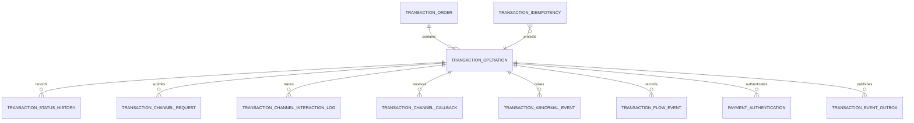

| 事实 | 语义 |
| --- | --- |
| `transaction_order` | 同一原始交易生命周期主单，聚合累计授权、请款、退款等金额 |
| `transaction_operation` | 一次具体支付动作，是渠道执行和状态推进的主要粒度 |
| `transaction_idempotency` | 业务幂等键与结果绑定，数据库唯一约束是最终兜底 |
| `transaction_status_history` | 每次状态迁移的来源、前后值和时间 |
| 渠道请求/交互表 | 渠道提交事实、脱敏请求响应和关联标识 |
| 渠道回调表 | 原始回调事实、匹配结果、处理状态和 ACK 轨迹 |
| 异常/流程事件表 | 无法自动处理的异常和过程审计 |
| `transaction_event_outbox` | 与交易事实同事务写入的待发布事件 |

后续动作由外部 `sourceTransactionId` 定位原动作所在季度，再读取内部 `operation_id` 和生命周期主单。外部调用方不需要知道内部聚合 ID 或物理分表。

### 11.2 同步交易时序

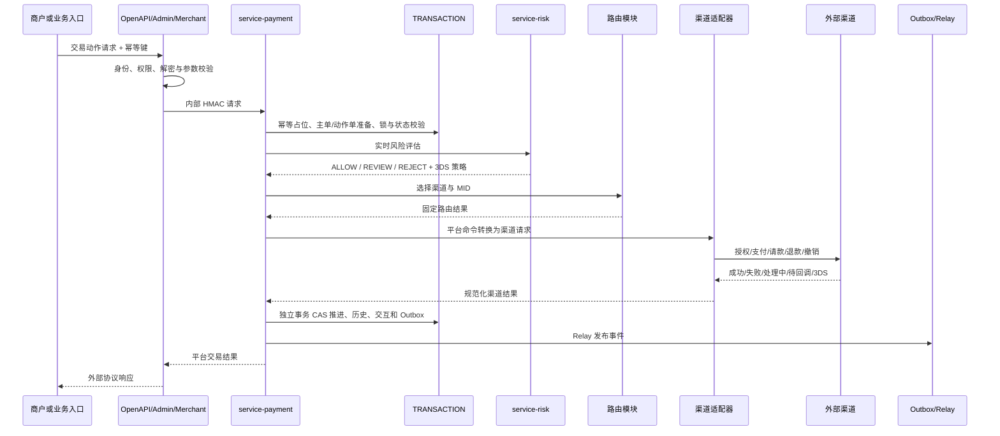

渠道网络调用不能被数据库长事务包裹。代码将“渠道调用前准备”和“渠道结果提交”分开，避免持锁等待外部网络，同时依靠幂等、固定路由结果和状态 CAS 吸收重试。

### 11.3 结果状态与过程阶段

交易结果状态只表达对外业务结果：

- `SUCCESS`
- `FAILED`
- `PENDING`
- `PROCESSING`

过程阶段表达当前内部执行位置：

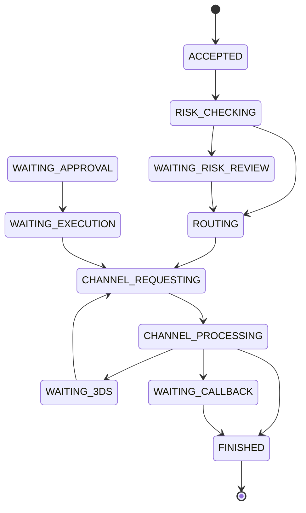

结果状态与过程阶段必须分开，避免把“正在路由”“等待 3DS”误当成新的资金终态。

### 11.4 资金与并发不变量

1. 同一商户幂等键的并发重放不能重复调用渠道。
2. 状态更新必须带当前状态或版本条件，CAS 失败后重新读取，不允许盲写覆盖。
3. 终态默认不可逆；渠道迟到回调不得把已确认终态降级。
4. 原交易币种与后续动作币种必须一致。
5. 累计请款金额不得超过累计授权金额。
6. 累计退款金额不得超过可退款金额。
7. `PAYMENT`、授权、请款、退款、撤销分别保存动作金额，禁止用单一金额字段覆盖所有语义。
8. 平台规范状态与渠道原始状态分别持久化，状态映射可追溯。
9. 金额计算使用确定精度的十进制/最小货币单位，禁止 `float`/`double`。
10. 交易事实和事件 Outbox 必须同事务提交，避免“状态已变但事件丢失”。

### 11.5 当前内部热点

`PaymentTransactionApplicationService` 是入口编排；`PaymentTransactionServiceImpl` 约 3291 行，集中锁、幂等、风控、路由、渠道执行、状态推进和结果组装；`DefaultTransactionRecordService` 约 4437 行，集中分片定位、DO、锁、CAS 和多表写入。功能已不是简单骨架，但内部局部性不足，是 V2 的首要改造对象。

## 12. Hosted Checkout 架构

### 12.1 完整链路

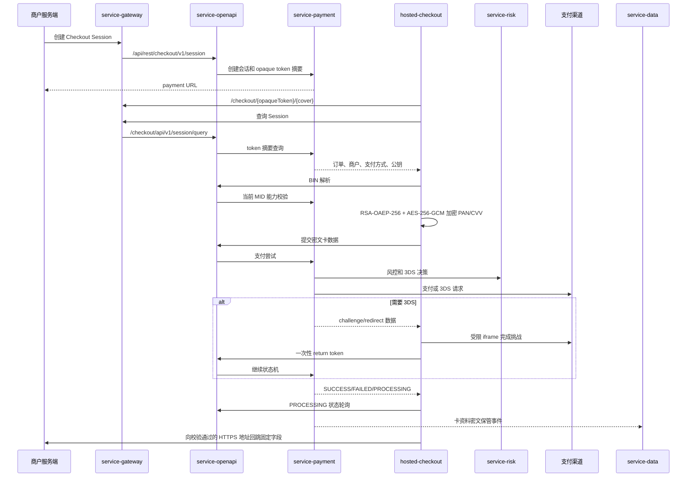

### 12.2 Checkout 状态阶段

`service-payment` 使用独立过程阶段记录 Checkout：

`SESSION_CREATED -> WAITING_PAYER -> CARD_VALIDATE -> CARD_SUBMITTED -> INITIATE_3DS -> AUTHENTICATE_PAYER -> WAITING_3DS -> SUBMIT_CHANNEL -> WAITING_CHANNEL -> RESULT_RENDERED`

不同支付路径可以跳过不适用阶段，但不得跳过会话有效性、卡数据解密边界、支付幂等和终态保护。

### 12.3 卡数据安全边界

1. 浏览器生成 AES-256-GCM 数据密钥加密 PAN/CVV，再用 RSA-OAEP-256 包裹数据密钥。
2. 原始 PAN/CVV 只允许出现在受控内存链路，禁止普通日志、异常消息、URL、MQ 明文和数据库明文。
3. CVV 禁止持久化；Card Vault 只保存允许保存的字段密文、显示摘要、PAN HMAC 和被 KEK 包裹的 DEK。
4. 原始 Checkout Token 不进入内部服务和数据库，内部使用 HMAC/摘要定位。
5. 3DS 返回使用一次性 Token 和受限 Origin/iframe；商户回跳地址只接受校验通过的 HTTPS 目标。

### 12.4 当前前端热点

`hosted-checkout/src/App.vue` 已超过 2300 行，同时承担 UI、状态机、加密、轮询、3DS、PDF、回跳和开发 Fixture。下一步应按 `session`、`payment-attempt`、`3ds`、`polling`、`receipt` 和视图组件拆分，但不能改变浏览器协议和卡数据安全边界。

## 13. 渠道架构、回调与主动勾兑

### 13.1 渠道执行分层

```text
Payment 交易动作
-> 平台渠道命令
-> payment-channel-api SPI
-> payment-channel-core 执行模板
-> MPGS / Worldpay / ScottChannelA Provider
-> 外部渠道
-> 规范化渠道结果
-> Payment 状态机
```

路由结果至少包含渠道、MID、支持能力、币种、卡品牌和 3DS 策略。一次动作选定路由后，重试和回调匹配不能任意漂移到另一个 MID。

### 13.2 渠道回调链路

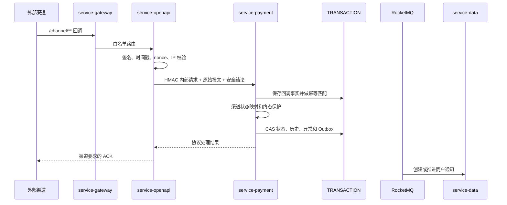

公网验签、协议 ACK 和平台状态推进是三个边界：OpenAPI 拥有前两个，Payment 拥有最后一个。普通日志只记录脱敏 Header 摘要和不可逆正文摘要，不输出完整卡数据或密钥。

### 13.3 主动查询和异常匹配

当同步响应不确定、回调缺失或无法直接匹配时，Payment 通过原渠道和 MID 主动查询，并把结果提交给同一状态机。无法自动匹配的回调进入异常事实，由 Admin 查询和处置。主动查询、回调和同步响应必须共享终态保护，不能各自维护一套状态迁移规则。

## 14. 异步事件与 Outbox

### 14.1 事件拓扑

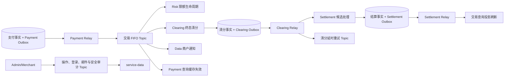

### 14.2 Topic 清单

| Topic | 主要用途 |
| --- | --- |
| `payment-event` | 支付创建事件兼容/基础主题 |
| `acquiring_payment_transaction_fifo_topic` | 交易生命周期有序事件 |
| `acquiring_payment_clearing_delay_topic` | 清分到期重试，要求 DELAY 类型 |
| `payout-event` | 代付事件骨架 |
| `acquiring_admin_operation_log_topic` | 管理端操作日志 |
| `acquiring_merchant_operation_log_topic` | 商户端操作日志 |
| `acquiring_risk_evaluation_audit_topic` | 风控评估审计 |
| `acquiring_security_intercept_audit_topic` | 安全拦截审计 |
| `acquiring_login_audit_topic` | 登录审计 |
| `acquiring_email_delivery_topic` | Admin/Merchant 邮件投递 |
| `acquiring_checkout_card_vault_topic` | Checkout 卡资料受控保管 |
| `acquiring_cache_invalidation_topic` | Card BIN 等跨实例缓存失效 |

具体 Topic 名和消费组由 `rocketmq-{env}.yaml` 与服务 DataId 共同配置；表中名称是当前代码/模板基线，发布前必须与 Broker 实际资源核对。

### 14.3 主要 Tag

| Tag | 语义 | 典型消费者 |
| --- | --- | --- |
| `TRANSACTION_CREATED` | 交易动作已创建 | Risk、数据投影 |
| `TRANSACTION_STATUS_CHANGED` | 同步结果或主动查询推进状态 | Risk、Clearing、Data |
| `TRANSACTION_CALLBACK_PROCESSED` | 回调完成并推进状态 | Risk、Clearing、Data |
| `TRANSACTION_CLEARING_COMPLETED` | 动作清分完成 | Settlement、查询投影 |
| `TRANSACTION_SETTLEMENT_COMPLETED` | 结算入账完成 | 查询投影、通知 |
| `TRANSACTION_SETTLEMENT_REVERSED` | 已入账结算被冲正 | 查询投影、审计 |
| `TRANSACTION_CLEARING_RETRY_DUE` | 清分重试时间到期 | Clearing |
| `REFUND_EXECUTION_REQUESTED` | 退款审批通过等待渠道执行 | Payment |
| `MERCHANT_NOTIFICATION_RETRY_REQUESTED` | 后台人工重发商户通知 | Data |
| `MERCHANT_NOTIFICATION_RETRY_DUE` | 自动通知重试到期 | Data |
| `CHECKOUT_CARD_VAULT_STORE` | 保存允许持久化的卡资料密文 | Data |
| `CARD_BIN_CACHE_CHANGED` | Card BIN generation 变化 | 各缓存实例 |

此外还有 `risk-evaluation-audit`、`security-intercept-audit`、`login-audit`、`admin-email-delivery`、`merchant-email-delivery` 等审计/邮件 Tag。

### 14.4 可靠性语义

1. 事件投递是至少一次，不假设恰好一次。
2. Producer 以数据库 Outbox 为事实来源，发送成功后更新发送状态；失败由 Relay 重扫。
3. Consumer 使用业务唯一键、数据库唯一约束、CAS 或消费记录实现幂等。
4. 同一交易需要顺序语义的事件进入 FIFO Topic；跨交易不要求全局顺序。
5. 消费失败必须区分可重试、等待源数据和人工复核，禁止无限快速重试。
6. 延时 Topic 类型必须与 Broker 已有类型一致，初始化器遇到不一致时应失败关闭。
7. Redis 去重可以降低重复压力，但不能替代数据库最终幂等。

## 15. 清分、结算与财务计算

### 15.1 端到端链路

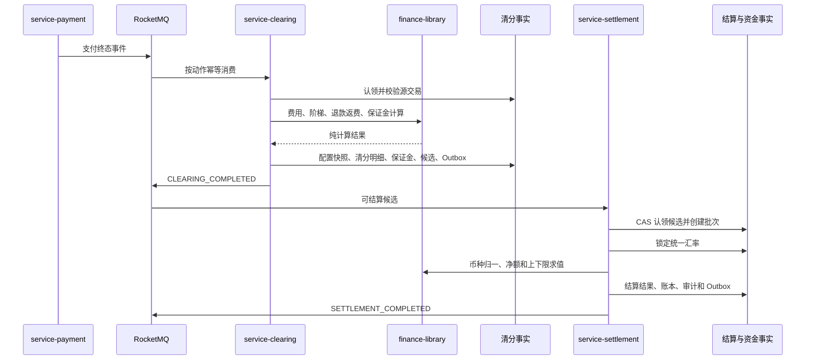

### 15.2 清分状态机

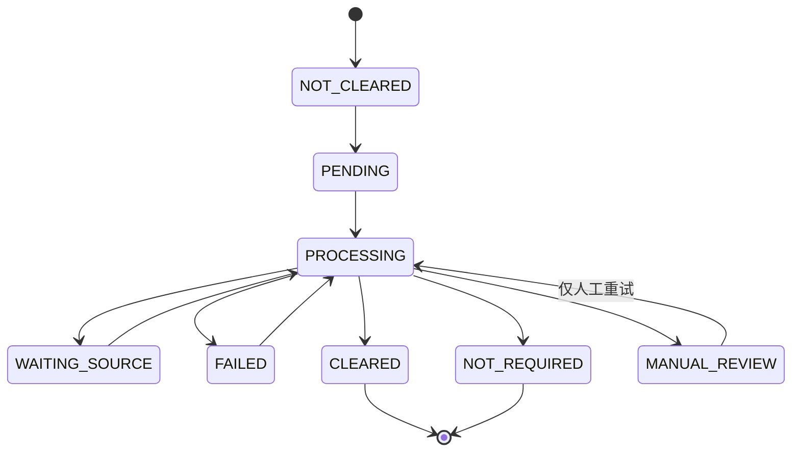

`CLEARED` 和 `NOT_REQUIRED` 是不可逆终态。清分事实按动作和修订保存，重算不能静默覆盖历史结果。

### 15.3 结算状态

结算候选状态：

`READY`、`REPLAY_HOLD`、`REVIEW_LOCKED`、`SUPERSEDED`、`CLAIMED`、`POSTED`、`MANUAL_REVIEW`、`CANCELLED`。

结算批次主链：

```text
CREATED
-> CLAIMING
-> CLAIMED
-> RATE_LOCKED
-> CALCULATING
-> CALCULATED
-> POSTING
-> POSTED
```

异常分支包括 `FAILED_RETRYABLE`、`MANUAL_REVIEW`、`CANCELLED`；已入账批次通过 `REVERSING -> REVERSED` 执行独立冲正。预审单采用 `PENDING_APPROVAL -> APPROVED/REJECTED/CANCELLED/EXPIRED`，冲正申请采用 `PENDING_APPROVAL -> APPROVED/REJECTED`。

### 15.4 资金约束

1. 清分按事件 ID、动作 ID 和修订幂等，不能因 MQ 重复生成重复费用。
2. 费用规则和保证金规则必须冻结版本与规范化 SHA-256 摘要，避免历史结果随配置变化。
3. 阶梯累计需要明确周期、锁粒度和重放规则。
4. 结算只消费 `READY` 且非影子模式候选；当前清分运行基线固定生成 `shadow_mode=1`，真实结算前需要单独准入。
5. 批次统一锁定汇率，批次内不得混用不同汇率版本。
6. 资金入账必须有唯一业务键和借贷方向，重试不得重复记账。
7. Maker 与 Checker 不得是同一操作人；审批、拒绝、取消和冲正都要留审计事实。
8. 冲正通过反向资金事实完成，不删除或修改原结算账本。

## 16. 数据架构

### 16.1 逻辑数据源

| 数据源 | 用途 | 典型场景 |
| --- | --- | --- |
| `MASTER` | 写入、强一致配置读取、锁、固定表 Outbox | 商户安全材料、风险配置、任务写入、审计写入 |
| `SLAVE` | 可接受复制延迟的页面查询和参考数据 | 字典、日志、列表、导出、后台查询 |
| `TRANSACTION` | ShardingSphere 交易逻辑库 | 支付、回调、通知、清分、结算、Card Vault |

强一致校验不能误用 `SLAVE`。任何“先写后读”、权限/密钥、状态推进、锁、幂等和资金判定必须使用 `MASTER` 或 `TRANSACTION`。

### 16.2 交易季度分片

1. 分片键是 `transaction_date_time`。
2. 分片时区固定为 `Asia/Shanghai`。
3. 当前配置包含 28 张交易逻辑表，物理节点按季度扩展，现有示例节点包括 `202603`、`202604`。
4. SQL 必须携带分片键或经过受控逻辑读执行器，禁止无界广播扫描。
5. 后续动作先通过外部交易号定位原动作分片，再访问同生命周期事实。
6. Job 负责分表治理和运行记录，但 DDL 发布仍需数据库变更流程和前后核验。

直接访问交易逻辑数据源的服务包括 Payment、Admin、Merchant、Risk、Data、Clearing 和 Settlement。共享访问提高了查询效率，也意味着当前数据所有权主要依赖代码约束，而不是物理库隔离。

### 16.3 数据所有权

| 领域 | 权威写入方 | 允许读取方 | 说明 |
| --- | --- | --- | --- |
| 商户、渠道、MID、费率、保证金、风控配置 | Admin | Payment、Risk、Clearing、Merchant | 运行时强一致配置读取按场景走 MASTER |
| 后台身份与 RBAC | Admin | Admin | 不与商户身份混用 |
| 商户身份、组织和自助接入配置 | Merchant | Merchant、Admin | OpenAPI 安全材料变更需受控 |
| 支付生命周期和动作 | Payment | Admin、Merchant、Risk、Data、Clearing、Settlement | 其他服务不得直接推进支付状态 |
| 风险评估和限额预占 | Risk | Payment、Admin、Data | 风控不拥有支付终态 |
| 清分、费用、保证金、候选 | Clearing | Admin、Merchant、Settlement | Settlement 只读清分事实 |
| 结算批次、汇率、结果、账本、复核、冲正 | Settlement | Admin、Merchant、Payment 投影 | 资金写入只由 Settlement 完成 |
| 操作/登录/安全/风控审计 | Data | Admin | 来源服务通过 MQ 发送 |
| 商户通知任务与投递日志 | Data | Admin、Job | Payment 只产生通知所需事件 |
| Checkout Card Vault | Data | 受控内部流程 | 不保存 CVV |
| 任务、节点、运行日志和分表治理 | Job | Admin | Job 不直接修改资金终态 |

### 16.4 事务边界

1. 单服务内以本地事务维护业务事实、状态历史和 Outbox 原子性。
2. 跨服务不依赖分布式强事务完成支付主链，使用幂等命令、Outbox 和补偿实现最终一致。
3. 渠道调用位于数据库事务之外，结果通过新的短事务提交。
4. 不允许在同一 `@Transactional` 方法中隐式跨 `MASTER` 和 `TRANSACTION` 写入并假设原子性。
5. Admin/Merchant 的跨域查询不获得对应事实的写权限。

## 17. 安全架构

### 17.1 外部 OpenAPI

商户 OpenAPI 安全链路包括：

1. 读取商户与密钥版本。
2. JWT 验签和声明校验。
3. 使用 `merchantId + jti` 在 Redis 原子防重放。
4. 解密请求 `data`。
5. DTO、商户状态、IP 白名单和来源策略校验。
6. 建立可信请求上下文，禁止业务代码使用客户端伪造身份 Header。
7. 处理完成后加密响应 `data`。
8. 将拦截结果异步写入安全审计，不输出明文密钥和敏感正文。

### 17.2 渠道回调

渠道回调按 Provider 配置执行签名、时间戳、nonce 和 IP 校验。OpenAPI 只把已验证的安全结论及必要原始报文交给 Payment；Payment 再做业务幂等、交易匹配和状态推进。入口验签成功不等于业务处理成功，ACK 策略必须符合各渠道协议。

### 17.3 内部服务

内部服务使用调用边 HMAC、请求体摘要、时间窗和 Redis nonce。UAT/生产密钥必须至少 32 字符，按环境隔离并支持双密钥轮换。不能通过 Nacos 动态关闭内部鉴权，不能把内部路径加入公网白名单。

### 17.4 身份与权限

1. Admin 与 Merchant 使用独立身份域、角色、菜单和权限。
2. 后端接口必须做权限校验，前端按钮隐藏不是安全边界。
3. Admin 调用核心服务时传递可信操作人上下文，并由内部 HMAC 保护。
4. 结算审批、冲正和高风险配置变更需要 Maker-Checker 和审计。
5. 前端 Token 当前存于 `localStorage`，是明确待整改项。

### 17.5 敏感数据与日志

1. PAN、CVV、JWT、内部 HMAC、数据库密码、Nacos 密码不得进入普通日志。
2. CVV 不落库、不入 MQ、不进审计正文。
3. URL、PAN 和 nonce 等关联字段优先保存 SHA-256/HMAC 摘要。
4. 日志格式包含 `traceId`，并对 access token 等字段做替换脱敏。
5. 商户资料文件使用 S3 兼容对象存储，数据库保存元数据和 SHA-256 完整性摘要；对象存储权限和下载授权必须与业务权限一致。

## 18. Redis、幂等与并发控制

Redis 主要承担：

1. JWT `jti`、内部请求 nonce、Checkout Token 等短期防重放。
2. 分布式锁和短期并发占位。
3. 商户、密钥、ISO、Card BIN、路由等缓存。
4. ID 生成和缓存 generation 广播辅助。
5. MQ 重复压力削减和时间桶索引。

关键约束：

1. Redis Key 带环境和业务命名空间，动态敏感值使用摘要。
2. 安全防重放 Redis 异常时失败关闭，不能静默放行。
3. 缓存失效不能改变数据库事实，数据库唯一约束/CAS 是最终正确性保障。
4. 锁必须有 TTL、所有者和安全释放；长渠道调用不能持有数据库锁或无界 Redis 锁。
5. 缓存对象演进需要 schema version 或兼容读取，尤其是路由配置模型迁移。

## 19. 任务调度、补偿与恢复

### 19.1 调度职责

Job 通过内部调用触发：

- 支付到期处理和渠道查单补偿。
- 清分失败、等待源数据和超时租约补偿。
- 商户通知重试和投递状态对账。
- 季度分表创建、核验和运行记录。

### 19.2 恢复原则

1. 调度器只发起命令，状态迁移仍由领域所有者完成。
2. 每个补偿命令必须可重入，并使用稳定业务键。
3. 租约超时和节点失联后可以被其他实例接管，但不能并发重复记账。
4. 自动重试有次数、退避和截止时间，超过阈值进入人工复核。
5. 人工恢复必须记录操作人、原因、原状态、目标动作和结果。
6. 生产恢复需要配套只读前检、变更、后检和回滚脚本，不能只修改数据库状态字符串。

## 20. 配置、部署与可观测性

### 20.1 Nacos 配置模型

| DataId | 职责 |
| --- | --- |
| `{service-name}-{env}.yaml` | 服务业务参数、客户端、超时、容量、观测和内部 HMAC 调用边 |
| `common-{env}.yaml` | 无敏感信息的共享 Web、时间和管理端点配置 |
| `dataSource-{env}.yaml` | MASTER/SLAVE、连接池和 MyBatis Plus |
| `sharding-{env}.yaml` | ShardingSphere 逻辑表、物理节点和算法 |
| `redis-{env}.yaml` | Redis Cluster |
| `rocketmq-{env}.yaml` | RocketMQ Topic、消费组和资源初始化 |
| `seata-{env}.yaml` | 兼容的事务基础设施配置，不能替代当前本地事务/Outbox 设计 |
| `xxl-job-{env}.yaml` | 调度基础设施参数 |

本地 `application.yml` 保留端口、服务名、Profile、优雅停机和不可远程关闭的安全门禁。Gateway 只导入自身服务配置和 Common，不导入业务中间件配置。

### 20.2 密钥与配置发布

1. 每个服务使用独立 Nacos 只读账号，只读取自身 DataId 和必要公共 DataId。
2. 发布账号与应用账号分离，UAT/生产 namespace、账号和调用边密钥互不复用。
3. 内部 HMAC 通过 `prepare -> activate -> verify -> retire-previous` 无停机轮换。
4. 12 份服务配置发布前整体备份，失败时按同一批备份整体恢复，不能只回滚一侧密钥。
5. `refresh-enabled` 不代表所有 Bean 可热更新；线程池、HTTP Client、鉴权路径和启动条件变化需要滚动重启。
6. `component-nacos-encryption` 只保留历史 cipher DataId 迁移兼容；当前安全依赖 namespace、RBAC、TLS/内网隔离、审计和磁盘/数据库加密。

### 20.3 运行拓扑要求

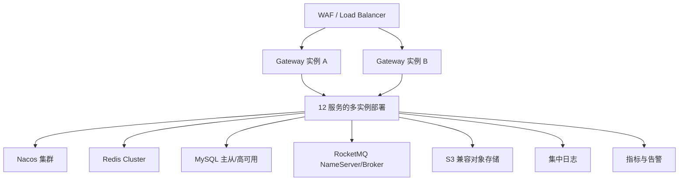

这是生产目标拓扑，不表示仓库中已有 Kubernetes、Helm 或完整容器编排。当前仓库重点提供服务代码、Nacos 模板、SQL 和运行手册，实际节点数、负载均衡、TLS、WAF、备份和跨可用区部署必须由环境验收。

### 20.4 可观测性

当前已存在的可观测基础包括：

1. 统一 `traceId` 日志格式和敏感值脱敏。
2. Gateway Actuator，以及清分 Micrometer 指标。
3. Admin 监控工作台对数据源、SQL、缓存、API、交易链路和渠道健康的查询能力。
4. 清分 Prometheus 规则和 Grafana Dashboard。
5. 交易状态历史、渠道交互、回调日志、异常事件、Outbox、通知日志和结算审计等业务可观测事实。

仍需补齐：全服务一致的 Actuator/Prometheus 暴露、统一告警分级、Trace 跨 HTTP/MQ 传播验证、SLO、容量水位、DLQ 告警和生产 Dashboard 验收。

## 21. 当前能力成熟度

| 能力域 | 当前成熟度 | 判断 |
| --- | --- | --- |
| Gateway 与 OpenAPI 安全 | 较完整 | 路由白名单、JWT、加密、防重放、内部 HMAC 已形成体系，需生产网络和密钥轮换验收 |
| 支付交易核心 | 较完整但内部耦合高 | 多动作、幂等、状态、回调、Outbox 已落地，核心大类需要模块化 |
| Hosted Checkout | 功能链路较完整 | Session、卡加密、3DS、轮询和回跳已接入，前端单文件过重 |
| 渠道适配 | 可扩展 | 已有 MPGS、Worldpay 和 ScottChannelA；真实渠道认证、超时和差异化回调仍需逐渠道验收 |
| 风控 | 已形成独立边界 | 同步决策和限额生命周期已存在，规则质量和生产策略仍需数据验证 |
| 清分 | 功能较深、发布受限 | 状态机、费用、保证金、补偿已存在；当前候选仍以影子模式为基线 |
| 结算 | 模型较完整 | 批次、汇率、入账、复核和冲正已存在；真实资金准入需专项验收 |
| 商户通知与审计 | 较完整 | 至少一次、任务/日志、重试和补偿已形成闭环 |
| 代付 | 骨架 | 只有创建受理，不具备生产级生命周期 |
| 对账与拒付 | 缺口 | 尚未形成完整领域闭环 |
| 前端工程化 | 中等 | 三应用和共享包明确，但测试、部署和共享层治理不足 |
| 生产运维 | 待环境证明 | 仓库有配置与部分运行手册，完整部署、容量和灾备不能由源码证明 |

## 22. 当前主要架构风险

### 22.1 P0 风险

1. `PaymentTransactionServiceImpl` 和 `DefaultTransactionRecordService` 规模过大，高风险规则修改的影响面持续扩大。
2. 共享 Schema 允许多个服务直接访问交易表，数据所有权依赖代码纪律，缺少物理隔离保护。
3. 生产对账、差错、拒付和代付闭环不完整，不能把“收单主链可运行”解释成“支付平台完整”。
4. 清分到结算的真实资金准入尚需完成非影子候选、Broker、迁移、回滚和资金核对验收。

### 22.2 P1 风险

1. `MerchantRouteProfile` 位于 `component-db`，业务语义反向污染技术公共层。
2. `DefaultClearingCompletionService` 约 1688 行，在单个事务脚本中处理过多费用、保证金、候选和异常分支。
3. 内部 DTO 和路径由各调用方维护，缺少服务所有者发布的稳定契约模块，存在协议漂移。
4. Hosted Checkout 主组件超过 2300 行，安全状态机与 UI 修改互相放大回归范围。
5. Admin 和 Merchant 动态菜单、路由、权限恢复及后台基础组件重复，规则开始分叉。
6. 前端 Token 使用 `localStorage`，XSS 发生时会直接扩大账户接管风险。

### 22.3 P2 风险

1. 前端没有常规单元/组件测试和仓库内发布清单。
2. API DTO 与路径手写，缺少从后端契约生成或一致性测试。
3. 可观测性覆盖不均匀，全服务 SLO、Trace 和 MQ/DLQ 告警尚未统一。
4. 季度分表增加长期归档、跨季度查询和 DDL 治理成本。
5. Nacos 热刷新能力容易被误解，部分变更实际需要滚动重启。

## 23. V2 架构演进判断

### 23.1 结论

当前系统已经可以进入 V2 架构演进，但这个判断是“可以开始受控重构”，不是“所有生产能力已经完备”。

进入 V2 的原因：

1. 支付、回调、风控、清分和结算已经有足够真实业务深度，可以从代码中识别稳定边界。
2. 当前主要矛盾从“缺少功能骨架”转为“核心编排类过大、模型所有权泄漏和契约分散”。
3. 继续直接向大类增加动作会降低可测试性和修改局部性，资金回归成本会非线性增长。
4. 服务边界总体合理，没有必要通过增加微服务数量解决服务内部模块问题。

### 23.2 V2 目标结构

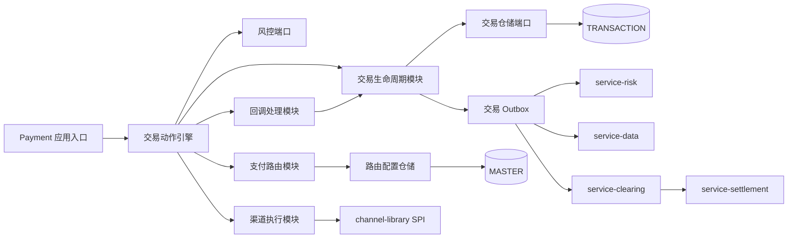

模块职责：

| 模块 | 拥有的语义 | 不应暴露的细节 |
| --- | --- | --- |
| 交易动作引擎 | 动作选择、执行顺序、失败分类和结果组装 | Mapper、DO、物理分表 |
| 交易生命周期 | 主单、动作单、金额、状态 CAS、历史和 Outbox 一致性 | SQL、ShardingSphere Hint |
| 支付路由 | 商户路由、MID、能力、币种、卡品牌、3DS 规则 | 通用 DB 组件内部结构 |
| 风控端口 | 风控命令与决策契约 | Risk 服务实现和表结构 |
| 渠道执行 | 平台命令到 SPI 的转换、固定路由调用 | 平台终态决策 |
| 回调处理 | 幂等匹配、状态映射请求和异常归类 | 公网验签与协议 ACK |

### 23.3 优先级

| 优先级 | 深化对象 | 当前问题 | V2 结果 |
| --- | --- | --- | --- |
| P0 | 支付交易动作引擎 | 多动作集中在 `PaymentTransactionServiceImpl` | 按动作隔离编排，共享幂等和生命周期能力 |
| P0 | 交易生命周期模块 | `DefaultTransactionRecordService` 暴露 DO、分片、锁和 CAS | 对上提供稳定生命周期 API，对下封装持久化 |
| P1 | 支付路由模块 | 路由模型位于 `component-db` | 业务模型回归 Payment，公共层只保留技术设施 |
| P1 | 清分完成模块 | 单事务脚本职责过多 | 保持事务边界，内部按准备、计算、落事实、发事件分层 |
| P1 | Hosted Checkout 前端 | UI 与安全状态机集中在 `App.vue` | 拆分组合式状态模块和视图组件，保持协议不变 |
| P2 | 内部契约 | DTO 和路径分散 | 由服务所有者发布纯契约模块或契约一致性测试 |
| P2 | 前端共享层 | 单一出口过大、后台能力重复 | 分层共享入口，统一菜单/权限和后台组件 |

### 23.4 V2 不做什么

1. 不因为类大就新增支付、回调、路由微服务。
2. 不在第一阶段修改外部 OpenAPI 路径、字段、签名、加解密和错误语义。
3. 不改变现有幂等键、唯一约束、状态值、分片键和分片定位规则。
4. 不把 Clearing、Settlement、Risk 或 Data 合并回 Payment。
5. 不用目录搬迁、类名统一或代码行数下降作为完成标准。
6. 不把代付、对账、拒付等新领域建设混入支付核心重构事务。

## 24. V2 分阶段实施

### 阶段 0：冻结基线

1. 固化 PAYMENT、AUTH、PRE_AUTH、INCREMENTAL_AUTH、CAPTURE、PRE_AUTH_COMPLETION、REFUND、VOID、QUERY 行为测试。
2. 覆盖并发幂等、重复渠道提交、非法状态迁移、累计金额上限、迟到回调、主动查询和终态保护。
3. 固化 Checkout Session、卡加密、3DS、轮询和回跳契约。
4. 记录渠道调用前准备、网络调用、结果提交和 Outbox 的事务边界。

### 阶段 1：提取交易动作引擎

1. 保持 Controller、内部路径和 DTO 不变。
2. 一次只迁移一个交易动作，优先从依赖最少的查询/撤销或单一后续动作开始。
3. 把动作差异放入命令处理器，把幂等、风险、路由和结果提交放入共享端口。
4. 新旧路径短期并存时必须有明确切换和回退开关，不能双写渠道。

### 阶段 2：收敛生命周期模块

1. 用领域接口替代上层直接传递 DO、Mapper 和物理分片时间。
2. 将主单/动作单、金额约束、状态 CAS、历史和 Outbox 组合成明确原子操作。
3. 保持数据库表、唯一约束和 ShardingSphere 路由不变，先做代码边界重构。

### 阶段 3：收回路由语义

1. 在 Payment 建立路由领域模型和仓储端口。
2. 将 `MerchantRouteProfile` 从 `component-db` 迁回支付路由模块。
3. 为 Redis 序列化对象提供 schema version、兼容读取或受控全量失效。

### 阶段 4：清分与回调内部模块化

1. 在不拆分清分本地事务的前提下，分离准备、计算、事实落库、候选和 Outbox。
2. 固化回调公网接入、内部传输和交易处理三个契约所有者。
3. 对回调、主动查询和同步响应复用同一终态解析与 CAS 规则。

### 阶段 5：前端与契约治理

1. 拆分 Hosted Checkout 状态编排，建立加密、3DS、轮询和回跳的独立测试。
2. 统一 Admin/Merchant 菜单、权限恢复和后台通用组件。
3. 建立 OpenAPI/内部 API 契约一致性检查，减少手写 DTO 漂移。
4. 补充前端单元、组件和关键支付流程浏览器测试。

## 25. V2 验收门槛

### 25.1 行为兼容

1. 外部 OpenAPI 和 Checkout 路径、字段、签名、加解密、错误码与 V1 兼容。
2. 相同请求在 V1/V2 路径产生相同业务状态、金额结果和渠道请求语义。
3. 管理端和商户端现有查询、退款、请款、撤销、结算操作不回退。

### 25.2 资金正确性

1. 同一幂等键在并发、超时和重试下最多执行一次渠道副作用。
2. 状态 CAS、终态保护、累计授权/请款/退款约束不弱于 V1。
3. 交易事实与 Outbox 原子提交，消费者可重复执行。
4. 清分费用、保证金、结算净额和冲正结果完成旧新实现对账。
5. 渠道调用不进入数据库长事务。

### 25.3 架构边界

1. `component-library` 不再新增支付、路由、清分或结算业务模型。
2. P0 模块可以通过接口完成测试，不要求测试直接构造 Mapper 或 DO。
3. Payment 是支付状态唯一写入方，Clearing/Settlement 各自保持事实所有权。
4. 内部契约变化有服务所有者、版本策略和调用方验证。

### 25.4 发布与运行

1. 完成数据库迁移前检、灰度、后检和回滚演练。
2. 完成内部 HMAC 密钥轮换、Redis 故障、MQ 重复/延迟/DLQ 和渠道超时演练。
3. 完成全链路 Trace、核心指标、告警和容量基线。
4. 完成支付、回调、Checkout、清分、结算和通知的端到端回归后，才能宣布 V2 落地。

## 26. 代码与文档导航

### 26.1 关键代码入口

| 主题 | 入口 |
| --- | --- |
| Gateway 路由 | `service-gateway/src/main/java/com/scott/payment/gateway/config/GatewayRouteConfig.java` |
| OpenAPI 安全解析 | `service-openapi/src/main/java/com/scott/payment/openapi/support/OpenApiRequestArgumentResolver.java` |
| OpenAPI 到 Payment | `service-openapi/src/main/java/com/scott/payment/openapi/client/payment/PaymentInternalRestClient.java` |
| 支付应用入口 | `service-payment/src/main/java/com/scott/payment/payment/application/PaymentTransactionApplicationService.java` |
| 支付核心编排 | `service-payment/src/main/java/com/scott/payment/payment/service/impl/PaymentTransactionServiceImpl.java` |
| 交易事实持久化 | `service-payment/src/main/java/com/scott/payment/payment/service/impl/DefaultTransactionRecordService.java` |
| 渠道回调处理 | `service-payment/src/main/java/com/scott/payment/payment/service/impl/DefaultTransactionCallbackService.java` |
| 支付过程阶段 | `service-payment/src/main/java/com/scott/payment/payment/domain/state/PaymentProcessStageEnum.java` |
| Checkout 过程阶段 | `service-payment/src/main/java/com/scott/payment/payment/domain/state/PaymentCheckoutProcessStageEnum.java` |
| 清分完成 | `service-clearing/src/main/java/com/scott/payment/clearing/service/impl/DefaultClearingCompletionService.java` |
| 清分状态机 | `service-clearing/src/main/java/com/scott/payment/clearing/domain/state/ClearingStateEnum.java` |
| 结算批次 | `service-settlement/src/main/java/com/scott/payment/settlement/application/SettlementBatchCommandApplicationService.java` |
| 结算状态 | `service-settlement/src/main/java/com/scott/payment/settlement/domain/model/*Status.java` |
| MQ Tag | `component-library/component-mq/src/main/java/com/scott/payment/component/mq/constant/MqTag.java` |
| 内部 HMAC | `component-security`、`component-web`、各服务 `*InternalAuth*` 配置 |
| 前端共享层 | `acquiring-frontend/packages/shared/src/index.ts` |
| Hosted Checkout | `acquiring-frontend/apps/hosted-checkout/src/App.vue` |

### 26.2 关联文档

1. `docs/architecture/payment-engineering.md`：支付工程约束。
2. `docs/architecture/hosted-checkout-v1-database-design.md`：Checkout 数据库与状态机。
3. `docs/architecture/shardingsphere-sql-compatibility-matrix.md`：分片 SQL 兼容矩阵。
4. `docs/architecture/datasource-routing-audit-and-remediation.md`：数据源路由基线。
5. `docs/architecture/transaction-clearing-implementation-design.md`：清分详细设计。
6. `docs/deployment/nacos/README.md`：Nacos、调用边和密钥轮换。
7. `docs/deployment/clearing-rollout-runbook.md`：清分发布和恢复。
8. `docs/deployment/prometheus/redis-monitoring-runbook.md`：Redis 监控与告警处置。
9. `docs/sql/`：清分、结算和治理 SQL 草案。

本文负责给出完整系统地图；上述专题文档负责给出局部实现、发布步骤和验证证据。两者冲突时，应先按源码和环境事实校准，再同步更新文档，避免架构说明继续积累过时结论。
